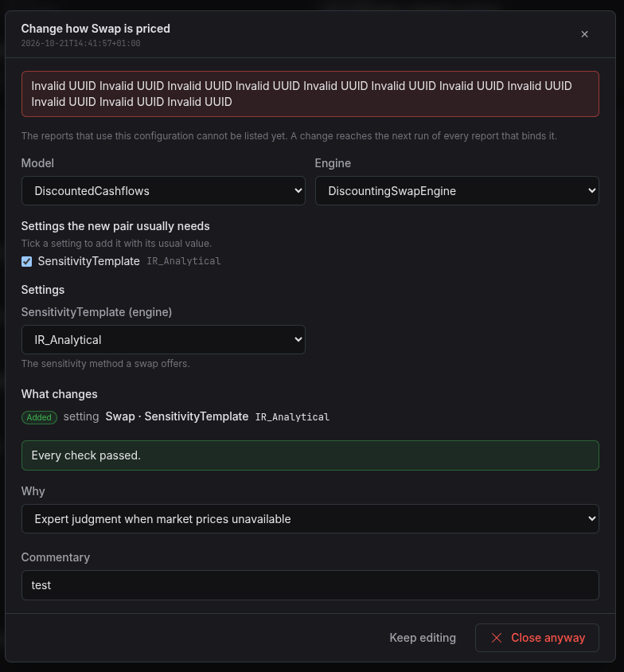

:PROPERTIES:
:ID: 2BCB9FC2-7D48-4046-85C2-86D49A9E0921
:END:
#+title: Test Scenario: Verify the pricing engine screens
#+description: Walk the pricing engine list, record page, change dialogs and author journey against the running stack as a tenant administrator.
#+type: test_scenario
#+level: s1
#+filetags: :author_the_report_configurations:sprint_28:v0:
#+target_dialog: Pricing engines
#+created: 2026-10-21
#+updated: 2026-10-21
#+environment: solid_dirac
#+todo: PENDING | PASSED FAILED
#+startup: inlineimages

This page documents a test scenario verifying [[id:986E1372-9BA6-4CA5-BFC1-FBDA134F221A][Build the pricing engine configuration screens]] in [[id:D119E90A-FC7B-4ED2-8CCF-4658C7351345][Author the report configurations on guided screens]]. It is filled in with the target screen and checklist of steps before testing starts; record the outcome by hand in =* Results=.

* Before you start

The environment is ready. The database is recreated from this commit, the 24 services run and the Acme Corporation tenant is provisioned with no failed step. The tenant holds 23 pricing engine configurations. London holds nine: EOD Official, Intraday Indicative, Pre-Trade Quick Price, Risk Sensitivities, XVA Overnight, Regulatory FRTB, Regulatory SIMM, Stress Test Shocked and Quant Sandbox. New York and Hong Kong hold six each, and the Group holds EOD Official and XVA Overnight. The screens show the configurations of the party you work in.

Open the web as the tenant administrator with =./compass.sh open-as tenant_admin=. Browser dev tools are useful for the last step.

* Scenario Info

| Field         | Value                                                             |
|---------------+-------------------------------------------------------------------|
| Verifies task | [[id:986E1372-9BA6-4CA5-BFC1-FBDA134F221A][Build the pricing engine configuration screens]]                    |
| Parent story  | [[id:D119E90A-FC7B-4ED2-8CCF-4658C7351345][Author the report configurations on guided screens]]                |
| Target screen | Reporting, Pricing engines (=/reporting/pricing-engines=)         |
| Clients       |                                                                   |
| State         | PENDING |

* Steps

** Log in as the tenant administrator

- Run =./compass.sh open-as tenant_admin=.
- The sign-in page shows =tenant_admin@acme_corporation= and the password =Secure-Password-123=. Press Sign in.
- Pass: the home page opens with no error.

*** Result

| Field  | Value |
|--------+-------|
| Status | PASS |

** Open the pricing engines list

- Go to Reporting and choose Pricing engines.
- Pass: the list shows the columns Configuration, Variant, Products, Settings, Changed by and Changed.
- Pass: for London, the rows are the nine configurations above. EOD Official has 101 products, one for each product type that ORE documents an engine for. Pre-Trade Quick Price has 7 and Regulatory SIMM 7.
- Type =XVA= in the search box. Pass: only XVA Overnight stays. Clear the box.
- Click the Configuration header. Pass: the order reverses.
- Note: if the list is empty, the party you work in may hold none. Say which party is active in Notes.

*** Result

| Field  | Value |
|--------+-------|
| Status | PASS |

** Read a configuration record

- Click XVA Overnight.
- Pass: the Details card shows name, description, variant, who changed it and when.
- Pass: the page lists 8 products. Swap and CrossCurrencySwap show the CrossAssetModel and AMC pair with their Training and Pricing settings. The other products show the usual pair.
- Pass: a notice says the reports that use the configuration cannot be listed yet.
- Pass: the Change, Add product, Remove and Delete configuration actions show.

*** Result

| Field  | Value |
|--------+-------|
| Status | PASS |

** Change the details with a reason

- Click Change on the Details card.
- Edit the description. Pass: the What changes list shows one Changed line for the description, with the old text struck through. Save stays off.
- Clear the name. Pass: a check says the configuration needs a name, and Save stays off. Restore the name.
- Leave the reason empty if the form allows it, then try Save. Pass: Save stays off until a reason is set. Choose a reason and type a comment if one is asked.
- Press Save. Pass: the dialog closes and the new description shows on the record page.
- Open the list. Pass: the Changed column for this row is new.

*** Result

| Field  | Value |
|--------+-------|
| Status | FAIL |
| Notes  | when I try to save i get: "Invalid UUID Invalid UUID Invalid UUID Invalid UUID Invalid UUID Invalid UUID Invalid UUID Invalid UUID Invalid UUID Invalid UUID Invalid UUID"; ; ;  |

** Change how a product is priced

- On EOD Official, click Change on a product row.
- Pass: the dialog shows the model and the engine side by side. Under each choice, a panel states what the model or the engine is and where the words come from: the ORE guide, the ORE code, or "Written for ORE Studio, to review".
- Pass: under the two panels, a line states how ORE builds the engine of the pair for this product type.
- Choose another model or engine. Pass: both panels change, and the dialog lists the settings the new pair does not take (tick to drop) and the settings it usually needs (tick to add).
- Choose a pair that is not in the vocabulary, if the lists allow it. Pass: a notice says the pair is not known to price the product, and you may keep it.
- Choose a known pair, tick one setting to drop and one to add, and edit one value. Pass: What changes lists each change.
- Open Change on the Bond product. Pass: TimestepPeriod is a list of tenors, such as 3M and 6M, and not a text field. Pass: each setting has a one-line meaning under its field, and the settings ORE needs carry the word "required".
- Open Change on a product that has SensitivityTemplate, such as a Swap of Risk Sensitivities. Pass: the setting is a list of sensitivity templates, and the asset class, the method and the meaning of the chosen template show under it.
- Give a reason and press Save. Pass: the record page shows the new pair and settings.

*** Result

| Field  | Value |
|--------+-------|
| Status | PENDING |

** Add a product and remove a product

- Press Add product. Choose a product type the configuration does not price. Pass: the model and engine start on the usual pair for that type.
- Give a reason and press Save. Pass: the product count rises by one.
- Press Remove on that same product. Pass: the dialog says the product and its settings are removed and the change reaches the next run of every report that binds the configuration.
- Give a reason and press Save. Pass: the product count falls by one, and the settings of the removed product are gone from the page after a reload.

*** Result

| Field  | Value |
|--------+-------|
| Status | PENDING |

** Check that a stale save is refused

- Open EOD Official in two browser tabs, A and B.
- In tab A, change the description and save.
- In tab B, without reloading, open Change, edit the description and press Save.
- Pass: tab B shows a notice that somebody changed the configuration, and a Read again button. The save does not overwrite tab A.
- Press Read again. Pass: the dialog closes and the page shows the description from tab A.

*** Result

| Field  | Value |
|--------+-------|
| Status | PENDING |

** Author a new configuration from a copy

- On the list page, choose the workflow card Define a pricing engine configuration.
- Step 1, Name it: choose Start from a copy of EOD Official. Pass: the name is =Copy of EOD Official=. Change it to =EOD Official Test=. Type the name of an existing configuration. Pass: a notice says the name is in use. Restore =EOD Official Test=.
- Step 2, Choose the products: Pass: the products of EOD Official are ticked. Tick one more.
- Step 3, Choose model and engine: Pass: each product has a pair. Use Use the usual pair on one product.
- Step 4, Set the parameters: Pass: the usual settings of each pair show. Add one setting with Add setting.
- Step 5, Check it: Pass: findings list any warning. An error stops you from going on.
- Step 6, Review and save: Pass: the summary names the configuration and counts its products and settings. Press Save configuration.
- Pass: the record page of =EOD Official Test= opens with the products and settings you set.
- Pass: =EOD Official Test= shows on the list.

*** Result

| Field  | Value |
|--------+-------|
| Status | PENDING |

** Author an empty configuration and see the checks

- Start the workflow again and choose An empty configuration. Leave the name empty.
- Pass: you cannot go past Step 1 without a name.
- Enter a name and go to Step 2 with no product ticked. Pass: you cannot go on, or the check says the configuration needs at least one product.

*** Result

| Field  | Value |
|--------+-------|
| Status | PENDING |

** Delete the test configuration

- Open =EOD Official Test= and press Delete configuration.
- Pass: the dialog says how many products and settings it removes, and that a report that binds it can no longer run.
- Give a reason and confirm. Pass: you return to the list and the row is gone.
- Check the other four configurations are unchanged except for your earlier edits.

*** Result

| Field  | Value |
|--------+-------|
| Status | PENDING |

** Check a user without write permission

- Sign out. Run =./compass.sh open-as role trading= and sign in.
- Pass: Pricing engines opens if the user may read it, and the list and record pages show.
- Pass: the workflow card, Change, Add product, Remove and Delete configuration do not show or do not work.
- Pass: if the user may not read it, the menu does not show Pricing engines, and the address shows a not-permitted screen.

*** Result

| Field  | Value |
|--------+-------|
| Status | PENDING |

* Results=.

* Before you start

# System-readiness prerequisites (build, database state, provisioning)
# belong here, performed by *you* (build/recreate/provision yourself,
# never hand this to the tester) before opening the client with this
# scenario -- not folded into Step 1 as a conditional the tester has to
# evaluate. By the time the tester opens this doc, the system must
# already be in the state Step 1 assumes. See [[id:0A22B752-D5CF-4B36-8429-2950130AAABD][How do I ready up an
# environment?]] for the standard confirm/recreate/provision sequence.
# Delete this whole section if the scenario has no such prerequisites
# (e.g. it only reads static reference data).

- The database must be freshly provisioned (state what tenant/data the
  scenario needs, e.g. "via =--source acme=") — confirm via
  =compass db status=, recreating only if stale: =compass db recreate
  -y -k= then the relevant =compass shell -f= provisioning script.
  Confirm the run completes with no failed steps before starting.

* Scenario Info

# A non-empty Clients cell below means "this is a multi-client
# scenario": every step then nests one level deeper, under a
# per-client heading. Leave the cell genuinely blank — no placeholder
# text, not even "(single client)" — for the common single-client
# case; a non-empty cell here with flat `**` steps (no per-client
# `**`/`***` nesting) is a malformed scenario. Only put text in it
# when the scenario truly needs several running client instances at
# once (e.g. a NATS notification lands on a second instance) — list
# the instance labels, e.g. "blue, red", and nest every step one
# level deeper under a `**` heading per client as shown further down.

| Field         | Value                                   |
|---------------+------------------------------------------|
| Verifies task | [[id:986E1372-9BA6-4CA5-BFC1-FBDA134F221A][Build the pricing engine configuration screens]] |
| Parent story  | [[id:D119E90A-FC7B-4ED2-8CCF-4658C7351345][Author the report configurations on guided screens]]   |
| Target screen | (UI screen under test, if any.)         |
| Clients       |                                          |
| State         | PENDING                               |

* Steps

Each step is its own heading — the title should be five to seven
words so it fits on one line in the step list
without wrapping or truncating (e.g. "Edit and save the record", not
a full sentence describing the whole operation). The body below the
title is a bullet-point checklist, not a prose paragraph: give the
tester every piece of context needed to execute that one step without
looking anything up elsewhere — what UI state must already exist,
exactly what to click or type, and exactly what confirms the step
passed. Record each step's PASS/FAIL/PENDING outcome and notes as
a =*** Result= child heading directly under it.

** Log in as <persona>

# This must be the scenario's first step (only * Steps entries
# carry a pass/fail outcome) -- name the *specific* persona this scenario
# actually needs: the exact account to log in as and its password
# (e.g. =tenant_admin@acme_corporation= / =Secure-Password-123=, or a
# specific staff username -- see doc/agile/versions/.../
# acme_corporation_holding_group/story.org for how generated staff
# usernames work, they're randomised per provisioning run so look one
# up via `accounts list` rather than assuming a fixed name). Assume
# the system is already in the state * Before you start establishes --
# this step is pure tester mechanics, not a readiness check. Never
# leave the tester to guess credentials -- and never copy this
# placeholder verbatim.

** (Next manual step the tester should perform.)

(Optional longer instructions for this step.)

# For a multi-client scenario (Clients field above is non-empty),
# nest steps one level deeper instead, under one sub-heading per
# client, e.g.:
#
#   ** blue
#   *** Open the counterparty lookup and search
#   ** red
#   *** Confirm the notification arrived and the list refreshed
#
# Single-client scenarios (the common case) keep steps as direct
# children of * Steps, as above.

* Results

| Field         | Value |
|---------------+-------|
| Status        | PENDING |
| Completed at  |  |
| Branch        |       |
| Commit        |       |
| Worktree      |       |

* Notes
