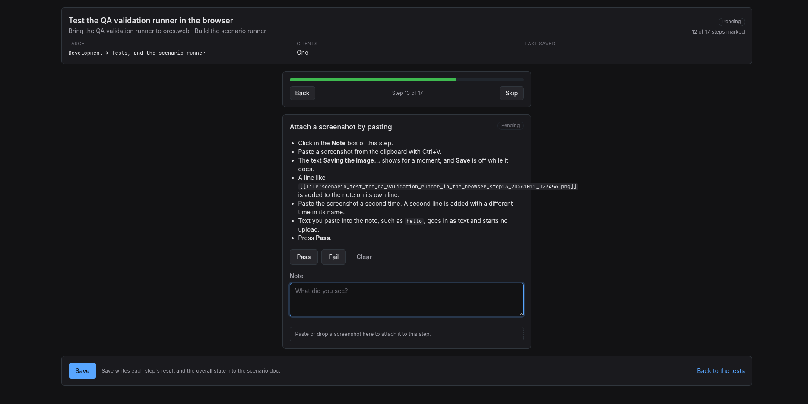

:PROPERTIES:
:ID: BE03EF33-C2A7-4B0B-A444-BDA37F4663AE
:END:
#+title: Test Scenario: Test the QA validation runner in the browser
#+description: Run the QA validation runner end to end in ores.web: find a scenario in the Tests queue, work through its steps, read the story and the task, attach a screenshot, save, and retest.
#+type: test_scenario
#+level: s1
#+filetags: :bring_the_qa_validation_runner_to_ores_web:sprint_27:v0:
#+target_dialog:
#+created: 2026-10-11
#+updated: 2026-10-11
#+environment:
#+todo: PENDING | PASSED FAILED
#+startup: inlineimages

This page documents a test scenario verifying [[id:4E45A124-F1E7-4371-BFAC-4E63A84F8F8B][Build the scenario runner]] in [[id:79DA69BB-0711-40E6-8400-1B2DAC2FA40D][Bring the QA validation runner to ores.web]]. It is filled in with the target screen and checklist of steps before testing starts; record the outcome by hand in =* Results=.

This scenario tests the runner by running in it. The scenario you are reading is the one you run. Steps 1 to 4 are done before the runner is open, and you mark them once it is.

* Before you start

- The database is provisioned with the Acme Corporation tenant, and the services run. Confirm with =./compass.sh services status=.
- The web service serves the build of main that has the runner, and it reads this work tree's =doc/= folder. It listens on port 21402, so the site is at =http://127.0.0.1:21402=.
- You have a screenshot on the clipboard for step 13. Any screenshot of a few hundred kilobytes will do.
- You have a small text file, such as =/etc/hostname=, to drag onto the page for step 14.
- Marks and notes that are not saved are lost when you leave the runner page. The runner asks first, and step 11 checks that it does.
- Save changes this doc and writes screenshots beside it. Look at them with =git status= and =git diff= when you are done. Do not commit them until the run is finished.

* Scenario Info

| Field         | Value                                   |
|---------------+------------------------------------------|
| Verifies task | [[id:4E45A124-F1E7-4371-BFAC-4E63A84F8F8B][Build the scenario runner]] |
| Parent story  | [[id:79DA69BB-0711-40E6-8400-1B2DAC2FA40D][Bring the QA validation runner to ores.web]]   |
| Target screen | Development > Tests, and the scenario runner |
| Clients       |                                          |
| State         | PASSED |

* Steps

** Open the app as the tenant admin

- In a terminal in this work tree, run =./compass.sh open-as tenant_admin=.
- Chrome opens on the sign-in page with the form filled in as =tenant_admin@acme_corporation=.
- Press *Sign in*. The home page loads and shows the Acme Corporation tenant.

*** Result

| Field  | Value |
|--------+-------|
| Status | PASS |

** Open Development from the menu

- In the top menu, click *Development*. The entry is there for everybody. It needs no permission.
- The page shows a path of Home, then Development, and two tabs, *Tests* and *Done*.
- The tabs have no heading of their own. There is no Board, Stories or Tasks tab.
- The *Tests* tab shows the scenarios that wait for a tester, grouped by sprint, the newest sprint first. Each sprint has a heading with its number and a count, and every sprint that has something waiting is open.

*** Result

| Field  | Value |
|--------+-------|
| Status | PASS |

** Find this scenario on the Tests tab

- In the *Sprint 27* section, find the row *Test the QA validation runner in the browser*.
- The row shows the story and the task of the scenario under the title, the target =Development > Tests, and the scenario runner=, a progress bar with *0 of 17 steps*, the state *Pending*, and the date it was created, =2026-10-11=.
- Inside a sprint the newest created date comes first, so this scenario is at the top of its sprint. The columns line up from one sprint to the next, and a date stays on one line.
- Click the *Done* tab. It lists the finished scenarios the same way, by sprint, the newest sprint first. Only the newest sprint is open. Click the heading of an older sprint to open it, and click it again to close it. Each row shows *Passed* or *Failed*, the created date and a completion time.
- Go back to the *Tests* tab.
- Wait up to ten seconds for a first listing. It scans the whole =doc/= tree.

*** Result

| Field  | Value |
|--------+-------|
| Status | PASS |

** Open this scenario from its row

- Click the title of the row, or anywhere else on it. The runner opens on the first step that is not marked.
- The address now ends in =/development/tests/= and the scenario's id.
- The tabs *Steps*, *Story* and *Task* sit above the runner.
- Press *Back* until you reach step 1. Mark steps 1 to 4 with *Pass*. Each Pass moves to the next step. Press *Skip* to come back to this step.

*** Result

| Field  | Value |
|--------+-------|
| Status | PASS |

** Check the header and the progress bar

- The header shows the title, the story and the task, the target, the clients as *One*, and the last save as a dash.
- The state tag shows *Pending*. Above the step, a progress bar and the words *Step 5 of 17* show where you are.
- The line under the state tag counts the steps you have marked. It says *4 of 17 steps marked* before you mark this one.
- *Back* is on when you are past step 1, and *Skip* is off on the last step.

*** Result

| Field  | Value |
|--------+-------|
| Status | PASS |

** Pass moves to the next step

- On this step, press *Pass*.
- The runner moves to *Step 7 of 17*, the next step, by itself.
- The line under the state tag now says *6 of 17 steps marked*, and the progress bar is longer.
- The state tag still says *Pending*. Marking steps never closes the scenario.

*** Result

| Field  | Value |
|--------+-------|
| Status | PASS |

** Fail stays on the step

- On this step, press *Fail*. The runner stays on step 7. It does not move on.
- The *Fail* button looks pressed, and the step tag says *Failed*.
- Click in the *Note* box and type =A Fail stays on its step.=
- The note stays in the box and the box stays editable.
- Press *Pass* to record the real result of this step. The runner moves on to step 8.

*** Result

| Field  | Value |
|--------+-------|
| Status | PASS |
| Notes  | A Fail stays on its step. |

** Read the story and the task

- Type =kept= in the *Note* box of this step.
- Click the *Story* tab. The story of this scenario shows as a page, with its title, its path and its text. The file header lines do not show.
- Click the *Task* tab. The task *Build the scenario runner* shows the same way.
- Click the *Steps* tab. You are on step 8 with =kept= still in the note, and the steps you marked are still marked.

*** Result

| Field  | Value |
|--------+-------|
| Status | PASS |

** Save part of the run

- Press *Pass* on this step. Then press *Save*.
- The page says that steps are still to mark and that the scenario stays open.
- *Save* is still there and *Retest* is not. Your notes and marks are still on screen.
- In a terminal, run =git status --short doc/agile/versions/v0/sprint_27/bring_the_qa_validation_runner_to_ores_web=. This scenario's file is changed.
- In =* Results= of this doc, *Status* says =PENDING= and *Completed at* is empty. The steps you marked have a *Result* table, with the note on step 7.

*** Result

| Field  | Value |
|--------+-------|
| Status | PASS |

** Follow a link inside a doc

- Click the *Task* tab. Find the link *Bring the QA validation runner to ores.web* in the first paragraph.
- Click it. The story opens inside the same tab, with a *Back* button above it. The page does not change, the browser does not reload, and no question is asked.
- Click *Back*. The task shows again. Click the *Steps* tab. This step is on show with your marks and notes.
- Press *Pass* on this step.

*** Result

| Field  | Value |
|--------+-------|
| Status | PASS |

** Get asked before leaving with unsaved marks

- You pressed Pass on step 10 and did not save. That mark is not saved yet.
- Click *Back to the tests*. A dialog asks *Leave without saving?* and offers *Stay* and *Leave*.
- Press *Stay*. You are still on this step, and the Pass on step 10 is still there.
- Press F5 to reload the page. Chrome asks if you want to leave the site. Press *Cancel*.
- Click the *Development* entry in the top menu. The same dialog asks. Press *Stay*.
- Press *Pass* on this step, then press *Save*. Click *Back to the tests*. This time nothing is asked.
- Click this scenario's row. The runner opens on step 12, with the marks you saved.

*** Result

| Field  | Value |
|--------+-------|
| Status | PASS |

** Follow a link that does not resolve

- In the address bar, add =/development/docs/DDDDDDDD-DDDD-4DDD-8DDD-DDDDDDDDDDDD= to the site address and press Enter. Nothing is unsaved, so nothing is asked. Sign in again if you are asked.
- The page says that no story, task or scenario has that id, and that the link may point at a doc the runner does not show. It does not show an error.
- Now use =/development/docs/0A22B752-D5CF-4B36-8429-2950130AAABD=, which is a recipe. It gives the same message.
- Open the Development menu entry and this scenario's row. The runner opens on this step. Press *Pass*.

*** Result

| Field  | Value |
|--------+-------|
| Status | PASS |

** Attach a screenshot by pasting

- Click in the *Note* box of this step.
- Paste a screenshot from the clipboard with Ctrl+V.
- The text *Saving the image...* shows for a moment, and *Save* is off while it does.
- A line like =[[file:scenario_test_the_qa_validation_runner_in_the_browser_step13_20261011_123456.png]]= is added to the note on its own line.
- Paste the screenshot a second time. A second line is added with a different time in its name.
- Text you paste into the note, such as =hello=, goes in as text and starts no upload.
- Press *Pass*.

*** Result

| Field  | Value |
|--------+-------|
| Status | PASS |
| Notes  | ; |

** Refuse a file that is no image

- Drag a text file from your file manager onto this step.
- A message says that only PNG, JPEG, GIF and WebP images can be attached.
- Nothing is added to the note, and nothing is saved beside the doc.
- Drag an image file, such as a PNG, onto the step. It is saved, and a link is added to the note.
- In a terminal, run =ls doc/agile/versions/v0/sprint_27/bring_the_qa_validation_runner_to_ores_web/*.png=. The screenshots from steps 13 and 14 are there, each named with the scenario, its step and a time.
- Press *Pass*.

*** Result

| Field  | Value |
|--------+-------|
| Status | PASS |

** Reopen the scenario from the queue

- Press *Save*. Then click *Back to the tests*. Nothing is asked.
- This scenario is still on the *Tests* tab, in its sprint. Its state says *In progress*, and its progress says *14 of 17 steps*.
- Click it. The runner opens on the first step that is not marked, which is this one, step 15. The notes and marks you saved are back, and the links to the screenshots are in the notes of steps 13 and 14.
- Reload the page with F5 first if the list looks out of date.
- Press *Pass*.

*** Result

| Field  | Value |
|--------+-------|
| Status | PASS |

** Read a finished scenario

- Press *Save*. Then open the Development menu entry and click the *Done* tab.
- Open any finished scenario.
- The runner shows the scenario's steps with their marks and notes. *Pass*, *Fail* and *Clear* are off, the *Note* box is off, and there is no *Save*.
- *Retest* is there. Press it. A dialog asks if you want to start a retest, and says that a retest clears every step.
- Press *Cancel*. Nothing is cleared. Do not confirm the retest on this scenario.
- Go back to this scenario from the Tests queue. The runner opens on this step. Press *Pass*.

*** Result

| Field  | Value |
|--------+-------|
| Status | PASS |

** Save the finished run

- Press *Pass* on this step. Step 17 is the last step, so the runner stays here.
- The state tag shows *Passed*, or *Failed* if you marked any step Fail. The scenario is not closed yet.
- Press *Save*. The page says that the scenario was saved and closed.
- *Retest* replaces *Save*. *Pass*, *Fail*, *Clear* and the note are off.
- Open the Development menu entry. This scenario is gone from the *Tests* tab and is on the *Done* tab, in its sprint, with its state and a completion time. Write what you saw in =* Notes=.
- If the scenario does not close, write that in =* Notes= too.

*** Result

| Field  | Value |
|--------+-------|
| Status | PASS |

* Results

| Field         | Value |
|---------------+-------|
| Status        | PASSED |
| Completed at  | 2026-10-11T01:50:09Z |
| Branch        |       |
| Commit        |       |
| Worktree      |       |

* Notes

Things this scenario does not cover: an image shown as a picture (the runner shows only the file name), a tester role, assignment, and the =ores.org-js= and =ores.dsh_kanban= retirement.
