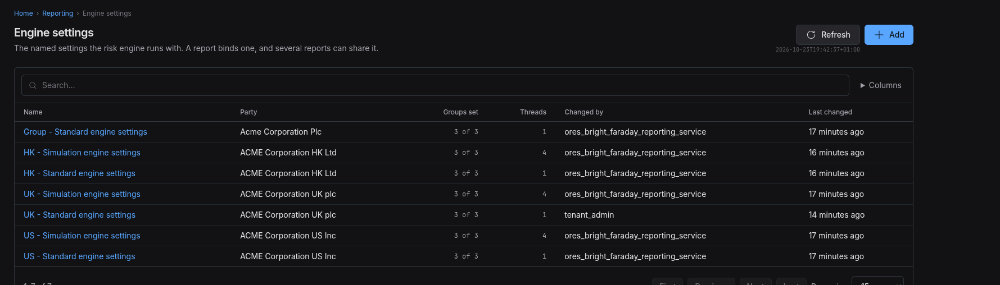

:PROPERTIES:
:ID: B8D70FF1-E3D9-4FF9-9134-BA64F82E106D
:END:
#+title: Test Scenario: Walk the engine settings screens as an Acme user
#+description: Open an Acme configuration, read the parameter documentation, change a group, read the history and revert, and rename and delete a configuration.
#+type: test_scenario
#+level: s1
#+filetags: :see-and-change-everything-a-report-runs:sprint_28:v0:
#+target_dialog: EngineSettingsPage
#+created: 2026-10-23
#+updated: 2026-10-23
#+environment: bright_faraday
#+todo: PENDING | PASSED FAILED
#+startup: inlineimages

This page documents a test scenario verifying [[id:6CAD1673-5A02-4319-BD36-9560FF8B5C6A][Test the engine settings]] in [[id:3D27C8F8-317E-41BC-8F1B-6FBD12836820][See and change everything a report runs]]. It is filled in with the target screen and checklist of steps before testing starts; record the outcome by hand in =* Results=.

* Before you start

Do these steps yourself, in this order, before you open the web client.

- Build the checkout of =feature/test-the-engine-settings=, then confirm the schema with =compass db status=. Recreate the database with =compass services stop= and =compass db recreate -y -k= when it says "out of sync".
- Start the services with =compass services start=. Check that =ores.reporting.service=, =ores.http.server= and =ores.web.service= run.
- Provision Acme with =compass shell -f projects/ores.shell/scripts/library/provisioning/how_do_i_provision_the_system_with_acme_corporation_holding_group.ores=. The run must finish with no failed step.
- Check that Acme holds engine settings: =compass sql -- -c "select name from ores_reporting_engine_settings_tbl where valid_to = ores_utility_infinity_timestamp_fn() order by name"= must list seven names, for example =UK - Valuation and risk engine settings=. If it lists none, the publish of the Acme bundle did not reach the reporting tables. Record this in the notes and stop.
- Check that the Acme tenant holds the parameter documentation: =compass sql -- -c "select count(*) from ores_reporting_ore_parameters_tbl p join ores_iam_tenants_tbl t on t.id = p.tenant_id where t.code = 'acme_corporation' and p.valid_to = ores_utility_infinity_timestamp_fn()"=. The count must be 610. The =base= bundle that provisioning publishes carries the parameters and their value domains. If the count is 0, the publish of =base= did not reach the reporting service. Record this in the notes and stop.
- Open the web client as the tenant administrator: =compass open-as tenant_admin=.

Nothing in this scenario was run against a live service before this page was written. A failure can come from the screens, the BFF, the reporting service or the data. Write down which layer you think failed.

* Scenario Info

| Field         | Value                                                    |
|---------------+----------------------------------------------------------|
| Verifies task | [[id:6CAD1673-5A02-4319-BD36-9560FF8B5C6A][Test the engine settings]]                              |
| Parent story  | [[id:3D27C8F8-317E-41BC-8F1B-6FBD12836820][See and change everything a report runs]]                |
| Target screen | Engine settings, at =/reporting/engine-settings=         |
| Clients       |                                                          |
| State         | FAILED |

* Steps

** Sign in as the tenant administrator

- Sign in as =tenant_admin@acme_corporation=. The password is =Secure-Password-123=. =compass open-as tenant_admin= fills the form.
- Select the UK party (ACME Corporation UK plc) when the page asks for a party. Steps 3 to 11 change UK rows, and a row can be changed only in the party that owns it.
- The sign-in must succeed and show the home page.

*** Result

| Field  | Value   |
|--------+---------|
| Status | PASS |

** Open the engine settings list

- Open the Reporting area and choose the Engine settings card. The address is =/reporting/engine-settings=.
- The title must read "Engine settings". The list must show the columns Name, Party, Groups set, Threads, Changed by and Last changed.
- The list holds the engine settings of every party the selected party can see. For the UK party, expect "UK - Exposure simulation engine settings" and "UK - Valuation and risk engine settings".
- Write down the Threads value of each row. Expect 4 for the exposure simulation and 1 for valuation and risk.
- Switch to the group party (Acme Corporation Plc). The list must now hold the settings of all four parties, and the Party column must say which party owns each row.
- Choose UK in the party filter. Only the two UK rows must remain. Choose All parties to bring the rest back.

*** Result

| Field  | Value   |
|--------+---------|
| Status | FAIL |
| Notes  | I see the engine settings for all parties tenant admin can see.; ;  |

** Open the UK valuation and risk settings

- Open "UK - Valuation and risk engine settings" from the list.
- The page must show the tabs Details, Fixings and cash flows, Market and trade building, Execution, Used by and History.
- On Details, the description must state what the settings are for: valuation, risk, regulatory and monitoring reports, one thread per run.
- Open Execution. Threads must read 1. The log mask must read 31.
- Open Fixings and cash flows. The setting implyTodaysFixings must read No, and it must not say "default".

*** Result

| Field  | Value   |
|--------+---------|
| Status | PASS |
| Notes  | ok standard engine settings seems a bit of a strange name, and also the description is just a list of reports ("Engine settings shared by Audit Trail Summary, Bucketed DV01, Cashflows, Credit Curves, Data Quality Completeness, Delta and Gamma, FRTB SA Capital, FX Spot Rates, Headline Position, Intraday Risk Monitor, Large Exposures, Leverage Ratio, Liquidity Coverage, MIFID II Transaction Reporting, Model Calibration, NPV, P&L Attribution, SA-CCR Exposure, Stressed VaR, Vega, Volatility Surfaces, Yield Curves."). we need to make the engine settings name reflect it's purpose. for example intraday engine settings or something. |

** Read the documentation of a setting

- On the Execution tab, choose "Show documentation" on the threads setting.
- The panel must show a label, a help text, a description and the default. The description must be more than one short sentence.
- Switch the panel to Advanced. It must show the ORE XML path, the format and the release in which ORE introduced the setting.
- The text "The documentation of ... is not in the data" must not appear. If it appears, the Acme tenant holds no parameter rows. Run the check in "Before you start" again.

*** Result

| Field  | Value   |
|--------+---------|
| Status | PASS |

** Filter the settings

- On the Execution tab, choose the filter "Set in this configuration". Only the settings with a value must remain, and the count line must change.
- Choose "Changes the numbers" as well. Only the settings with that mark must remain.
- Clear both filters. The full list must return.

*** Result

| Field  | Value   |
|--------+---------|
| Status | PASS |

** Change the threads and save

- On the Execution tab, choose Edit. Change threads from 1 to 2.
- The page must show "1 change". The control must show the new value.
- Choose Save. The page must leave edit mode and show threads as 2.
- The "version" label of the group must rise by one.
- Check the database: =compass sql -- -c "select n_threads, version from ores_reporting_engine_settings_execution_tbl where valid_to = ores_utility_infinity_timestamp_fn() order by valid_from desc limit 3"=. One row must show 2.

*** Result

| Field  | Value   |
|--------+---------|
| Status | FAIL |
| Notes  | A request did not finish; ; Repository error: Executing INSERT failed: ERROR: duplicate key value violates unique constraint "engine_settings_execution_one_per_settings_idx" (PUT /api/reporting/engine-settings/c93b503a-2356-4076-079b-8408d54ae274/groups/execution, request ca4422d6) |

** Refuse a value that is not valid

- Choose Edit on the Execution tab. Type 0 in the threads field, and then type =abc=.
- The page must show a problem text, for example "Threads must be at least 1" or "must be a whole number". Save must not send the value.
- Choose Cancel or reload. The saved value must stay 2.

*** Result

| Field  | Value   |
|--------+---------|
| Status | PASS |
| Notes  | can you make the field itself red and show the error "Threads must be at least 1." closer to the field? |

** Read the history and revert

- Open the History tab. The newest entry must be the change to 2 threads. The entries must show who changed it and when.
- Choose Revert on that entry. The dialog must say that the values go back as a new version.
- Confirm. The Execution tab must show 1 thread again. The History tab must now hold one more entry, and the old entries must stay.

*** Result

| Field  | Value   |
|--------+---------|
| Status | FAIL |
| Notes  | The engine_settings does not exist. |

** See the conflict of two editors

- Open the same configuration in two browser tabs, A and B. Open the Execution tab in both and choose Edit in both.
- Change threads to 3 in tab A and save.
- Change threads to 5 in tab B and save.
- Tab B must show "These settings changed since you opened them" and a "Read again" button. It must not overwrite the value from tab A.
- Choose "Read again". Threads must read 3.

*** Result

| Field  | Value   |
|--------+---------|
| Status | FAIL |
| Notes  | Can't save. |

** Check which reports use the settings

- Open the Used by tab of "UK - Valuation and risk engine settings".
- The tab must list the reports that bind the settings. The tab must list 22 reports.
- Open the Execution tab of a configuration that no report binds, once you create one in the next step. The Used by tab must say that no report binds it.

*** Result

| Field  | Value   |
|--------+---------|
| Status | PASS |

** Add, rename and delete a configuration

- On the list, choose Add. Name it "Scenario test settings". Choose Add.
- The new page must open. Every group must say that the configuration holds no row and that the engine uses its default.
- Choose the edit action in the page header and change the name to "Scenario test settings 2". The title must change.
- Delete the configuration. The dialog must warn that the history is kept.
- Try to delete "UK - Valuation and risk engine settings". The dialog must refuse and name the number of reports that bind it.

*** Result

| Field  | Value   |
|--------+---------|
| Status | FAIL |
| Notes  | A request did not finish; ; Repository error: Executing INSERT failed: ERROR: duplicate key value violates unique constraint "engine_settings_execution_one_per_settings_idx" (PUT /api/reporting/engine-settings/c93b503a-2356-4076-079b-8408d54ae274/groups/execution, request ca4422d6) |

** Read a child party's settings from the group party

- Switch to the group party (Acme Corporation Plc) and open "UK - Valuation and risk engine settings".
- The page must say that the settings belong to ACME Corporation UK plc, and it must offer "Switch to ACME Corporation UK plc". Edit and Delete must not show on the page header or on a group.
- Open the History tab. It must say that the history is in the owning party.
- Choose the switch button. The page must become editable, and the History tab must list the versions.

*** Result

| Field  | Value   |
|--------+---------|
| Status | PENDING |
| Notes  |         |

** Read the screens in French

- Open the account menu and choose Français under Language. Every screen must change at once, and the choice must stay after a reload.
- Reopen the engine settings page. The title, the tab names and the group titles must show French text, with no raw key such as =engineSettings.tabs.history=.

*** Result

| Field  | Value   |
|--------+---------|
| Status | FAIL |
| Notes  | no language selector. |

** Open the screen as a person without write access

- Sign out. Open a staff member who is not an administrator, for example =compass open-as title "senior trader" --location uk=.
- The Engine settings card must show, and the list must read.
- Record whether the Add and Edit actions show, and whether a save works.
- A person who works in one party must see no Party column and no party filter on the list.

*** Result

| Field  | Value   |
|--------+---------|
| Status | PASS |

* Results

| Field         | Value |
|---------------+-------|
| Status        | FAILED |
| Completed at  | 2026-10-23T18:53:59Z |
| Branch        |       |
| Commit        |       |
| Worktree      |       |

* Notes

- The Member role holds read and write on the engine settings, so the last step may show the Edit button. That is correct for the seeded role. Record what you see.
- The screens never ran against a live service before this scenario. Expect defects in the layer between the BFF and the reporting service. Capture each as a task in the story.
