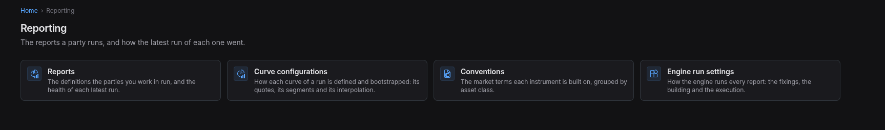

:PROPERTIES:
:ID: 7A88FF7D-0722-4A76-8E59-7B9A7D61CF95
:END:
#+title: Test Scenario: Import a pricing engine configuration as ORE XML
#+description: A person brings an exported pricingengine.xml back into a new configuration through the five steps, and the configuration it makes writes the same document out again.
#+type: test_scenario
#+level: s1
#+filetags: :one-configuration-screen-standard:sprint_29:v0:
#+target_dialog: /reporting/pricing-engines/import
#+created: 2026-10-28
#+updated: 2026-10-28
#+environment:
#+todo: PENDING | PASSED FAILED
#+startup: inlineimages

This page documents a test scenario verifying [[id:590A219B-1895-439A-9E92-EAC46E64D214][Import a pricing engine configuration as ORE XML]] in [[id:AB74EE5D-4E3B-499A-A964-BDCFF7853663][Make every configuration screen follow one standard]]. It is filled in with the target screen and checklist of steps before testing starts; record the outcome by hand in =* Results=.

* Before you start

- The environment runs the build of this branch: =./compass.sh build= passes and
  the fleet is up (=compass services start=).
- The database is recreated and the Acme tenant is provisioned, which is what
  seeds the pricing engine configurations:
  #+begin_example
  ./compass.sh db recreate -y -k
  ./compass.sh services start
  ./compass.sh smoke ticks --leave-running
  #+end_example
- One document is exported to a file, so the scenario has something to import:
  #+begin_example
  ./compass.sh sql -- -c "select id, name from ores_analytics_pricing_model_configs_tbl \
      where valid_to > now() and name = 'XVA Overnight' order by id"
  printf 'pricing_engines export <the id of the UK party XVA Overnight> \
      --file tmp/live/xva-overnight.xml\n' > tmp/live/export.script
  ./compass.sh shell -l tmp/live/export.script
  #+end_example

* Scenario Info

| Field         | Value                                   |
|---------------+------------------------------------------|
| Verifies task | [[id:590A219B-1895-439A-9E92-EAC46E64D214][Import a pricing engine configuration as ORE XML]] |
| Parent story  | [[id:AB74EE5D-4E3B-499A-A964-BDCFF7853663][Make every configuration screen follow one standard]]   |
| Target screen | /reporting/pricing-engines/import        |
| Clients       |                                          |
| State         | PENDING |

* Steps

** Log in as tenant_admin@acme_corporation

- Open http://localhost:21002/sign-in and sign in as
  =tenant_admin@acme_corporation= / =Secure-Password-123=.
- Choose the party *Acme Corporation Plc* when the session asks.
- Passes when the landing page shows the account in the header.

*** Result

| Field  | Value |
|--------+-------|
| Status | PASS |

** Open the pricing engines list

- Go to *Reporting -> Product pricing*.
- The list shows the configurations the party holds, with the product and
  setting counts of each.
- Passes when *Import* stands on the header between *Refresh* and *Workflows*.

*** Result

| Field  | Value |
|--------+-------|
| Status | FAIL |
| Notes  | There is not product pricing under reporting. ;  |

** Choose the exported file

- Press *Import*. The steps open at their own address, with the file, what it
  holds, what the system does not know, where it goes, and the difference on the
  rail.
- Choose =tmp/live/xva-overnight.xml=.
- Press *Next*.
- Passes when the second step states 8 products and 19 settings and lists each
  product with its model and engine.

*** Result

| Field  | Value |
|--------+-------|
| Status | PENDING |

** Read what the system does not know

- Press *Next*.
- Passes when the step says everything in the file is known, because the file
  came from this system.

*** Result

| Field  | Value |
|--------+-------|
| Status | PENDING |

** Choose where the file goes

- Press *Next*.
- Leave *A new configuration* chosen, and state a name and a variant, for
  example *From the scenario* and *scenario*.
- Passes when the step states that the import writes the change directly with
  your reason and commentary, and that nothing is written before the last step.

*** Result

| Field  | Value |
|--------+-------|
| Status | PENDING |

** Review the difference and import

- Press *Next*. The review states 27 added, 0 changed, 0 removed, 0 already
  held, and lists each addition with its setting.
- Leave the reason as it stands and write a commentary.
- Press *Import*.
- Passes when the list comes back and holds the new configuration with 8
  products.

*** Result

| Field  | Value |
|--------+-------|
| Status | PENDING |

** Read the new configuration's document

- Open the new configuration and press *Export*, saving the file.
- Compare it with the file the scenario started from:
  #+begin_example
  diff tmp/live/xva-overnight.xml <the saved file>
  #+end_example
- Passes when the two documents are identical.

*** Result

| Field  | Value |
|--------+-------|
| Status | PENDING |

** Import a file that omits rows

- Press *Import* again and choose a file that holds one product.
- Choose *A configuration I hold* and the *XVA Overnight* configuration.
- Press *Next*.
- Passes when the review lists the removed rows first, each with *Keep ours*
  chosen and *Delete it* beside it.

*** Result

| Field  | Value |
|--------+-------|
| Status | PENDING |

* Results

| Field         | Value |
|---------------+-------|
| Status        | PENDING |
| Completed at  |  |
| Branch        |       |
| Commit        |       |
| Worktree      |       |

* Notes

The same round trip was driven by Playwright on the running environment while
the task was built (steps 1 to 8 of =tmp/live/drive_import.mjs=, with the
screenshots in =tmp/live/shots/=), and the import was also run through the BFF
routes and through =ores.shell=. The task's =* Result= records those runs.
