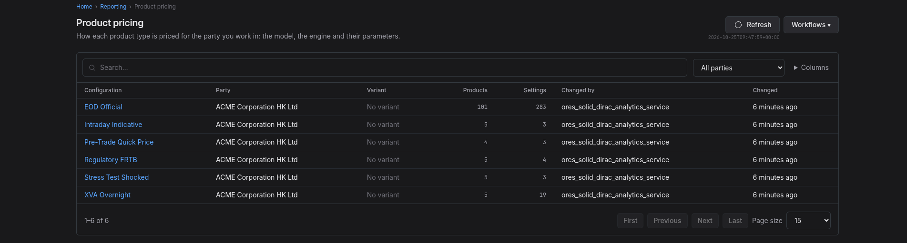
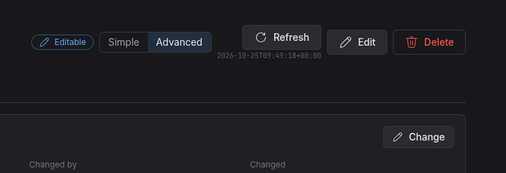
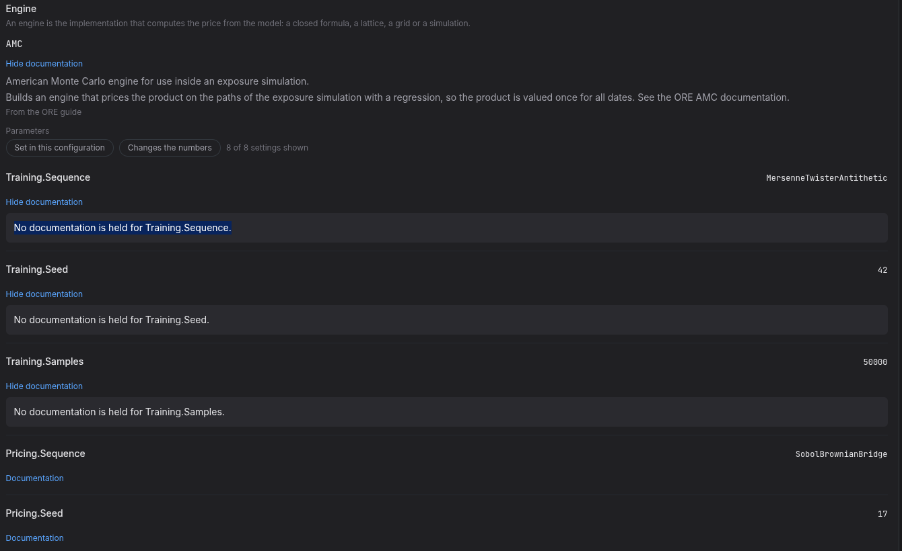
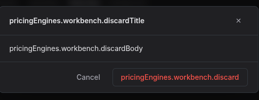
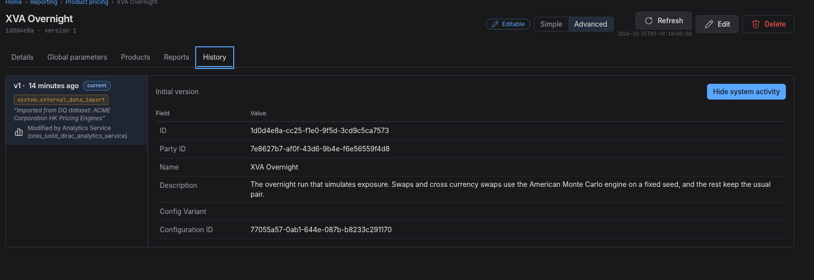

:PROPERTIES:
:ID: 804EEE6C-772B-4BAA-8378-A6747F16E0B6
:END:
#+title: Test Scenario: Verify the Product pricing screen
#+description: Check the five tabs of a product pricing configuration, the tree by asset class, the product workbench with its model and engine groups, the documentation depth, the edits, the reach and the history.
#+type: test_scenario
#+level: s1
#+filetags: :one-configuration-screen-standard:sprint_29:v0:
#+target_dialog:
#+created: 2026-10-24
#+updated: 2026-10-25
#+environment: solid_dirac
#+todo: PENDING | PASSED FAILED
#+startup: inlineimages

This page documents a test scenario verifying [[id:5BF23494-E801-4B0A-8FE0-CEB8DE48BF13][Apply the standard to the pricing engine configuration]] in [[id:AB74EE5D-4E3B-499A-A964-BDCFF7853663][Make every configuration screen follow one standard]]. It checks the screen the task built: the five tabs, the tree by asset class, the product workbench with its model and engine groups, the documentation depth, the edits, the reach and the history. A pass means every step below held on the running system, and the edits a step makes were visible after a reload.

* Before you start

The session already did the following. Confirm the system is in this state before you start; do not repeat the work.

- The build is current for commit =0535beb5c7= in worktree =solid_dirac=.
- The database was recreated on that build's schema and Acme Corporation is provisioned: 6 parties, 23 pricing configurations, 7 engine settings, 78 report definitions and 4 trade generation configs.
- The HK party holds 6 configurations. This scenario opens *XVA Overnight*, which has 5 products and is bound by 3 reports.
- All 24 services are active and the web answers on =http://localhost:21002=.
- You need =tenant_admin@acme_corporation= / =Secure-Password-123=. Choose the party *ACME Corporation HK Ltd*.
- Nothing here needs a value you must keep. Use a throwaway value for each edit; the scenario only checks that the edit is written and reaches the history.

* Scenario Info

| Field         | Value                                   |
|---------------+------------------------------------------|
| Verifies task | [[id:5BF23494-E801-4B0A-8FE0-CEB8DE48BF13][Apply the standard to the pricing engine configuration]] |
| Parent story  | [[id:AB74EE5D-4E3B-499A-A964-BDCFF7853663][Make every configuration screen follow one standard]]   |
| Target screen | Reporting → Product pricing (=/reporting/pricing-engines=) and one configuration, on http://localhost:21002 |
| Clients       |                                          |
| State         | PENDING |

* Steps

** Log in as the tenant administrator

- Open =http://localhost:21002=.
- Log in as =tenant_admin@acme_corporation= with password =Secure-Password-123=.
- Choose the party *ACME Corporation HK Ltd*.
- The reporting area opens. If it does not, the login or the party failed; stop here.

*** Result

| Field  | Value |
|--------+-------|
| Status | PASS |

** Filter the list by party

- Open Reporting, then Product pricing.
- The list has a party filter and a Party column.
- Set the party to *ACME Corporation HK Ltd*. The list shows only that party's 6 configurations.
- Set it back to *All parties*. The list shows every party you may see.

*** Result

| Field  | Value |
|--------+-------|
| Status | FAIL |
| Notes  | i can only see HK even for all parties.; ;  |

** Open a product pricing configuration

- Open the configuration named *XVA Overnight*.
- The page title is that name.
- The line under it shows the record key (8 characters) and the version, then Simple | Advanced, Refresh, Edit and Delete.

*** Result

| Field  | Value |
|--------+-------|
| Status | PASS |

** Check the five tabs in order

- The page shows Details, Global parameters, Products, Reports and History, in that order.
- Details is open on arrival.
- Choose Global parameters, then reload the page. The same tab is open after the reload.

*** Result

| Field  | Value |
|--------+-------|
| Status | PASS |

** Read the details of the configuration

- The Details tab shows the name, the party, the variant, who changed it and when, and the description.
- The tab offers no field to type in.
- Choose Edit. A dialog opens with the name, the variant, the description and a change reason. Choose Cancel; nothing is written.

*** Result

| Field  | Value |
|--------+-------|
| Status | PASS |
| Notes  | why do we need an edit and change button;  |

** Read the product tree by asset class

- Open Products.
- The left side groups the 5 products under their asset class, each group showing its count.
- Type part of a product type in the filter. The tree narrows and the counts follow; clear the filter.
- Expand all and Collapse all open and close every group.
- Choose a product. The workbench on the right changes to it.

*** Result

| Field  | Value |
|--------+-------|
| Status | PASS |

** Read the workbench for one product

- The product card states the product type, its asset class and its instrument.
- Its Documentation disclosure shows the product type's description.
- The Model section states what a model is, then names the model, its description and its source.
- The Engine section does the same for the engine.
- A warning says a pair is not known to work only when the pair is not in the vocabulary.

*** Result

| Field  | Value |
|--------+-------|
| Status | FAIL |
| Notes  | "The Swap product type. ORE uses it for the trade type Swap for single-currency swaps. 2 model and engine pairs price it; the usual pair is DiscountedCashflows with DiscountingSwapEngine." this is not what I would consider the documentation of the Swap product, it is very ORE specific. also lots of missing docs. ;  |

** Open a parameter's documentation

- Under Model, each parameter shows its label and its value in force.
- The filters narrow the list. Set hides a parameter still at its default; Numbers keeps the ones that change the numbers.
- Open Documentation on a parameter. It shows the description and the default in both modes.
- With Advanced chosen it also shows the XPath, the format, the release it was introduced in and the release it was removed in.
- A parameter the contract does not document says so.

*** Result

| Field  | Value |
|--------+-------|
| Status | FAIL |
| Notes  | missing docs as per previous step. |

** Switch between Simple and Advanced

- In the page header choose Advanced, then Simple.
- In Advanced the parameter panels and the model and engine panels show the schema fields; in Simple they show only the description and the default.
- Reload the page. The choice is still the one you made.

*** Result

| Field  | Value |
|--------+-------|
| Status | PASS |

** Change a product setting

- Open Products, then choose Edit on the product card.
- The workbench becomes a form in place. The rest of the page keeps its layout.
- Change the value of one setting, then choose Save.
- The dialog states the difference the change makes and asks for a change reason. Give a reason and save.
- The workbench shows the new value. Reload the page and reopen the product; the value is still there.

*** Result

| Field  | Value |
|--------+-------|
| Status | PASS |

** Discard a draft on a product switch

- With the product editor open and one value changed, choose another product in the tree.
- A dialog says the draft for the first product will be discarded.
- Choose Cancel. The editor stays and your changed value is still there.
- Choose the other product again and choose Discard. The other product opens and the draft is gone.

*** Result

| Field  | Value |
|--------+-------|
| Status | FAIL |
| Notes  |  |

** Change the model and see the engine

- Choose Edit on the product card again.
- Change the model to a different one in the list.
- The engine changes with it to the first engine the vocabulary pairs with the new model.
- If a pair is not known to work, the card marks it and still lets you choose it. It never refuses.
- Choose Cancel; nothing is written.

*** Result

| Field  | Value |
|--------+-------|
| Status | PASS |

** Edit and save a global parameter

- Open Global parameters.
- The tab says these parameters apply to the whole document.
- Each row shows its label or its name, its value and a Documentation disclosure.
- Choose Edit. A boolean becomes a choice of true and false; a number becomes a number input.
- Change one value, choose Save, give a change reason and save.
- The new value shows. Reload the page; it is still there.

*** Result

| Field  | Value |
|--------+-------|
| Status | PASS |

** Read the reports that bind it

- Open Reports.
- The tab states that a report needs a price for every product type in its portfolio, and that a change reaches the next run of each report.
- It lists the 3 reports that bind this configuration. Open one; its page opens.

*** Result

| Field  | Value |
|--------+-------|
| Status | PASS |

** Read the history of the configuration

- Open History.
- The versions list newest first, each with who changed it and why.
- The product edit and the global parameter edit from the steps above are in the list, each with the reason you gave.

*** Result

| Field  | Value |
|--------+-------|
| Status | FAIL |
| Notes  | we are using legacy history format.;  |

** Follow the engine run settings link

- Return to Products.
- Read the notice above the workbench. It says this page sets how each product is priced; the link goes to the other configuration.
- Follow the link. The Engine run settings list opens.
- That screen is a different one: it sets how the engine runs the whole document, not how one product is priced.

*** Result

| Field  | Value |
|--------+-------|
| Status | PENDING |

* Results

| Field         | Value |
|---------------+-------|
| Status        | PENDING |
| Completed at  |  |
| Branch        | main  |
| Commit        | 0535beb5c7 |
| Worktree      | solid_dirac |

* Notes

- The page is read only until you choose Edit. A change is never made in a field on the page.
- Every parameter carries a label, a help line, a format and the XPath of its leaf. A parameter the contract does not hold says so.
- The model and the engine names are a choice from the vocabulary; a pair the vocabulary does not hold is marked and never refused.
- The Simple and Advanced choice is remembered for the whole screen family, so the engine settings screen opens in the same mode.
- The QA run on 2026-10-25 failed five steps. Two are fixed in this branch: the duplicate Change button, and the discard dialog that showed its translation keys. The parameter documentation now falls back to a row with the same setting name, so a pair the guide leaves out still reads.
- Three findings are tasks: [[id:005B424F-0F10-472F-B3BA-2F92395FB1C2][Serve the history of the whole pricing engine document]], [[id:F2CE9184-C4F8-4EA2-BB74-B813BA602A96][Author the documentation of every product type]] and [[id:8C0BEBAB-E0E7-48C2-8E15-CA454F11C8F4][Show every party's configurations on the list]].
- Re-run steps 5, 7, 8 and 11 after the fixes land. Steps 2 and 15 stay failed until their tasks are done.
