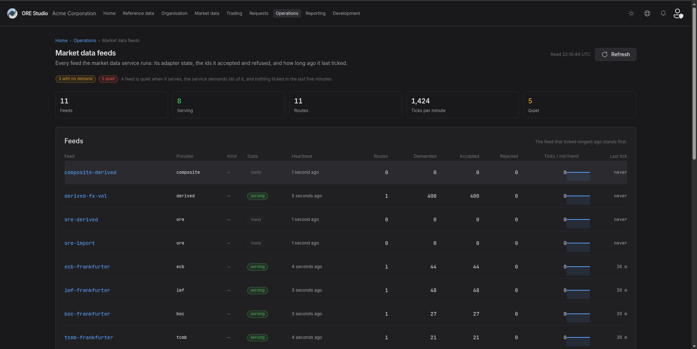

*Market data feeds in operations: every feed, its adapter state, and what it accepted and refused.*

*November 2026*

Sprint 29 merged 781 pull requests across the whole product. The C++ server took on more of the web tier: it streams changes and responses, holds the session at the door, and bounds and streams request bodies. `ores.ore` became the only owner of ORE formats, every output ORE writes is modelled, and generated trades are proved against the ORE samples. Market data gained suppliers, sessions and feeds, public fixings through an adapter, volatility surfaces, the Connectivity and Public rates screens, and new tick arrival models. The trade blotter, draft booking, the product type page and the ACME trade population all moved forward. Record and configuration screens now follow one standard, driven through a repeatable screen pipeline. Generated code replaced most of sqlgen and reflect-cpp, every wire type gained a generated roundtrip test, pricing runs on native Windows workers, and the local gate runs only the checks a change needs. The mission was to finish the work carried from sprint 28, and that did not happen: the sprint ran eight days past its plan and 61 stories return to the product backlog.

---

# ✅ Highlights

-   **The C++ server takes on the web tier.** Changes stream to the browser as they happen, a response streams while it is made, the session is held at the door, and request bodies are bounded and streamed. Sign in, one list and the change stream work on the new server.
-   **ores.ore owns the ORE formats.** It alone converts between ORE formats and domain types. Every output family ORE writes is named in one catalogue, and generated trades are proved against the ORE samples.
-   **One standard for screens.** Record and configuration screens follow one specification, with rules a check can point at. The reference data and currencies topics went through a repeatable screen pipeline. The interface switches between light and dark and chooses its language from the header.
-   **Market data grew into a service with adapters.** Suppliers, sessions and feeds are modelled, public fixings publish through an adapter, volatility surfaces are held and served, and the Connectivity and Public rates screens read the model.
-   **Trading moved forward.** The blotter reads a page rather than the book, a trade books as a draft, one page describes every product type, and the ACME books hold a broader trade population.
-   **Richer synthetic data.** Hawkes tick arrivals and a market-wide regime let generated series speed up together.
-   **Generated code replaces most of sqlgen and reflect-cpp.** Every wire type has a generated JSON and MessagePack roundtrip test. The remaining tasks are carried in the product backlog.
-   **Safer writes.** A write checks the version of the acting party's row, and a delete or unclaimed write stays within that party.
-   **Pricing on native Windows, and a cheaper gate.** Workers price on native x64 Windows with the same engine revision as Linux, and the local gate runs only the checks a change needs.

# 🛠️ Key Improvements

## Hotfixes

-   **Fix the nightly platform failures**: Every nightly builds, tests and submits its results to CDash, and the codegen drift check on main passes.
-   **Hotfix: Keep the build warning-free on every toolchain**: ores.nats compiles clean under gcc and clang with warnings as errors, and the web build follows the source-to-feed rename.
-   **Hotfix: The fleet runs the machine out of memory**: The machine runs the fleet again without running out of memory.
-   **Hotfix: Make CI green on every platform**: Main's CI is green on Linux, macOS and Windows, and on every check workflow.
-   **Hotfix: clear the six failing checks on main**: Every check the local gate runs passes on main: drift, collisions, the ER diagram, the column types, the list-request table and the ticks smoke.
-   **Hotfix: read the marketdata log the launcher writes**: The ticks smoke check reads the marketdata logs the launcher writes, so a healthy system passes it and a system with no demand still fails it.

## Financial Features

-   **Atomise every convention onto the central entity — the remaining work**: Tenor basis swap is rebuilt on the central convention row and the composite parent-and-parts pattern, with the family get and put generated.
-   **Fix the tenor basis swap convention model and the document TU — the remaining work**: The tenor basis swap convention carries its identity, legs, coupon treatment, market-data annex and change audit as separate field groups, so no reflected literal is wide.
-   **Gather each trade set and its market data — the remaining work**: Partition a report's trade population into trade sets and record them against the run, export one trade set as an archive and map it into the ORE portfolio, resolve and export each set's market data at its as-of, hand each configuration to its owner by id at an as-of, and assemble the package only when every declared input is present.
-   **Let the blotter read a page, not the book**: A desk opens the blotter and has its rows in well under a second, at any size the tenant has written, and its rail states how many rows sit at each node without reading the book to find out.

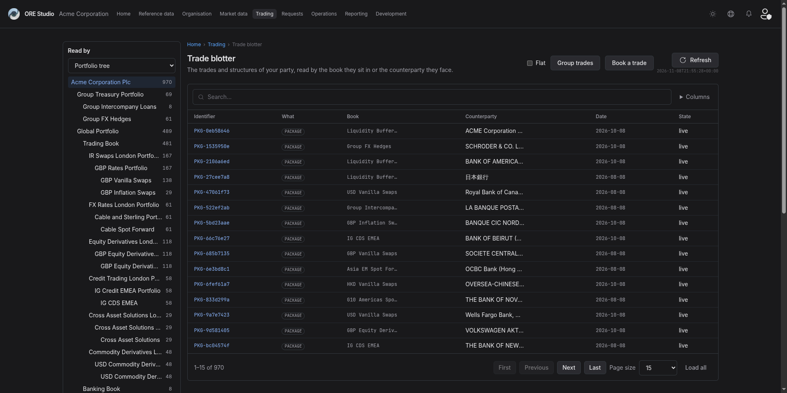

*The trade blotter reads one page at a time, and its rail counts the rows under each book.*

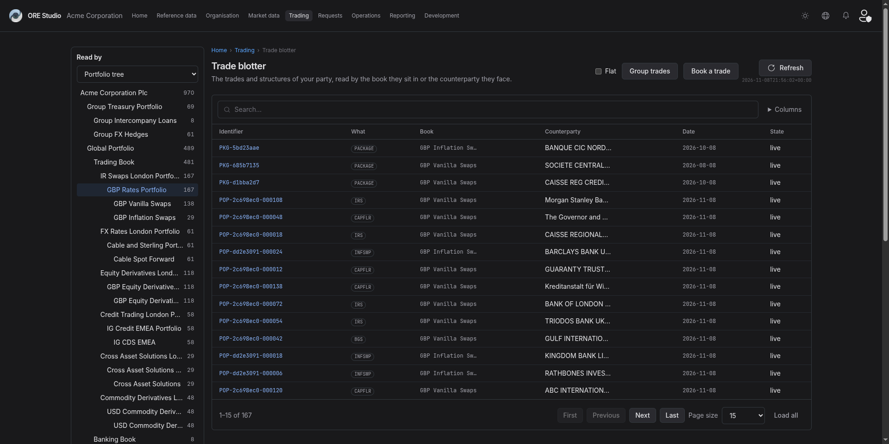

*The same blotter narrowed to one portfolio, with its swaps, caps and floors.*

-   **Make ores.ore the only owner of ORE formats**: ores.ore converts between ORE formats and our domain types and does nothing else.
-   **Model every output ORE writes**: Every output family ORE writes is named in one catalogue, read by ores.ore from the samples checked in, and stored by the component that owns the data.
-   **Prove generated trades value against the ORE samples**: Every product type the generator books has a trade that ORE builds and values, and a test that fails when the trade XML or the generated data drifts from the ORE samples.
-   **Populate the ACME books with a realistic trade population — the remaining work**: ACME's books hold a realistic trade population: every asset class the platform can price, in the proportions a dealing institution holds, dated relative to the day the tenant is provisioned, and referencing the parties, books, counterparties and staff the tenant already holds.
-   **Rework the market data feeds into a market data service with adapters — the remaining work**: ores.marketdata owns the catalogue, the mapping, the ingest path, routing and metering.
-   **Split the types that carry too many columns**: A persisted type holds one component's fields.
-   **Trade Blotter — the remaining work**: Build the Trade Blotter: the primary front-office screen from which traders, sales, and middle office view, manage, and act on the live book of trades &#x2013; booking new deals, amending existing ones, and routing trades through their lifecycle (expiry, fixing, delivery, exercise, settlement).
-   **Describe every product type on one page**: One page a person can read to find out what a product type is before they book it: every type the tenant may book, what each one means, where its documentation lives, and which books and permissions allow it.
-   **Book a trade as a draft**: A booking states whether the deal is a draft and why it waits. With no reason, the trade goes live at once.

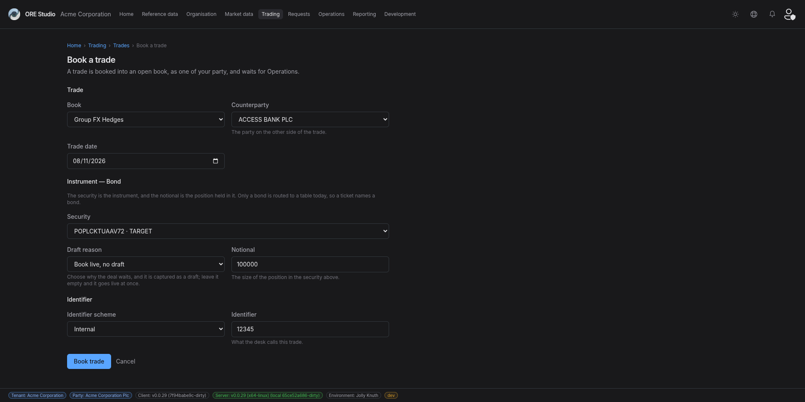

*Booking a trade: a draft reason captures the deal as a draft, and no reason books it live.*

-   **Let the model state how the store keeps a column**: A model states the conversion between a domain value and the code the store keeps, and the generated mapper applies it. A regeneration no longer erases the conversion.
-   **Draw every ORE leaf the same way, starting with conventions**: One standard says how every screen draws a leaf of an ORE document and the element type it belongs to, with the exact words, and an Allium specification carries its state rules so tests can follow them.

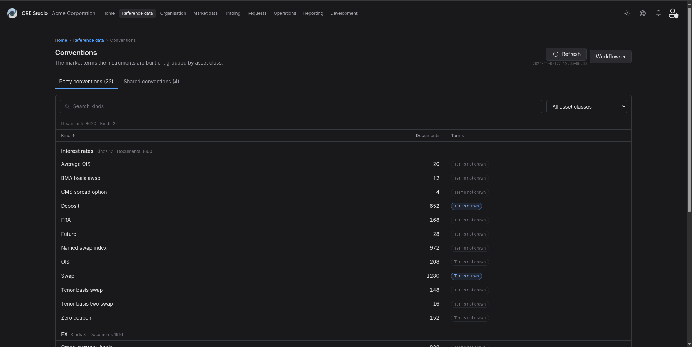

*The conventions, grouped by asset class, with the kinds whose terms are drawn.*

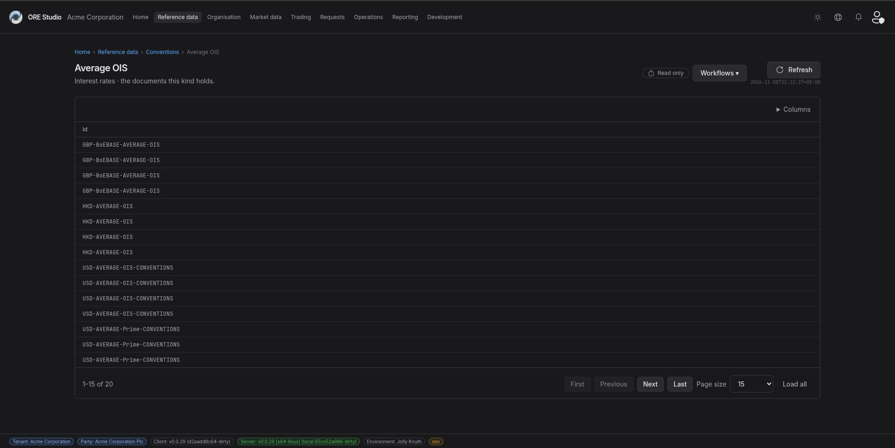

*The documents one convention kind holds.*

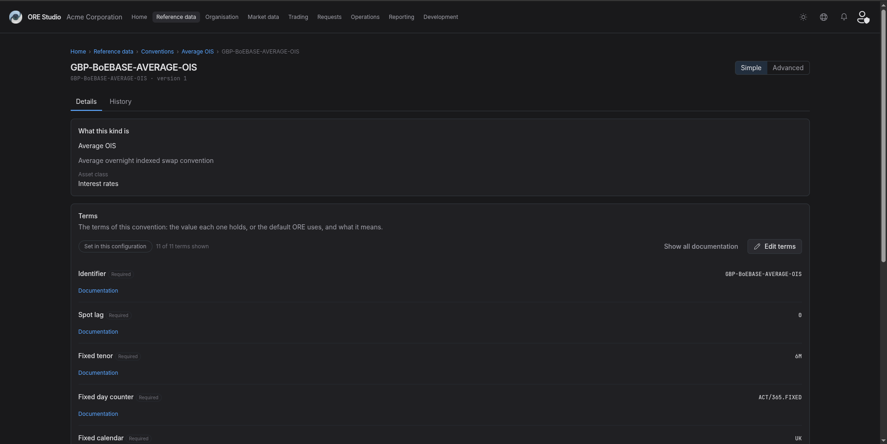

*A convention record: each term shows its value and its documentation.*

-   **Standardise the curve configuration's parameters on the one contract**: A curve configuration is drawn like every other configuration that comes off an ORE document.

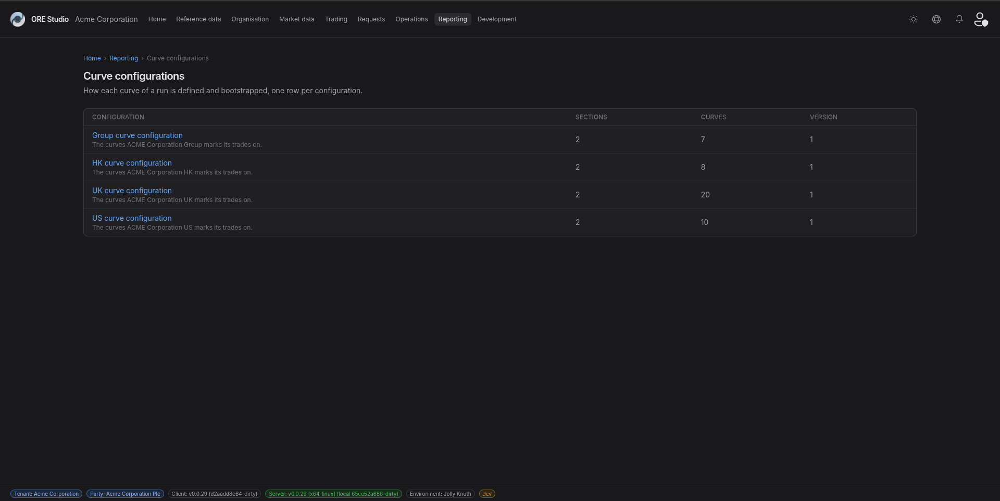

*Curve configurations, one row per configuration.*

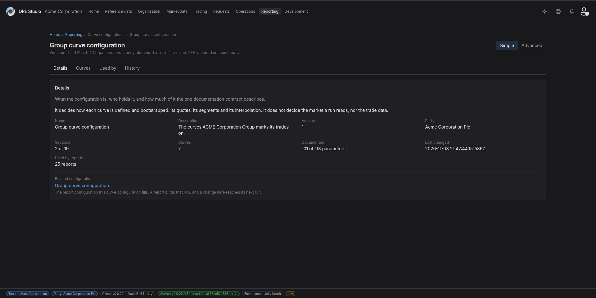

*A curve configuration follows the same record standard as every other configuration.*

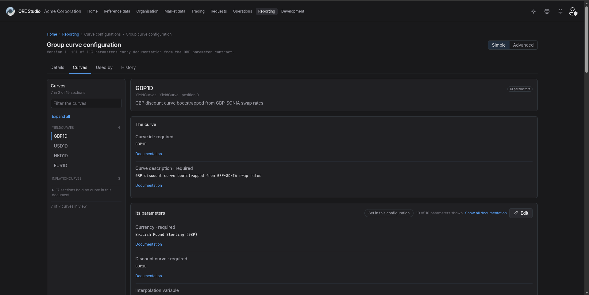

*The curves of a configuration, each with its documented parameters.*

-   **A write checks the version of another party's row**: A write from a party that sees other parties is checked against its own row.
-   **Let the plan state domain rows, not a bag**: A trade has one description, in the domain.

## Market Data & Curves

-   **Publish public fixings through an adapter**: A synthetic feed that starts takes the most recent rate that a central bank or public body published, and every publisher it can draw on is a market data provider like any other, with its terms accepted, its vendor ids mapped, and its fixings stored for good.

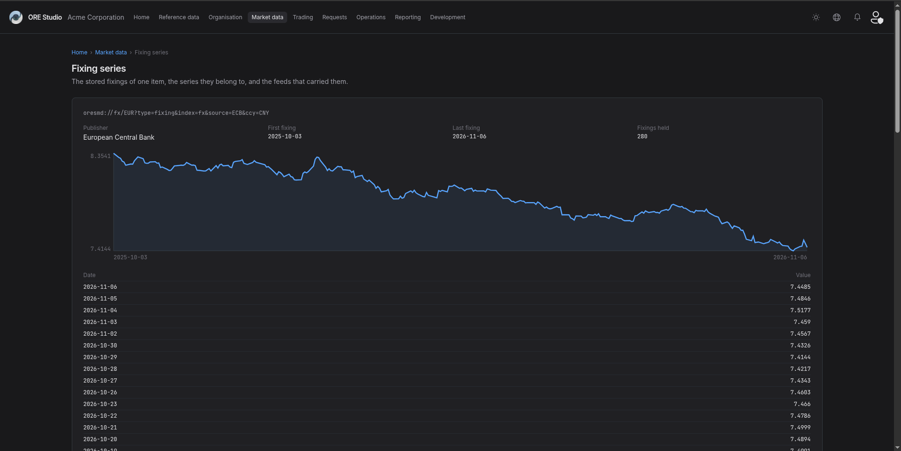

*The stored fixings of one item, with the series they belong to.*

-   **Add a Hawkes tick arrival process to analytics.quant**: Know what the tick library does, what the port into ores.analytics.quant needs, and where the process fits in the generator design, before any code changes.

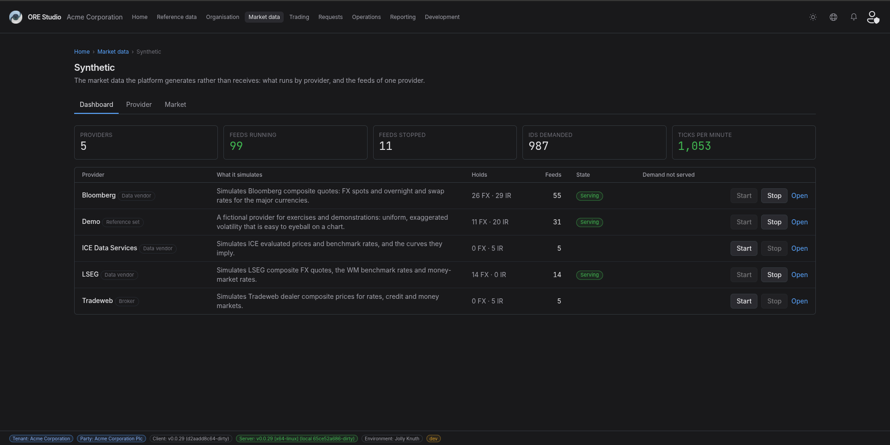

*Synthetic market data by provider: what runs, what it simulates and the ticks per minute.*

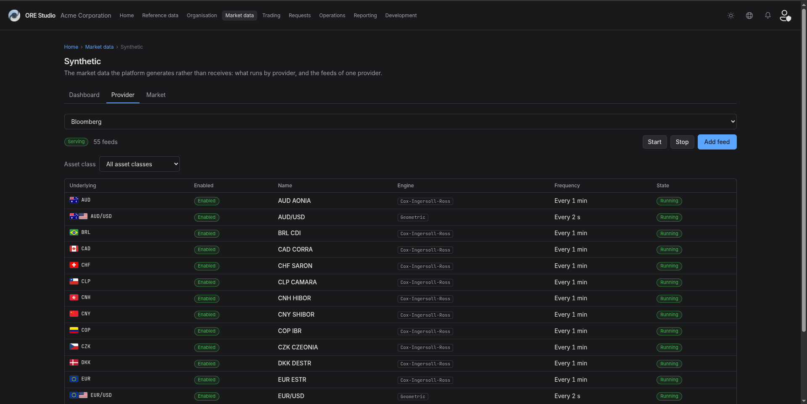

*The feeds of one provider, with their engines and frequencies.*

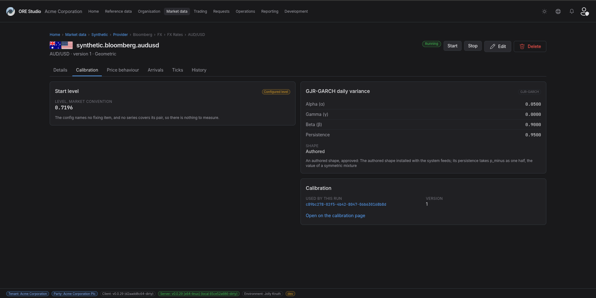

*The calibration of a synthetic feed, with its GJR-GARCH daily variance.*

-   **Model suppliers, sessions and feeds**: A system administrator configures a supplier session once, with its endpoint, environment, credential and settings, and adds the publisher feeds that come off it.
-   **Build the IR curves of every supported currency from public data**: Every currency the synthetic IR feeds support has a published overnight-index curve in the system tenant, bootstrapped from that currency's quotes, and those quotes start from the currency's public overnight rate.
-   **Present the market data series**: Give engineers a slide series that explains synthetic market data generation, from the raw data to the models, and anchor it on real market data.
-   **Build the Connectivity screens**: The signed-off Connectivity prototype becomes the screen: the delivery tree, the supplier dashboard, the adapter catalogue, the session and feed records, and the two setup flows, backed by reads and writes.

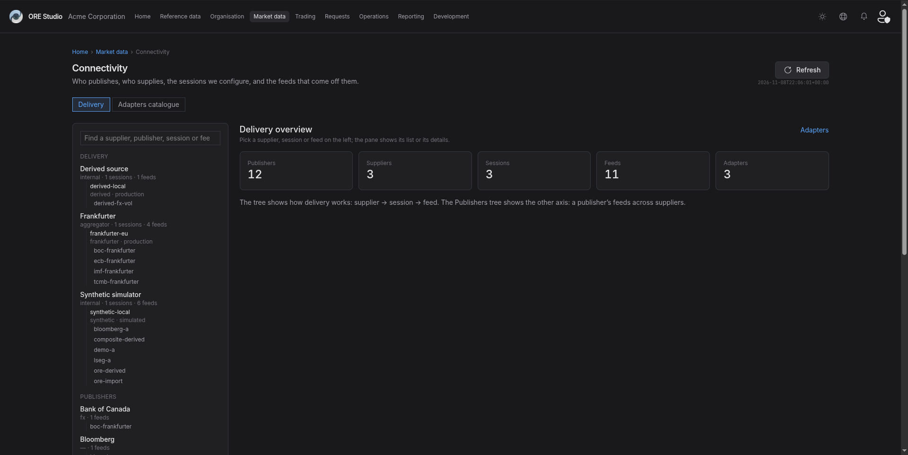

*Connectivity: the delivery tree of suppliers, sessions and feeds.*

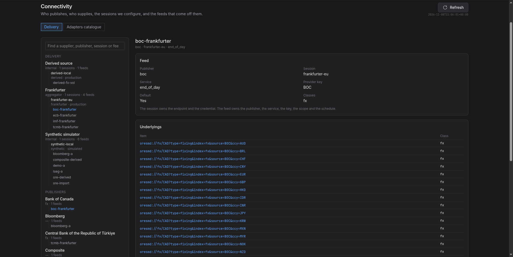

*A feed and the underlyings it carries.*

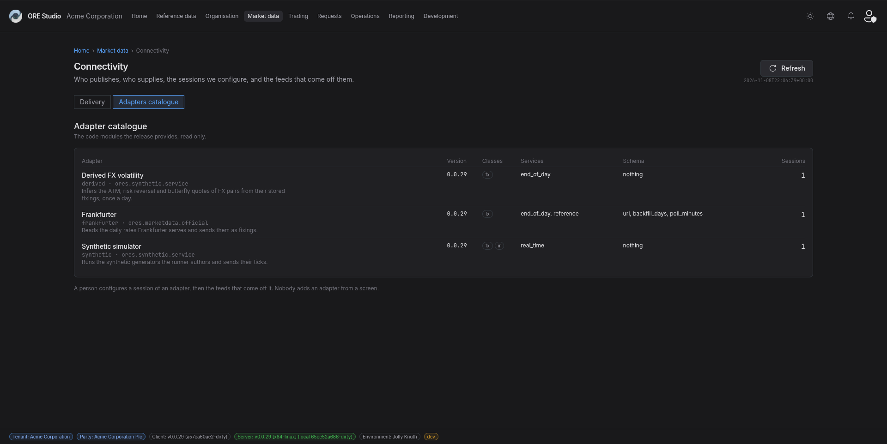

*The adapter catalogue: the code modules the release provides.*

-   **Build the Public rates screens**: Public rates reads the model: publisher and class rows, the routed feed and supplier, freshness from the feed schedule, availability and compare, and a service-aware fetch.

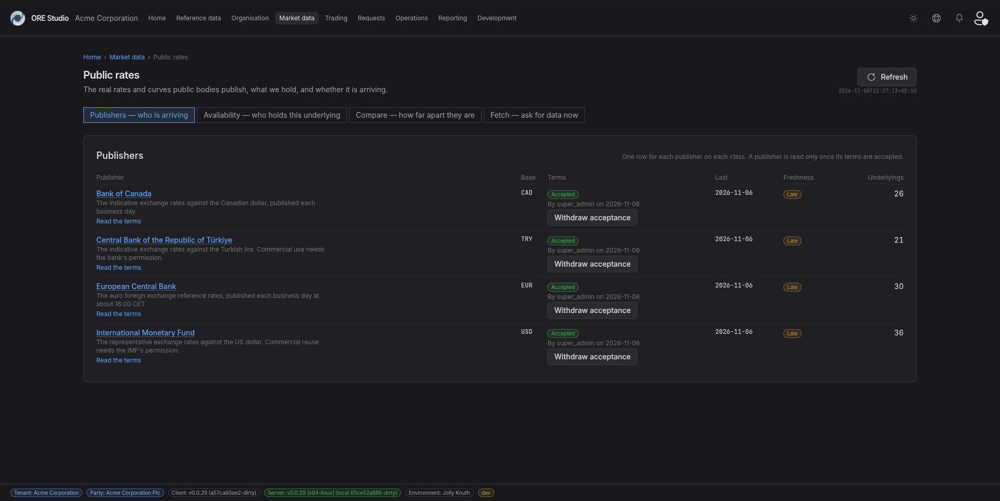

*Public rates: each publisher, its terms and its freshness.*

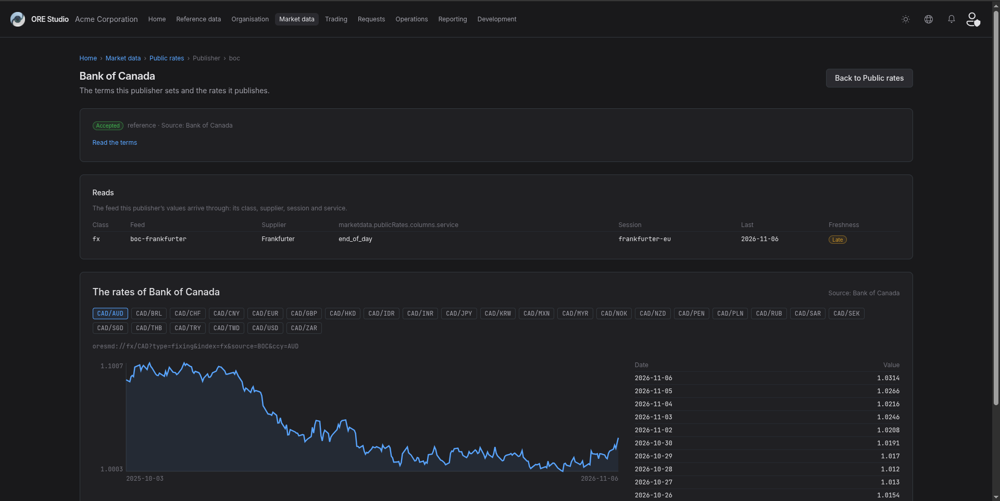

*One publisher: how its rates arrive, and the rates themselves.*

-   **Support volatility surfaces**: The system holds, builds and serves volatility surfaces as market data, and pricing reads them.

## Security & Tenancy

-   **Account for the grid's usage**: The grid's global view answers which tenant is using what, from what the installation observed about its own operation.
-   **Carry a large body without holding it**: The gateway decides how much body it will accept, refuses what is past the limit, and then reads everything it accepted into one string.
-   **Move the IAM collections onto their areas**: The IAM entity collections answer under the area they belong to, and no two routes want the same path for different reasons.
-   **Answer while the answer is still being made**: Every response is assembled whole in one string before the first byte leaves the server.
-   **Hold the session at the door**: A browser holds the bearer token today, in a place a script on the page can reach.

## Compute & Storage

-   **Bound the memory a request body may cost**: The server reads every request body whole, into one buffer per connection, with a single limit of 256 MiB for every route: small enough to be useless as a bound, and applied before the route is known.
-   **Prove the report grid run end to end — the remaining work**: The ACME report definition runs to completion against the compute grid from an input bundle that already exists, the compute results are retrieved, and the run is reproducible from a freshly recreated database.
-   **Support native Windows pricing and local services**: Run pricing on native x64 Windows workers using the same Engine revision and package contract as Linux.

## Web & Journeys

-   **Bring the existing screens to the entity screen specification**: Every existing screen follows the entity screen specification: paging on the server, people as links, history as a timeline, edit in a dialog, flags, states and words.
-   **Make every configuration screen follow one standard**: One screen standard covers every configuration that comes off an ORE XML document: the same list, the same record page, the same sections, the same documentation, the same reach, the same history, the same import and the same lifecycle.
-   **Complete a structure from a screen**: Grouping trades makes one structure in one operation, with every leg live and waiting on Operations, so a half-grouped deal cannot stand.

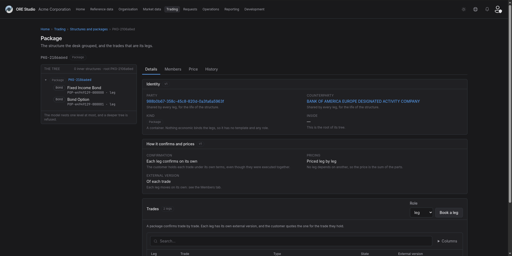

*A package of two bonds, with its tree of legs and how it confirms and prices.*

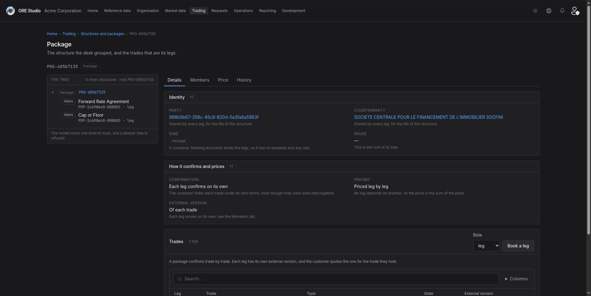

*A rates package: a forward rate agreement and a cap or floor.*

-   **Inventory the Qt reference data screens and audit the UX standards**: The epic starts from facts.
-   **Settle the UX language for record screens**: A reviewer or a check can point at a rule by its identifier, and the rule has one answer.
-   **Check every record screen against the UX language**: The checks exist before the screens change, so the first screen work proves the checks.
-   **Take the first reference data topic through the screen pipeline**: One reference data topic goes end to end through the pipeline, and the pipeline is written down so the next topic repeats it without discussion.
-   **Take the currencies topic through the screen pipeline**: The second topic of Screen pipeline topics, currencies and pairs, goes through the screen pipeline runbook: the currency, the desk group, the currency pair and the currency pair convention, with the classifications their pickers offer.

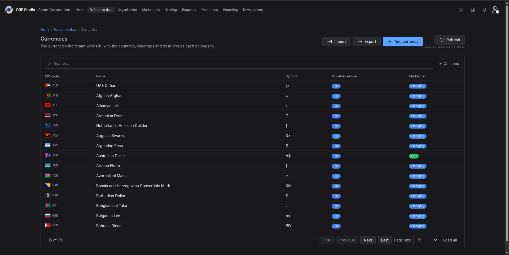

*Currencies, after the screen pipeline.*

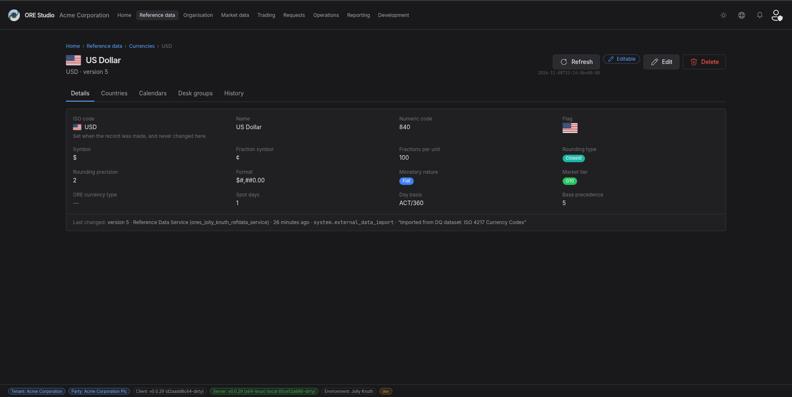

*A currency record.*

-   **Switch the interface between light and dark, and choose the language from the header**: The header carries a palette switch and a language menu. The palette survives a reload and applies before the first paint.

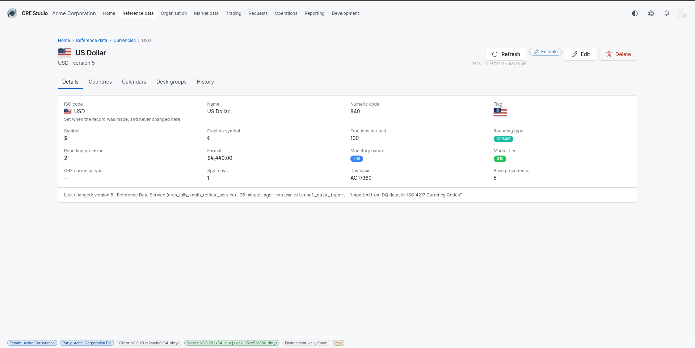

*The light theme.*

*The dark theme.*

-   **Normalise every ORE parameter representation**: Every ORE parameter whose reader accepts more than one rendering of a value is stored in one canonical representation, and the map from a rendering to that representation is data the database holds, not a table compiled into a binary.
-   **Serve one screen from the new server**: Sign in, one list and the change stream all work on the C++ server, and no screen calls them: the browser still reaches the BFF for everything.

## Codegen & Tooling

-   **Carry a market-wide arrival regime**: The synthetic generators can represent a fast market: every series speeds up together for a while, and then calms down.
-   **Decide whether codegen replaces sqlgen and reflect-cpp with generated raw code**: A decision, with measurements, on whether the generator emits raw SQL, MessagePack and JSON code for every entity in place of sqlgen and reflect-cpp, and if so the plan to move.
-   **Seed the commodity permissions the handler needs**: The permission seed defines every code the commodity handler checks, the two codegen tests pass on main, and the tooling class of the local gate is green again for every branch.
-   **Scope a delete and an unclaimed write to the acting party**: A write or a delete from a session that sees several parties acts on the acting party's row of the key, and only on that row.
-   **Generate roundtrip tests for the wire codecs**: Every type the wire codec writes, from 621 opted-in models, has a generated test that fills it with non-default values, writes it in JSON and MessagePack, reads it back and requires the same value.

## Data, SQL & Quality

-   **Stop the gateway blocking its own event loop**: Connections and handlers share one thread today.
-   **Carry one hundred thousand feeds on the data path**: The system carries one hundred thousand feeds on one machine that runs ten environments against one PostgreSQL instance.
-   **Report when a database's timescaledb version is not on disk**: compass db status names the timescaledb version a database records, the versions whose library is on disk, and the statement that reconciles them, so the apt-upgrade failure is read once and fixed in one line.

## Build, CI & Testing

-   **Make main green after the sqlgen removal**: Main is green across the board: every local check the gate runs, and the Linux, macOS and Windows CI, apart from the MSVC reflect-cpp errors, which the reflect-cpp removal retires.
-   **Stamp the time a build starts and finishes**: A person who reads a build's console output or its log can tell when the build started, when it ended, and how it ended.
-   **Run only the checks a change needs**: A gate run that costs what the change reaches: the heavy checks run only when production code changed, ctest runs only the suites whose binaries compile a changed file, and the suites run in parallel.

## Agile & Documentation

-   **Open sprint 29**: Sprint 29 opened on version 0.0.29 with the latest vcpkg, and took in the 57 stories carried from sprint 28.
-   **Sprint health review — System 2 analysis**: A System 2 review of sprint 29.

## Other

-   **Classify every HTTP route against the resource rule**: Every route both servers answer is inventoried and classified, 402 in all, and a gate refuses a row with no classification.
-   **Stop the workflow from losing steps to a transient storm**: A workflow step must survive a transient failure of the service that serves it.
-   **Let the area come from the model**: An entity's HTTP area is a declaration on its model, resolved in one place, so a URL can outlive a component rename.
-   **Stream the changes as they happen**: A client can follow the changes over one long response, and a quiet market does not look like a dead connection.
-   **Run an independent local AI assistant**: Provide the independent agent/MCP application described in issue #4295, backed only by NATS and a separately deployed CUDA LFM3 model.

# ⚠️ Known Issues & Postponed

-   **Let a busy market move prices, not only the clock** (ABANDONED): deferred.
-   **Add entity groups and finish the remaining codegen work — the remaining work** (ABANDONED): deferred.
-   **Approve a reporting line change by the proposed manager** (ABANDONED): deferred.
-   **Audit the bonds instrument family against the data-oriented design guidelines** (ABANDONED): deferred.
-   **Audit the policies that let the system tenant read every tenant** (ABANDONED): deferred.
-   **Author the report configurations on guided screens** (ABANDONED): deferred.
-   **Bring the FX spot conventions onto the market standard** (ABANDONED): deferred.
-   **Bring the role screens to the standard** (ABANDONED): deferred.
-   **Bring the service code onto the NATS patterns — the remaining work** (ABANDONED): deferred.
-   **Browse and follow the grid's jobs — the remaining work** (ABANDONED): deferred.
-   **Build the bindings screen and clear the oresmd snags — the remaining work** (ABANDONED): deferred.
-   **Build the retire or reset tenant journey — the remaining work** (ABANDONED): deferred.
-   **Build the synthetic collection and model catalogue journeys** (ABANDONED): deferred.
-   **Clean ores.synthetic to the component clean standard** (ABANDONED): deferred.
-   **Close the tenor journey and the remaining refdata gaps — the remaining work** (ABANDONED): deferred.
-   **Complete the ACME report inputs and prove they run** (ABANDONED): deferred.
-   **Import and export conventions without a document aggregate** (ABANDONED): deferred.
-   **Design and seed the reports, configurations and portfolio trees each ACME party runs** (ABANDONED): deferred.
-   **Draw every coded value as its badge — the remaining work** (ABANDONED): deferred.
-   **Draw the node heatmap and carry the engine run statistics** (ABANDONED): deferred.
-   **Edit a party on a standard entity page** (ABANDONED): deferred.
-   **End a session when its window closes, not when it is unattended** (ABANDONED): deferred.
-   **Find a trade by its identifiers, state, book and date from one list — the remaining work** (ABANDONED): deferred.
-   **Find why market data ticks lag the wall clock — the remaining work** (ABANDONED): deferred.
-   **Finish moving the hand-written SQL onto models** (ABANDONED): deferred.
-   **Follow the child run a workflow hands off** (ABANDONED): deferred.
-   **Gate every ER diagram** (ABANDONED): deferred.
-   **Give the other prototype groups their design notes** (ABANDONED): deferred.
-   **Give each tenant its own buckets and scope the reaper** (ABANDONED): deferred.
-   **Keep the record screens up to date — the remaining work** (ABANDONED): deferred.
-   **Manage reports from the list a party runs — the remaining work** (ABANDONED): deferred.
-   **Validate that every trade type is modelled as ORE reads it** (ABANDONED): deferred.
-   **Name the record in a change event** (ABANDONED): deferred.
-   **Preview a convention's term structure on a calendar — the remaining work** (ABANDONED): deferred.
-   **Codegen facet: generate the DQ publish-from-dq pattern** (ABANDONED): deferred.
-   **Raise a notification for a scenario waiting for a tester — the remaining work** (ABANDONED): deferred.
-   **Raise approval requests from the remaining gated write paths** (ABANDONED): deferred.
-   **Record service lifecycle events and surface them in system health** (ABANDONED): deferred.
-   **Record system events in a central event log** (ABANDONED): deferred.
-   **Refactor conventions onto families and bundles — the remaining work** (ABANDONED): deferred.
-   **Restore the trading guards the versioned model dropped — the remaining work** (ABANDONED): deferred.
-   **Run a report end to end on a synthetic bond population — the remaining work** (ABANDONED): deferred.
-   **Scope a report by regulatory book type** (ABANDONED): deferred.
-   **See and change everything a report runs — the remaining work** (ABANDONED): deferred.
-   **Seed a relative-time trade population with the market data it needs** (ABANDONED): deferred.
-   **Sort every list by when it was updated** (ABANDONED): deferred.
-   **Subscribe tenants to provider feeds and prove the browser at scale** (ABANDONED): deferred.
-   **Draw a trade's status as its badge** (ABANDONED): deferred.
-   **Trace a process run and the trade groups it creates — the remaining work** (ABANDONED): deferred.
-   **Validate a curve pillar's tenor codes** (ABANDONED): deferred.
-   **Replace sqlgen and reflect-cpp with generated code** (ABANDONED): deferred.
-   **Eight columns in the trading models hold JSON blobs where th…** (ABANDONED): deferred.
-   **Configure every seeded report from the ORE examples** (ABANDONED): deferred.
-   **Read a batch of rows in one query in the generated services** (ABANDONED): deferred.
-   **Run the public sources from the Official rates screen** (ABANDONED): deferred.
-   **Run the adapter per session** (ABANDONED): deferred.
-   **Read the public interest rate sources** (ABANDONED): deferred.
-   **Own the refresh in the scheduler** (ABANDONED): deferred.
-   **Publish the market data catalogue from DQ** (ABANDONED): deferred.
-   **Govern the public feeds** (ABANDONED): deferred.
-   **Seed the public fixings history from a DQ snapshot** (ABANDONED): deferred.

# 📈 Sprint Charts

## PRs and Commits per Day

Dual-axis bar chart. PRs (left axis) and commits (right axis) per day. A high commits-to-PR ratio may indicate scope creep.

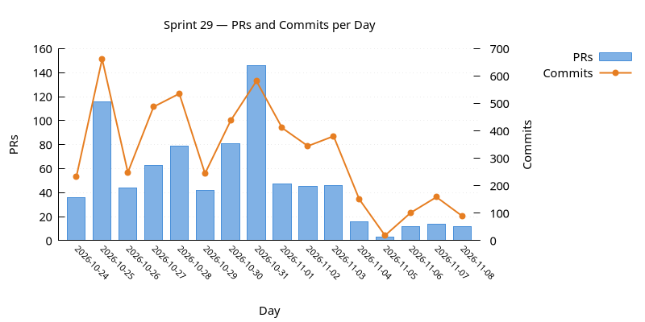

## Daily Line Churn

Lines added (green) and deleted (red) per day. Building work produces mostly additions; refactoring produces a mix.

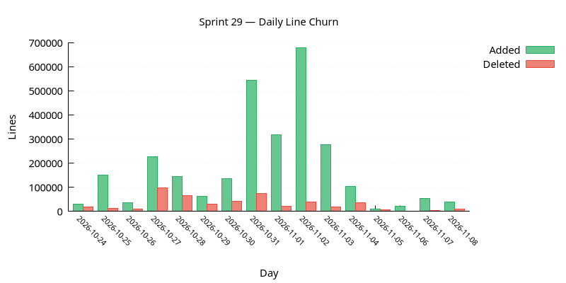

## PR Cycle Time

Hours from PR open to merge, one dot per PR for every PR merged in the sprint, on a log scale, with the median and the upper quartile as lines. High dots indicate review bottlenecks.

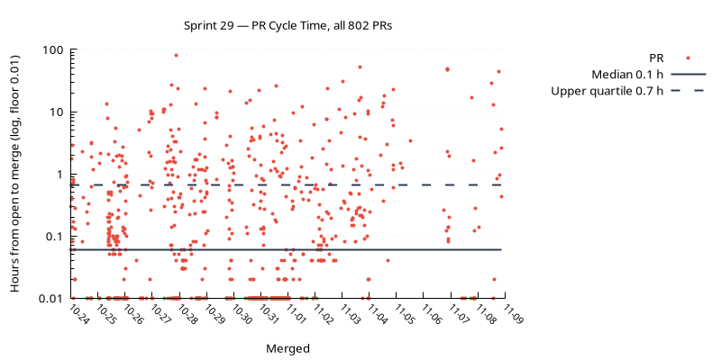

## Cumulative Stories Done

Line chart tracking stories marked DONE during the sprint. Steady upward slope is healthy; plateauing signals a stall.

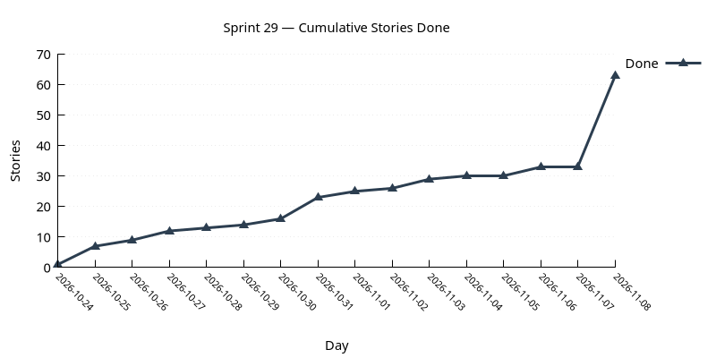

# 📊 Time Summary

-   **Total effort**: not tracked
-   **PRs merged**: 781 (since v0.0.28, 2026-10-24 to 2026-11-08)
-   **Sprint duration**: 2026-10-23 → 2026-11-08

---

*Next sprint: Finish the sqlgen and reflect-cpp move, and limit the stories in flight.*
