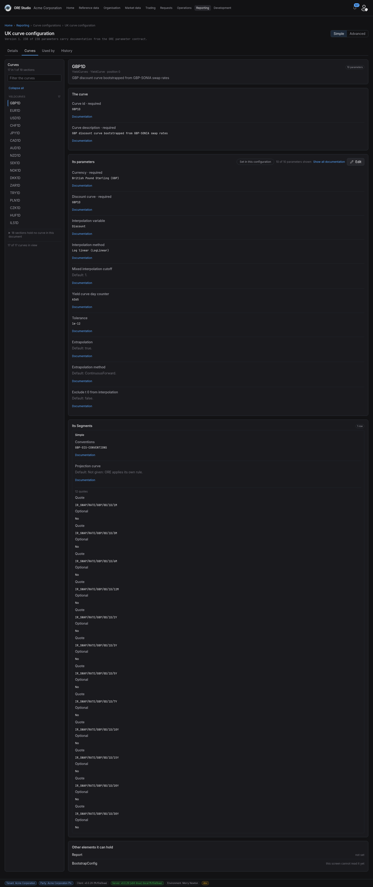

:PROPERTIES:
:ID: D2120291-825B-4117-A85F-7B9F28237942
:END:
#+title: Test Scenario: Walk the curve segments and quotes on the screen
#+description: A person signs in as the tenant administrator, opens a curve configuration and reads the Curves tab: the segments a curve holds, the leaves each segment carries and the quotes it bootstraps from, then the other tabs of the same page. It is walked by hand, because the browser suite renders from fixtures and cannot tell a screen that draws the right data from one that draws the wrong data neatly.
#+type: test_scenario
#+level: s1
#+filetags: :standardise_the_curve_configuration_parameters:sprint_29:v0:
#+target_dialog:
#+created: 2026-10-30
#+updated: 2026-10-30
#+environment: merry_newton
#+todo: PENDING | PASSED FAILED
#+startup: inlineimages

This page documents a test scenario verifying [[id:894F3A64-F564-44B2-A6F1-AB00FF30A6B9][Draw the nested collections of a curve entry]] in [[id:18A29061-FBAD-4C5A-90A1-F02039F791BF][Standardise the curve configuration's parameters on the one contract]]. It is filled in with the target screen and checklist of steps before testing starts; record the outcome by hand in =* Results=.

* Before you start

The environment is ready. The database was recreated from this commit, the 24
services run, and the Acme Corporation tenant is provisioned with no failed step.
The tenant holds four curve configurations; the UK one carries seventeen yield
curves across YieldCurves, and eighteen sections hold no curve in that document.
Every yield curve holds one segment of kind =Simple= with twelve quotes.

Open the shell in the tenant administrator's session:

=./compass.sh open-as tenant_admin=

* Scenario Info

| Field         | Value                                                             |
|---------------+-------------------------------------------------------------------|
| Verifies task | [[id:894F3A64-F564-44B2-A6F1-AB00FF30A6B9][Draw the nested collections of a curve entry]] |
| Parent story  | [[id:18A29061-FBAD-4C5A-90A1-F02039F791BF][Standardise the curve configuration's parameters on the one contract]]   |
| Target screen | Reporting, Curve configurations (=/reporting/curve-configurations=) |
| Clients       |                                                                   |
| State         | PASSED |

The numbers this scenario states were measured on a fresh provisioning of the
branch it was written against. A later dataset changes them; treat a count that
moved as information, and a count that moved to zero as a failure.

* Steps

** Log in as the tenant administrator

- Run =./compass.sh open-as tenant_admin=.
- The sign-in page shows =tenant_admin@acme_corporation= and the password
  =Secure-Password-123=. Press Sign in.
- If the shell asks which party to work as, choose *Acme Corporation Plc*.
- Pass: the home page opens with *Welcome, Tenant Admin*, working for *Acme
  Corporation Plc*, and no error notice.

*** Result

| Field  | Value |
|--------+-------|
| Status | PASS |

** Open the UK curve configuration

- Go to Reporting and choose Curve configurations.
- Pass: the list holds four configurations: Group, HK, UK and US curve
  configuration.
- Click UK curve configuration.
- Pass: the page title is *UK curve configuration*, the tabs are *Details*,
  *Curves*, *Used by* and *History*, and the line under the title reads *Version 1
  · 238 of 238 parameters carry documentation from the ORE parameter
  contract*.

*** Result

| Field  | Value |
|--------+-------|
| Status | PASS |

** Read the segments of a curve

- Click the *Curves* tab.
- Pass: the rail on the left shows *YieldCurves* holding 17 curves, and one line
  *18 sections hold no curve in this document*.
- Pass: *GBP1D* is selected, and the workbench shows its header, then *The curve*,
  then *Its parameters*.
- Scroll to the card titled *Its Segments*.
- Pass: the card says *1 row*, and the row names its kind: *Simple*.
- Pass: the row lists its leaves, each with a value or a default and a
  *Documentation* link: *Conventions* with =GBP-OIS-CONVENTIONS=, and
  *Projection curve* reading *Default: Not given. ORE applies its own rule.*
- Note: a snag is a segment leaf that prints an ORE name such as =Conventions= or
  =RecordedAt= where a label belongs, or a leaf that belongs to another kind.

*** Result

| Field  | Value |
|--------+-------|
| Status | PASS |

** Confirm the segment's quotes

- Still on the *Its Segments* card, below the leaves.
- Pass: the line reads *12 quotes*.
- Pass: twelve identifiers follow, in tenor order, all of the form
  =IR_SWAP/RATE/GBP/0D/1D/…=: 1M, 3M, 6M, 12M, 2Y, 3Y, 5Y, 7Y, 10Y, 15Y, 20Y and
  30Y.
- Note: a snag is a quote listed under the wrong segment, a quote missing, or the
  list ordered by anything other than tenor.

*** Result

| Field  | Value |
|--------+-------|
| Status | PASS |

** Confirm what the page does not draw

- At the foot of the workbench, below the parameters and the segments.
- Pass: a card titled *Other elements it can hold* lists them, one to a line, each
  with its state on the right: *Report* with *not set*, and *BootstrapConfig* with
  *this screen cannot read it yet*.
- Pass: *Segments* does not appear in that card, because the page draws the
  segments as rows and naming the block again would say it twice.

*** Result

| Field  | Value |
|--------+-------|
| Status | PASS |
| Notes  | "Held as its own element:; Report; not stated; BootstrapConfig; not recorded here" this is extremely confusing to users. |

** Read the Details tab

- Click *Details*.
- Pass: the card shows the configuration's name, its version, the party that holds
  it, the count of curves and the documentation count.
- Pass: a sentence says what the configuration decides (each curve's definition
  and bootstrap) and what it does not (the market a run reads, nor the trade
  data).

*** Result

| Field  | Value |
|--------+-------|
| Status | PASS |

** Read the reports the configuration serves

- Click *Used by*.
- Pass: a table lists the reports bound to this configuration with the party that
  runs them, under *ACME Corporation UK plc*: Audit Trail Summary, Bucketed DV01,
  Cashflows, Credit Curves, CVA/DVA/FV.
- Pass: the sentence above the table says a change reaches the next run of each
  report, and that a run already produced keeps what it ran with.

*** Result

| Field  | Value |
|--------+-------|
| Status | PASS |

** Read the history of the configuration

- Click *History*.
- Pass: the newest version comes first, dated, reading *Created* with the reason
  code =system.external_data_import= for a freshly provisioned configuration.
- Pass: a *Hide system activity* control is shown.
- Note: an empty history, or a timeline with no version, is a failure: the curve
  configuration's history provider has to be registered for the page to draw it.

*** Result

| Field  | Value |
|--------+-------|
| Status | PASS |

** Check the known snags

These are the defects already recorded. Meeting one is expected; the step is to
confirm the current behaviour and say whether it is what the note describes.

- Pass: =Conventions= draws with its label and its value =GBP-OIS-CONVENTIONS=,
  and a *Documentation* link. A gap here means the build predates the inherited
  leaves, [[id:3D1208F2-1D51-4733-81FB-01B19D36E8EE][the task that closed it]].
- Pass: the =GBP1D= header reads *10 parameters* while the page reads *238 of
  238*, because the curve's tag counts its own parameters and not its segment's.
  Still open; it is a snag, not a failure of this walk.
- Pass: no row reads =RecordedAt=. A row that shows it means the build predates
  the fix.

*** Result

| Field  | Value |
|--------+-------|
| Status | PASS |

* Results

| Field         | Value |
|---------------+-------|
| Status        | PASSED |
| Completed at  | 2026-10-30T17:05:00Z |
| Branch        | main at ffcf0a5baa, provisioned from a fresh database |
| Evidence      |  |
| Commit        | ffcf0a5baa |
| Worktree      | ores_dev_merry_newton |

* Notes
