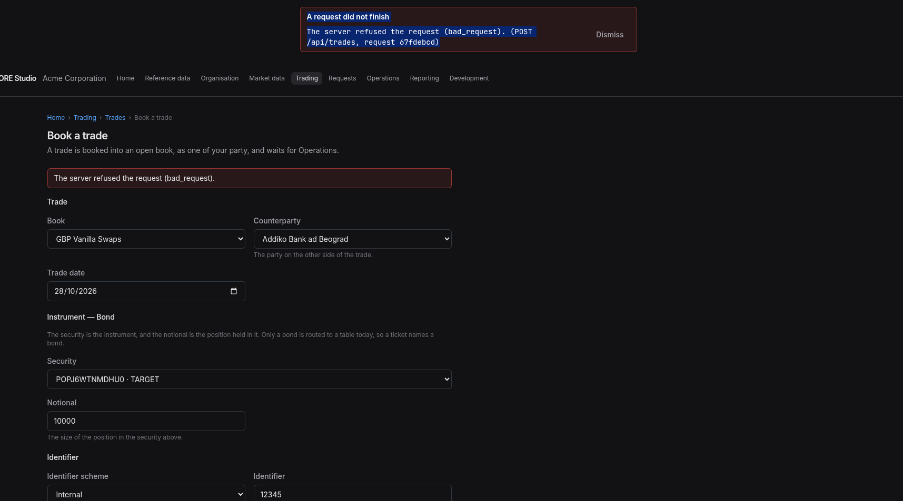

:PROPERTIES:
:ID: E45DD02C-CB73-4D63-8EAF-692A4C0F8CD3
:END:
#+title: Test Scenario: Verify Book a trade
#+description: Manual steps confirming a trade books from the form into an open book, opens its own page with the terms it stated, and that a frozen book is not offered and a bad notional is refused with a reason.
#+type: test_scenario
#+level: s1
#+filetags: :trading:booking:trade-blotter-remaining:sprint_29:v0:
#+target_dialog:
#+created: 2026-10-25
#+updated: 2026-10-25
#+environment: jolly_knuth
#+todo: PENDING | PASSED FAILED ABANDONED
#+startup: inlineimages

This page documents a test scenario verifying [[id:2D3C5B23-E6DB-46D5-8732-ACF54987A33A][Build Book a trade]] in [[id:67C1C30A-5CF6-408A-B73C-99A79A01B19F][Trade Blotter — the remaining work]]. It is filled in with the target screen and checklist of steps before testing starts; record the outcome by hand in =* Results=.

* Before you start

Ready to test as it stands: the fleet is up on this checkout, the database holds
tenant =acme_corporation= provisioned from =acme_demo=, and the trading service
carries the booking rule. Nothing to run first.

*Sign out and back in before Step 1 if this browser was signed in before the
database was last provisioned.* A session outlives the data it names: it keeps
the party id and the book ids it was opened with, and a booking made through it
is refused with =The book must belong to the trade's party= — a message about
the book, when the fault is the age of the session. Signing in again takes a
fresh party and a fresh token, and the same booking then succeeds.

Two states are prepared on purpose, so the scenario can show both answers a
booking gets:

- *One book is frozen.* =USD Vanilla Swaps= holds status =Frozen= in
  =ores_refdata_books_tbl=. The form offers open books only, so it must not
  appear in the Book picker; that is Step 3.
- *Every other book is open*, so a booking has somewhere to land.

*Freeze it before each run*, because the state does not survive one: the run
thaws the book at its end, and the environment is left as it is found. To
prepare the scenario:

#+begin_example
update ores_refdata_books_tbl set book_status = 'Frozen'
 where name = 'USD Vanilla Swaps'
   and valid_to = ores_utility_infinity_timestamp_fn();
#+end_example

If the scenario is abandoned, thaw it with:

#+begin_example
update ores_refdata_books_tbl set book_status = 'Active'
 where name = 'USD Vanilla Swaps'
   and valid_to = ores_utility_infinity_timestamp_fn();
#+end_example

* Scenario Info

| Field         | Value                        |
|---------------+------------------------------|
| Verifies task | [[id:2D3C5B23-E6DB-46D5-8732-ACF54987A33A][Build Book a trade]] |
| Parent story  | [[id:67C1C30A-5CF6-408A-B73C-99A79A01B19F][Trade Blotter — the remaining work]] |
| Target dialog | Book a trade, at =/trading/trades/new= |
| Clients       |                              |
| State         | PENDING |

* Steps

Every step names what to click, what to type, and what confirms it passed. The
credentials are the provisioned Trading persona: =diane.kay@acme_corporation= /
=Secure-Password-123=.

** Log in as diane.kay

- Open http://127.0.0.1:20802/
- Username =diane.kay@acme_corporation=, password =Secure-Password-123=, then
  *Sign in*.
- Passes when the home page greets *Welcome, Diane Kay* and the menu shows
  *Trading*.

*** Result

| Field  | Value |
|--------+-------|
| Status | PASS |

** Open the booking form from the list

- Choose *Trading* in the menu, then the *Trades* card.
- Passes when the list draws rows and a *Book a trade* button sits above them.
- Click *Book a trade*.
- Passes when the address is =/trading/trades/new=, the crumb reads
  *Home › Trading › Trades › Book a trade*, and the form shows Book,
  Counterparty, Trade date, Notional, Security, Identifier scheme and
  Identifier.

*** Result

| Field  | Value |
|--------+-------|
| Status | PASS |

** Confirm a frozen book is not offered

- Open the *Book* picker and read its options.
- Passes when =USD Vanilla Swaps= is *not* in the list and =G10 Majors
  Options= is.
- The picker names books rather than stating their status, so absence is what
  this step proves: the screen offers what the service would accept, and the
  one frozen book is left out.

*** Result

| Field  | Value |
|--------+-------|
| Status | PASS |

** State the terms of the trade

- The form is in three parts: *Trade*, *Instrument — Bond* and *Identifier*. The
  instrument's terms are asked for inside its own part, after the security is
  named: the notional is the position held in the security above it.
- Book: =G10 Majors Options=
- Counterparty: any name in the list (they are LEI names, e.g. one starting
  *МОСКОВСКИЙ*); the choice is not asserted beyond it being accepted.
- Trade date: leave today.
- Notional: =1250000.25=
- Security: any entry; each reads as a security id and its calendar, e.g.
  =POP… · TARGET=.
- Identifier scheme: the only option the picker offers (=Internal= on this
  tenant).
- Identifier: =QA-<your initials>-1=
- Passes when *Book trade* becomes enabled only after every field is answered,
  and the button reads *Book trade* rather than the pending text.
- The Book picker offers the open books of the party you are working as. If it
  offers a book the booking then refuses as belonging to another party, that is
  a fault worth reporting, not a mis-click.

*** Result

| Field  | Value |
|--------+-------|
| Status | PASS |

** Book the trade and read its page

- Click *Book trade*.
- Passes when the browser lands on a trade page whose address ends in a uuid,
  the heading is the identifier you typed (=QA-<your initials>-1=), the State
  badge reads *Live*, Authorisation reads *waiting*, and Book names
  =G10 Majors Options=.

*** Result

| Field  | Value |
|--------+-------|
| Status | FAIL |
| Notes  | on book i get A request did not finish; ; The server refused the request (bad_request). (POST /api/trades, request 67fdebcd); ; ;  |

** Follow the approval to the trade

- Choose *Requests* in the menu and open the newest =Asks for
  trading.operational_authorisation= entry, the one your booking just raised.
- Passes when the page says *About =<your identifier>= at version =<n>=*, the
  identifier is a link, and following it opens the trade you booked.
- This is the join the request itself does not carry: the trading component
  keeps the request and the trade together, and the page reads it from there.

*** Result

| Field  | Value |
|--------+-------|
| Status | PENDING |

** Read the terms on the Instrument tab

- Click the *Instrument* tab.
- Passes when Trade type reads *Bond*, Notional reads =1250000.25=, and the
  Issue section shows a security, a face value, an issue date, settlement days,
  a calendar (it is a link) and a credit group.

*** Result

| Field  | Value |
|--------+-------|
| Status | PENDING |

** Find the booked trade in the list

- Click *Trades* in the crumb to return to the list.
- Passes when =QA-<your initials>-1= appears among the rows, with the same book,
  counterparty and date, and the list still offers *Book a trade*.

*** Result

| Field  | Value |
|--------+-------|
| Status | PENDING |

** Refuse a notional that is text

- Click *Book a trade* again and fill every field as before, except Notional:
  type =abc=.
- The browser's form will accept it, because the field does not validate.
- Click *Book trade*.
- Passes when the form stays put and a notice above it reads *The notional is a
  plain decimal.*, and no trade is created: returning to the list shows no row
  for that attempt.

*** Result

| Field  | Value |
|--------+-------|
| Status | PENDING |

** Confirm an empty field blocks booking

- On the same form, clear the Security choice.
- Passes when *Book trade* becomes disabled again, and stays disabled until a
  security is chosen.

*** Result

| Field  | Value |
|--------+-------|
| Status | PENDING |

* Results

| Field         | Value |
|---------------+-------|
| Status        | PENDING |
| Completed at  |  |
| Branch        |  |
| Commit        |  |
| Worktree      |  |

(The QA Validation Runner writes each step's outcome here.)

* Notes

- A booking makes three service writes: the trade, its identifier and its bond
  instrument. A booking whose identifier or instrument write is refused leaves
  the trade booked and the Instrument tab saying that no terms are held for it
  yet, because those two writes follow the booking. Note the identifier you
  used if that happens.
- The counterparty names come from the GLEIF import into this tenant, so they
  are legal names in their own scripts. Picking by sight is expected.
- A frozen book is refusable but not selectable, so the refusal itself is
  covered by the route's own test rather than by a manual step.
