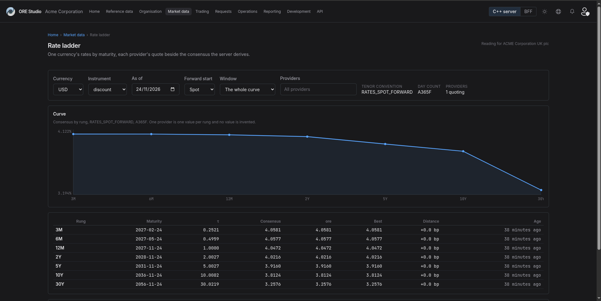
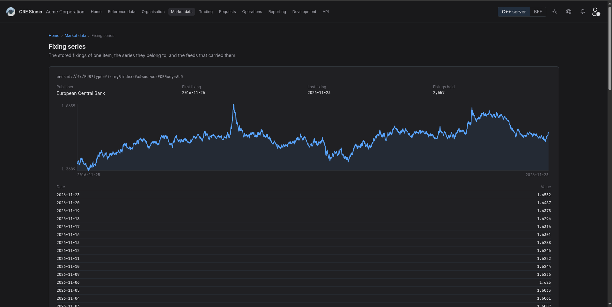
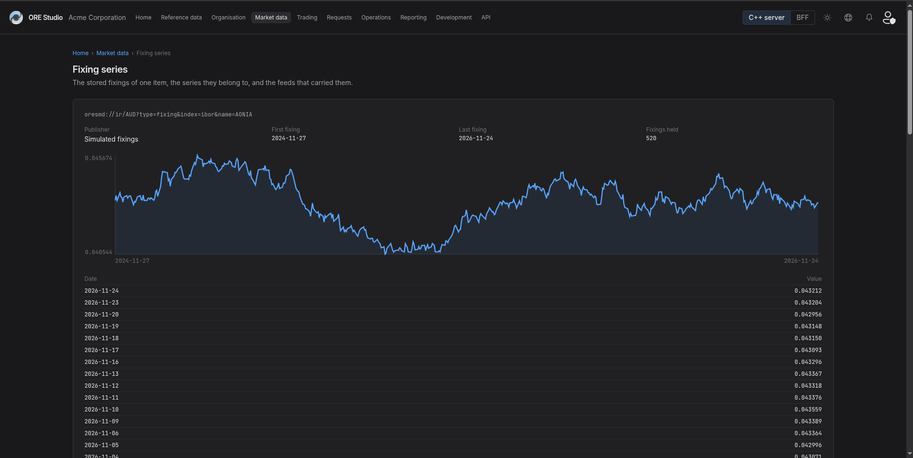
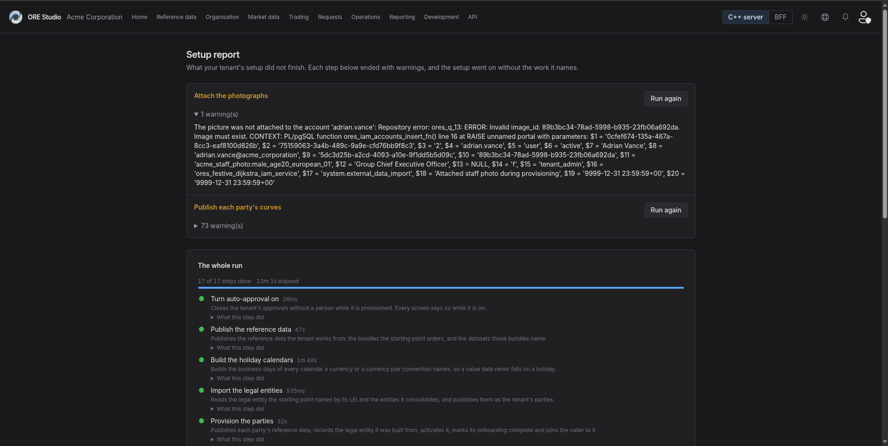
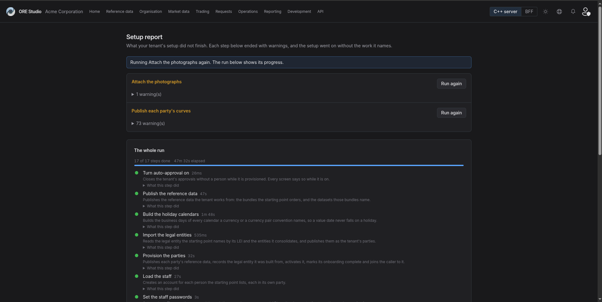

:PROPERTIES:
:ID: FC6494C7-B467-4A4B-B593-600865858D0E
:END:
#+title: Test Scenario: Capture the ladder, the fixings and the setup report
#+description: The three screens the first capture run missed: the spot rate ladder, the fixing series of both kinds, and the setup report with its warnings.
#+type: test_scenario
#+level: s1
#+filetags: :screenshots:release_notes:test_scenario:publish_the_sprint_30_release:sprint_30:v0:
#+target_dialog:
#+created: 2026-11-24
#+updated: 2026-11-24
+#+environment: festive-dijkstra
+#+todo: PENDING | PASSED FAILED
+#+startup: inlineimages

This page documents a test scenario verifying [[id:04A0214D-CC6D-4683-8F5B-A9FFABDDB01E][Assemble the release notes, charts and retrospective]] in [[id:728FB790-CE79-4833-856C-5075BCED287C][Publish the sprint 30 release]]. It is filled in with the target screen and checklist of steps before testing starts; record the outcome by hand in =* Results=.

* Before you start

The environment is ready before you open this scenario.

- Worktree =festive_dijkstra= runs a current build of =main= with the market
  data service rebuilt from the spot-ladder fix.
- The database is provisioned with =acme_corporation= and the services run.
- The web client is at =http://localhost:21801= (=ORES_WEB_PORT= in =.env=).

Rules for every capture:

- Use a browser window 1600 pixels wide, at 100% zoom.
- Save each image in =assets/images/= with the file name the step gives.
- Do not capture real names, passwords or tokens.
- Tell the person who runs it with
  =compass notify scenario doc/agile/versions/v0/sprint_30/publish_the_sprint_30_release/scenario_capture_the_ladder_the_fixings_and_the_setup_report.org --to <username@tenant>=.

* Scenario Info

| Field         | Value                                   |
|---------------+------------------------------------------|
| Verifies task | [[id:04A0214D-CC6D-4683-8F5B-A9FFABDDB01E][Assemble the release notes, charts and retrospective]] |
| Parent story  | [[id:728FB790-CE79-4833-856C-5075BCED287C][Publish the sprint 30 release]]   |
| Target screen | The rate ladder, a fixing series, and the setup report |
| Clients       |                                          |
| State         | PASSED |

* Steps

Each step captures one image for the release notes. Record PASS, FAIL or PENDING in its =*** Result=. Record FAIL when the screen is empty, shows an error or does not match the step, and say what you saw.

** Log in as tenant_admin

- Open =http://localhost:21801/login=.
- Log in as =tenant_admin@acme_corporation= with the password =Secure-Password-123=.
- Confirm the shell opens with no permission errors.

*** Result

| Field  | Value |
|--------+-------|
| Status | PASS |

** Capture the spot rate ladder

- Open =http://localhost:21801/market-data/rate-ladder=.
- Choose the USD currency, which is the ladder the provisioning publishes.
- Confirm the rungs show, with a rate and a tenor each; the screen must not
  report that no provider quotes a USD discount ladder starting 0D. It did
  before the reader learned that a spot series states no forward start.
- Save the screenshot as =assets/images/ore_studio-v0.0.30-rate-ladder.png=.
- Caption for the release notes: /The rates ladder reads every published
  instrument of a currency, against the market data the party holds./

*** Result

| Field  | Value |
|--------+-------|
| Status | PASS |
| Notes  |  |

** Read an FX fixing series

- Open this address, which names the ECB's EUR/AUD fixing series:
  =http://localhost:21801/market-data/fixings?uri=oresmd%3A%2F%2Ffx%2FEUR%3Ftype%3Dfixing%26index%3Dfx%26source%3DECB%26ccy%3DAUD=
- Confirm the page states the series, its recent fixings and the provider they
  came from. The series holds 2,557 fixings.
- Save the screenshot as =assets/images/ore_studio-v0.0.30-fixings-fx.png=.
- Caption: /A fixing series states its series identity, its recent fixings and
  the provider that published them./

*** Result

| Field  | Value |
|--------+-------|
| Status | PASS |
| Notes  |  |

** Read an interest rate fixing series

- Open this address, which names the AUD AONIA fixing series:
  =http://localhost:21801/market-data/fixings?uri=oresmd%3A%2F%2Fir%2FAUD%3Ftype%3Dfixing%26index%3Dibor%26name%3DAONIA=
- Confirm the same page draws for an interest rate series, whose 3,048
  fixings come from its publisher rather than from the synthetic feeds.
- Save the screenshot as =assets/images/ore_studio-v0.0.30-fixings-ir.png=.
- Caption: /The same page for an interest rate index: an overnight rate and the
  history its publisher states./

*** Result

| Field  | Value |
|--------+-------|
| Status | PASS |
| Notes  |  |

** Read the setup report

- Open =http://localhost:21801/setup-report=.
- Confirm every provisioning step is listed with its state, and that the one
  that ended with a warning says which (the run warned that
  =attach_photos= could not attach one account's picture).
- Save the screenshot as =assets/images/ore_studio-v0.0.30-setup-report.png=.
- Caption: /The setup report states each step of the provisioning, and the one
  that ended with a warning says why./

*** Result

| Field  | Value |
|--------+-------|
| Status | PASS |
| Notes  |  |

** Confirm a warned step can be re-run

- On the setup report, find the step that ended with a warning.
- Confirm the page offers to run it again, and that it states what the warning
  was before it offers the action. Do not press it unless the warning is still
  present and the step is harmless to repeat.
- Save the screenshot as
  =assets/images/ore_studio-v0.0.30-setup-report-rerun.png=.
- Caption: /A step that ended with warnings can be run again from its report,
  and the warnings stay in front of the person until none remain./

*** Result

| Field  | Value |
|--------+-------|
| Status | PASS |
| Notes  |  |

* Results

| Field         | Value |
|---------------+-------|
| Status        | PASSED |
| Completed at  | 2026-11-24T09:42:38Z |
| Branch        |       |
| Commit        |       |
| Worktree      |       |

* Notes

- This scenario exists because the first release capture
  ([[id:AD1C422D-0CFC-494F-88CD-AF6FFE22240A][Capture the sprint 30 release screenshots]]) could not take these three
  screens: the ladder answered that no provider quoted a USD discount ladder
  starting 0D, the fixings page had no front door, and the setup report was not
  in the first scenario at all.
- The ladder failure was a defect and is fixed: a spot series states no forward
  start, and the reader now reads 0D as the spot ladder.
- The fixings page still has no front door, because a fixing is not in the
  instrument catalogue; the addresses above are the way in, and the gap is a
  capture in the product backlog.
- The setup report's warning comes from this environment's provisioning run,
  which attached 25 photographs and refused one.
