:PROPERTIES:
:ID: AD1C422D-0CFC-494F-88CD-AF6FFE22240A
:END:
#+title: Test Scenario: Capture the sprint 30 release screenshots
#+description: Walk the screens sprint 30 delivered on an ACME-provisioned environment and capture one screenshot per release highlight.
#+type: test_scenario
#+level: s1
#+filetags: :screenshots:release_notes:test_scenario:publish_the_sprint_30_release:sprint_30:v0:
#+target_dialog:
#+created: 2026-11-24
#+updated: 2026-11-24
#+environment: festive-dijkstra
#+todo: PENDING | PASSED FAILED
#+startup: inlineimages

This page documents a test scenario verifying [[id:728FB790-CE79-4833-856C-5075BCED287C][Publish the sprint 30 release]] in [[id:9F7C5484-E2D1-40E0-B24D-AD1B69A057F5][Sprint 30]]. It is filled in with the target screen and checklist of steps before testing starts; record the outcome by hand in =* Results=.

* Before you start

The environment is ready before you open this scenario.

- Worktree =festive_dijkstra= runs a current build of =main=.
- The database is recreated and =acme_corporation= is provisioned:
  =compass db status= to confirm, then =compass db recreate -y -k= and
  =compass shell -f projects/ores.shell/scripts/library/provisioning/how_do_i_provision_the_system_with_acme_corporation_holding_group.ores=
  if it is stale. The provisioning run must end with no failed step, because
  every market data screen below reads what it publishes.
- The services run (=compass services start=). The synthetic feeds must be
  publishing, or the quotes and feed pages have nothing to show.
- The web client is served by the C++ gateway at
  =http://localhost:21801= (=ORES_WEB_PORT= in =.env=; adjust if this
  worktree was provisioned on another base port).

Rules for every capture:

- Use the light theme and English.
- Use a browser window 1600 pixels wide, at 100% zoom.
- Save each image in =assets/images/= with the file name the step gives.
- Do not capture real names, passwords or tokens.
- Tell the person who runs it with
  =compass notify scenario doc/agile/versions/v0/sprint_30/scenario_capture_the_sprint_30_release_screenshots.org --to <username@tenant>=.

* Scenario Info

| Field         | Value                                   |
|---------------+------------------------------------------|
| Verifies task | [[id:04A0214D-CC6D-4683-8F5B-A9FFABDDB01E][Assemble the release notes, charts and retrospective]] |
| Parent story  | [[id:728FB790-CE79-4833-856C-5075BCED287C][Publish the sprint 30 release]] |
| Target screen | The market data and operations screens named in each step |
| Clients       |                                          |
| State         | FAILED |

* Steps

Each step captures one image for the release notes. Record PASS, FAIL or PENDING in its =*** Result=. Record FAIL when the screen is empty, shows an error or does not match the step, and say what you saw.

** Log in as tenant_admin

- Open =http://localhost:21801/login=.
- Log in as =tenant_admin@acme_corporation= with the password =Secure-Password-123=.
- Confirm the shell opens with no permission errors.

*** Result

| Field  | Value |
|--------+-------|
| Status | PASS |

** Capture the release hero

- Open =http://localhost:21801/market-data/rate-ladder=.
- Pick a currency whose ladder the provisioning published; the rows must show
  instruments, their rates and their tenors.
- Save the screenshot as =assets/images/ore_studio-v0.0.30.png=.
- Caption for the release notes: /The rates ladder reads every published
  instrument of a currency, against the market data the party holds./

*** Result

| Field  | Value |
|--------+-------|
| Status | FAIL |
| Notes  | A request did not finish; ; No provider quotes a USD discount ladder starting 0D at this as-of. (POST /api/market/rate-ladder, request e229296e) |

** Search the instrument catalogue

- Open =http://localhost:21801/market-data/instruments=.
- Type a few letters of a published instrument's name.
- Confirm the list narrows and each row names the instrument, its class and
  its currency.
- Save the screenshot as =assets/images/ore_studio-v0.0.30-instruments.png=.
- Caption: /Instrument search over the market data the party actually holds./

*** Result

| Field  | Value |
|--------+-------|
| Status | PASS |
| Notes  | 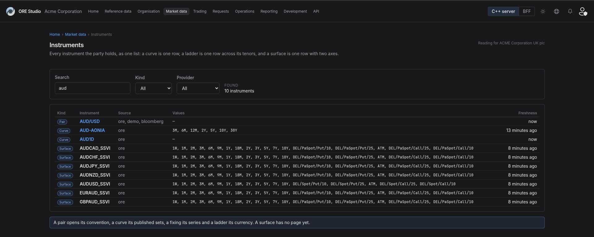 |

** Read an FX spot montage

- Open =http://localhost:21801/market-data/fx-montage=.
- Choose a pair the provisioning published.
- Confirm the montage shows the spot, its day's move and the points it came
  from.
- Save the screenshot as =assets/images/ore_studio-v0.0.30-fx-montage.png=.
- Caption: /The FX spot montage draws one pair's spot, its move and the
  points behind it./

*** Result

| Field  | Value |
|--------+-------|
| Status | PASS |
| Notes  | 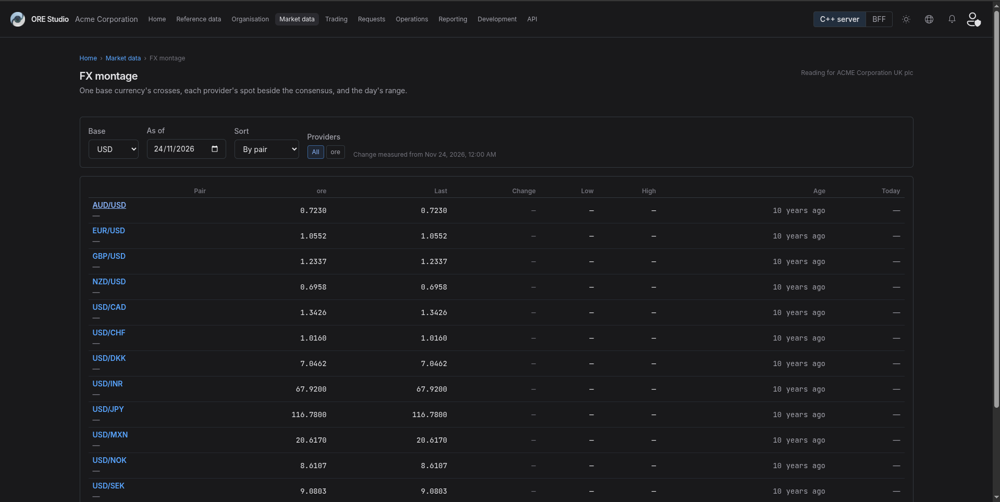 |

** Watch the vendors' quotes

- Open =http://localhost:21801/market-data/quotes=.
- Leave the page open long enough for a tick to land.
- Confirm a board per vendor, one column each, and that the cells change
  without a refresh.
- Save the screenshot as =assets/images/ore_studio-v0.0.30-quotes.png=.
- Caption: /The quotes view shows the market as each vendor quotes it, one
  board per vendor, live./

*** Result

| Field  | Value |
|--------+-------|
| Status | PASS |
| Notes  | 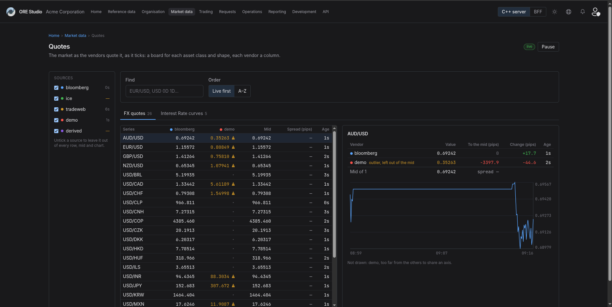; ; 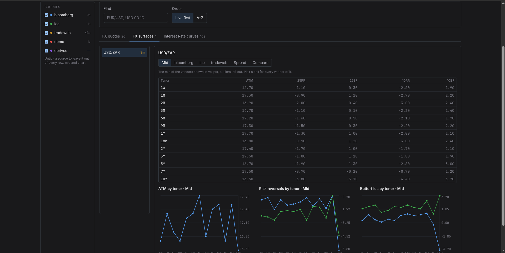; ; ; 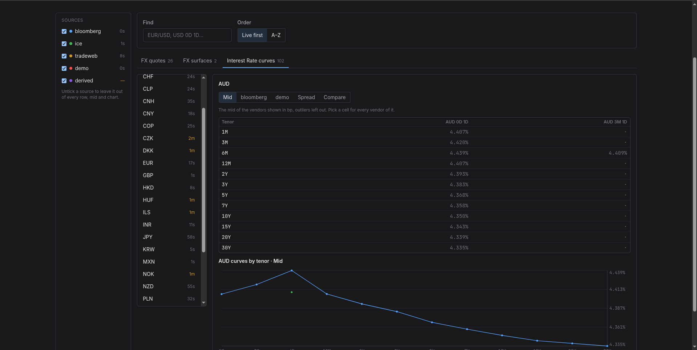 |

** Inspect a published curve

- Open =http://localhost:21801/market-data/published-curves=.
- Open one curve.
- Confirm the page states its pillars, its quotes and when it was published,
  and that the grid draws.
- Save the screenshot as =assets/images/ore_studio-v0.0.30-curve.png=.
- Caption: /A published curve states its pillars, the quotes it was built
  from, and the moment it published./

*** Result

| Field  | Value |
|--------+-------|
| Status | PASS |
| Notes  | 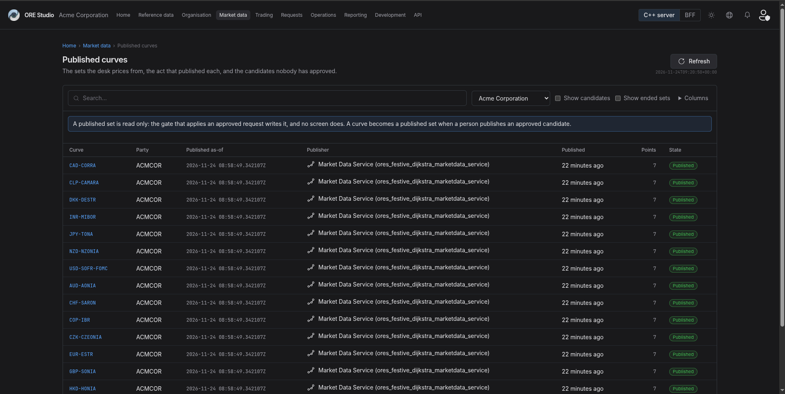; ; ; 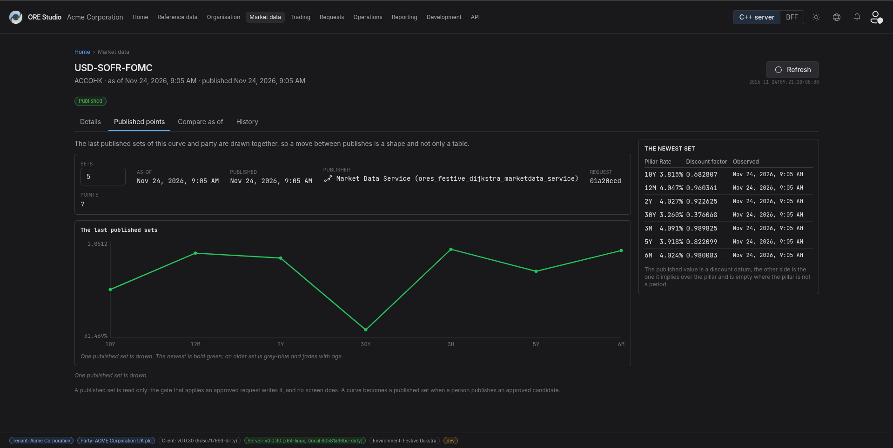 |

** Compare curves across currencies

- Open =http://localhost:21801/market-data/curve-analytics=.
- Compare within one currency first, then switch to the across-currency
  comparison.
- Confirm the screen says in words what the overnight-to-overnight comparison
  shows.
- Save the screenshot as =assets/images/ore_studio-v0.0.30-curve-analytics.png=.
- Caption: /Curves compared within a currency by default, and across
  currencies only like for like./

*** Result

| Field  | Value |
|--------+-------|
| Status | PASS |
| Notes  | 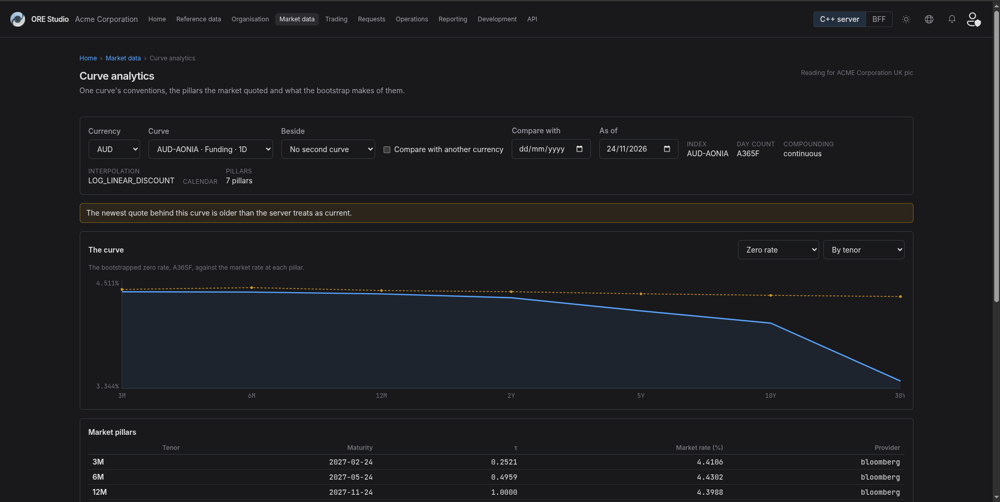; 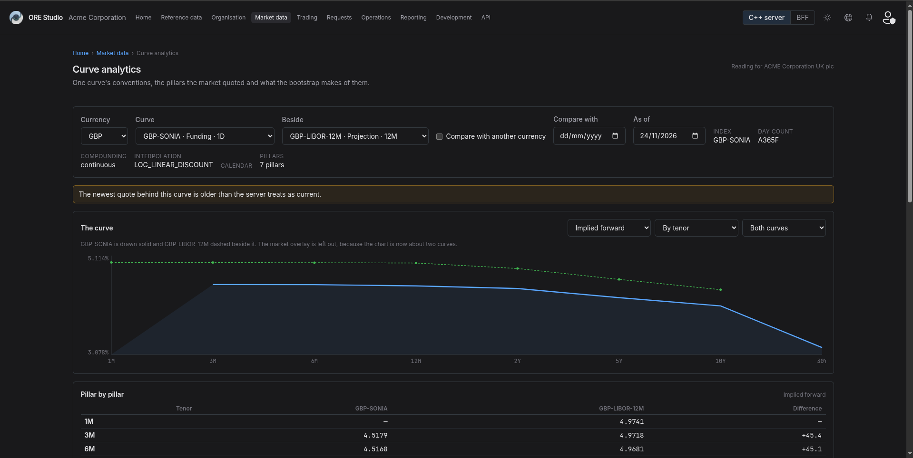 |

** Read the IR calibration coverage

- Open =http://localhost:21801/market-data/calibration= and choose the
  interest rate asset class.
- Confirm one row per curve, the class policy as a card, and a state that is
  true for the feeds the provisioning published.
- Save the screenshot as =assets/images/ore_studio-v0.0.30-calibration.png=.
- Caption: /IR calibration coverage: one row per curve, and a state that is
  true./

*** Result

| Field  | Value |
|--------+-------|
| Status | PASS |
| Notes  | 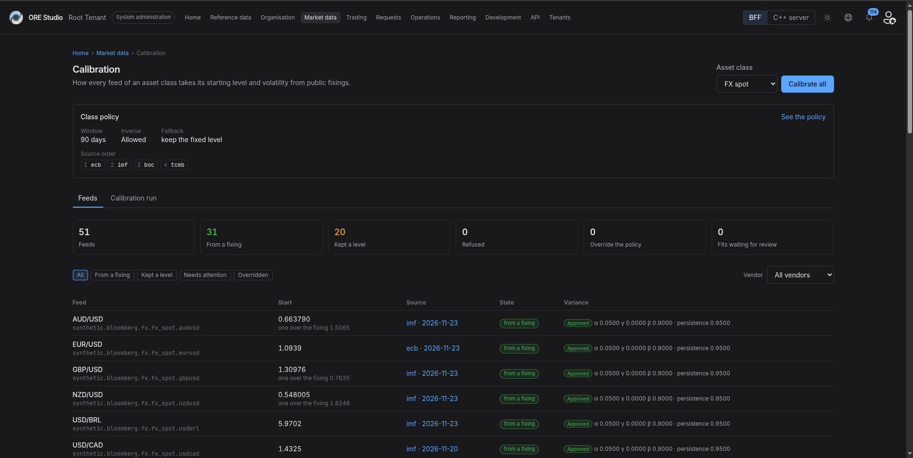; ; 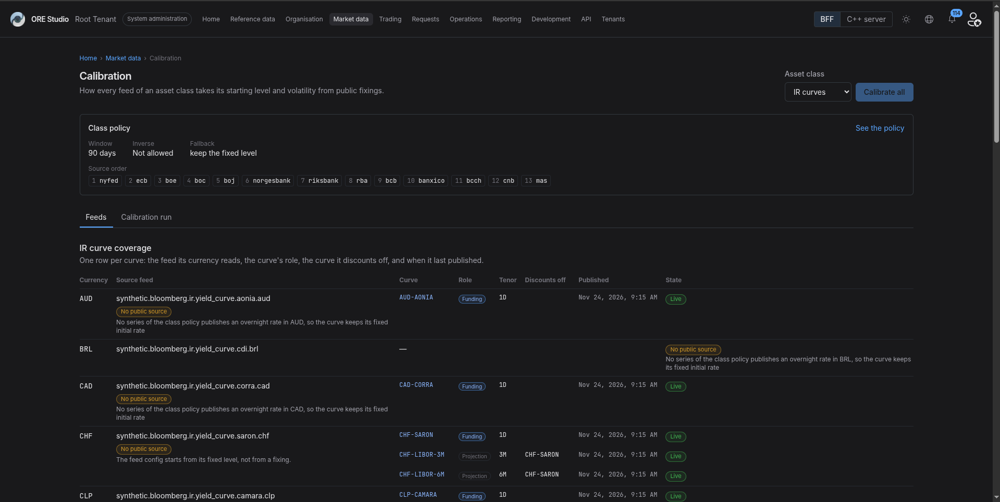; ; |

** Read the fixings of both kinds

- Open =http://localhost:21801/market-data/calibration= and pick the feed
  whose start item is a fixing series.
- Follow the series link on the feed to the fixings page.
- Confirm the page states the series, its recent fixings and the provider they
  came from.
- There is no fixings card in Market data and the page refuses a direct visit:
  a fixing is not in the instrument catalogue yet, so nothing lists one. That
  gap is its own capture; this step reaches the page the way a person can.
- Save the screenshot as =assets/images/ore_studio-v0.0.30-fixings.png=.
- Caption: /FX and interest rate fixings side by side, each with its
  provider./

*** Result

| Field  | Value |
|--------+-------|
| Status | FAIL |
| Notes  | - No fixings card in market data; - via direct URL gives error: "Open this page from an oresmd link, so it knows which item to show." |

** Browse identity shapes as records

- Open =http://localhost:21801/market-data/identity-shapes=.
- Open one shape.
- Confirm the list is paged, and the shape's page states its code, its
  description and its field rules.
- Save the screenshot as =assets/images/ore_studio-v0.0.30-identity-shapes.png=.
- Caption: /An identity shape is a record: a code, a description and the field
  rules that make a series identifiable./

*** Result

| Field  | Value |
|--------+-------|
| Status | PASS |
| Notes  | 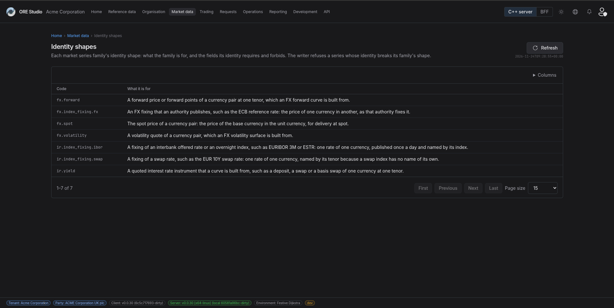; ; 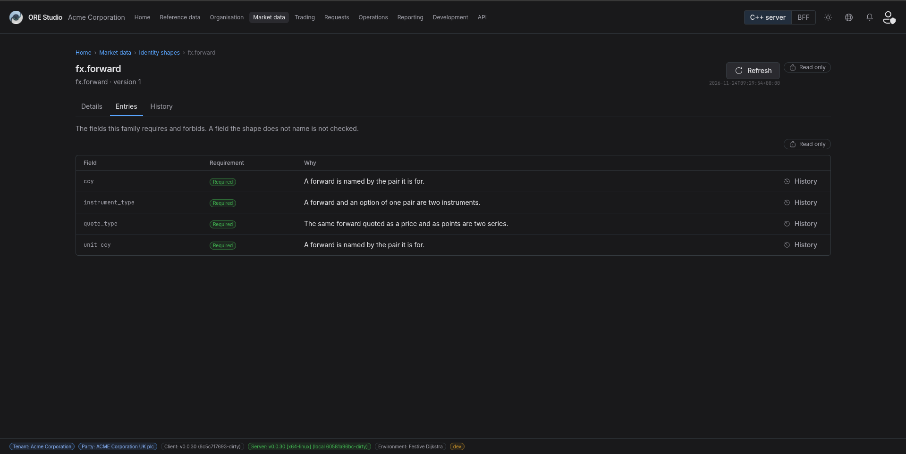 |

** Follow the synthetic feed graph

- Open =http://localhost:21801/operations/market-data-feeds= and open one
  synthetic feed.
- Confirm the page draws the feed graph: the latent surface, the vendor views
  downstream of it, each node's state and its messages.
- Save the screenshot as =assets/images/ore_studio-v0.0.30-feed-graph.png=.
- Caption: /The feed graph names what feeds what, each node's state, and the
  reason a node stopped./

*** Result

| Field  | Value |
|--------+-------|
| Status | PASS |
| Notes  | 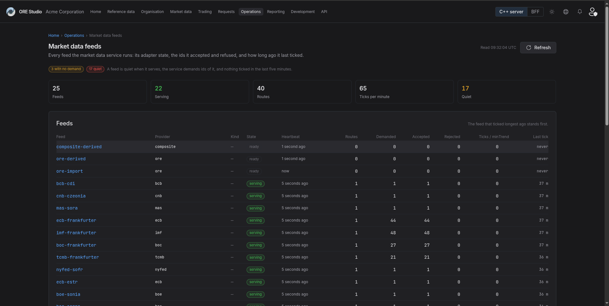 |

** Check the role screens

- Open =http://localhost:21801/organisation/roles= and open one role.
- Confirm the list is paged and the role page follows the record standard,
  with the people who hold the role.
- Save the screenshot as =assets/images/ore_studio-v0.0.30-roles.png=.
- Caption: /Roles on the shared record parts, with a paged list and the people
  who hold a role./

*** Result

| Field  | Value |
|--------+-------|
| Status | PASS |
| Notes  | 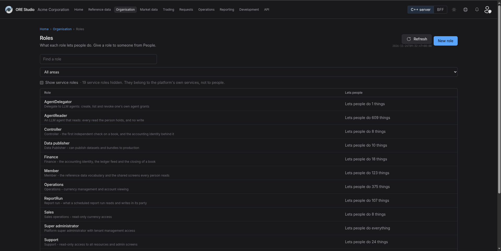 |

* Results

| Field         | Value |
|---------------+-------|
| Status        | FAILED |
| Completed at  | 2026-11-24T09:32:57Z |
| Branch        | doc/sprint-30-health-review |
| Commit        | d66d21c385 |
| Worktree      | festive_dijkstra |

* Notes

- The screens this scenario captures are the ones sprint 30 changed or added:
  the market data screens ported from hedgr, the vendor quotes view, the
  redesigned IR calibration coverage, the cross-currency curve comparison, the
  fixings view, identity shapes as records, the synthetic feed graph and the
  role screens.
- Screens the sprint only partly delivered are not captured here: the
  volatility surface calibration, the scripted trade editor and the grid job
  screens carry into the product backlog as their own stories.
- The release notes' images resolve from =main= only after the notes and these
  files are merged, and the notes name each file the steps save.

* Review of the run

Ten of the twelve steps passed and produced fifteen captures. Two failed, and
both failures are the product's, not the scenario's.

** The rate ladder cannot build a USD ladder

=POST /api/market/rate-ladder= answers "A request did not finish; No provider
quotes a USD discount ladder starting 0D at this as-of." (request =e229296e=).
The screen therefore has no hero shot, and the failure names the reason
precisely: something must quote the 0D pillar of a USD discount ladder. Either
the provisioning should publish that quote, or the ladder should build from the
pillars a provider does quote. Worth chasing: the same ladder is the release's
front page.

** The fixings screen cannot be reached or addressed

There is no fixings card anywhere in Market data, and the page refuses a direct
visit: "Open this page from an oresmd link, so it knows which item to show."
The screen exists but has no front door and no way to state its own subject, so
a person cannot get to it and a bookmark cannot either.

** What the captures themselves show

- The ten passing steps captured the screens the sprint changed: instruments,
  the FX spot montage, the vendor quotes boards, a published curve, the
  cross-currency comparison, IR calibration coverage, identity shapes, the
  synthetic feed graph and the roles screen.
- The captures were taken in the dark theme at 1919 pixels wide, against the
  scenario's rule of the light theme at 1600 pixels. They are legible, and they
  match each other, so the set is usable as it stands; the rule exists so a
  release reads the same from one sprint to the next.
- The runner wrote one malformed table per step: the separator landed after the
  rows and a second, empty =Status= row followed. Repaired by hand; the harness
  should write one table per result.
- The captures were saved beside this scenario, not in =assets/images/=. They
  were copied there under the names the release notes use.
