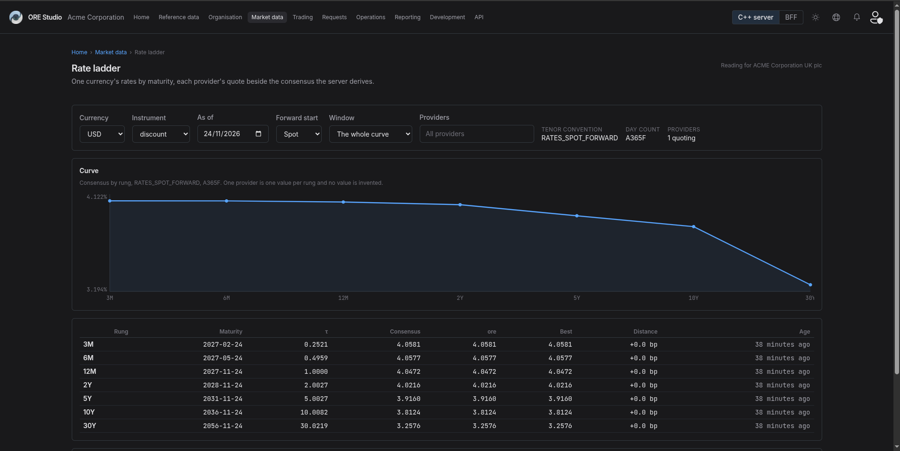

*The rates ladder reads every published instrument of a currency, against the market data the party holds.*

*November 2026*

Sprint 30 was named for finishing the move off sqlgen and reflect-cpp, and that work closed on its second day: every component now reads its rows through generated statements on a thin libpq layer, and its codecs are generated rather than reflected. The sprint then removed the reason a change was expensive, forward-declaring the headers most of the build depended on and passing the database context by reference. Every product type ORE reads is now held as a trade, generated for Acme in each form the engine accepts and proved by the engine itself. Market data gained a latent surface quoted through vendors, overnight rates from a dozen central banks, and curve and fixing histories a party triangulates for itself. The migration of the gates and the generator onto compass-ng reached v0.0.13 and now runs in CI, and the pooler work closed with the environment naming one database endpoint. The sprint merged 579 pull requests with a median cycle of twelve minutes. It also ran seventeen days against a seven-day plan, so nineteen stories were split with the work that remains named in their successors, and eighty-one unstarted stories returned to the product backlog with their tasks intact.

---

# ✅ Highlights

-   **The mission's deliverable shipped.** Moving off sqlgen and reflect-cpp was the reason for the sprint, and it closed on its second day. The work that made it stick — forward declarations, the database context by reference, the wide-type exceptions — closed on day 13.
-   **The queue never blocked.** 579 pull requests merged with a median cycle of twelve minutes, and never more than one open at a time. Review was not the constraint at any point in the sprint, and nothing waited in a branch.
-   **The gate and the CI kept their word.** The local check gate runs the class a change needs, CI installs its pinned tools, and CDash receives every continuous build.
-   **The close was clean.** Seventy-four stories were delivered, six abandoned, and every piece of open work was either finished or named: nineteen stories were split into successors whose titles say what remains, and eighty-one unstarted stories returned to the backlog with their tasks and history.

# 🛠️ Key Improvements

## Hotfixes

-   **Hotfix: nightly CI failures**: The nightly builds on Linux, macOS and Windows and the valgrind run are red.
-   **Hotfix: two changes on main fail four local checks**: Make the local gate pass on main again.
-   **Hotfix: recent changes on main fail five local checks**: Make the local gate pass on main again.
-   **Hotfix: Main CI is red on Windows, GCC, and tests**: Restore a green main branch: the GCC and the Windows builds compile, and the test suites that main runs pass.
-   **Hotfix: Fix the warnings and the macOS database tests**: Make the macOS nightly pass its database tests, and clear compiler warnings from the tree so warnings-as-errors can be switched back on.
-   **Start the synthetic service on a fresh database**: A recreated database reaches a running fleet: the synthetic service registers, announces ready, and starts its adapters, and a start-up failure reports itself instead of hanging.
-   **Hotfix: Clear the Windows, GCC and test breakages CI now reports**: Clear the four breakages CI reports on main: the Windows export collision, the GCC 16 name collision, the banxico test that the environment lookup change broke, and the PostgreSQL build that fails our queries.
-   **Hotfix: Fix the AppleClang min call and the generated link drift**: Make macOS compile again, and bring three generated CMake files back in line with the models they are generated from.
-   **Hotfix: Publish the catalogues the booking test reads**: Make the generated-trade booking test pass by publishing the refdata catalogues a basket constituent is resolved against.
-   **Hotfix: Give the booking test its own refdata**: Let the booking test run against its own reference data, instead of depending on a publish step that only provisioning should perform.
-   **Hotfix: Main stops at the surface set test**: A full build of main compiles every target again, and the two raise functions agree on whether a caller may discard what they return.

## Financial Features

-   **Design and seed the reports, configurations and portfolio trees each ACME party runs**: Each ACME party gets the reports it would really run, with the configuration those reports need and a realistic portfolio tree, root portfolio and currencies.
-   **Every index a generated trade floats on has a curve and fixings**: A report over the generated trades finds the fixings and the curve of every index a trade floats on.
-   **Eight columns in the trading models hold JSON blobs where th…**: Eight columns in the trading models hold JSON blobs where the domain should hold rows, and each is a place where the store cannot answer a question about the trade without parsing text.
-   **Make the generated trades value correctly in ORE**: Every trade the generator books is correct according to ORE: ORE builds it, and a report values it to the NPV ORE itself gives for the same trade.
-   **Build the calendars without a read per day**: Provisioning a tenant builds its holiday calendars well inside the `build_calendars` step's 600 s, so a new tenant is ready without a manual rebuild.
-   **Data model clean up**: One data-oriented, consistent model of the system's persisted data.
-   **Publish one curated convention set and provision to completion**: A fresh environment provisions the system and Acme to completion, every step of it, and each party holds every convention its trades and curves name.
-   **Hold every product type the engine supports**: ORE Studio supports every trade ORE supports.
-   **Triangulate each party's rates from the series it holds**: A rate a firm does not observe, it triangulates: the driver pairs are the ones its vendors publish, the pivot is the pivot its publisher quotes against, and the choice of CRM is the firm's own.
-   **Design the scripted trade subsystem**: One scripted trade subsystem serves every way a scripted trade enters ORE Studio: a product-specific booking form that books a product natively or as scripted, a free-form scripted trade editor validated on the server, import, and the generator that proves every product books and values.

-   **Run a report on the generated trades with the market data they need**: A report over the trades the generator books runs to completion, and ORE values every generated trade type from market data the system holds.
-   **Read the public interest rate sources**: The public overnight rate of as many currencies as their publishers allow is stored as fixings in the system tenant, with its history.

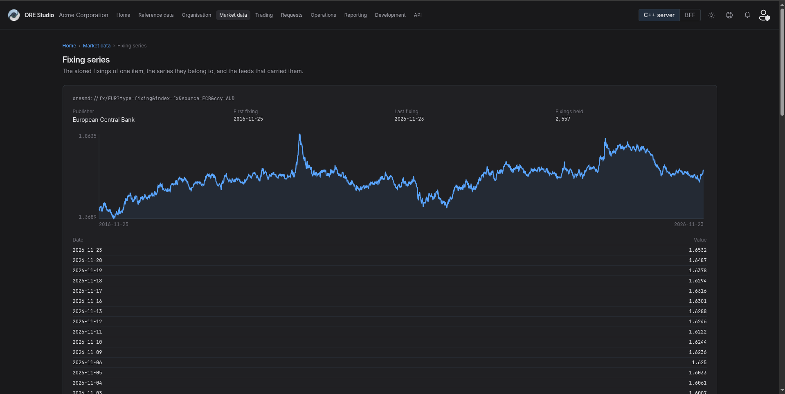

*A fixing series states its identity, its recent fixings and the provider that published them.*

-   **Support volatility surfaces — the remaining work**: The system builds and serves volatility surfaces as market data.
-   **Build the IR curves of every supported currency from public data — the remaining work**: Every currency the synthetic IR feeds support has a published overnight-index curve in the system tenant, bootstrapped from that currency's quotes, and those quotes start from the currency's public overnight rate.
-   **Port the market data screens from hedgr**: Hedgr prototyped five market-data screens for its own terminal.

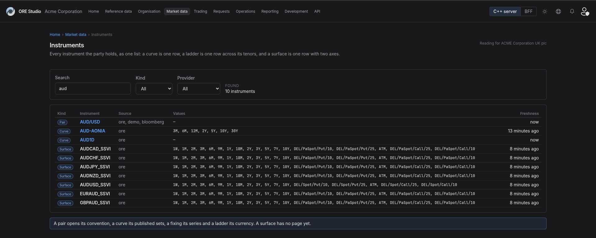

*Instrument search over the market data the party actually holds.*

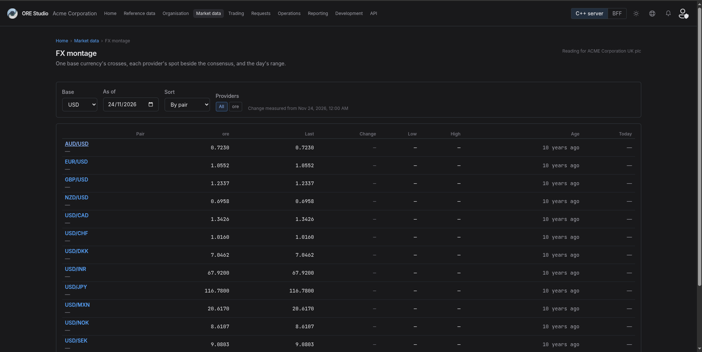

*The FX spot montage draws one pair's spot, its move and the points behind it.*

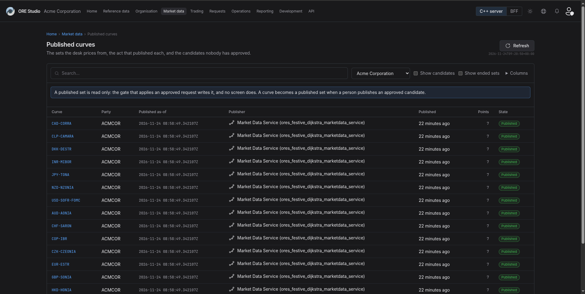

*A published curve states its pillars, the quotes it was built from, and the moment it published.*

-   **Size a volatility surface to the data its party holds**: A surface should reach as far as its party's market data reaches and no further, and say where it stopped.
-   **Build each party's volatility surfaces from vendor quotes of a latent surface**: The system tenant simulates FX volatility quotes as if they were public market data: a latent surface, struck against the simulator's own spot and forward curves, quoted by vendor contributors with their own noise.
-   **State the identity of a market series**: market\_series\_identity is one wide table of nullable columns with one shape per instrument class, and nothing states which fields a class requires: the requirement lives in the code that parses an oresmd URI, so a new series can be written sparse and nothing refuses it until a consumer far downstream says it has no series.
-   **Configure the public sources in a setup dialog**: A person configures the public sources, and the key of each, on the setup steps screen.
-   **Browse identity shapes as records**: A person browses the identity shapes as they browse any other record: a paged list of shapes, each saying what its family is for, and a page per shape with its entries and its history.

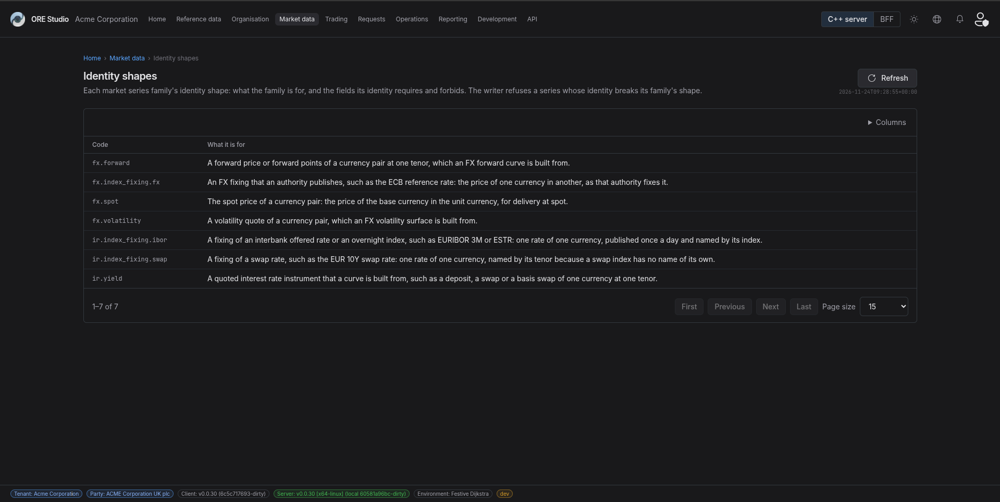

*An identity shape is a record: a code, a description and the field rules that make a series identifiable.*

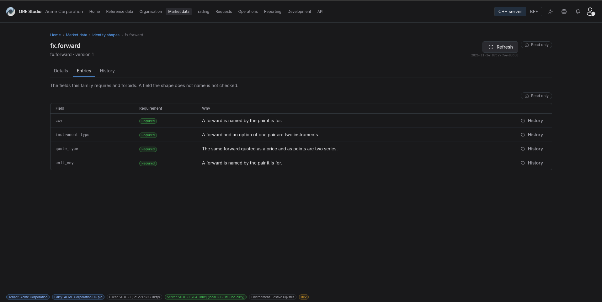

*A shape's own page: its field rules, one entry each.*

-   **Redesign the IR calibration coverage**: A person reads the IR calibration coverage at a glance: one line per curve with its role, tenor, discount curve, publish and state, the class policy in one compact card, and a state that is what the system found.

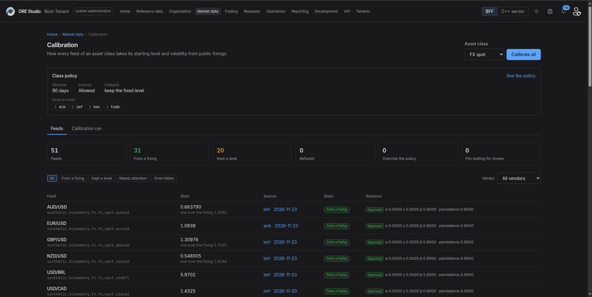

*IR calibration coverage: one row per curve, and a state that is true.*

-   **Compare curves within a currency, and across currencies like for like**: A person compares the curves of one currency by default, and compares two currencies only overnight against overnight, with the screen saying what each comparison shows.

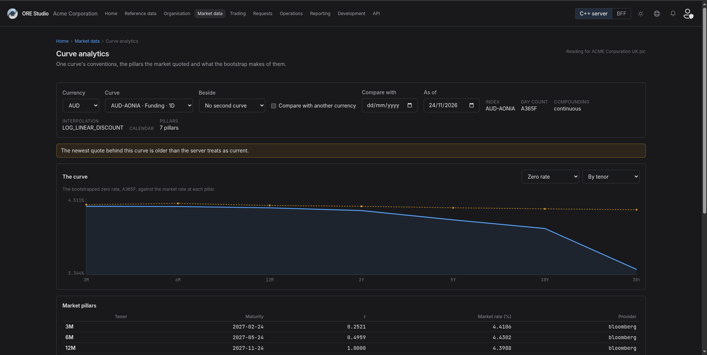

*Curves compared within a currency by default, and across currencies only like for like.*

-   **CZEONIA days with no fixing fail the refresh**: The CNB adapter reads a day with an empty rate as a day with no fixing, so every yearly file parses and a refresh across any window stores the days the bank fixed.
-   **Model the synthetic feeds as a dependency graph: upstreams, latent surfaces and vendor views**: A person who runs the synthetic market sees it as what it is: a graph of feeds, where each node depends on the nodes upstream of it.

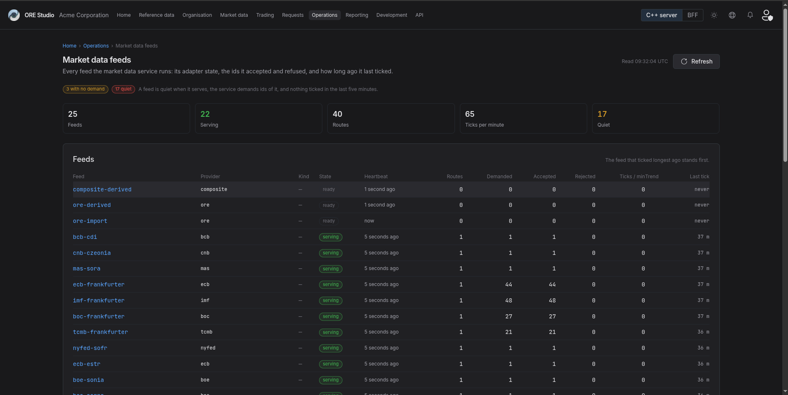

*The feed graph names what feeds what, each node's state, and the reason a node stopped.*

## Security & Tenancy

-   **Bring the role screens to the standard**: Move the roles list and role page onto the shared record parts, with paged server reads for roles and for the people who hold a role.

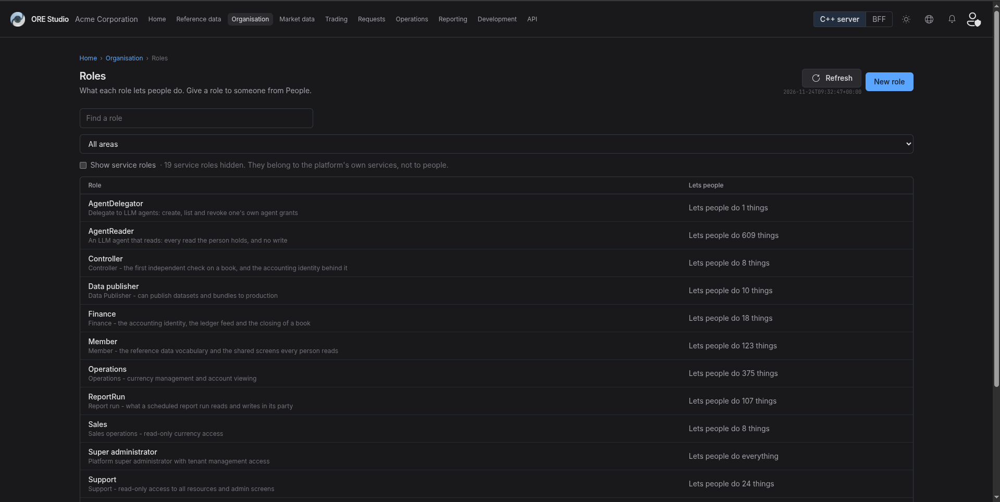

*Roles on the shared record parts, with a paged list and the people who hold a role.*

-   **Follow the child run a workflow hands off**: A person who provisions a tenant should not be told it is ready while its setup is still running.
-   **Make a workflow step survive a slow request**: A workflow step calls a service over the bus, and every one of those requests takes the same 30-second deadline, whatever work it asks for.
-   **Own each durable NATS delivery with one RAII transaction**: A service that reads a durable NATS subject never crashes on, loses, or answers twice a delivery it was handed.
-   **Keep workflow steps alive while they work, and off iam**: Provisioning completes on a busy host.
-   **Re-run a setup step that ended with warnings**: A tenant whose setup left work undone is one click from finishing it: the tenant administrator sees an alert on the tenant dashboard while any setup step stands with warnings, follows it to the setup report, and re-runs the step there or in the shell.

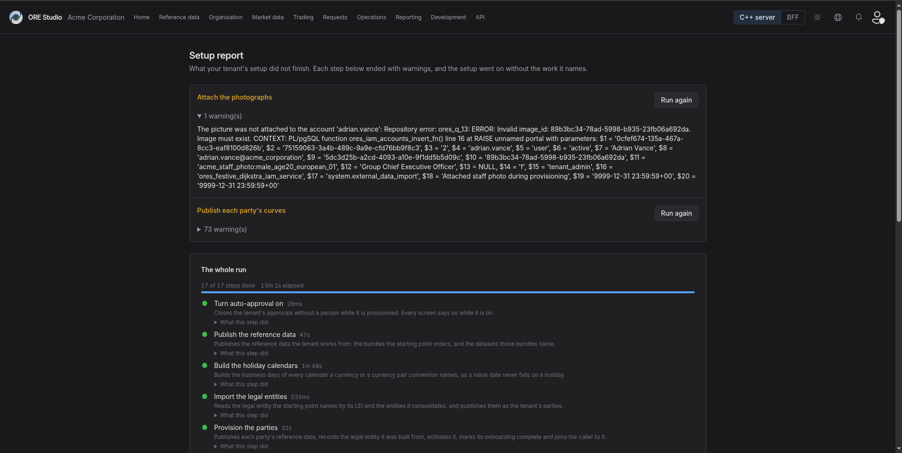

*The setup report states each step of the provisioning, and the one that ended with a warning says why.*

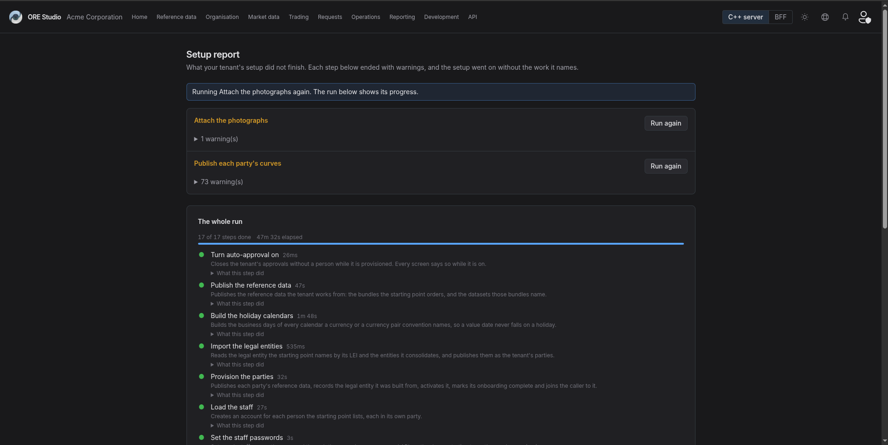

*A step that ended with warnings can be run again from its report.*

-   **Put a content security policy on the site**: The site states a Content-Security-Policy on every page it serves, so a script that reaches a page without being part of the bundle cannot run, and a page cannot load from or talk to a host the policy does not name.
-   **Run the tests through the pooler**: The tests run through pgbouncer, the way the fleet does.
-   **Two providers of one fixing collide in the identity table**: The series table keys a series by party, URI and provider, so one party may hold the EURIBOR 6M fixing from Bloomberg and from LSEG.

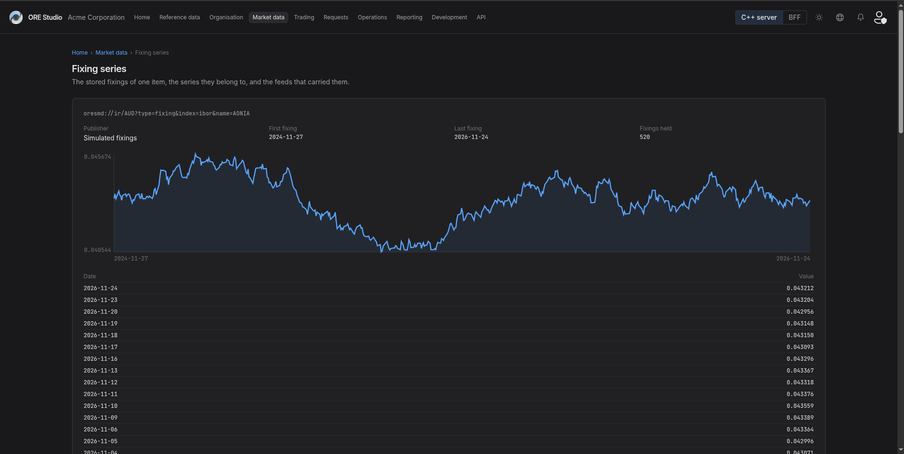

*The same page for an interest rate index: an overnight rate and the history its publisher states.*

## Compute & Storage

-   **Handle the backlog when the compute path stalls**: (Describe the user-visible outcome this story delivers.)

## Web & Journeys

-   **Bring the assistant into ores.web on the target architecture**: A person signed in to ores.web asks the assistant, in a panel of ores.web, to do anything they can do themselves: find and read records, run reports, explain results, and book or change records.
-   **Serve what the BFF serves, then retire it — the remaining work**: Every route the BFF answers has an equivalent on the C++ server, merged and proved as it lands, and the browser keeps calling the BFF until the last one does.
-   **See the market as the vendors quote it**: A person sees the market as the vendors quote it: every quote of every provider they subscribe to, live and in any asset class, in one view that reads the same from any party, and every provider from the system tenant.

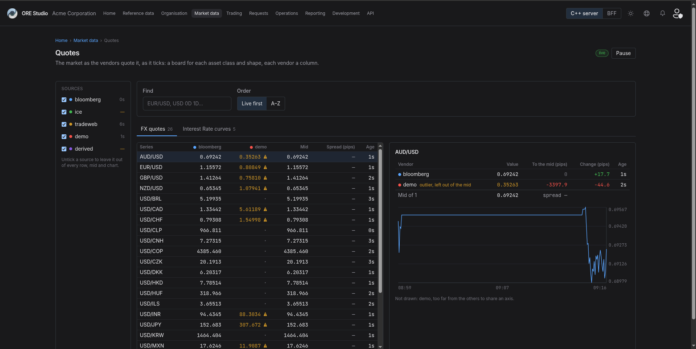

*The quotes view shows the market as each vendor quotes it, one board per vendor, live.*

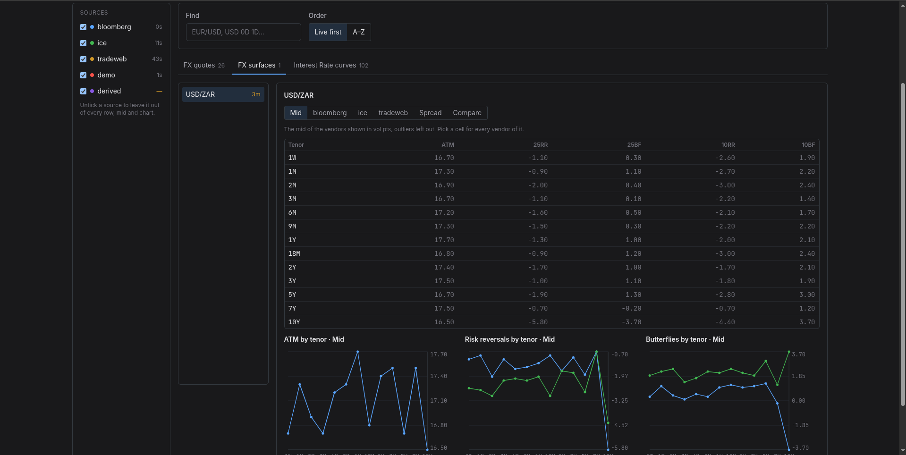

*A second moment of the same board, as the next tick lands.*

-   **Fold a long warning on the run's rail**: A step that finishes with a warning shows the reason under its name on the run rail, and a warning that names hundreds of items keeps that sentence short enough to read: the first sentence stands, and the rest waits behind a disclosure beside it.

## Codegen & Tooling

-   **Clean ores.synthetic to the component clean standard**: ores.synthetic meets the Component Clean Standard: every item: All, Protocol and Entity pass, each item that does not apply is recorded with its reason, and ores.synthetic joins `COMPONENTS_UNDER_TEST`.
-   **Gate every ER diagram**: Make the er-diagram check compare every generated group diagram and the index, discovered from the model rather than a hard-coded list.
-   **Read a batch of rows in one query in the generated services**: A bulk request to a generated service reads the rows it needs in one query per batch, not one per row.
-   **Enforce the protocol's 1,000-element bound on generated put-many and delete-many**: The generated put-many and delete-many refuse a batch of more than 1,000 elements as `invalid`, as the protocol states.
-   **Move codegen and the gates to compass-ng**: compass-ng generates the code and runs the build-free gates for every environment, for CI and for external developers.

## Data, SQL & Quality

-   **Replace sqlgen and reflect-cpp with generated code**: Every component reads and writes the database through generated statements on a thin libpq layer, and encodes its messages through generated JSON and MessagePack codecs.
-   **Pool the fleet's connections**: A service gets the connections its work needs, and the database carries only what it can.
-   **Take the DQ pipeline end to end, from a seeded artefact table to a published system**: Carry reference data from a blank database to a usable one, deliberately.

## Build, CI & Testing

-   **Hear how a build went**: A build reports itself to a person who is not watching it.
-   **Show each Catch2 test case on CDash**: CDash shows each Catch2 test case's status, time and failure text, so a failed suite names the case that failed and a slow suite names the slow case.
-   **Make every generated batch write check its claims**: Every generated write states a claim about each row, and the store checks it.
-   **Keep main green**: Developers start work from a commit that CI has proven green, and main only moves to commits that passed the full platform matrix.
-   **Make the build faster**: Builds get fast enough that integration moves more often and an advisory PR build becomes possible.
-   **Break the large compilation dependencies**: A change to one header rebuilds only the code that uses what the header defines.
-   **Run the Linux CI on GCC 16**: Build the Linux CI with GCC 16, the compiler the worktrees run, so a warning the CI reports is a warning a developer can reproduce.
-   **Move the Linux CI image to Ubuntu 26.04**: Run the Linux CI image on the latest LTS with the tools that image ships, so a developer on the same release builds with the same compiler and sees the same warnings.
-   **Share the service libraries and publish the images to GitHub Container Registry**: (Describe the user-visible outcome this story delivers.)
-   **Link the shared service error on Windows**: (Describe the user-visible outcome this story delivers.)
-   **Publish restores the empty runtime directories**: The nightly publishes the images it stages.

## Agile & Documentation

-   **Open sprint 30**: Sprint 30 is open: it is the current sprint in the version manifest and the agile index, and the project is on version 0.0.30 with the latest vcpkg.
-   **Sprint health review — System 2 analysis**: A System 2 review of sprint 30.

## Other

-   **Serve ORE's API to LLM agents over MCP**: An MCP client, Claude Code, Claude Desktop or a small local model's agent, connects to ores.http, works as a person who signed in, finds the operations that person may call, and calls them.
-   **Stop the workflow from losing steps to a transient storm — the remaining work**: A workflow step must survive a transient failure of the service that serves it.
-   **Run a service's steps concurrently**: A provisioning run whose steps run side by side completes, however long one of them takes.

*The quotes view shows the market as each vendor quotes it, one board per vendor, live.*

*An identity shape is a record: a code, a description and the field rules that make a series identifiable.*

*The setup report states each step of the provisioning, and the one that ended with a warning says why.*

# ⚠️ Known Issues & Postponed

-   **Search the knowledge base from ores.web** (ABANDONED): deferred.
-   **Validate that every trade type is modelled as ORE reads it** (ABANDONED): deferred.
-   **Seed a relative-time trade population with the market data it needs** (ABANDONED): deferred.
-   **Seed the public fixings history from a DQ snapshot** (ABANDONED): deferred.
-   **Open sprint 29 — the remaining work** (ABANDONED): deferred.
-   **Prove the report grid run end to end — the remaining work** (ABANDONED): deferred.

# 📈 Sprint Charts

## PRs and Commits per Day

Dual-axis bar chart. PRs (left axis) and commits (right axis) per day. A high commits-to-PR ratio may indicate scope creep.

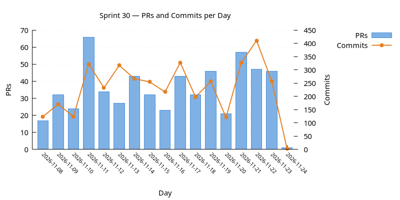

## Daily Line Churn

Lines added (green) and deleted (red) per day. Building work produces mostly additions; refactoring produces a mix.

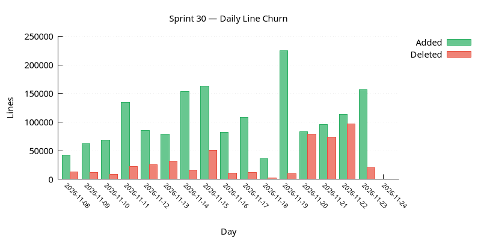

## PR Cycle Time

Hours from PR open to merge, one dot per PR for every PR merged in the sprint, on a log scale, with the median and the upper quartile as lines. High dots indicate review bottlenecks.

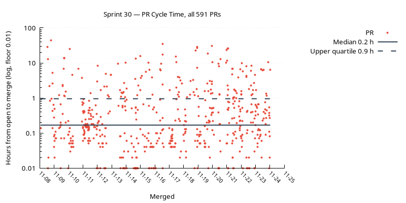

## Cumulative Stories Done

Line chart tracking stories marked DONE during the sprint. Steady upward slope is healthy; plateauing signals a stall.

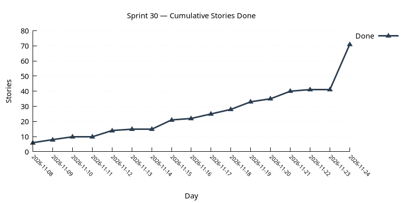

*The last step is the close itself: nineteen stories that were split and ten that had finished their tasks but were never closed all land on the same day. Read the shape of the first sixteen days, not the final jump.*

# ↩️ Carried forward

These stories closed with part of their work done. Each remaining scope lives on as a story in the product backlog whose title states it.

-   [Bring the assistant into ores.web on the target architecture](https://orestudio.github.io/OreStudio/doc/agile/versions/v0/sprint_30/bring_the_assistant_into_ores_web/story.html) → [Settle the assistant's inference server and its machine operations](https://orestudio.github.io/OreStudio/doc/agile/product_backlog/next/settle_the_assistants_inference_and_machine_operations/story.html)
-   [Configure the public sources in a setup dialog](https://orestudio.github.io/OreStudio/doc/agile/versions/v0/sprint_30/configure_the_public_sources_in_a_setup_dialog/story.html) → [Store each provider's keys as a tenant secret](https://orestudio.github.io/OreStudio/doc/agile/product_backlog/next/store_each_providers_keys_as_a_tenant_secret/story.html)
-   [Data model clean up](https://orestudio.github.io/OreStudio/doc/agile/versions/v0/sprint_30/data_model_clean_up/story.html) → [Close the document loophole in the data-oriented rules](https://orestudio.github.io/OreStudio/doc/agile/product_backlog/next/close_the_document_loophole_in_the_data_rules/story.html)
-   [Design the scripted trade subsystem](https://orestudio.github.io/OreStudio/doc/agile/versions/v0/sprint_30/design_the_scripted_trade_subsystem/story.html) → [Finish the scripted trade subsystem](https://orestudio.github.io/OreStudio/doc/agile/product_backlog/next/finish_the_scripted_trade_subsystem/story.html)
-   [Every index a generated trade floats on has a curve and fixings](https://orestudio.github.io/OreStudio/doc/agile/versions/v0/sprint_30/every_floating_index_has_a_curve_and_fixings/story.html) → [Derive term indices from their overnight curves](https://orestudio.github.io/OreStudio/doc/agile/product_backlog/next/derive_term_indices_from_their_overnight_curves/story.html)
-   [Handle the backlog when the compute path stalls](https://orestudio.github.io/OreStudio/doc/agile/versions/v0/sprint_30/handle_the_backlog_when_the_compute_path_stalls/story.html) → [Bound the delivery counts when the compute path stalls](https://orestudio.github.io/OreStudio/doc/agile/product_backlog/next/bound_the_delivery_counts_when_the_compute_path_stalls/story.html)
-   [Keep main green](https://orestudio.github.io/OreStudio/doc/agile/versions/v0/sprint_30/keep_main_green/story.html) → [Promote dev to main only from a green run](https://orestudio.github.io/OreStudio/doc/agile/product_backlog/next/promote_dev_to_main_from_a_green_run/story.html)
-   [Keep workflow steps alive while they work, and off iam](https://orestudio.github.io/OreStudio/doc/agile/versions/v0/sprint_30/keep_workflow_steps_alive_and_off_iam/story.html) → [Run each workflow step in the service that owns its work](https://orestudio.github.io/OreStudio/doc/agile/product_backlog/next/run_each_step_in_the_service_that_owns_its_work/story.html)
-   [Make the build faster](https://orestudio.github.io/OreStudio/doc/agile/versions/v0/sprint_30/make_the_build_faster/story.html) → [Cut the build time](https://orestudio.github.io/OreStudio/doc/agile/product_backlog/next/cut_the_build_time/story.html)
-   [Model the synthetic feeds as a dependency graph: upstreams, latent surfaces and vendor views](https://orestudio.github.io/OreStudio/doc/agile/versions/v0/sprint_30/model_the_synthetic_feed_dependency_graph/story.html) → [Give every synthetic feed node a state and its own diagnostics](https://orestudio.github.io/OreStudio/doc/agile/product_backlog/next/give_every_synthetic_feed_node_a_state/story.html)
-   [Move codegen and the gates to compass-ng](https://orestudio.github.io/OreStudio/doc/agile/versions/v0/sprint_30/move_codegen_and_gates_to_compass_ng/story.html) → [Install compass-ng for external developers and gate CI with it](https://orestudio.github.io/OreStudio/doc/agile/product_backlog/next/install_compass_ng_for_external_developers/story.html)
-   [Put a content security policy on the site](https://orestudio.github.io/OreStudio/doc/agile/versions/v0/sprint_30/put_a_content_security_policy_on_the_site/story.html) → [State a content security policy on every answer the BFF serves](https://orestudio.github.io/OreStudio/doc/agile/product_backlog/next/state_a_content_security_policy_on_every_answer/story.html)
-   [Run a report on the generated trades with the market data they need](https://orestudio.github.io/OreStudio/doc/agile/versions/v0/sprint_30/run_a_report_with_market_data/story.html) → [Value the generated trades against ORE's own NPVs](https://orestudio.github.io/OreStudio/doc/agile/product_backlog/next/value_the_generated_trades_against_ore/story.html)
-   [Run the tests through the pooler](https://orestudio.github.io/OreStudio/doc/agile/versions/v0/sprint_30/run_the_tests_through_the_pooler/story.html) → [Give the tests a running pooler and a clean parse](https://orestudio.github.io/OreStudio/doc/agile/product_backlog/next/give_the_tests_a_running_pooler/story.html)
-   [Serve what the BFF serves, then retire it — the remaining work](https://orestudio.github.io/OreStudio/doc/agile/versions/v0/sprint_30/serve_one_screen_from_the_new_server-remaining/story.html) → [Close the route parity between ores.http and the BFF](https://orestudio.github.io/OreStudio/doc/agile/product_backlog/next/close_the_route_parity_between_http_and_the_bff/story.html)
-   [Serve ORE's API to LLM agents over MCP](https://orestudio.github.io/OreStudio/doc/agile/versions/v0/sprint_30/serve_mcp_from_ores_http/story.html) → [Sign an MCP client in through OAuth](https://orestudio.github.io/OreStudio/doc/agile/product_backlog/next/sign_an_mcp_client_in_through_oauth/story.html)
-   [Size a volatility surface to the data its party holds](https://orestudio.github.io/OreStudio/doc/agile/versions/v0/sprint_30/size_a_surface_to_its_data/story.html) → [Give each party the configuration its surfaces are built with](https://orestudio.github.io/OreStudio/doc/agile/product_backlog/next/give_each_party_its_surface_configuration/story.html)
-   [Support volatility surfaces — the remaining work](https://orestudio.github.io/OreStudio/doc/agile/versions/v0/sprint_30/support_volatility_surfaces-remaining/story.html) → [Calibrate and publish the surfaces on a schedule](https://orestudio.github.io/OreStudio/doc/agile/product_backlog/next/calibrate_and_publish_the_surfaces_on_a_schedule/story.html)
-   [Build each party's volatility surfaces from vendor quotes of a latent surface](https://orestudio.github.io/OreStudio/doc/agile/versions/v0/sprint_30/vendor_quotes_of_a_latent_surface/story.html) → [Prove a party's surfaces agree with the latent market and its forwards](https://orestudio.github.io/OreStudio/doc/agile/product_backlog/next/prove_a_partys_surfaces_agree_with_the_latent_market/story.html)

# 📊 Time Summary

-   **Total effort**: not tracked
-   **PRs merged**: 579 (since v0.0.29, 2026-11-08 to 2026-11-24)
-   **Sprint duration**: 2026-11-08 → 2026-11-24

---

*Next sprint: finish installing compass-ng for external developers and gate CI with it; close the route parity between ores.http and the BFF; value the generated trades against ORE's own NPVs; and calibrate and publish the volatility surfaces on a schedule. The product backlog carries a hundred stories out of this sprint, and the change that would reshape the next one is a work-in-progress limit the tool enforces rather than a sentence in a mission.*
