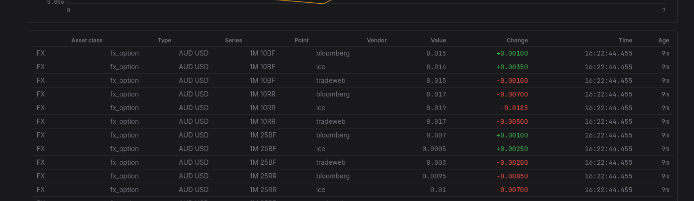

:PROPERTIES:
:ID: 109B7D07-EA58-42D4-A304-666B37EEAC6C
:END:
#+title: Test Scenario: Watch the vendors' quotes as a party and as the system tenant
#+description: A person opens Market data, Quotes, as an Acme party and as the system tenant, and checks the sources, the live quotes, the layouts, the filters and the all quotes panel against the signed-off prototype.
#+type: test_scenario
#+level: s1
#+filetags: :see_the_market_as_vendor_quotes:sprint_30:v0:
#+target_dialog:
#+created: 2026-11-19
#+updated: 2026-11-19
#+environment: bright_faraday
#+todo: PENDING | PASSED FAILED
#+startup: inlineimages

This page documents a test scenario verifying [[id:7421F842-BD73-42CA-8EF7-D47DBA72C79B][Build the quotes view]] in [[id:726A5326-E52C-44FB-9453-133D1E51C242][See the market as the vendors quote it]]. It is filled in with the target screen and checklist of steps before testing starts; record the outcome by hand in =* Results=.

* Before you start

Done by the scenario's author before the tester opens it:

- The fleet runs this branch's build (=feature/build-the-quotes-view=), with the
  BFF (=ores.web.service=), =ores.http=, the market data service and the synthetic
  service active: =compass services status=.
- Acme Corporation is provisioned (=acme_demo=), and the ticks smoke check passes:
  =compass smoke ticks --start-services --skip-provision=.
- The quotes board fills from the moment the BFF starts; wait a minute after a
  restart so every feed has ticked.

* Scenario Info

| Field         | Value                                   |
|---------------+------------------------------------------|
| Verifies task | [[id:7421F842-BD73-42CA-8EF7-D47DBA72C79B][Build the quotes view]] |
| Parent story  | [[id:726A5326-E52C-44FB-9453-133D1E51C242][See the market as the vendors quote it]]   |
| Target screen | Market data, then Quotes (=/market-data/quotes=), on the BFF at =http://localhost:20602= |
| Clients       |                                          |
| State         | PASSED |

* Steps

** Log in as the Acme tenant administrator

- Open =http://localhost:20602= and sign in as =tenant_admin@acme_corporation=,
  with the password in =ORES_SHELL_LOGIN_PASSWORD= of the worktree's =.env=.
- Choose the party *Acme Corporation Plc*.
- Passes when the home page shows Acme Corporation in the header.

*** Result

| Field  | Value |
|--------+-------|
| Status | PASS |

** Open the quotes view

- Open *Market data*, then the *Quotes* card (or =/market-data/quotes=).
- Passes when the page is titled *Quotes*, the tag beside *Pause* reads *live*, and
  the *Sources* rail lists *All vendors* first, then the party's vendors:
  bloomberg, derived, ice and tradeweb, each with a dot and the age of its last
  tick. lseg, demo and composite are not listed: Acme Corporation Plc does not
  route to them.

*** Result

| Field  | Value |
|--------+-------|
| Status | PASS |
| Notes  | we should default page size to 15. also columns are not lined up. ;  |

** Watch the quotes tick in place

- With *All vendors* chosen and *Every datum* as the layout, watch the table for
  ten seconds.
- Passes when rows show the asset class name (FX, Interest Rate), the instrument
  type (fx_spot, ir_swap, fx_option), the series, the point, the vendor, the
  value, the change, the time and the age; values change in place, a changed
  value flashes, and the change is green when up and red when down.
- Passes when fx_option rows (vol quotes) are among them, from at least one of
  bloomberg, ice or tradeweb.

*** Result

| Field  | Value |
|--------+-------|
| Status | PASS |

** Page through the quotes

- With *All vendors* and *Every datum*, look below the table.
- Passes when the table shows at most one page of rows (50 at first) and the pager
  reads =1–50 of N=, where N is every quote that matches.
- Click *Next*: the pager reads =51–100 of N= and the rows change. Choose a page
  size of 100: the table shows up to 100 rows and returns to the first page.
- Choose a source, a filter or a layout: the table returns to its first page.

*** Result

| Field  | Value |
|--------+-------|
| Status | PASS |

** Choose one source on the rail

- Click *bloomberg* on the rail.
- Passes when the vendor column goes, every row is a Bloomberg quote, and the
  rail marks bloomberg as chosen.
- Click *All vendors* again; the vendor column comes back.

*** Result

| Field  | Value |
|--------+-------|
| Status | PASS |

** Narrow by asset class and type

- Set *Asset class* to *FX*: only FX rows remain.
- Set *Instrument type* to *fx_option*: only vol quotes remain.
- Type =EUR= in *Find*: only series containing EUR remain.
- Passes when the asset class list holds the names of the asset class codes table
  (FX, Interest Rate, Credit, Equity, Commodity, Inflation, Bond, Scripted), in
  that order, and each filter narrows the rows as stated. Clear the filters
  afterwards.

*** Result

| Field  | Value |
|--------+-------|
| Status | PASS |

** Switch to the by series layout

- Click *By series* under *Layout*.
- Passes when a series with several points (an IR curve such as USD 0D 3M, or an
  FX vol surface) is one row showing its point count, its newest point and value,
  and the pager counts series rather than quotes;
  clicking it opens its points beneath it, and clicking again closes them. A
  series of one point, such as an FX spot, stays a single row.
- Click *Every datum* to go back.

*** Result

| Field  | Value |
|--------+-------|
| Status | PASS |
| Notes  | ok the series UX does not make a lot of sense. we should click on a button and then go "inside" the series. also series and paging does not work well. when I select 15 for the page size, I no longer understand which series I am in. |

** Compare the vendors on one datum

- With *All vendors* chosen, click an FX spot row quoted by more than one vendor
  (for example a USD cross quoted by bloomberg and demo).
- Passes when the *All quotes* panel opens above the table, under the filters,
  titled with the series and point; it lists each vendor that quotes the datum with its value, its
  distance to the mid, its change and its age, then *Mid of N* and the spread; and
  the chart below draws one line per vendor for the last hour, coloured as the
  marks beside the vendors.

*** Result

| Field  | Value |
|--------+-------|
| Status | PASS |

** Pause and resume the view

- Click *Pause*.
- Passes when the tag reads *paused*, the values stop changing, and the ages keep
  growing.
- Click *Resume*; the tag reads *live* and the values move again.

*** Result

| Field  | Value |
|--------+-------|
| Status | PASS |

** Log in as the super administrator

- Sign out, then sign in as the super administrator account set up at bootstrap
  (the system tenant).
- Open *Market data*, then *Quotes*.
- Passes when the rail lists every feed of the catalogue: bloomberg, demo, derived,
  ice, lseg, tradeweb and composite. Feeds that have ticked show an age; a feed
  that has not ticked since the BFF started shows a dash and an amber dot.
- Passes when, with *All vendors*, rows from lseg and demo appear beside the
  others, and the *All quotes* panel of an FX spot row lists every vendor that
  quotes it, lseg and demo included.

*** Result

| Field  | Value |
|--------+-------|
| Status | PASS |

** Check a party with no display right

- Sign in as the Acme tenant administrator again and choose the party *ACME
  Corporation HK Ltd*.
- Passes when the rail shows only the vendors that party routes to (bloomberg in
  the demonstration); if a party has no subscription with the display right, the
  page says so instead of showing a table.

*** Result

| Field  | Value |
|--------+-------|
| Status | PASS |

* Results

| Field         | Value |
|---------------+-------|
| Status        | PASSED |
| Completed at  | 2026-11-19T22:33:25Z |
| Branch        | feature/build-the-quotes-view |
| Commit        | 88d384a9b0 |
| Worktree      | bright_faraday |

* Notes
