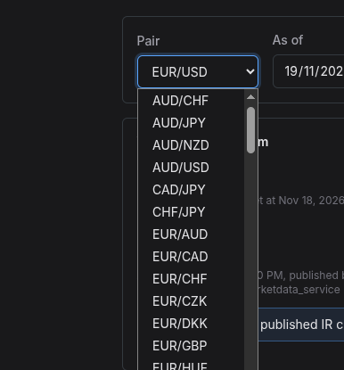

:PROPERTIES:
:ID: 535F4797-2CB5-459B-A0D5-7286537F3EB1
:END:
#+title: Test Scenario: Verify the FX forward ladder screen
#+description: Read a party's published FX forward set, for a USD pair and for a cross, with where each number came from, in all four measures, and see a missing set say why.
#+type: test_scenario
#+level: s1
#+filetags: :support_volatility_surfaces-remaining:sprint_30:v0:
#+target_dialog: Market data: FX forward ladder
#+created: 2026-11-09
#+updated: 2026-11-19
#+environment: bright_faraday
#+todo: PENDING | PASSED FAILED
#+startup: inlineimages

This page documents a test scenario verifying [[id:0CEB75D7-3227-4FDD-A95C-0AD426DB5D26][Build the FX forward ladder screen]] in [[id:95541791-E25C-44A5-9625-C8A1E44976D7][Support volatility surfaces — the remaining work]]. It is filled in with the target screen and checklist of steps before testing starts; record the outcome by hand in =* Results=.

* Before you start

These are readiness conditions. The environment is already in this state.

- The database is recreated, Acme is provisioned and the fleet is running.
  =compass services status= reports every service running and none failed.
- Provisioning published 39 FX forward sets for each Acme party at its as-of,
  2026-11-18 at about 23:21. Each set was raised by the market data service and
  closed by auto-approval, because the Acme tenant does not enforce approvals.
- ACME Corporation US Inc has no published set of USD/BRL.
- The figures below are this environment's. On another environment the values
  differ; check the relations each step states instead.

* Scenario Info

| Field         | Value |
|---------------+-------|
| Verifies task | [[id:0CEB75D7-3227-4FDD-A95C-0AD426DB5D26][Build the FX forward ladder screen]] |
| Parent story  | [[id:95541791-E25C-44A5-9625-C8A1E44976D7][Support volatility surfaces — the remaining work]] |
| Target screen | Market data: FX forward ladder |
| Clients       |       |
| State         | PENDING |

* Steps

** Log in as the trader

- Open the app at =http://localhost:20602=.
- Sign in as =henry.jones@acme_corporation= with =Secure-Password-123=.
- If the app asks for a party, choose ACME Corporation US Inc.
- Passes when the home page shows Acme Corporation in the header.

*** Result

| Field  | Value |
|--------+-------|
| Status | PENDING |

** Open the FX forward ladder

- Go to *Market data* and open the *FX forward ladder* card.
- Confirm the address ends =/market-data/fx-forwards=.
- Confirm *Pair* lists every pair with a convention, crosses included: USD pairs
  such as USD/JPY, crosses such as EUR/GBP and AUD/CHF, and the metals such as
  XAU/USD. Each pair is listed once, in order.
- Confirm *Pair* defaults to EUR/USD and *As of* defaults to today.

*** Result

| Field  | Value |
|--------+-------|
| Status | PENDING |

** Read what the set is built from

- With EUR/USD, read *What this is built from*.
- Confirm *Spot* reads about 1.1625, and the line under it says the set reads
  the market at 18 November 2026, about 23:21.
- Confirm one spot leg, *EUR/USD spot*, observed at the same time, whose link
  opens the EUR/USD pair.
- Confirm *Spot date* reads 2026-11-20 with T+2, and *Convention* reads EUR/USD,
  version 1, pip 0.0001, calendars TARGET and UnitedStates.Settlement.
- Confirm the EUR funding curve is =EUR-ESTR= and the USD funding curve is
  =USD-SOFR-FOMC=, each as of 18 November and published by the market data
  service, and each a link to its record.
- Confirm *Method* names covered interest parity, and the notice says the rates
  hold no cross-currency basis.

*** Result

| Field  | Value |
|--------+-------|
| Status | PENDING |

** Read how the set was approved

- Read *How it was approved*.
- Confirm it says the set was closed by auto-approval under the tenant rule, and
  that no person decided it.
- Confirm *Request* reads Approved, *Raised by* and *Decided by* name the market
  data service, and the decision's comment says the tenant does not enforce
  approvals, as tenant_admin set in version 2 of the approvals mode.
- Confirm *Published by* names the market data service, at about 23:21 on
  18 November.

*** Result

| Field  | Value |
|--------+-------|
| Status | PENDING |

** Read the ladder rows

- Confirm 18 rows in this order: ON, TN, SP, SN, 1W, 2W, 1M, 2M, 3M, 6M, 9M, 1Y,
  18M, 2Y, 3Y, 5Y, 7Y, 10Y.
- Confirm the columns: tenor, near date, value date, forward rate, forward
  points, swap points, the EUR discount factor and the USD discount factor.
- Confirm SP has the spot rate, zero forward points and zero swap points.
- Confirm TN has zero forward points and the same swap points as ON, and ON has
  forward points of the opposite sign.
- Confirm every row from SN onwards has a near date of 2026-11-20, and its
  forward points equal its swap points.
- Confirm the forward rate rises with the tenor, as EUR rates are below USD
  rates, and each discount factor falls with the tenor.
- Confirm no value date falls on a Saturday or a Sunday. For example, 3M rolls
  to Monday 2027-02-22.

*** Result

| Field  | Value |
|--------+-------|
| Status | PENDING |

** Switch the chart between measures

- Under *Chart*, choose each of *Forward rate*, *Discount factors*, *Forward
  points* and *Swap points* in turn.
- Confirm the chart title follows the choice, and the chart draws the column of
  the same name in the ladder: one line for a rate or points, one line per
  currency for discount factors.

*** Result

| Field  | Value |
|--------+-------|
| Status | PENDING |

** Change where the ladder starts

- Under *Ladder starts from*, choose *Today*, then *Tomorrow*, then *Spot*.
- Confirm *Today* starts the rows at ON and *Tomorrow* starts them at TN, and the
  forward points then run from that start rather than from spot.
- Confirm *Spot* gives back the rows of the step before.

*** Result

| Field  | Value |
|--------+-------|
| Status | PENDING |

** Price a forward-forward

- In *Forward-forward*, choose a near tenor of 3M and a far tenor of 6M.
- Confirm *Near forward rate* and *Far forward rate* equal the 3M and 6M forward
  rates in the ladder.
- Confirm *3M x 6M swap points* equal the 6M forward points less the 3M forward
  points, and *Days* reads 87.
- Choose a far tenor of 1M. Confirm the panel says to choose a far tenor after
  the near tenor.

*** Result

| Field  | Value |
|--------+-------|
| Status | PENDING |

** Read a cross pair

- Choose EUR/GBP in *Pair*.
- Confirm two spot legs: *EUR/USD spot, base leg* and *GBP/USD spot, quote leg*,
  each with its value and observation time.
- Confirm *Spot* equals the base leg divided by the quote leg, at about 0.885.
- Confirm the funding curves are =EUR-ESTR= and =GBP-SONIA=, the calendars are
  TARGET and UnitedKingdom.Settlement, and the ladder's last two columns are the
  EUR and GBP discount factors.

*** Result

| Field  | Value |
|--------+-------|
| Status | PENDING |

** See a pair with no set

- Choose USD/BRL in *Pair*.
- Confirm the screen reads "Your party has no published forward set of USD/BRL
  at or before the as-of." and shows no ladder.

*** Result

| Field  | Value |
|--------+-------|
| Status | PENDING |

** Move the as-of before publication

- Choose EUR/USD again, and set *As of* to 2026-11-17.
- Confirm the screen reads "Your party has no published forward set of EUR/USD
  at or before the as-of."
- Set *As of* back to today. Confirm the ladder of the earlier steps returns.

*** Result

| Field  | Value |
|--------+-------|
| Status | PENDING |

* Results

| Field         | Value |
|---------------+-------|
| Status        | PENDING |
| Completed at  |  |
| Branch        |       |
| Commit        |       |
| Worktree      | bright_faraday |

* Notes

Rewritten on 2026-11-19 for the published ladder. The first version, of
2026-11-09, tested the ladder the screen computed itself, which answered USD
pairs only. Its run failed at *Open the FX forward ladder*, because the pair list
now offers crosses, as designed
().

The layout, rows, dates and refusals above were read from the screen on this
environment, signed in to ACME Corporation UK plc. The spot values of ACME
Corporation US Inc come from its published sets in the database. ACME Corporation UK plc
published a EUR/GBP set of about 0.704 at provisioning, from demo legs that
disagree with its own bloomberg EUR/USD and GBP/USD sets. A spot now reads the
party's highest-ranked source (see the story's Decisions), and a set UK plc
publishes today reads bloomberg for both. The provisioned set keeps the legs it
was approved with, which is why this scenario uses ACME Corporation US Inc.
