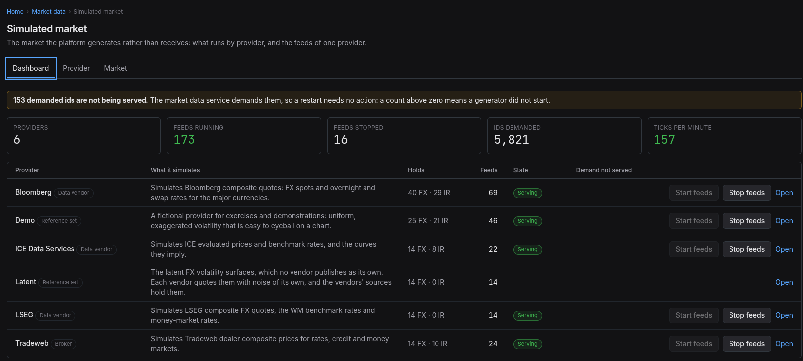

:PROPERTIES:
:ID: 41603F5F-7F14-4BDA-913E-227A98F002AD
:END:
#+title: Test Scenario: Check the derived term fixings
#+description: Walk the IR curve feed screen and the fixing series page to see a term index no publisher quotes take its rate from its currency's overnight curve.
#+type: test_scenario
#+level: s1
#+filetags: :derive_term_indices_from_their_overnight_curves:sprint_31:v0:
#+target_dialog: IR curve feeds; Fixing series
#+created: 2026-11-25
#+updated: 2026-11-25
#+environment: clever_dijkstra
#+todo: PENDING | PASSED FAILED
#+startup: inlineimages

This page documents a test scenario verifying [[id:1993E4E7-A59B-4473-8635-C9F6DF974EB5][Task: Derive a term index from its overnight curve]] in [[id:F2F266AE-8B43-41DD-89AF-7A22D52D1C74][Derive term indices from their overnight curves]]. It is filled in with the target screen and checklist of steps before testing starts; record the outcome by hand in =* Results=.

* Before you start

These are yours to ready, before the tester opens the client:

- The fleet is up: =compass services start=, and =compass services
  status= shows every unit active.
- The database carries the five derived configs. On a database built
  from this branch:

  #+begin_src sql
  select currency_code, index_family, tenor, rate_source,
         derived_spread_basis_points
  from ores_synthetic_ir_curve_generation_configs_tbl
  where rate_source <> 'process'
    and valid_to = ores_utility_infinity_timestamp_fn()
  order by currency_code;
  #+end_src

  Expect five rows: COP ibr 3M, JPY eytibor 3M, KRW generic 3M, PLN
  wibor 6M and USD sofr 1M, each with =auto_start = true=.
- The system administrator exists: =super_admin= with
  =Secure-Password-123=. The bootstrap creates it, and every screen these
  steps open is a system control, so no tenant needs provisioning first.
- The five derived feeds are running, and each states its own series: the
  synthetic service builds a derived node when its config starts, so the
  person readying the screen starts the collection once, as the system
  administrator:

  #+begin_src sh
  ./compass.sh shell -f start_derived.ores
  #+end_src

  where the script holds =connect $ORES_NATS_URL=, the login, and one
  =synthetic start feed= for each of the five source names below. The
  derived node does not state anything while the curve it reads is stopped,
  so the five overnight curves of USD, COP, JPY, KRW and PLN must be running
  too: =synthetic list feeds= shows each as =[running]=.
- =select count(*) from ores_marketdata_market_fixings_tbl f join
  ores_marketdata_market_series_tbl s on s.id = f.series_id where
  s.oresmd_uri like '%tenor=%' and s.oresmd_uri like 'oresmd://ir/%';=
  answers five series of 520 fixings each. If they are absent, read
  =ores.synthetic.service.0.log= for "The derived index ... is offered" and
  for "is starved".

* Scenario Info

| Field         | Value                                   |
|---------------+------------------------------------------|
| Verifies task | [[id:1993E4E7-A59B-4473-8635-C9F6DF974EB5][Task: Derive a term index from its overnight curve]] |
| Parent story  | [[id:F2F266AE-8B43-41DD-89AF-7A22D52D1C74][Derive term indices from their overnight curves]]   |
| Target screen | IR curve feeds (Feed calibration, interest rates); Fixing series (Market data) |
| Clients       |                                          |
| State         | PENDING |

* Steps

** Log in as the system administrator

- Open the web client at the address =compass services status= reports.
- Sign in as =super_admin= with =Secure-Password-123=.
- Confirm the shell offers *Market data* → *Feed calibration*: it is a
  system control, and a tenant administrator does not see it.

*** Result

| Field  | Value |
|--------+-------|
| Status | PASS |

** Read the rule on the curve feed

- Go to *Market data* → *Simulated market*, the collection whose provider
  is *Derived*.
- Open the feed =synthetic.derived.ir.yield_curve.sofr.usd.1m=: every feed
  is named by the scheme, =synthetic.<provider>.ir.yield_curve.<index>.<currency>.<tenor>=.
- The *Feed calibration* screen is not the one to use here: its interest
  rates list is the coverage of the curves that get published, and a row
  there opens Curve analytics.
- Read the *Rate from* field: it shows *The overnight rate compounded
  over the tenor*.
- Confirm *Spread over the overnight rate* is 0 and *Who states the
  spread* is empty.

*** Result

| Field  | Value |
|--------+-------|
| Status | FAIL |
| Notes  | we don't seem to have a derived provider.; ;  |

** Read a spread index's stated source

- Open the JPY/EYTIBOR 3M feed
  (=synthetic.derived.ir.yield_curve.eytibor.jpy.3m=), then the
  KRW/GENERIC 3M (=...generic.krw.3m=) and PLN/WIBOR 6M
  (=...wibor.pln.6m=) feeds in turn.
- Confirm each shows *The overnight rate plus the spread below*.
- Confirm each shows the spread it states — 10, 15 and 20 basis points —
  and a non-empty *Who states the spread*.

*** Result

| Field  | Value |
|--------+-------|
| Status | FAIL |
| Notes  | Same cause: the coverage list holds only the curves that get published, so a derived index with no bootstrap config is absent from it. |

** Open a derived fixing series

- Go to *Market data* → *Fixings* (=/market-data/fixings=).
- Enter the address of the one-month term SOFR series:
  =oresmd://ir/USD?type=fixing&index=ibor&name=SOFR&tenor=1M=.
- Confirm the page opens the series and lists its fixings, each with a
  date and a value.
- Repeat for =oresmd://ir/COP?type=fixing&index=ibor&name=IBR&tenor=3M=,
  =oresmd://ir/JPY?type=fixing&index=ibor&name=EYTIBOR&tenor=3M=,
  =oresmd://ir/KRW?type=fixing&index=ibor&name=GENERIC&tenor=3M= and
  =oresmd://ir/PLN?type=fixing&index=ibor&name=WIBOR&tenor=6M=.

*** Result

| Field  | Value |
|--------+-------|
| Status | PENDING |

** Compare the term fixing with its curve

- Note the latest one-month term SOFR fixing on that page.
- Go to *Market data* → *Published curves* and open the USD SOFR
  overnight curve, then read the one-month point of its forward.
- Confirm the fixing sits on that forward: the two agree to within the
  few basis points the curve's interpolation allows, and a spread
  index's fixing sits above its overnight curve by the spread its feed
  states.

*** Result

| Field  | Value |
|--------+-------|
| Status | PENDING |

** Stop the curve the derived index reads

- Go to *Market data* → *Simulated market* → the feed graph, and stop the
  node =synthetic.bloomberg.ir.yield_curve.sofr.usd=, the overnight curve
  the one-month term SOFR reads. In the shell it is =synthetic stop node
  synthetic.bloomberg.ir.yield_curve.sofr.usd --reason-code common.other=.
- Confirm the derived node =synthetic.derived.ir.yield_curve.sofr.usd.1m=
  reads *starved* on the graph: it is a view of that curve, and an input
  that does not run starves it.
- Confirm the fixing page for =...name=SOFR&tenor=1M= has gained no fixing,
  and that no value repeats the one already stated for the day. The service
  log says it once: "The node of 'synthetic.derived.ir.yield_curve.sofr.usd.1m'
  is starved: it states no fixing until its input runs again."
- Start the node again. Confirm the derived node reads *running*, and that
  the days it was starved for stay empty: nothing is backfilled.

*** Result

| Field  | Value |
|--------+-------|
| Status | PENDING |

* Results

| Step | Outcome | Notes |
|------+---------+-------|
|      |         |       |
| Status        | PENDING |
| Completed at  |  |

Attempt 1, 2026-11-25, failed at the second step before the product was
reached: the scenario named a tenant administrator for the calibration
screen,
which is a system control. The persona is now =super_admin= and the
navigation goes through *Market data*. Re-run from the first step.

Attempt 2, 2026-11-25, failed at the second step again: the Derived
provider was registered without a dataset of its own, so no screen listed
it, and the step named feeds by a source name the scheme does not write.
Both are fixed: =synthetic.feeds.derived= is a dataset of the system
bundle, and the feed names above are the scheme's. The five derived nodes
also need starting first, because nothing starts a config node on its own.
Re-run from the first step.
