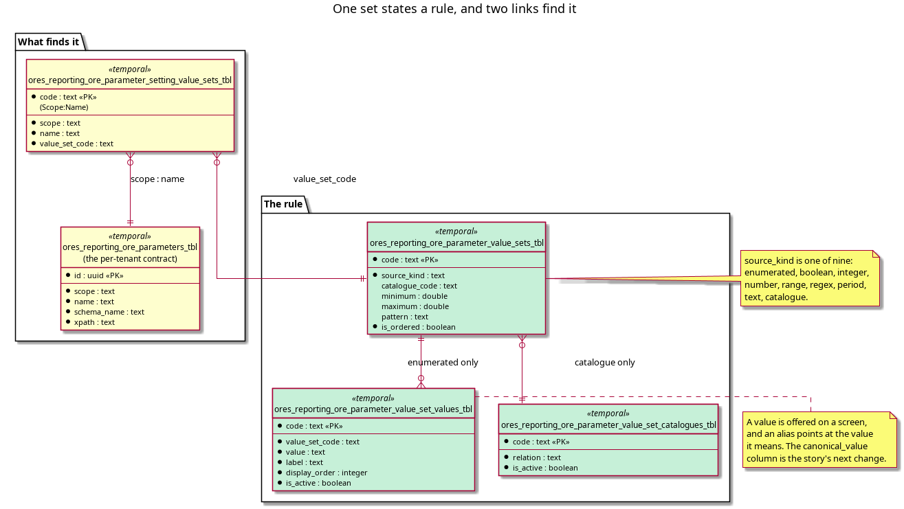

:PROPERTIES:
:ID: D5FFD498-A6E9-45AA-B80D-E16E3A432BD0
:END:
#+title: A value set is the only place an ORE parameter's rule is written
#+description: The five tables that state what a parameter accepts, the nine kinds of rule, the two links that find a set from a parameter or a leaf, and the seed that writes them from the ORE source.
#+type: knowledge
#+level: cross
#+filetags: :ore:xml:value-sets:architecture:
#+created: 2026-10-30
#+updated: 2026-10-31

* Summary

One table states what one ORE parameter accepts, once, and every other table
that needs the answer points at it. A set states a kind, and the kind decides
which of its other columns mean anything: an enumerated set states its values, a
catalogue set names a relation to read, a range states a floor and a ceiling, a
regex states a pattern. Nothing else in the tree repeats the rule: the part
tables carry no CHECK constraint on the columns a set governs, and no screen
validates.

* The five tables

| Table | States |
|-------+--------|
| =ores_reporting_ore_parameter_value_sets_tbl= | the rule: =source_kind=, plus =minimum=, =maximum=, =pattern=, =catalogue_code=, =is_ordered= |
| =ores_reporting_ore_parameter_value_set_values_tbl= | the values of an enumerated set: =value=, =label=, =display_order=, =is_active= |
| =ores_reporting_ore_parameter_value_set_catalogues_tbl= | the relation a catalogue set reads, such as =ores_refdata_currency_catalogue_v= |
| =ores_reporting_ore_parameter_setting_value_sets_tbl= | the link from =(scope, name)= to a set, which is how a parameter finds its rule |
| =ores_reporting_ore_parameter_vocabularies_tbl= | the link from an ORE element to a set, which nothing reads yet |

#+caption: Figure 1. The rule, its values and its catalogue, with the two tables that find it. The parameter link is the one the guards use.

* The nine kinds

=source_kind= holds one of nine values, and
=projects/ores.sql/create/reporting/reporting_ore_parameter_value_validate_fn_create.sql:64=
is the only code that reads it. Everything a rule can say is in this list.

The seed uses seven of the nine on 2026-10-31: 149 sets are =text=, 75 =number=,
52 =enumerated=, 47 =integer=, 10 =boolean=, 7 =catalogue= and 2 =regex=, with no
=range= and no =period= set yet. The large =text= count is not a gap. A =text=
set is the honest answer for a parameter whose values ORE passes through, such as
a file path or a date, and it is recorded as a decision rather than left absent.

| Kind | What it checks | Where it reads |
|------+----------------+----------------|
| =enumerated= | the value is an active row of the set's values | the values table |
| =boolean= | =true=, =false=, =Y= or =N=, in any case | nothing; the chart is in the function |
| =integer= | every comma-separated part matches =-?[0-9]+= and is in bounds | the set row |
| =number= | every part parses as a number and is in bounds | the set row |
| =range= | the value is a number within =minimum= and =maximum= | the set row |
| =regex= | the value matches =pattern= | the set row |
| =catalogue= | the value is an active row of the relation the set names | the catalogue relation |
| =period= | nothing: a period is a value ORE parses, not a list to choose from | nothing |
| =text= | nothing: the set states that the parameter is free text | nothing |

A numeric set checks every comma-separated part, because a grid such as
=128,128,128= is one value in the XML and several numbers in the rule. That is
why the list is checked rather than waved through.

* What a set looks like as data

The sets are seeded, not typed in. The curated input is
=projects/ores.seeder/datasets/ore_pricing_engines/curation/value-sets.json=
with =value-sets-code.json= for the codes, and
=projects/ores.sql/utility/generate_value_sets.py= writes the populate scripts;
=--check= fails the build when the committed SQL and the curation disagree. Each
row's description names the ORE source the rule was taken from, so a set can be
re-derived rather than guessed:

#+begin_src sql
('curve.duplicate_pillar_policy', ores_utility_system_tenant_id_fn(), 0,
 'Duplicate pillar policy',
 'The values the ORE parser parseDuplicatePillarPolicy accepts, from its map at '
 'OREData/ored/utilities/parsers.cpp:1612.',
 'enumerated', ..., 'Seed parameter value sets'),
#+end_src

* The values a set governs

Three kinds of place hold a value a set governs, and each is reached differently.

#+begin_src xml
<CurveConfiguration>
  <SwaptionVolatilities>
    <SwaptionVolatility>
      <CurveId>EUR_SWPTN</CurveId>
      <VolatilityType>Lognormal</VolatilityType>
    </SwaptionVolatility>
  </SwaptionVolatilities>
</CurveConfiguration>

<PricingEngines>
  <Product type="Swap">
    <EngineParameters>
      <Parameter name="EnforceMonotoneVariance">true</Parameter>
    </EngineParameters>
  </Product>
</PricingEngines>
#+end_src

- A curve or convention leaf, such as =VolatilityType=, becomes a column of a
  refdata table, and the set is found through the parameter contract, as
  [[id:8E71C928-6618-455F-AECA-102AACB07883][Three tables answer which ORE
  element a row is]] describes.
- A named parameter, such as =EnforceMonotoneVariance=, becomes a row of the
  pricing model's parameter table, and its set is found by =(scope, name)=.
- A run or engine setting becomes a column of an engine settings part table, and
  its set is found by =(Setup, name)=.

All three land on the same link table and the same set. That is the point of the
model: the rule is stated once whether the value arrives from a curve, a product
or a run.

* What is not settled

Two gaps are known, and both are changes rather than open questions.

- An alias is a value of its own today. =curve.business_day_convention= is a
  catalogue set, so the seven stored conventions are what it offers, and the
  twenty-seven spellings ORE accepts are converted by a C++ table before the
  value reaches a row. The representation story moves that table into the values:
  a =canonical_value= column, empty when a value is its own canonical form, so
  the set states what is accepted, what it means and what a screen offers in one
  row.
- A set code the tables do not hold admits every value
  (=…reporting_ore_parameter_value_validate_fn_create.sql:87=). A guard that
  cannot find a rule cannot refuse, so a dangling link is silent. The shell
  check's completeness gate (see the enforcement note) catches a parameter with
  no set; it does not catch a typo in a set code, which only a foreign key
  would.

* See also

- [[id:7DFE57DE-70C9-4EB6-AF94-DCEC65ADB494][The ORE XML infrastructure]] — the
  structure note that orders this cluster; this page is its fifth step, and the
  one a reader needs before the enforcement page makes sense.
- [[id:E693B10B-7C28-4F21-95EC-ED9579E23D1A][The database refuses a value that
  no value set states]] — *completes* this page by naming the one code path that
  reads =source_kind= and the four functions that call it.
- [[id:8E71C928-6618-455F-AECA-102AACB07883][Three tables answer which ORE
  element a row is]] — the lookup half: this page is what the lookup finds, and
  that page is what finds it.
- [[id:948DAC44-404D-4B70-A8FC-3E9D4C05F72D][A stored value is converted at
  the entity mapper, never in the codec]] — *contradicts* the reading of this
  page that would put the twenty-seven spellings in the set today: they live in
  the mapper, and this page states what the change would move.
- [[id:17032DC3-55F4-42FD-B3C1-C33D8DCED488][Consolidate the ORE element
  maps]] — the task that gives the leaf link one home before the alias work
  adds rows to the sets.
