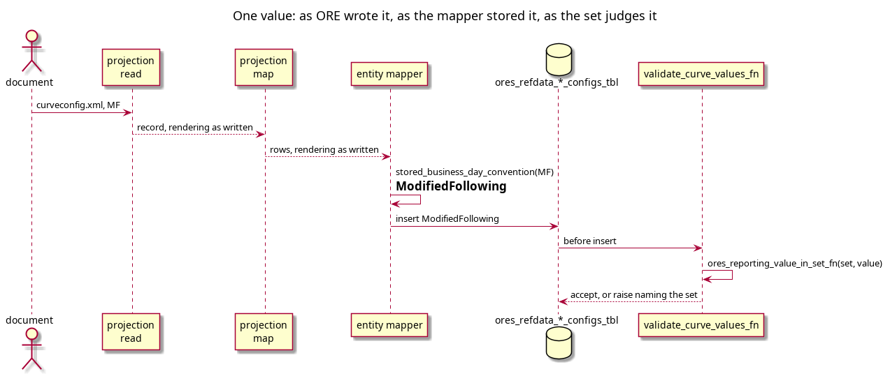

:PROPERTIES:
:ID: 948DAC44-404D-4B70-A8FC-3E9D4C05F72D
:END:
#+title: A stored value is converted at the entity mapper, never in the codec
#+description: Why an ORE value that has more than one rendering is converted to the stored form by the entity mapper and not by the projection, with the call chain, the files and the two tests that hold the line.
#+type: knowledge
#+level: cross
#+filetags: :ore:xml:import:mapping:codec:
#+created: 2026-10-30
#+updated: 2026-10-31

* Summary

A value that ORE states in more than one rendering, =F= and =Following= for a
business day convention, reaches the table in one form because the *entity
mapper* converts it, and it reaches the XML back in one form because the codec
does not convert anything at all. The codec and the conversion are deliberately
separate, and a change that moves the conversion into
=curve_configuration_projection::read= breaks the corpus test by design.

* The call chain

#+begin_src text
curveconfig.xml  <BusinessDayConvention>F</BusinessDayConvention>
  curve_configuration_projection::read(xml)        XML -> typed record, "F" kept
  curve_configuration_projection::map(record)      record -> rows, "F" kept
  curve_configuration_document_service::save(rows) writes through a repository
  <family>_mapper::map(const domain::X&)           "F" -> "Following"
  repository insert                                "Following"
#+end_src

The code, in order:

- =projects/ores.ore/core/src/domain/curve_configuration_projection.cpp:3213=:
  =read= binds the document with =xml::binder::bind=. It compares no field and
  converts nothing.
- =…/curve_configuration_projection.cpp:2825=: =map= builds the refdata rows. It
  carries the rendering as the document stated it.
- =projects/ores.refdata/core/src/service/curve_configuration_document_service.cpp=:
  =save= calls =write_amendment(ctx_, <repo>, rows, reason, commentary)= per
  family.
- =projects/ores.refdata/core/src/repository/base_correlation_config_mapper.cpp:93=
  and the ten siblings: the domain-to-entity =map= is the last code before the
  SQL. It calls
  =projects/ores.refdata/core/include/ores.refdata.core/repository/business_day_convention_code.hpp=,
  whose =stored_business_day_convention= holds the twenty-seven-to-seven table.
  An unknown rendering is returned unchanged, so the value set refuses it and
  names the set.
- =projects/ores.sql/create/refdata/refdata_curve_configuration_columns_validate_create.sql=:
  =ores_refdata_validate_curve_values_fn= runs as a before-insert trigger and asks
  =ores_reporting_value_in_set_fn=
  (=…/reporting/reporting_ore_parameter_value_validate_fn_create.sql=) whether the
  stored value is one the set states.

#+caption: Figure 1. One value's journey. The conversion is a step in the mapper, and the database checks the result against the set.

* Why the conversion is not in the codec

Two tests hold the line, and both assert *where* the conversion sits:

- =projects/ores.ore/core/tests/xml_curve_configuration_projection_roundtrip_tests.cpp:72=
  reads the corpus documents through =read=, =map=, =reverse= and =write=, then
  compares each one to its own text. It passes only because =read= and =write=
  move no value. Put the conversion in =read= and the comparison fails with
  ='MF' became 'ModifiedFollowing'=, which is what happened when it was tried.
- =projects/ores.refdata/core/tests/curve_configuration_database_roundtrip_tests.cpp:262=
  writes a document to the database and compares what comes back to *the rows the
  store received*, =as_stored(mapped)=, not to the file, because the rendering is
  the one thing the store does not keep.

* The consequence for a change

A new ORE rendering becomes a row in the mapper helper today, and it will become
a row in the value set when the representation story lands. Either way it is one
row in one place, and it is not the codec. A change to the document's shape
touches the projection and the two round-trip tests. A rule about which values
are legal touches the value set only. Keeping the three apart is what makes each
change small.

* See also

- [[id:7DFE57DE-70C9-4EB6-AF94-DCEC65ADB494][The ORE XML infrastructure]] — the
  structure note that orders this cluster; this page *completes* it by naming the
  one boundary at which a rendering changes.
- [[id:FB734007-5AB3-41D0-8F94-4A37584FE049][The export writes the stored form,
  so a round trip is not byte-identical]] — *answers* the question this page
  leaves open, which is what the export emits once the rendering is gone.
- [[id:D5FFD498-A6E9-45AA-B80D-E16E3A432BD0][A value set is the only place an
  ORE parameter's rule is written]] — *exemplifies* the same split one level up:
  the set states the rule, a trigger enforces it, and neither is in the
  projection.
- [[id:9697F09E-441A-4B51-869E-FC59433EEA1E][One component reads every ORE
  document, and none of them stores XML]] — *contradicts* any reading of this
  page that puts document knowledge in the mapper: the projection owns the shape,
  the mapper owns only the rendering.
