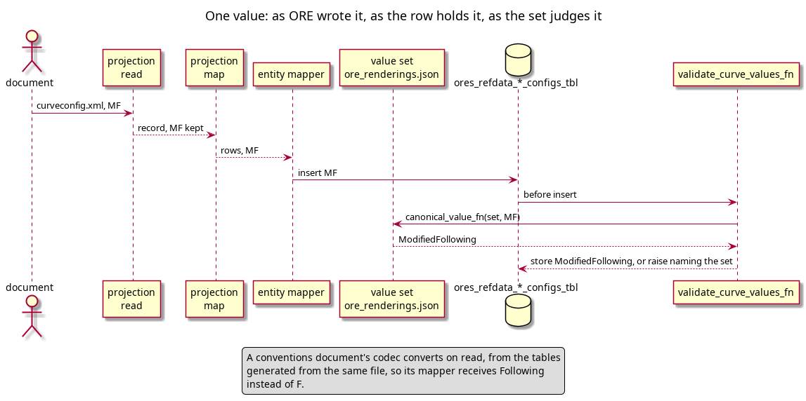

:PROPERTIES:
:ID: 948DAC44-404D-4B70-A8FC-3E9D4C05F72D
:END:
#+title: A stored value reaches the row in the form the value set names
#+description: The path one ORE value takes from a document into a row: which boundary converts it for each document family, which file states the mapping, and the tests that hold the line.
#+type: knowledge
#+level: cross
#+filetags: :ore:xml:import:mapping:codec:
#+created: 2026-10-30
#+updated: 2026-11-03

* Summary

A value that ORE states in more than one rendering, =F= and =Following= for a
business day convention, reaches the table in one form because two boundaries
convert it, and neither is the entity mapper. The codec converts a convention
document on read, from the tables generated from the mapping file. The database
guard converts every write the codec did not convert: every curve document, and
every writer that maps no document at all.

The two boundaries are not duplication. The codec knows only the families it
reads, and the guard is the one boundary every writer passes.

* The call chain

A conventions document, where the codec knows the family:

#+begin_src text
conventions.xml  <FixedConvention>F</FixedConvention>
  conventions_family_swap.cpp::map_swap        F -> Following, from the tables
  swap_convention_mapper::map(domain)          rows, Following as it stands
  repository insert                            Following
  ores_refdata_validate_convention_terms_fn    the set agrees, or refuses
#+end_src

A curve configuration document, where it does not:

#+begin_src text
curveconfig.xml  <BusinessDayConvention>MF</BusinessDayConvention>
  curve_configuration_projection::read         MF kept
  curve_configuration_projection::map          rows, MF
  base_correlation_config_mapper::map(domain)  MF as it stands
  repository insert                            MF
  ores_refdata_validate_curve_values_fn        MF -> ModifiedFollowing
#+end_src

The code, in order:

- =projects/ores.sql/utility/ore_renderings.json= states the mapping: for each
  table, the form a configuration holds and every rendering that means it.
- =projects/ores.ore/core/src/domain/conventions_renderings.hpp= holds the C++
  tables, generated from that file by
  =projects/ores.ore/scripts/generate_renderings_tables.py=. The check fails when
  the committed header differs from the file, and when a hand-written table
  appears beside it.
- =…/conventions_fields.cpp:207=: =code_of= looks a rendering up in a table and
  raises =Unknown business day convention enum value= when it finds none.
- =…/conventions_family_swap.cpp:37=: =bdc_of= reads a member through the table.
  Fifty-four more call sites in nineteen domain units do the same.
- =…/curve_configuration_projection.cpp:1555=: =required_spelling= keeps the
  spelling the document wrote. The projection states no rule, so the row carries
  =MF= until the database sees it.
- =…/refdata_curve_configuration_columns_validate_create.sql:71= and
  =…/refdata_convention_terms_validate_create.sql:77=: both guards ask
  =ores_reporting_value_in_set_fn= whether the value is one the set states, then
  =ores_reporting_canonical_value_fn= for the form it holds. A value outside the
  set is refused with the set's name; a rendering is stored as its form.
- =projects/ores.refdata/core/src/repository/*_mapper.cpp=: the entity mapper
  assigns the value it was handed. It converts nothing and includes no header for
  converting, which is what #4431 removed.

#+caption: Figure 1. One value's journey for a curve document: the codec keeps the rendering, and the guard stores the form the set names.

* Why the codec converts where it can

The form a configuration holds is one of the renderings, and the mapping file is
the only statement of which. A codec that reads a document without converting
leaves the mapping to one boundary, the database, and that works. A codec that
converts reads the same file the value sets read, so the codec and the guard
cannot disagree about a value: they read one statement.

What the codec may not do is hold a table of its own. That is what made the
refdata normaliser a second authority, and the generated header is how the copy
stays a copy.

* Why the guard is still needed

A convention document states the value a row carries, but not every writer maps a
document. The publisher that imports a tenant's configurations, the seeder, and
the curve projection all reach a table with a spelling no codec converted. A rule
only the codec enforced would hold for one caller and leak for the rest, so the
trigger is the boundary that makes the rule true of the table rather than of a
path to it.

* The tests that hold it

- =projects/ores.ore/core/tests/xml_curve_configuration_projection_roundtrip_tests.cpp:72=
  reads, maps, reverses and writes every curve configuration in the corpus, then
  reads the result again and compares the two *records*. Both sides pass through
  =read=, so the case proves the path is a fixed point of the mapping, not that
  the exported bytes equal the imported ones.
- =projects/ores.refdata/core/tests/curve_configuration_database_roundtrip_tests.cpp:259=
  writes a document through the store and states the round trip on what the store
  returns: the document it holds exports and reads back unchanged. This is the
  only case that can be right about a value the guard rewrote.
- =…/test/reporting_ore_parameter_canonical_form_test.sql= asserts what the sets
  state, and =ores_reporting_canonical_value_violations_fn()= names any live row
  that holds a rendering instead of its form. Zero today.

* See also

- [[id:7DFE57DE-70C9-4EB6-AF94-DCEC65ADB494][The ORE XML infrastructure]] — the
  structure note that orders this cluster; this page *completes* it by naming the
  two boundaries at which a rendering changes.
- [[id:FB734007-5AB3-41D0-8F94-4A37584FE049][The export writes the stored form,
  so a round trip is not byte-identical]] — *answers* the question this page
  leaves open, which is what the export emits once the rendering is gone.
- [[id:D5FFD498-A6E9-45AA-B80D-E16E3A432BD0][A value set is the only place an
  ORE parameter's rule is written]] — *exemplifies* the same split one level up:
  the set states the rule, a trigger enforces it, and neither is in the
  projection.
- [[id:9697F09E-441A-4B51-869E-FC59433EEA1E][One component reads every ORE
  document, and none of them stores XML]] — *contradicts* any reading of this
  page that puts document knowledge in the mapper: the projection owns the shape,
  the codec owns the rendering.
