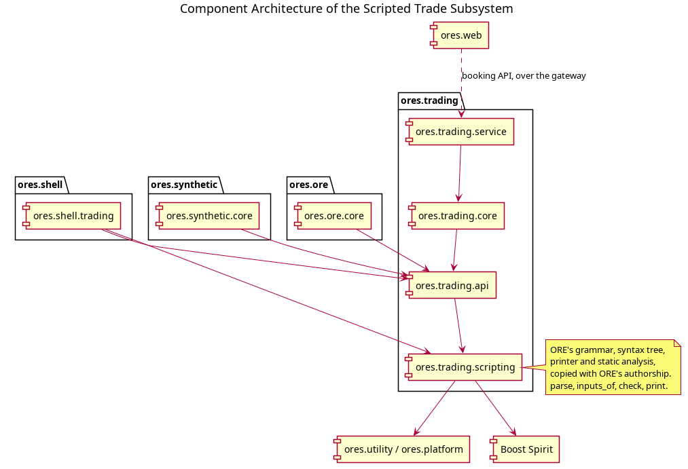

:PROPERTIES:
:ID: 4E135FB5-6E0A-45CC-A805-F5B70F29DDB4
:END:
#+title: Component Architecture of the Scripted Trade Subsystem
#+description: The components of the scripted trade subsystem, the responsibility and interface of each, and the acyclic dependency graph that relates them.
#+type: knowledge
#+level: cross
#+filetags: :scripting:trading:architecture:
#+created: 2026-11-21
#+updated: 2026-11-21

* Summary

The scripted trade subsystem resides in =ores.trading=, with ORE's parser in a
sub-component of its own, =ores.trading.scripting=. The parser depends on nothing
within ORE Studio other than its utility libraries, and every component that
reads scripts depends upon it, so that the dependency graph is directed and
acyclic. The invariant that preserves this property is that a component depends
only on components beneath it in the diagram, and that the parser has no
knowledge of any trading type.

* Detail

** Components

| Component | Responsibility | Interface | Dependencies |
|-----------+----------------+-----------+--------------|
| =ores.trading.scripting= | ORE's script grammar, syntax tree, printer and static analysis, reproduced ([[id:8FD7BD95-AAEC-4CF9-A9F4-D609A9DEFBD8][Script Parsing with ORE's Grammar]]) | =parse=, =inputs_of=, =check=, =print=; the diagnostic type | =ores.utility=, =ores.platform=, Boost Spirit |
| =ores.trading.api= | the domain types (script, variant, input, scripted instrument), the product schema, the builders including the scripted builder, the twin recipe evaluator and the booking protocol, including diagnostics as data | the =describe_product=, =validate_script=, =book= and =book_scripted= messages; the builders | =ores.trading.scripting= |
| =ores.trading.core= | the repositories, the script library (whose publication parses scripts and derives their inputs) and the booking service | the services implementing the protocol | =ores.trading.api= |
| =ores.trading.service= | the NATS handlers | the service | =ores.trading.core= |
| =ores.ore.core= | the projection of =ScriptedTradeData= and of the script library to and from ORE's XML ([[id:9697F09E-441A-4B51-869E-FC59433EEA1E][One component reads every ORE document, and none of them stores XML]]) | the projections | =ores.trading.api= |
| =ores.synthetic.core= | synthetic generation, drawing terms against schemas | the generation plan | =ores.trading.api= |
| =ores.shell.trading= | the script and product commands ([[id:B01292A4-0394-40E8-A0B4-2DBA3F46C052][Scripted Trade Commands in the Shell]]) | the commands | =ores.trading.scripting=, =ores.trading.api= |

=ores.web= consumes the API through the gateway and executes the editor's
grammar in the browser ([[id:8CF94EFE-4699-4F7D-B59B-E695AFD723CA][Differential Testing of the Script Editor Grammar]]); it links no C++ component.

** The position of the parser

The parser is required by the shell in the absence of a server, by the store at
the publication of a script, and by the booking API at the validation of a
trade. Its position beneath =ores.trading.api= allows each consumer to link it
independently of the others. It carries no database or message bus dependency,
in the manner of =quant= in =ores.analytics= ([[id:F27E5DF7-6223-4B6F-80A5-CEFBEB1BC756][Component architecture]]). Were it to
depend on trading's domain types, the API could not depend upon it without
creating a cycle; it therefore returns types of its own, which
=ores.trading.api= maps onto rows. The sub-component catalogue of [[id:F27E5DF7-6223-4B6F-80A5-CEFBEB1BC756][Component architecture]] lists
=scripting= among the specialist roles of =ores.trading=.
