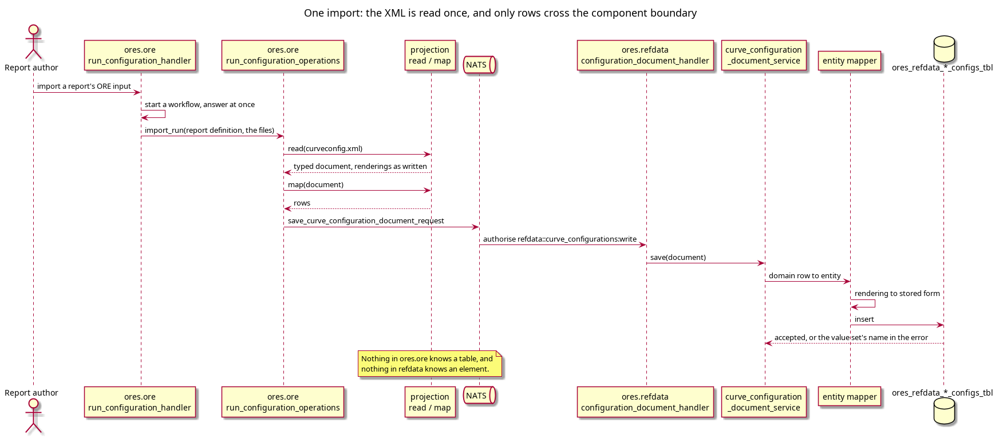

:PROPERTIES:
:ID: 9697F09E-441A-4B51-869E-FC59433EEA1E
:END:
#+title: One component reads every ORE document, and none of them stores XML
#+description: The five ORE documents a run names, the component that parses each one, the components that own the rows, and the dependency direction that keeps the shape compiled into one place.
#+type: knowledge
#+level: cross
#+filetags: :ore:xml:projection:architecture:
#+created: 2026-10-30
#+updated: 2026-10-31

* Summary

Every ORE document a run names is parsed and written by =ores.ore=. The
components that store the documents receive typed rows over the message bus and
never see XML. The boundary is not a convention: =ores.ore.core= links the three
message contracts it needs, and none of the owning components links =ores.ore=,
so a call from a store into the codec does not compile.

* The five documents

An ORE input directory holds one run document and the configuration files its
=Setup= names. All five are the codec's to read.

#+begin_src xml
<ORE>
  <Setup>
    <Parameter name="asofDate">2016-02-05</Parameter>
    <Parameter name="conventionsFile">conventions.xml</Parameter>
    <Parameter name="curveConfigFile">curveconfig.xml</Parameter>
    <Parameter name="marketConfigFile">todaysmarket.xml</Parameter>
    <Parameter name="pricingEnginesFile">pricingengine.xml</Parameter>
  </Setup>
  <Markets>
    <Parameter name="lgmcalibration">libor</Parameter>
  </Markets>
</ORE>
#+end_src

| Document | ORE root element | Read by | Rows owned by |
|----------+------------------+---------+---------------|
| =ore.xml= | =<ORE>= | =run_document_projection= | =ores.reporting= |
| =conventions.xml= | =<Conventions>= | =conventions_mapper= | =ores.refdata= |
| =curveconfig.xml= | =<CurveConfiguration>= | =curve_configuration_projection= | =ores.refdata= |
| =todaysmarket.xml= | =<TodaysMarket>= | =todays_market_projection= | =ores.analytics= |
| =pricingengine.xml= | =<PricingEngines>= | =pricing_engine_projection= | =ores.analytics= |

The =Setup= parameter is the only link between the run document and the other
four. =projects/ores.ore/core/include/ores.ore.core/xml/run_document_files.hpp:48=
lists the four pairs in one array, so the document names its own files and the
import does not guess a file name.

* The path, and where it crosses

The import starts at
=projects/ores.ore/service/src/messaging/run_configuration_handler.cpp:77=, which
starts a workflow and answers at once. A step of that workflow calls =import_run=
(=…/run_configuration_operations.cpp:309=). The step reads each file the run
document names (=…:257=), maps it to rows there and then, and hands the rows to
the owning component as a request (=…:276=):

#+begin_src text
save_curve_configuration_document_request    -> ores.refdata
save_todays_market_document_request          -> ores.analytics
save_pricing_engines_document_request        -> ores.analytics
save_run_document_request                    -> ores.reporting
#+end_src

The message type is the document written as records, one per element, with the
document's header beside them. This cluster calls those records rows: they are
what a store writes, and no part of a file survives in them.

#+caption: Figure 1. The import of one curve configuration. The projection and the store are in different components, and the request between them carries rows.

The other end is a handler per owning component, for example
=projects/ores.refdata/core/src/messaging/configuration_document_handler.cpp=,
whose =save_curve_configuration_document= authorises
=refdata::curve_configurations:write=, calls
=curve_configuration_document_service::save=, and replies. The request and reply
types are generated from the domain model and live in
=projects/ores.refdata/api/include/ores.refdata.api/messaging/configuration_document_protocol.hpp=.

* Why the boundary is where it is

A component that parsed ORE XML itself would have to track the ORE schema
version, and two components would then disagree about what an element means. The
tree pays one price for the alternative it chose: everything a document can hold
must be expressible as a row and as a message type. The gain is that the schema
is compiled into one component's release, and that the stores can be tested
without an XML file.

The dependency direction is what holds the boundary, and the compiler checks it:

- =projects/ores.ore/core/src/CMakeLists.txt= links =ores.refdata.api.lib=,
  =ores.analytics.api.lib=, =ores.reporting.api.lib= and =ores.trading.api.lib=.
- =projects/ores.refdata/core/src/CMakeLists.txt=,
  =projects/ores.analytics/core/src/CMakeLists.txt= and
  =projects/ores.reporting/core/src/CMakeLists.txt= link no =ores.ore= library.

That asymmetry is the design. The codec may depend on the contracts of the
components it feeds; a component may not depend on the codec. Add
=ores.ore.core.lib= to a store's link line and the boundary is gone, with no test
to say so. The round-trip tests the next two pages name are what a reader has
instead.

* The run document is not stored as a document

=ore.xml= looks like the other four and is not. The other four are stored as the
rows of one configuration, and reading one gives the document back.
=projects/ores.reporting/core/include/ores.reporting.core/service/run_document_service.hpp=
states the difference: reporting stores a risk report configuration and the
bindings that put each configuration in the run's slots, and =get= rebuilds the
run document from those rows.

That is why the export can build a complete ORE input from rows: the run
document's content is the bindings, and each bound configuration is fetched from
the component that owns it.

* See also

- [[id:7DFE57DE-70C9-4EB6-AF94-DCEC65ADB494][The ORE XML infrastructure]] — the
  structure note that orders this cluster; this page is its first step, because
  the boundary it draws is what the other five pages act inside.
- [[id:948DAC44-404D-4B70-A8FC-3E9D4C05F72D][A stored value is converted at
  the entity mapper, never in the codec]] — *completes* this page: it descends
  from the boundary into the one transformation the rows undergo.
- [[id:FB734007-5AB3-41D0-8F94-4A37584FE049][The export writes the stored
  form, so a round trip is not byte-identical]] — *answers* where the run
  document's reconstruction is used, and what the codec is asked to write.
- [[id:8E71C928-6618-455F-AECA-102AACB07883][Three tables answer which ORE
  element a row is]] — *contradicts* any reading of this page that puts the
  element's name in the codec: the name a row is stored under is a row in a
  table, not a string in the projection.
- [[id:81AB065B-E6EB-4CC2-BB18-F3FD2652EC47][PostgreSQL Architecture]] — a
  neighbouring cluster that owns the message and transaction conventions the
  handlers here follow.
