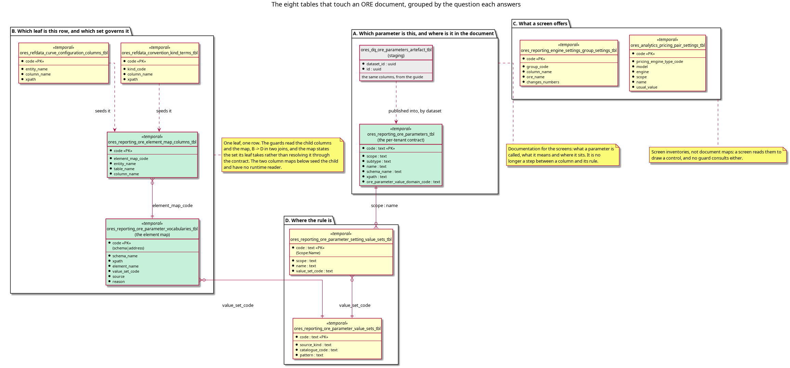

:PROPERTIES:
:ID: 8E71C928-6618-455F-AECA-102AACB07883
:END:
#+title: One map answers which ORE element a row is
#+description: The eight tables that touch an ORE document, grouped by the question each answers, and why the leaf question now has one answer that the guards join directly.
#+type: knowledge
#+level: cross
#+filetags: :ore:xml:mapping:architecture:
#+created: 2026-10-30
#+updated: 2026-10-31

* Summary

A leaf reaches a row in one of three ways, and each way has to state two facts:
which ORE element the column is, and which value set governs its value. The
element map states both in one row, keyed by the leaf's address in its schema,
and it states the value set the leaf itself takes rather than resolving it
through another table. Both leaf guards join that map, so the question "which
set governs this column" is answered by one table and one join.

Eight tables touch an ORE document. The other seven answer other questions: what
the parameter is, what a screen offers, and where the rule is. None of them is on
the path a guard takes to a set.

* The inventory

Row counts are from a recreated and populated database on 2026-10-31. The
per-tenant contract varies by tenant, so it has no fixed count.

| Table | Rows | Answers | Read by |
|-------+------+---------+---------|
| =ores_reporting_ore_parameter_vocabularies_tbl= | 480 | which set governs this leaf, and why | both leaf guards, the element map check |
| =ores_reporting_ore_element_map_columns_tbl= | 482 | which column of which table carries that leaf | both leaf guards |
| =ores_reporting_ore_parameters_tbl= | per tenant | what this parameter is, and where it sits in the document | the shell check, the screens |
| =ores_dq_ore_parameters_artefact_tbl= | 2295 | the same, staged from the ORE guide | the publish functions that fill the contract |
| =ores_reporting_ore_parameter_setting_value_sets_tbl= | 972 | which set governs this setting, by =(scope, name)= | the parameter trigger, the screens, the shell |
| =ores_refdata_curve_configuration_columns_tbl= | 212 | which curve column carries a leaf | the map's seed, nothing at runtime |
| =ores_refdata_convention_kind_terms_tbl= | 270 | which convention term carries a leaf | the map's seed, the convention screens |
| =ores_reporting_engine_settings_group_settings_tbl= | 15 | which part column is which =Setup= name | the engine run settings screen |
| =ores_analytics_pricing_pair_settings_tbl= | 834 | which settings a pricing pair takes | the pricing screen |

#+caption: Figure 1. The eight tables by the question each answers. The guards walk B to D in two joins, and the contract in A is documentation rather than a step on that path.

* What the leaf guards actually do

Both leaf guards are the same query, and the map's code is the leaf's address.
From
=projects/ores.sql/create/refdata/refdata_curve_configuration_columns_validate_create.sql:43=:

#+begin_src sql
select k.column_name, m.value_set_code
  from ores_reporting_ore_element_map_columns_tbl k
  join ores_reporting_ore_parameter_vocabularies_tbl m
    on m.code = k.element_map_code
   and m.tenant_id = ores_utility_system_tenant_id_fn()
   and m.valid_to = ores_utility_infinity_timestamp_fn()
 where k.entity_name = TG_ARGV[0]
   and k.tenant_id = ores_utility_system_tenant_id_fn()
   and k.valid_to = ores_utility_infinity_timestamp_fn()
#+end_src

The convention terms guard is the same join over =kind_code= instead of
=entity_name=. Neither guard reads the parameter contract, so a tenant that has
not published the contract still meets the rule.

* Why the map states the rule itself

The map's value set used to be resolved through the parameter contract: a leaf's
=xpath= joined a contract row, and the row's =(scope, name)= joined the setting
link. That made the leaf's rule depend on whether a *different* table happened to
hold a row, and the contract only holds a row for a leaf a person wrote text for.
So 79 of the 480 leaves took =text= by omission and the map could not say so.

The rule now comes from the parser the ORE source reads the leaf with, through the
same curation the value set seed is written from. A leaf's rule and the rule of
the setting that shares its name are one fact, so the map reads the resolved
curation instead of deriving the answer a second way; the contract keeps its own
job, which is documentation for the screens. The row records the file and line the
ORE code reads the leaf at, so a reviewer can check the rule without trusting the
map.

The gap that remains is the other kind. A leaf whose read the term extractor does
not know has no parser to take a rule from, so the map states =text= and says why.
28 leaves are in that state, and =generate_ore_element_map.py= holds the number
down with =UNREAD_ALLOWED= so it can fall but not grow unnoticed.

* What the two column maps still do

=ores_refdata_curve_configuration_columns_tbl= and
=ores_refdata_convention_kind_terms_tbl= still hold every projection column and
its =xpath=, and the map's seed is written from them. Nothing reads them at
runtime any more: the map's child carries the same rows, and the guards join the
child. They are the next slice, and the constraint is that the child already
answers every question they do, so removing them changes no guard.

* See also

- [[id:7DFE57DE-70C9-4EB6-AF94-DCEC65ADB494][The ORE XML infrastructure]] — the
  structure note that orders this cluster; this page is its fourth step, and it
  is the one that says which of the eight tables states a leaf's rule.
- [[id:D5FFD498-A6E9-45AA-B80D-E16E3A432BD0][A value set is the only place an
  ORE parameter's rule is written]] — *completes* this page: the map here names
  the set, and that page says what a set is.
- [[id:E693B10B-7C28-4F21-95EC-ED9579E23D1A][The database refuses a value that
  no value set states]] — *exemplifies* why the map states the rule itself: a
  guard that cannot find a rule admits every value, so a leaf the map resolves
  through a table that lacks a row is a value nothing refuses.
- [[id:9697F09E-441A-4B51-869E-FC59433EEA1E][One component reads every ORE
  document, and none of them stores XML]] — *contradicts* any reading of this
  page that looks for the element name in the projection: the name lives in a
  table, and this page is where.
- [[id:17032DC3-55F4-42FD-B3C1-C33D8DCED488][Consolidate the ORE element
  maps]] — the task that builds this map, and that keeps its numbers.
