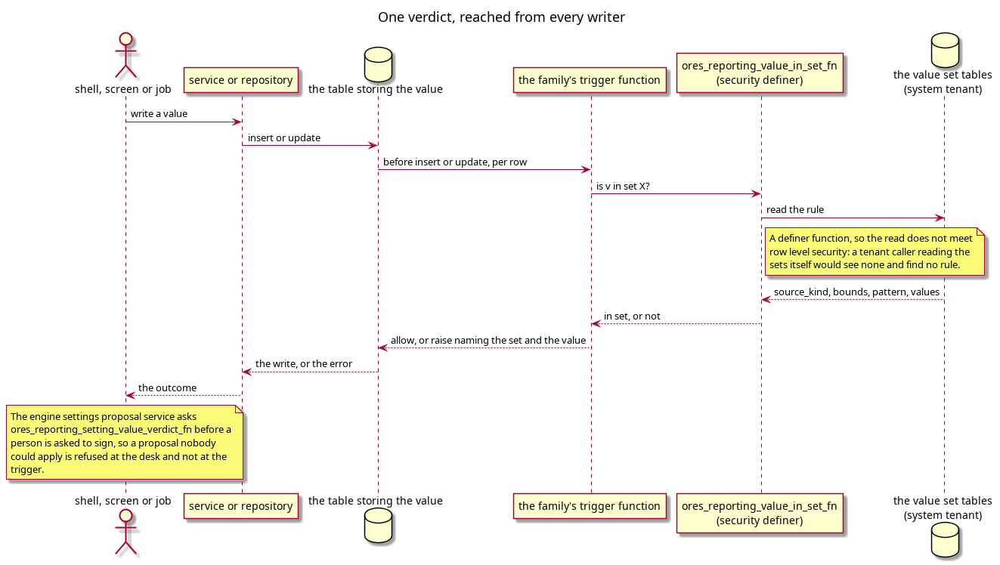

:PROPERTIES:
:ID: E693B10B-7C28-4F21-95EC-ED9579E23D1A
:END:
#+title: The database refuses a value that no value set states
#+description: The four trigger functions that enforce a value set, the one verdict function they and the sign-off path share, why it runs as a definer, and the three places a missing rule still passes.
#+type: knowledge
#+level: cross
#+filetags: :ore:xml:value-sets:enforcement:architecture:
#+created: 2026-10-31
#+updated: 2026-10-31

* Summary

A value that no set states is refused by a trigger on the table that stores it,
not by the service that writes it. Four trigger functions cover the four ways a
value reaches a row, and all of them delegate the verdict to one function,
=ores_reporting_value_in_set_fn=. A fifth function,
=ores_reporting_setting_value_verdict_fn=, answers the same question in a form a
caller can read: whether the setting names a set at all, which set, and whether
the value is in it. The engine settings sign-off path asks that one before a
person is asked to sign.

The reason for the database rather than the services is that the writers are
plural: the shell, a screen through the BFF, an import job and a publish
function all reach the same table, and only a trigger sees all four.

* The four guards

| Trigger function | Attached to | Resolves the set by |
|------------------+-------------+---------------------|
| =ores_reporting_validate_parameter_value_fn= | =ores_analytics_pricing_model_product_parameters_tbl= | =(scope, name)= on the setting link |
| =ores_refdata_validate_curve_values_fn= | each of the refdata curve configuration tables | the column's row in the element map, which names the set |
| =ores_refdata_validate_convention_terms_fn= | each of the convention and currency pair tables | the term's row in the element map, which names the set |
| =ores_reporting_validate_engine_settings_part_fn= | the fixings, building and execution part tables | =Setup:= and the part's ORE name |

Each is a =security definer= trigger, and each raises an error that names the
value, the setting and the set. The message is the interface: a person reading a
failed import sees which rule refused them.

The part guard is the one that does not spell its own join. It reads the columns
a group holds from =ores_reporting_engine_settings_group_settings_tbl=, so a
column the group does not state is left alone and the guard does not know which
table it is attached to
(=projects/ores.sql/create/reporting/reporting_engine_settings_part_value_guard_create.sql:46=).

* Why the verdict is a definer

#+begin_src text
A tenant-scoped caller that read the tables itself would meet row-level
security, see nothing, and read a rule that does not exist.
#+end_src

That sentence is from the function's own comment
(=projects/ores.sql/create/reporting/reporting_ore_parameter_value_validate_fn_create.sql:170=),
and it is the whole argument. The value sets are shared rows in the system
tenant, and the writer is tenant-scoped. A check that ran with the writer's
rights would meet row-level security, see no sets, find no rule and admit the
value. Running the read as the definer is not a privilege shortcut; it is what
makes the rule visible at all.

The verdict function exists in this shape for the same reason: the reporting core
suite proves it answers for a tenant caller who cannot see the sets
(=projects/ores.sql/test/reporting_setting_value_verdict_test.sql=, five
assertions covering a found setting, a value in its set, a value outside it, a
typed value and a setting with no set).

* Before the write, not only after it

The engine settings proposal service refuses a bad value at the desk. It calls
the same verdict function
(=projects/ores.reporting/service/src/service/engine_settings_proposal.cpp:171=)
and throws before the approval request exists, because a proposal nobody could
apply should not be signed. The comment there states the design rule the whole
cluster rests on: no copy of the rule lives in the service to drift from the
store's.

The screen standard follows the same shape: a screen reads what the set states
and draws it, rather than carrying a copy of the rule.

#+caption: Figure 1. Every writer reaches the same verdict, and the sign-off path asks it before the write.

* The three places a missing rule still passes

All are stated here rather than left for a reader to discover.

- A leaf the element map states =text= for is admitted, because text is a rule
  that admits every value. For 232 of the 480 leaves that is a decision the ORE
  parser justifies. For 28 it is not: the extractor does not read the form those
  leaves are read in, so no parser states a rule for them. The count is a
  ratchet in =generate_ore_element_map.py= (=UNREAD_ALLOWED=), so it can fall but
  not grow unnoticed.
- A parameter with no set is admitted by the product parameter guard: it returns
  the row when the link is not found
  (=…reporting_ore_parameter_value_validate_fn_create.sql:231=). The engine
  settings guard does the opposite and refuses, because every engine setting a
  group states is required to name a set. The shell's completeness gate,
  =ore_parameter_settings check=
  (=projects/ores.shell/reporting/src/app/commands/reporting/ore_parameter_settings_commands.cpp:353=),
  is what catches the product case: it fails when a parameter in the contract
  has no set or a set has no values, and it refuses to judge at all when the
  contract is not published for the tenant.
- A set code that names no set admits every value
  (=…reporting_ore_parameter_value_validate_fn_create.sql:87=). Nothing catches a
  typo in a link's =value_set_code=; only a foreign key would. The consolidation
  task is the moment to add one, because it is rewriting the links anyway.

Until both are closed, "the rule is always enforced" is true for a parameter that
has a set and false for one whose set is missing or misspelt. A reader checking a
specific value should ask =ores_reporting_setting_value_verdict_fn= and read
=found=, not =is_in_set= alone.

* See also

- [[id:7DFE57DE-70C9-4EB6-AF94-DCEC65ADB494][The ORE XML infrastructure]] — the
  structure note that orders this cluster; this page is its last step, and the
  one that says who has the last word on a value.
- [[id:D5FFD498-A6E9-45AA-B80D-E16E3A432BD0][A value set is the only place an
  ORE parameter's rule is written]] — *answers* what the guards read: this page
  is the reading, and that page is the thing read.
- [[id:8E71C928-6618-455F-AECA-102AACB07883][One map answers which ORE
  element a row is]] — *contradicts* any claim that all three maps are enforced:
  the guards use the curve columns and the convention terms, so the vocabularies
  table states a rule with no enforcer.
- [[id:FB734007-5AB3-41D0-8F94-4A37584FE049][The export writes the stored
  form, so a round trip is not byte-identical]] — *completes* this page: because
  nothing reaches a row without the verdict, the export cannot emit a document
  that ORE would refuse.
- [[id:81AB065B-E6EB-4CC2-BB18-F3FD2652EC47][PostgreSQL Architecture]] — the
  cluster that owns the row-level security and definer conventions this page
  depends on.
