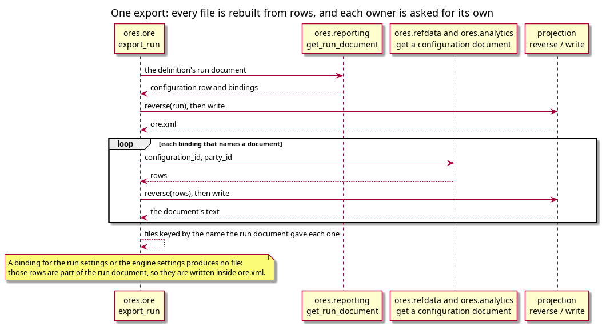

:PROPERTIES:
:ID: FB734007-5AB3-41D0-8F94-4A37584FE049
:END:
#+title: The export writes the stored form, so a round trip is not byte-identical
#+description: The export path from rows to a whole ORE input, and why the stored rendering is what a document comes back as: which code composes the files, which tests assert it, and what "reproducible" means here.
#+type: knowledge
#+level: cross
#+filetags: :ore:xml:export:architecture:
#+created: 2026-10-30
#+updated: 2026-10-31

* Summary

Export runs the import backwards and rebuilds a whole ORE input from rows. Each
document is fetched from the component that owns it and each projection reverses
it. The one thing a document does not get back is the rendering it arrived with:
a file that said =F= is stored as =Following=, so the export writes
=Following=. That is the design, not a defect, and the round-trip tests assert
the right thing only because they compare the export to the rows rather than to
the imported text.

* The path

=projects/ores.ore/service/src/messaging/run_configuration_operations.cpp:418=
is =export_run=. It returns a map of file name to text: the run document plus one
file for each configuration the report binds. The market data and the portfolio
are not in it. The function runs in four steps.

1. Read the run document from reporting
   (=rp::get_run_document_request=), and reverse it to a typed record.
2. Write =ore.xml= from that record.
3. For each binding that names a configuration document, ask the owning
   component for its rows and reverse them.
4. Key each file by the name the run document's =Setup= gives it, so the output
   directory is one ORE can run.

Step 3 is the reason the run document is stored as bindings rather than as a
document: the export needs the identity of each configuration to ask its owner,
and a document in the run document's rows would be a second copy of what the
owners already hold.

#+caption: Figure 1. One export. Each configuration document is fetched from its owner, and the run document supplies the file name each one takes.

* What survives, and what does not

The rows keep everything a document states except the rendering of a value that
has more than one. Two consequences, and they are not the same consequence:

- *The export is stable.* The mapper's table maps a stored value to itself, so
  importing an exported document changes no row, and exporting it again gives the
  same text. The stored form is a fixed point of the path.
- *The export is not the import.* The first export differs from the file the
  person supplied, in exactly those values the mapper converted. A test that
  compares an export to an arbitrary input is therefore wrong about what the
  system promises.

The two tests state the promise precisely, and each one covers a different half:

- =projects/ores.ore/core/tests/xml_curve_configuration_projection_roundtrip_tests.cpp:72=
  compares =write(reverse(map(read(text))))= to =text= over the corpus. It passes
  because the corpus is already in the stored form for those values, and it is
  the test that fails if the codec starts converting (see the conversion note).
- =projects/ores.refdata/core/tests/curve_configuration_database_roundtrip_tests.cpp:262=
  writes through the store and compares the document it gets back to
  =as_stored(mapped)=, which is the rows the store received. This is the only
  test that can be right about a value whose rendering the mapper changed.

* Why the run document is rebuilt, not read

=projects/ores.reporting/core/include/ores.reporting.core/service/run_document_service.hpp=
stores a risk report configuration, the bindings, and the run's own setting rows;
=get= projects them back into a =run_document=. So the export never reads a blob
and never parses a document it stored: it reads rows, the same way a screen does.
A run document is therefore as reproducible as the rows it is built from, and a
change to the projection changes every exported run document at once, which is
the property that makes the format one thing rather than a copy per configuration.

* See also

- [[id:7DFE57DE-70C9-4EB6-AF94-DCEC65ADB494][The ORE XML infrastructure]] — the
  structure note that orders this cluster; this page is its third step, and the
  one where the import's work is checked from the other end.
- [[id:948DAC44-404D-4B70-A8FC-3E9D4C05F72D][A stored value is converted at
  the entity mapper, never in the codec]] — *contradicts* a reading of this page
  that calls the lost rendering a bug: the conversion is what makes the export a
  fixed point, so the two pages stand or fall together.
- [[id:9697F09E-441A-4B51-869E-FC59433EEA1E][One component reads every ORE
  document, and none of them stores XML]] — *completes* this page by naming the
  components the export calls, and why it must call one per document rather than
  read one store.
- [[id:E693B10B-7C28-4F21-95EC-ED9579E23D1A][The database refuses a value that
  no value set states]] — *answers* what stops an import from writing a value
  that the export could not then read back: nothing reaches a row without the
  guard's agreement, so the export cannot emit a value ORE refuses.
