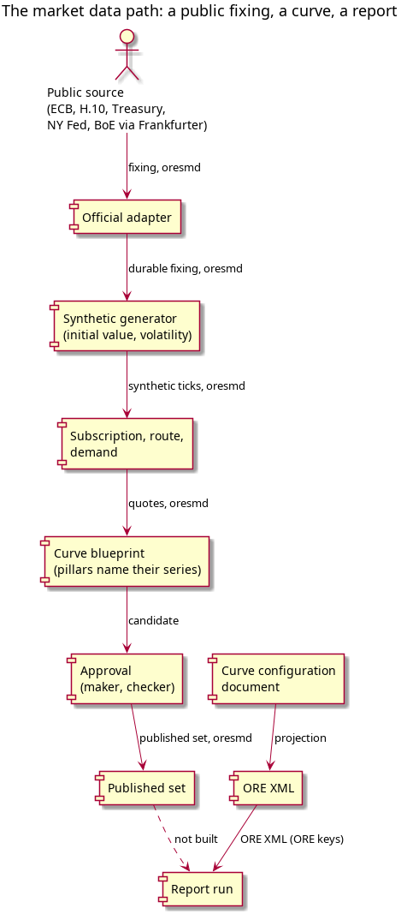

:PROPERTIES:
:ID: FDD02CA9-1DAD-4162-95AC-C7C5C611DDDC
:END:
#+title: The market data path: a public fixing, a curve, a report
#+description: The six hops from a public source's fixing to a report that consumes a curve, the oresmd identity at every runtime hop, the ORE key boundary, and the one link not built.
#+type: knowledge
#+level: cross
#+filetags: :marketdata:path:oresmd:publish:report:
#+created: 2026-10-28
#+updated: 2026-10-28

* Summary

One path runs from a public source's fixing to a report: the fixing seeds a
synthetic generator, the generator publishes ticks that a party's subscription
demands, a curve blueprint reads the quotes and builds a candidate, an approval
publishes it, and a report consumes a curve. At every hop of the runtime the
identity is the oresmd URI: the series and the datum. The ORE key is a boundary
format, and appears only where ORE XML is read or written.

The path is not closed. Six hops are built; the last one, a report reading the
published curve, is not. Reports read the curve configuration document, which
the ORE export turns into XML, and nothing in that path reads the market data
service's published set. That gap is named in /The report/ below rather than
smoothed over.

* The path at a glance

| Hop | The record | The oresmd identity | Who may | Screen or command |
|-----+------------+---------------------+---------+-------------------|
| 1. The public source | the provider and its terms in the catalogue, and the source under it | the fixing series and its datum | a reader of the catalogue | the official adapter's terms and catalogue |
| 2. The generator | the generation config, its fixing items, rank, policy and window | the synthetic series and their ticks | the simulator's author | the Market data simulator screens |
| 3. The subscription | the party's subscription, its rights, the route to a source, the computed demand | the series the party may receive | the party's administrator | the subscription and route screens |
| 4. The blueprint | the named config, its pillars, its conventions | each pillar's market series, and the blueprint's output series | the maker | /market-data/curve-blueprints |
| 5. The publication | the approval request, the publish record, the published set | the output series and its datum points | the maker and the decider | the request page, the published list, the shell |
| 6. The report | the report definition, its run, the curve configuration it names | the curve the ORE XML names at the boundary | the report's owner | the report screens and the run |

* The rule: oresmd inside, ORE keys at the edge

An internal identity is an oresmd URI and nothing else. An ORE key is a boundary
format: it converts to and from an oresmd identity in [[id:D1A25B9E-B1A0-4E7C-AB5C-1C7C3EF07F90][ORE import and export]],
and nowhere else. [[id:7AE57098-08D4-4D4A-83D6-918FE520B68E][A pillar names the market series it reads]] settles the rule and
the migration that still removes the last ORE spellings from the runtime: the
curve reader and the synthetic IR feed compose a pillar's series today, the
series classifier keys its rules on an ORE series key, and the oresmd codec
refuses a datum without an ORE spelling. Those are the open items of the
[[id:EAD9F02F-3B4B-495E-B37D-71BF766F7970][pillar-naming task]].

* Hop by hop

** The public source

The free public sources are the level of the world: the ECB euro reference
rates, the Federal Reserve H.10 through FRED, the US Treasury par yield curve,
the New York Fed SOFR and the Bank of England SONIA, reached for FX through the
Frankfurter API. The official adapter publishes what each source published, once
a day, as a durable fixing per provider, and the terms rule decides what may be
stored: a provider with no terms page is not loaded. The identity stored is the
oresmd series and datum of the fixing, with the provider key kept so the credit
and the terms apply.

See [[id:F4BBEF34-D84C-4AE6-A3AA-DC47C3EE06EE][Public sources publish daily fixings through an adapter]] and
[[id:3F9D6EAE-9FB8-4A0D-9BAF-1EA3EA93AB4F][Synthetic prices are calibrated from free public sources]].

** The generator seeds from the fixing

Each generation config names the fixing items it may start from, with a rank, a
policy and a window. The initial value is the latest fixing on or before the
market clock's date, and the volatility is the spread of the log returns over the
window. The config fetches nothing; the adapter has already published the fixing
as a durable tick, and the generator reads it. What the generator then publishes
is a synthetic series of ticks, with its own oresmd identity, in the provider's
catalogue.

See [[id:BB2B7C4C-FD4E-4DCA-BF1D-00F929622B87][Synthetic market data generation: approach]],
[[id:316F0EA0-2DA4-4E96-87D5-F4EAE7490938][The IR curve generation config]] and
[[id:FB57F761-0FC3-4283-AD32-CCF2FE68AD2E][The IR curve producer]]. The Frankfurter route and the
published-quotes loader are in flight with the prime origin environment; this page
names the path and does not restate that work.

** The subscription, the route and the demand

A party takes a provider's feeds through a subscription that carries its display,
non-display and derived rights. A route names the one source the party uses for
that provider. The demand is computed from the subscriptions, and the adapters
follow the demand: a source runs because a party needs it, not because a
configuration exists. The generator's need for a public fixing is part of that
demand, which is why a public adapter can run with no party subscribed to it
directly.

See [[id:31BCA3F8-31AD-49C2-9B6B-F2312EE7DECB][A party takes a provider's feeds through a subscription]],
[[id:37B27CA8-9F44-4A61-9B02-3EAABD8C3818][A party routes to exactly one source for each provider]],
[[id:083D4B54-549B-4D56-AE89-430A8A4277FF][Demand drives what an adapter publishes]] and
[[id:7D1DE23F-AA14-44AB-81D5-9961EF02533C][Market data ticks because ownership, demand and a smoke check agree]].

** The blueprint and its pillars

A blueprint is a named recipe: party, currency, index tenor, family role,
interpolation, day count, tenor convention, split tenor, and the output series it
owns. Its pillars are start tenor, end tenor and instrument role. Each pillar
names the market series its quote comes from, and the compute reads that series'
observations at the as-of, resolves the tenor dates through the reference
conventions, and runs the bootstrap engine. A projection also reads its funding
curve's discount factors. The result is written as observations on the
blueprint's output series, with lineage naming the source series and the config
version: the candidate.

See [[id:FBD32402-C71F-4730-A3D2-70BA1D5F3868][Maintain the curve blueprints]],
[[id:62728AF9-01AD-4FBF-B022-83DCD64204A9][Check that a curve blueprint builds]],
[[id:F55B08E3-0ADA-4267-8CB9-127FF1814549][Bootstrap or refresh a curve]],
[[id:0220F3F7-C674-47EE-91CE-1C04804B4558][Tenor and Curve Bootstrapping Architecture]] and
[[id:573F9165-C20B-463C-B0B3-F324AFE4E81F][Curve Point Provenance]].

** The approval and the publication

The maker raises a publish naming the blueprint and the as-of; the subject is a
publish record. A second person decides, under the kind's maker and checker
permissions and the record's four-eyes rule. Publishing applies the approved
request once, stamps the publisher and the instant, ends the set it replaces, and
sends the notice. The set then reads as published, superseded or withdrawn, with
its points, its publisher and its history.

See [[id:239E4C3C-12E7-4A87-9DE3-16B9F093BC14][Ask for a publish to be approved]],
[[id:A85B6C4E-0F93-4410-BF2E-7167722849ED][Decide a publish]],
[[id:53F31919-86FA-4E35-8594-9E72197C4A3B][Publish the approved set]] and
[[id:B05A31CC-FA22-4534-848E-601A30822992][Withdraw or replace a published curve]].

** The report

A report has a definition, a schedule and a run. The run needs market data, and
the data it consumes is the curve configuration document: the reporting component
projects that document, and the ORE export turns it into the ORE XML the compute
reads. The ORE key is exactly the boundary format the decision reserves for this
edge: the document and the XML name curves the ORE way, and the conversion is
where the oresmd identity of the market data service stops and the ORE world
begins.

*** The finding: the report does not read the published set

Nothing in the report path reads the market data service's published set. The
report consumes a curve configuration document, and the published curve is a
market data record; the two halves of the path are not joined. So a curve can be
published correctly, with its approval, its publisher and its notice, and no
report will consume it. The decision to make is whether the report path should
read the published set, with the ORE XML built from it, or whether the curve
configuration document remains the only input and the published set serves the
screens and the consumers that read market data directly.

* What is under construction

- The Frankfurter route and the load of the published quotes are prime origin's
  work; the path above names them and does not restate their design.
- The pillar names its market series, which removes the last ORE spellings from
  the runtime: the reader, the synthetic feed, the series classifier and the
  oresmd codec. See the [[id:EAD9F02F-3B4B-495E-B37D-71BF766F7970][pillar-naming task]].
- The join from the published set to the report, above, is not built and has no
  task yet.

* The gaps

1. The published curve does not reach a report; the report reads the curve
   configuration document instead.
2. The pillar's series is derived, not named, until the migration lands.
3. The series classifier keys its rules on an ORE series key at runtime.
4. The oresmd codec refuses a datum that has no ORE spelling.
5. A blueprint's output series has no screen that mints it; the Add dialog picks
   a series that must already exist, and the catalogue offers the feeds' own
   series rather than a curve's output.

* See also

- [[id:DF2B616F-E112-4C57-A73B-69F85BE96EF4][Market Data Architecture]] -- the service, its records and its screens.
- [[id:CE99CD2A-B31F-4306-865F-CBC519FBC1B8][The oresmd datum identity]] -- what the identity is.
- [[id:E4736D88-03B2-4A40-B7F4-01B06B9B9FD7][A quote series is keyed by item, provider and party]] -- where the identity starts.
- [[id:D1A25B9E-B1A0-4E7C-AB5C-1C7C3EF07F90][ORE import and export]] -- the boundary, and the only home of an ORE key.
- [[id:7AE57098-08D4-4D4A-83D6-918FE520B68E][A pillar names the market series it reads]] -- the rule this page states.
