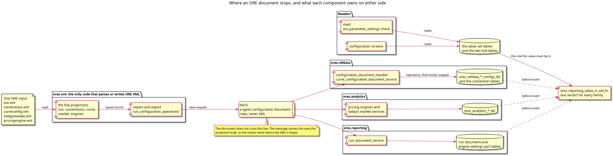

:PROPERTIES:
:ID: 7DFE57DE-70C9-4EB6-AF94-DCEC65ADB494
:END:
#+title: The ORE XML infrastructure
#+description: How an ORE document becomes rows and comes back, ordered as six notes: the component that owns the document's shape, the mapper that converts a rendering, the export that states the stored form, the tables that name the element, the value set that states the rule, and the trigger that enforces it.
#+type: knowledge
#+level: cross
#+filetags: :ore:xml:architecture:structure_note:
#+created: 2026-10-30
#+updated: 2026-10-31

* What this cluster answers

A person changing how an ORE document is stored has four questions. Which
component may read the XML? Where does a value change form? Which row is a given
element? What makes a value legal? Six pages answer them, in an order that
follows the dependencies between the answers rather than the file layout.

#+caption: Figure 1. The document stops at one component. Everything to the right of the message bus is rows, and one verdict function decides whether a row may be written.

* The order, and why it is the order

The sections are in dependency order, not reading order. Each one says what it
makes possible for the page after it.

** The document's shape has one owner

[[id:9697F09E-441A-4B51-869E-FC59433EEA1E][One component reads every ORE document, and none of them stores XML]]

=ores.ore= holds the code for each of the five documents a run names, and no
other component parses ORE XML. A store receives typed rows. Read this first
because every rule in this cluster acts on rows: a reader who does not know where
the XML stops cannot tell which page owns a change.

** A value changes form exactly once

[[id:948DAC44-404D-4B70-A8FC-3E9D4C05F72D][A stored value is converted at the entity mapper, never in the codec]]

The conversion from an ORE rendering to the stored form is the only
transformation in the path, and it sits in the entity mapper. It follows from the
boundary above: the codec may not know the store, so the conversion cannot be
there. It comes next because it settles what the value means for everything
below it.

** The way out is not the way in

[[id:FB734007-5AB3-41D0-8F94-4A37584FE049][The export writes the stored form, so a round trip is not byte-identical]]

The export builds the documents from rows by reversing each projection. Because
of the conversion, the rendering the imported file used does not survive the
store, and this page says why that is correct and what the two round-trip tests
assert instead.

** Which element a row is

[[id:8E71C928-6618-455F-AECA-102AACB07883][Three tables answer which ORE element a row is]]

Identity, now that the value is settled: eight tables touch the document, three
of them state the same leaf fact, and one of those three is read by nothing. That
is the defect the normalisation story removes first, so it is worth knowing
before trusting any of them.

** What makes the value legal

[[id:D5FFD498-A6E9-45AA-B80D-E16E3A432BD0][A value set is the only place an ORE parameter's rule is written]]

A parameter or a leaf element resolves to one value set, and the set states the
kind, the bounds, the pattern, the catalogue and the values. Nothing else in the
tree repeats it. The identity page is the lookup; this page is what the lookup
lands on.

** Who refuses an illegal value

[[id:E693B10B-7C28-4F21-95EC-ED9579E23D1A][The database refuses a value that no value set states]]

Enforcement comes last because it depends on the set being reachable from every
writer. Four trigger functions and one verdict function refuse the value, and why
the verdict runs as a definer belongs to this page.

The identity page and the value set page can be swapped by a reader who wants
only the data model. The first two cannot be: the conversion is a consequence of
the boundary above it.
* What this cluster does not cover

The screens are a neighbouring cluster, not this one. How a value is drawn, the
words a control uses, and what a screen offers as a choice belong to the
[[id:852207A6-6785-43E6-A5D6-2D5C2C374101][ORE element and leaf screen standard]],
which reads the value sets this cluster describes. The two meet at one rule: a
screen offers what the set states and refuses nothing of its own, so the set has
to be complete before the screen can be.

Three more neighbours, and why each boundary falls where it does:

- [[id:EDAE3C87-7733-4D0C-881F-5AA65DD832AC][Pricing Configuration]] covers
  the configurations as a product feature: what a party configures, and when a
  run uses it. This cluster stops at the row.
- [[id:C5C95B29-2EF9-4DFC-9E04-428C41C1925D][ORE Products by Asset Class]]
  covers what the products mean. This cluster only cares that a product type is
  a key in the document.
- [[id:DF2B616F-E112-4C57-A73B-69F85BE96EF4][Market Data Architecture]]
  covers where the numbers come from. A market data file reaches ORE by another
  path and is not one of the five documents here.

* See also

- [[id:E3B70401-5142-4ACC-A61F-1BBF19F8470F][Zettelkasten]] — the method this
  hub follows: it gists and links, and holds no claim its cluster does not.
  *Completes* the cluster by saying how the pages are written.
- [[id:7474935C-95D1-3034-B833-83DCD9FB3A09][Knowledge]] — the index this hub
  is filed under, in the Architecture table.
- [[id:852207A6-6785-43E6-A5D6-2D5C2C374101][ORE element and leaf screen
  standard]] — the improbable neighbour: a UI page that constrains this data
  model. *Answers* the question a reader of the value set page asks, which is why
  the set must be complete rather than merely used: a screen may not carry a rule
  of its own.
- [[id:81AB065B-E6EB-4CC2-BB18-F3FD2652EC47][PostgreSQL Architecture]] — the
  row-level security and bitemporal conventions the value set tables and the
  guards are built on. *Exemplifies* the platform rules the cluster relies on.
