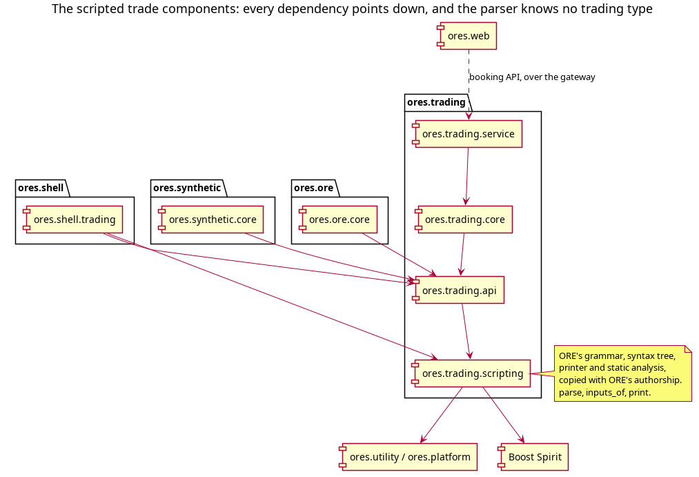

:PROPERTIES:
:ID: 4E135FB5-6E0A-45CC-A805-F5B70F29DDB4
:END:
#+title: The scripted trade components depend in one direction
#+description: The components of the scripted trade subsystem, each one's responsibility and public API, and the dependency graph between them, which has no cycle.
#+type: knowledge
#+level: cross
#+filetags: :scripting:trading:architecture:
#+created: 2026-11-21
#+updated: 2026-11-21

* Summary

The scripted trade subsystem lives in =ores.trading=, with ORE's parser in a
sub-component of its own, =ores.trading.scripting=. The parser depends on
nothing in ORE Studio but its utilities, and everything else that reads scripts
depends on it, so the dependency graph runs one way and has no cycle. The rule
that keeps it so: a component may depend only on components below it in the
diagram, and the parser knows no trading type.

* Detail

** The components

| Component | Responsibility | Public API | Depends on |
|-----------+----------------+------------+------------|
| =ores.trading.scripting= | ORE's script grammar, syntax tree, printer and static analysis, copied ([[id:8FD7BD95-AAEC-4CF9-A9F4-D609A9DEFBD8][ORE's grammar is the one authority on whether a script parses]]) | =parse=, =inputs_of=, =print= | =ores.utility=, =ores.platform=, Boost Spirit |
| =ores.trading.api= | the domain types (script, variant, input, scripted instrument), the product schema, the builders including the scripted builder, the twin recipe evaluator, the booking protocol | =describe_product=, =validate_script=, =book=, =book_scripted= messages; the builders | =ores.trading.scripting= |
| =ores.trading.core= | the repositories, the script library (publish parses and derives inputs), the booking service | the services behind the protocol | =ores.trading.api= |
| =ores.trading.service= | the NATS handlers | the service | =ores.trading.core= |
| =ores.ore.core= | the projection of =ScriptedTradeData= and of the script library to and from ORE's XML ([[id:9697F09E-441A-4B51-869E-FC59433EEA1E][One component reads every ORE document, and none of them stores XML]]) | the projections | =ores.trading.api= |
| =ores.synthetic.core= | the generator, drawing terms against schemas | the plan | =ores.trading.api= |
| =ores.shell.trading= | the script and product commands ([[id:B01292A4-0394-40E8-A0B4-2DBA3F46C052][The shell parses a script without a login]]) | the commands | =ores.trading.scripting=, =ores.trading.api= |

=ores.web= reads the API over the gateway and runs the editor's grammar in the
browser ([[id:8CF94EFE-4699-4F7D-B59B-E695AFD723CA][The editor's grammar is tested against ORE's parser]]); it links no C++ component.

** Why the parser sits at the bottom

A parser is needed by the shell with no server, by the store when a script is
published, and by the booking API when a trade is validated. Placing it below
=ores.trading.api= lets each link it without linking the others, and it holds no
database or bus dependency, the role =quant= has in =ores.analytics=
([[id:F27E5DF7-6223-4B6F-80A5-CEFBEB1BC756][Component architecture]]). If it depended on trading's domain types, the API could
not depend on it without a cycle, so it returns its own types, and
=ores.trading.api= maps them onto rows.

** Where today's code differs

=ores.trading.scripting= does not exist, and the sub-component catalogue of
[[id:F27E5DF7-6223-4B6F-80A5-CEFBEB1BC756][Component architecture]] gains =scripting= when it is created. The twin recipe evaluator
lives in =ores.synthetic.core=, not =ores.trading.api=.
