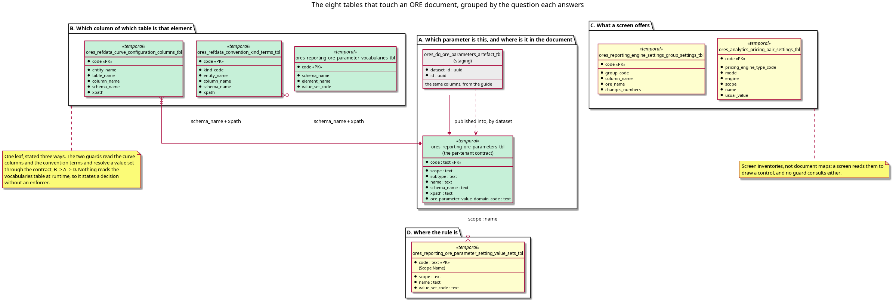

:PROPERTIES:
:ID: 8E71C928-6618-455F-AECA-102AACB07883
:END:
#+title: Three tables answer which ORE element a row is
#+description: The eight tables that touch an ORE document, grouped by the question each answers, and why the leaf question has three answers of which one is consulted by nothing.
#+type: knowledge
#+level: cross
#+filetags: :ore:xml:mapping:architecture:
#+created: 2026-10-30
#+updated: 2026-10-31

* Summary

Eight tables touch an ORE document. Four map something, one stages a map, two
are inventories a screen reads, and one is the link to the rule. The leaf
question, which column of which table is which ORE element, has three answers
and a fourth path that the guards actually take: a curve column or a convention
term resolves its element by =(schema_name, xpath)= into the parameter contract,
and the contract names the value set. The vocabularies table states the element
to set mapping directly and nothing reads it, so the three answers do not
disagree so much as one of them is inert.

* The inventory

Row counts are from a recreated and populated database on 2026-10-30. The
per-tenant contract varies by tenant, so it has no fixed count.

| Table | Rows | Maps | Read by |
|-------+------+------+---------|
| =ores_reporting_ore_parameters_tbl= | per tenant | =(scope, subtype, name)= and an =xpath= to a value domain and its text | the shell check, the screens, both leaf guards |
| =ores_dq_ore_parameters_artefact_tbl= | 2295 | the same columns, staged from the ORE guide | the publish functions that fill the contract |
| =ores_reporting_ore_parameter_setting_value_sets_tbl= | 756 | =(scope, name)= to a value set | the parameter trigger, the screens, the shell |
| =ores_reporting_ore_parameter_vocabularies_tbl= | 4 | an ORE element =(schema, element)= to a value set | nothing at runtime |
| =ores_refdata_curve_configuration_columns_tbl= | 212 | a curve column =(entity, table, column)= to a schema and an =xpath= | the curve value guard |
| =ores_refdata_convention_kind_terms_tbl= | 270 | a convention kind term to a schema and an =xpath= | the convention terms guard, the convention screens |
| =ores_reporting_engine_settings_group_settings_tbl= | 15 | a part column to the =Setup= ORE name | the engine run settings screen |
| =ores_analytics_pricing_pair_settings_tbl= | 834 | =(pricing engine type, model, engine, scope, name)= to the setting a pair takes | the pricing screen |

#+caption: Figure 1. The eight tables by the question each answers. The guards walk B to A to D, and the vocabularies table in B is on no path a write takes.

* What the leaf guards actually do

Both leaf guards are the same query, and the join is the statement of which
element a row is. From
=projects/ores.sql/create/refdata/refdata_curve_configuration_columns_validate_create.sql:43=:

#+begin_src sql
select k.column_name, l.value_set_code
  from ores_refdata_curve_configuration_columns_tbl k
  join ores_reporting_ore_parameters_tbl p
    on p.schema_name = k.schema_name
   and p.xpath = k.xpath
   and p.tenant_id = ores_utility_system_tenant_id_fn()
  join ores_reporting_ore_parameter_setting_value_sets_tbl l
    on l.code = p.scope || ':' || p.name
 where k.entity_name = TG_ARGV[0]
#+end_src

The convention terms guard
(=…/refdata_convention_terms_validate_create.sql:51=) is the same join over
=kind_code= instead of =entity_name=. The =xpath= is the element: the schema and
the path together name the leaf, and the contract already carries that pair.

The vocabularies table carries =(schema_name, element_name, value_set_code)=,
which is the same fact with the element split rather than spelled as a path. It
would be the natural single map. It has no reader at runtime:

#+begin_src text
$ grep -rln "ore_parameter_vocabularies" --include=*.cpp --include=*.hpp \
      --include=*.ts --include=*.tsx projects/ apps/
(no output)
#+end_src

The three matches in the tree are the SQL that creates, populates and drops the
table, and the two Python files that write its populate script from
=projects/ores.sql/utility/ore_parameter_vocabularies.json=. So the leaf
question has three answers: two consulted, both longer than they need to be, and
one short and consulted by nobody.

* What the overlap costs

A leaf can be named in the curve columns and missing from the vocabularies, and
nothing notices. A leaf not named in the curve columns is free text as far as its
guard is concerned:
=refdata_curve_configuration_columns_validate_create.sql:29= says so in its own
comment, and "a column the map does not name is free text and passes" is the
shape a gap takes when the map has three authors.

That is the same defect the representation story exists to remove, one level up.
One fact, several statements, and the statements can disagree in silence.

* The consolidation, and what it has to preserve

[[id:17032DC3-55F4-42FD-B3C1-C33D8DCED488][Consolidate the ORE element maps]]
is the story's first task, and it runs before anything reads a set through a
link. It makes one map keyed by the ORE element, attaches the projection columns
to it, and collapses the two link shapes, so that a caller asks one question and
gets one answer.

The constraint that makes it a consolidation and not a rewrite: every row of the
three tables must move, and the curve column guard's pgTAP suite must pass
unchanged. That suite
(=projects/ores.sql/test/refdata_curve_configuration_columns_validate_test.sql=)
is the proof that the same column still resolves the same set, whichever table
now states it.

Until that task lands, a reader who needs "which set states this leaf" asks the
contract, as both guards do, and treats the curve columns and the convention
terms as what they are: the list of columns that carry an element, not the
statement of which element that is.

* See also

- [[id:7DFE57DE-70C9-4EB6-AF94-DCEC65ADB494][The ORE XML infrastructure]] — the
  structure note that orders this cluster; this page is its fourth step, and it
  is the one that says which of the eight tables can be believed.
- [[id:D5FFD498-A6E9-45AA-B80D-E16E3A432BD0][A value set is the only place an
  ORE parameter's rule is written]] — *completes* this page: the link table here
  is one end of the join, and that page is the other end.
- [[id:E693B10B-7C28-4F21-95EC-ED9579E23D1A][The database refuses a value that
  no value set states]] — *exemplifies* why the missing reader matters: a guard
  that cannot find a rule admits every value, so a map nothing reads is a rule
  nothing enforces.
- [[id:9697F09E-441A-4B51-869E-FC59433EEA1E][One component reads every ORE
  document, and none of them stores XML]] — *contradicts* any reading of this
  page that looks for the element name in the projection: the name lives in a
  table, and this page is where.
- [[id:17032DC3-55F4-42FD-B3C1-C33D8DCED488][Consolidate the ORE element
  maps]] — the task that resolves the overlap, and the reason this page can
  state a defect rather than a design.
