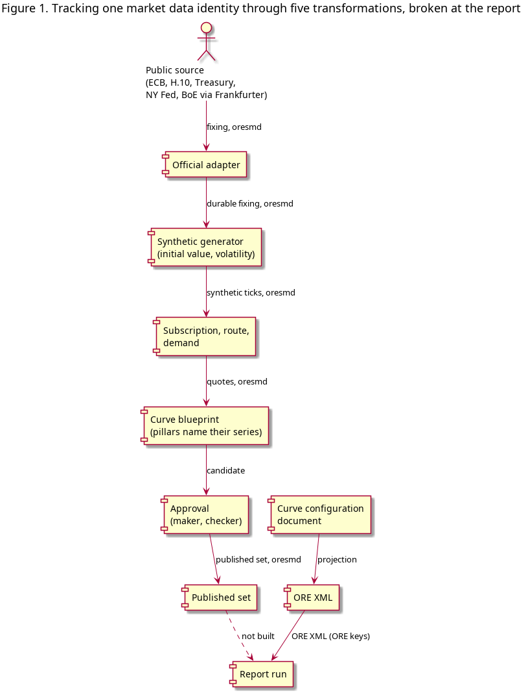

:PROPERTIES:
:ID: FDD02CA9-1DAD-4162-95AC-C7C5C611DDDC
:END:
#+title: Tracking market data identity from fixing to report
#+description: This document argues that ORE Studio's market data is one oresmd identity carried through five transformations, and that the chain breaks where a report reads a curve configuration document instead of the published set.
#+type: knowledge
#+level: cross
#+filetags: :marketdata:path:oresmd:publish:report:structure_note:
#+created: 2026-10-28
#+updated: 2026-10-28

* Abstract

This document argues that the market data of ORE Studio is a single identity, the
oresmd series and datum, and that the identity is preserved through five
transformations: the publication of a public fixing, the generation of a
synthetic series calibrated from it, the subscription that carries it to a party,
the bootstrapping of a curve that reads it, and the approval that publishes the
curve. The identity is preserved because every stage names the same oresmd URI,
and because the ORE key vocabulary is confined to the ORE XML boundary. The document
then shows where the chain breaks. The report path reads a curve configuration
document, which the ORE export turns into XML, and it never reads the published
set. The discontinuity, and not the chain, is the system's central provenance
question: a curve can be published correctly and still fail to reach a report.

* 1. Introduction

A reader who asks where a number in a report came from can follow the chain in
one direction: the report names a curve, the curve names a set of points, the
points name the quotes they were bootstrapped from, the quotes name a series, and
the series names a provider and a fixing. The system holds every one of those
records. What it does not hold is the argument that they are the same market
data seen at five points, and without that argument the chain is a set of
adjacent tables rather than a provenance.

This document supplies the argument. It states the invariant that the chain
preserves, it shows how each transformation preserves it, and it identifies the
transformation that does not.

* 2. Thesis

The thesis is stated in two parts.

The first part is descriptive. Market data in ORE Studio has one runtime identity:
the oresmd URI of a series, and within it the datum URI of an observation. No
stage of the chain invents a second identity. A provider publishes a series; the
generator calibrates a series; the subscription authorises a series; a curve
pillar reads a series and writes its output series; the publication records the
output series. The ORE key, the vendor spelling `IR_SWAP/RATE/...`, is not an
identity. It is a boundary format, converted to and from the oresmd identity
where ORE XML is read or written.

The second part is critical. If the identity is preserved, the chain is
auditable: a report can be traced to a fixing because every link names the same
URI. If the identity is broken at any hop, the report's number is unexplained at
that hop, whatever the records below it say. The evidence in this document shows
that the chain is preserved through the first five transformations and broken at
the sixth.

* 3. The identity of a market datum

The identity begins with a definition rather than a record: a datum is a series
and a coordinate, and a series is an item in a provider's catalogue for a party.
The definition is stated in
[[id:CE99CD2A-B31F-4306-865F-CBC519FBC1B8][The oresmd datum identity]] and
[[id:E4736D88-03B2-4A40-B7F4-01B06B9B9FD7][A quote series is keyed by item, provider and party]]. Two
properties of the definition matter here. First, the identity does not depend on
the vendor's spelling: a series published by a synthetic feed and a series read
by a bootstrap are the same series when their oresmd URIs are the same, whether
or not a vendor would name them the same way. Second, a point on a curve is a
datum of the output series, not a new record type, so the curve's points are
observations under the same identity as any other market datum.

The boundary is equally part of the definition. An ORE key names a datum in the
corpus' vocabulary, and converts to an oresmd datum at the edge; it is not stored
as an identity. The conversion is stated in
[[id:D1A25B9E-B1A0-4E7C-AB5C-1C7C3EF07F90][ORE import and export]].

* 4. The chain of transformations

The chain has five transformations before the report. Each is described as a
proposition: the transformation preserves the identity, and the proposition is
supported by the records and the code.

** 4.1 The publication of a public fixing

The free public sources are the level of the world: the ECB euro reference rates,
the Federal Reserve H.10 through FRED, the US Treasury par yield curve, the New
York Fed SOFR and the Bank of England SONIA, reached for FX through the
Frankfurter API. The official adapter publishes what each source published, once
a day, as a durable fixing per provider. The identity stored is the oresmd series
and datum of the fixing, and the provider key is kept with it, so the credit and
the terms of that provider apply. A provider with no terms page is not loaded.

See [[id:F4BBEF34-D84C-4AE6-A3AA-DC47C3EE06EE][Public sources publish daily fixings through an adapter]] and
[[id:3F9D6EAE-9FB8-4A0D-9BAF-1EA3EA93AB4F][Synthetic prices are calibrated from free public sources]].

** 4.2 The generation of a synthetic series

Each generation config names the fixing items it may start from, with a rank, a
policy and a window. The initial value is the latest fixing on or before the
market clock's date, and the volatility is the spread of the log returns over the
window. The config fetches nothing; the adapter has already published the fixing
as a durable tick, and the generator reads it. What the generator publishes is a
synthetic series of ticks, with its own oresmd identity, in the provider's
catalogue.

See [[id:BB2B7C4C-FD4E-4DCA-BF1D-00F929622B87][Synthetic market data generation: approach]],
[[id:316F0EA0-2DA4-4E96-87D5-F4EAE7490938][The IR curve generation config]] and
[[id:FB57F761-0FC3-4283-AD32-CCF2FE68AD2E][The IR curve producer]].

** 4.3 The subscription, the route and the demand

A party takes a provider's feeds through a subscription that carries its display,
non-display and derived rights. A route names the one source the party uses for
that provider. The demand is computed from the subscriptions, and the adapters
follow the demand: a source runs because a party needs it, not because a
configuration exists. The generator's need for a public fixing is part of that
demand, which is why a public adapter can run with no party subscribed to it
directly.

See [[id:31BCA3F8-31AD-49C2-9B6B-F2312EE7DECB][A party takes a provider's feeds through a subscription]],
[[id:37B27CA8-9F44-4A61-9B02-3EAABD8C3818][A party routes to exactly one source for each provider]],
[[id:083D4B54-549B-4D56-AE89-430A8A4277FF][Demand drives what an adapter publishes]] and
[[id:7D1DE23F-AA14-44AB-81D5-9961EF02533C][Market data ticks because ownership, demand and a smoke check agree]].

** 4.4 The bootstrapping of a curve

A blueprint is a named recipe: party, currency, index tenor, family role,
interpolation, day count, tenor convention, split tenor, and the output series it
owns. Its pillars are start tenor, end tenor and instrument role. Each pillar
names the market series its quote comes from, and the compute reads that series'
observations at the as-of, resolves the tenor dates through the reference
conventions, and runs the bootstrap engine. A projection also reads its funding
curve's discount factors. The result is written as observations on the
blueprint's output series, with lineage naming the source series and the config
version: the candidate.

The identity at this hop has been the subject of a decision. The pillar now names
its series rather than deriving it; the derivation by the ORE vocabulary is the
residual leak that
[[id:7AE57098-08D4-4D4A-83D6-918FE520B68E][A pillar names the market series it reads]] removes. The
records are [[id:73A5FAA1-377C-45A6-999E-4AD4DE406F78][IR Curve Bootstrap Config]] and
[[id:5DC8A225-A2FD-4ECC-8284-C1D333F0EB3A][IR Curve Bootstrap Pillar]]. The journeys are
[[id:FBD32402-C71F-4730-A3D2-70BA1D5F3868][Maintain the curve blueprints]],
[[id:62728AF9-01AD-4FBF-B022-83DCD64204A9][Check that a curve blueprint builds]] and
[[id:F55B08E3-0ADA-4267-8CB9-127FF1814549][Bootstrap or refresh a curve]]; the architecture is
[[id:0220F3F7-C674-47EE-91CE-1C04804B4558][Tenor and Curve Bootstrapping Architecture]], and the
provenance is [[id:573F9165-C20B-463C-B0B3-F324AFE4E81F][Curve Point Provenance]].

** 4.5 The publication of the curve

The maker raises a publish naming the blueprint and the as-of; the subject is a
publish record. A second person decides, under the kind's maker and checker
permissions and the record's four-eyes rule. Publishing applies the approved
request once, stamps the publisher and the instant, ends the set it replaces, and
sends the notice. The set then reads as published, superseded or withdrawn, with
its points, its publisher and its history.

See [[id:239E4C3C-12E7-4A87-9DE3-16B9F093BC14][Ask for a publish to be approved]],
[[id:A85B6C4E-0F93-4410-BF2E-7167722849ED][Decide a publish]],
[[id:53F31919-86FA-4E35-8594-9E72197C4A3B][Publish the approved set]] and
[[id:B05A31CC-FA22-4534-848E-601A30822992][Withdraw or replace a published curve]].

#+caption: Figure 1. The chain of transformations and its one broken link. The solid path carries one oresmd identity; the report reads a curve configuration document through ORE XML instead.

* 5. The report discontinuity

The sixth transformation is the one the thesis predicts may fail, and it does.
A report has a definition, a schedule and a run. The run needs market data, and
the data it consumes is the curve configuration document: the reporting component
projects that document, and the ORE export turns it into the ORE XML the compute
reads. The ORE key is exactly the boundary format that the decision reserves for
this edge: the document and the XML name curves the ORE way, and the conversion
is where the oresmd identity of the market data service stops and the ORE world
begins.

The evidence for the break is negative and therefore stated as such: no code in
the report path, and none in the ORE export, reads the market data service's
published set. The report consumes a curve configuration document, and the
published curve is a market data record; the two halves of the chain are not
joined. A curve can therefore be published correctly, with its approval, its
publisher and its notice, and no report will consume it.

The thesis fails at this hop in a precise sense. The first five transformations
preserve the identity; the sixth does not read it. The consequence is not that
the published curve is wrong, but that its provenance stops where the report
begins, and the report's curve is a different record from the one the market data
service published.

Two resolutions are available, and the document does not choose between them. The
first is to make the report read the published set, with the ORE XML built from
it; the chain then closes, and the report's curve is the published curve. The
second is to declare the curve configuration document the authoritative input for
a report and the published set an artefact for consumers that read market data
directly; the chain then has two branches, and the document must say so rather than
present one chain.

* 6. Discussion: the boundary and the residual leaks

The ORE boundary is legitimate. A report runs an ORE compute, and ORE consumes
ORE XML; the conversion at the edge is the correct place for the ORE key. The
document's objection is not to the boundary but to the leaks across it. Four
spellings of the ORE vocabulary remain in the runtime: the curve reader and the
synthetic IR feed compose a pillar's series, the series classifier keys its rules
on an ORE series key, and the oresmd codec refuses a datum that has no ORE
spelling. The decision in
[[id:7AE57098-08D4-4D4A-83D6-918FE520B68E][A pillar names the market series it reads]] removes the
first two; the classifier and the codec are named as the remaining work of
[[id:EAD9F02F-3B4B-495E-B37D-71BF766F7970][Name a curve pillar's market series]]. Until they are
removed, the identity is not the only runtime identity, and the thesis holds only
for the stages that have been migrated.

A second leak lies outside the boundary's direction. The Add dialog of a
blueprint picks an output series that must already exist, and no screen mints
one; the catalogue offers the feeds' own series rather than a curve's output.
The identity of the output series is therefore sound once it exists, but its
creation is not part of the chain the screens present. This is a gap in the
chain's completeness, not in its identity.

* 7. Threats to validity and open questions

The argument rests on the code as it stands at the time of writing, and on the
negative evidence that no report path reads the published set. Four matters are
open and would change the conclusions.

First, the Frankfurter route and the load of the published quotes are in flight
in another environment; the first transformation is described from the notes and
the adapter, not from a completed migration.

Second, the series classifier's rules and their catalogue are the largest part of
the migration; until they are keyed on the oresmd identity, the classification of
a series at ingest remains an ORE-key operation.

Third, whether a person picks a market series or a catalogue instrument that
resolves to a provider's series is undecided; the decision names the series, and
the catalogue remains the open alternative.

Fourth, the report discontinuity has two resolutions and no decision; the document's
thesis is therefore a claim about the current system, not a prescription.

* 8. Conclusion

The market data of ORE Studio is one identity carried through five
transformations. Each transformation names the same oresmd URI, and the ORE key
is confined to the ORE XML boundary. The identity is what makes the chain
auditable, and the chain is what a report must read if its numbers are to be
traced to the fixings that produced them. The evidence shows that the chain is
preserved through publication and broken at the report, and that the break is a
design choice still to be made. The document's contribution is the statement of the
invariant, the demonstration of where it holds, and the identification of the
one place where it does not.

* References

- [[id:CE99CD2A-B31F-4306-865F-CBC519FBC1B8][The oresmd datum identity]]
- [[id:E4736D88-03B2-4A40-B7F4-01B06B9B9FD7][A quote series is keyed by item, provider and party]]
- [[id:D1A25B9E-B1A0-4E7C-AB5C-1C7C3EF07F90][ORE import and export]]
- [[id:F4BBEF34-D84C-4AE6-A3AA-DC47C3EE06EE][Public sources publish daily fixings through an adapter]]
- [[id:3F9D6EAE-9FB8-4A0D-9BAF-1EA3EA93AB4F][Synthetic prices are calibrated from free public sources]]
- [[id:BB2B7C4C-FD4E-4DCA-BF1D-00F929622B87][Synthetic market data generation: approach]]
- [[id:316F0EA0-2DA4-4E96-87D5-F4EAE7490938][The IR curve generation config]]
- [[id:FB57F761-0FC3-4283-AD32-CCF2FE68AD2E][The IR curve producer]]
- [[id:31BCA3F8-31AD-49C2-9B6B-F2312EE7DECB][A party takes a provider's feeds through a subscription]]
- [[id:37B27CA8-9F44-4A61-9B02-3EAABD8C3818][A party routes to exactly one source for each provider]]
- [[id:083D4B54-549B-4D56-AE89-430A8A4277FF][Demand drives what an adapter publishes]]
- [[id:7D1DE23F-AA14-44AB-81D5-9961EF02533C][Market data ticks because ownership, demand and a smoke check agree]]
- [[id:7AE57098-08D4-4D4A-83D6-918FE520B68E][A pillar names the market series it reads]]
- [[id:73A5FAA1-377C-45A6-999E-4AD4DE406F78][IR Curve Bootstrap Config]]
- [[id:5DC8A225-A2FD-4ECC-8284-C1D333F0EB3A][IR Curve Bootstrap Pillar]]
- [[id:EAD9F02F-3B4B-495E-B37D-71BF766F7970][Name a curve pillar's market series]]
- [[id:FBD32402-C71F-4730-A3D2-70BA1D5F3868][Maintain the curve blueprints]]
- [[id:62728AF9-01AD-4FBF-B022-83DCD64204A9][Check that a curve blueprint builds]]
- [[id:F55B08E3-0ADA-4267-8CB9-127FF1814549][Bootstrap or refresh a curve]]
- [[id:0220F3F7-C674-47EE-91CE-1C04804B4558][Tenor and Curve Bootstrapping Architecture]]
- [[id:573F9165-C20B-463C-B0B3-F324AFE4E81F][Curve Point Provenance]]
- [[id:239E4C3C-12E7-4A87-9DE3-16B9F093BC14][Ask for a publish to be approved]]
- [[id:A85B6C4E-0F93-4410-BF2E-7167722849ED][Decide a publish]]
- [[id:53F31919-86FA-4E35-8594-9E72197C4A3B][Publish the approved set]]
- [[id:B05A31CC-FA22-4534-848E-601A30822992][Withdraw or replace a published curve]]
- [[id:DF2B616F-E112-4C57-A73B-69F85BE96EF4][Market Data Architecture]]
- [[id:7474935C-95D1-3034-B833-83DCD9FB3A09][Knowledge]]

* Patterns used

- [[id:94C14185-EE64-412F-8681-849AFF04B4D8][Request-Reply]] -- each hop is a call that waits for its answer: the screen reads, the compute, the publish, the report run.
- [[id:5C52B5EA-C13B-4149-BC18-DCB2D9AE998B][Competing Consumers]] -- the adapter and every service handler take their messages through a queue group, so one instance of the service handles each.
- [[id:26AE458C-5E23-423B-BEBE-1B55D83A7AA5][Idempotent Receiver]] -- the publish gate applies one request once, and the ingest tolerates a repeated tick, so a retry or a replay cannot move a set twice.
- [[id:D5F77B10-D498-4B56-ADF7-7E5CEFA44FA0][Database per Service]] -- the path crosses the market data, refdata, inbox and reporting stores, and each component owns its own.
