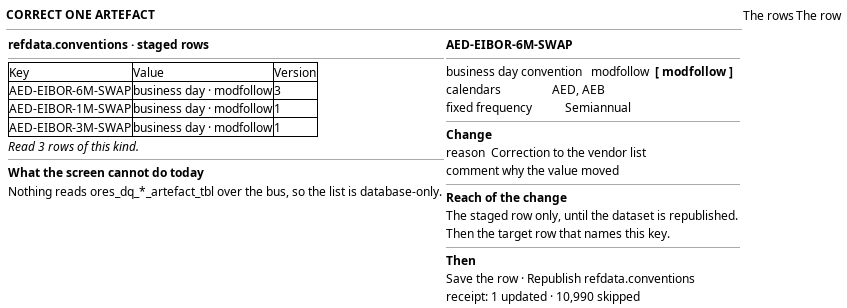

:PROPERTIES:
:ID: FC857853-3657-4B61-AB19-4E264B28EB88
:END:
#+title: User Journey: Correct one artefact
#+description: A data quality operator changes one staged artefact row and republishes the dataset it belongs to, then reads what the correction wrote.
#+type: user_journey
#+level: cross
#+filetags: :knowledge:user_journey:dq:
#+created: 2026-11-22
#+updated: 2026-11-22
#+startup: inlineimages

This page documents a [[id:F44766FA-1E9C-416F-849A-E131101B2ECA][user journey]]: A data quality operator changes one staged artefact row and republishes it.

A user journey describes what one person is trying to do, before anything is
built. It is a design document that outlives any sprint, so it names the
screens, the entity fields each screen shows, and the operations and messages
each step needs.

* Goal

"One value in a catalogue is wrong. I have the corrected value. I need to change
that one row and get it into the tables without re-importing the source and
without touching the other rows."

The journey is done when the person has changed the staged value, republished the
dataset it belongs to, and read a receipt whose counts show that the other rows
were skipped rather than rewritten.

* Actor and trigger

The actor is a data quality operator holding DQ write. The trigger is a term a
valuation disagrees with, or a review that found a bad value in a curated set.

It starts at the staged rows of one dataset and ends at the receipt of the
republish. It is the narrowest of the DQ journeys: it changes one value and
carries it, and it does not change a definition, a schema or a target table.

The journey carries no state of its own beyond the edit. The republish is a
workflow instance, as every publish is.

* Steps

1. *Find the staged row.* The person opens a dataset, asks for its artefact
   rows, and searches by the key the value belongs to — a convention's key, a
   currency's code, a country's alpha-2. The system lists the rows and says how
   many it read.

2. *Read the row as a record.* The person opens one row. The system shows the
   row's key fields, its value fields, and the provenance the row carries: which
   dataset staged it, when, and the as-of date of that dataset.

3. *Change one value.* The person edits the field and states why, choosing a
   change reason from the list. The system states what the change will reach: the
   staged row only, until the dataset is republished, and then the target row
   that names this row's key.

4. *Save the staged row.* The system writes the row, bumps its version, and
   records the change reason and the commentary. Nothing in the target tables has
   changed yet, and the screen says so.

5. *Read what the republish would write.* The person asks for the preview of the
   dataset's publish, and the system reports the counts: one row to update, the
   others skipped. This is the answer to "did I disturb anything else".

6. *Republish the dataset.* The person publishes the dataset the row belongs to.
   The system starts the workflow instance and reports when the step completes.

7. *Read the receipt.* The system reports the four counts. One updated row and
   the rest skipped is the successful correction; a large inserted count means the
   dataset was not the one the row belonged to.

* Screens and wireframes

Two screens. The first lists the artefact rows of one dataset with the key the
person searches by, and says how many rows it read. The second is the row as a
record page: key, values, provenance, and the two actions that carry the change —
save, then republish.

#+caption: Correct one artefact: the staged rows of one dataset, and one row as a
#+caption: record with the reach of the change stated before it is saved.
#+attr_html: :width 100%

The source is [[proj:doc/knowledge/journeys/dq/wireframe_correct_one_artefact.puml][~wireframe_correct_one_artefact.puml~]],
rendered with =plantuml -tpng wireframe_correct_one_artefact.puml=.

* Prototype

The prototype is at
[[proj:doc/prototypes/dq/correct-one-artefact/][=doc/prototypes/dq/correct-one-artefact/=]]
and its design note is
[[id:1123ACA9-A228-4A78-94F2-EE3E1C69BB8F][Correct one artefact prototype]].

* Entities composed

| Entity | Panel | Fields |
|--------+-------+--------|
| the artefact table of the dataset | The row list and the record page | the entity's own columns, plus =dataset_id= and =tenant_id= |
| =dataset= | The provenance | =code=, =name=, =as_of_date=, =source_system= |
| =change_reason= | The edit | =code=, =category=, =requires_commentary= |
| =publication= | The receipt, when the run log has a writer | the four counts, =published_at=, =published_by= |

The artefact table is not an entity model with a screen: it is generated from the
entity it stages, so the record page is the target entity's fields plus the two
bookkeeping columns, and the page must say so.

* Operations and messages

| Step | Operation | Subject | Provided today |
|------+-----------+---------+----------------|
| 1 | List a dataset's artefact rows | — | no: nothing reads =ores_dq_*_artefact_tbl= over the bus |
| 2 | Read one staged row | — | no: same |
| 3, 4 | Write one staged row, with a change reason | — | no: same |
| 5 | Preview the dataset's publish | — | no: the preview function is per bundle and unserved |
| 6 | Republish the dataset | =dq.v1.ops.publish_datasets= | yes |
| 7 | The receipt | the workflow step result | yes, as a workflow result |

* What is missing

- *No read of an artefact table over the bus.* This is the journey's whole first
  half. DQ publishes artefact types and datasets, and never the rows they stage,
  so a screen cannot list a row, read it or write it. The
  [[id:99481EA8-1D2B-426D-A4E6-5E834FF5FFCE][conventions publish journey]]
  records the same gap from the other side: what is about to land is readable
  only in the database.
- *No write to an artefact table over the bus.* A correction that cannot be
  written is not a correction. It needs the same read and write pair, with the
  change reason and the commentary the rest of the system requires of an edit.
- *A correction republishes the dataset, not the row.* The publish function takes
  a dataset, so the smallest correction still runs the whole dataset. That is
  acceptable when the other rows are skipped, and it is why step 5 exists: the
  person must be able to see that the run skipped everything else.
- *No per-dataset preview.* Same gap as
  [[id:23E34C1D-4C42-450A-BF19-E5165739D20C][Publish a dataset]], and this
  journey depends on it more than that one does.

* Related journeys

- [[id:23E34C1D-4C42-450A-BF19-E5165739D20C][Publish a dataset]] — the republish
  this journey ends with.
- [[id:84DB1AC9-9384-43BB-A97A-2A17261DA50F][Find the trade a published value
  belongs to]] — reached first, when the person does not yet know which value is
  wrong.
- [[id:5344ADC1-E729-4846-BE07-C6BC2169C4C9][Is my reference data complete?]] —
  the read this journey assumes.

* Related knowledge

- [[id:F05B779F-769B-49D5-B369-D2AAC029B36D][DQ Bundle Publication Pipeline]] — what a republish does, and what it records.
- [[id:F19A6B98-1CAD-4206-913B-A4EAAED2DEAF][From an entity model to a published row]] — the artefact table's shape, and why it has no keys.
- [[id:2BF7F03F-6BF4-45FF-8E26-4D3B4E2D943D][Record screen standard]] — the shape the row's page takes.

* See also

- [[id:34A4373F-1BD1-4710-885B-95B3C3A3B8F7][Design and build the DQ screens from the journeys]] — the task that builds this.
- [[id:50550498-38ED-4A07-AF28-209BAFF378F0][DQ journeys]] — the group this belongs to.
