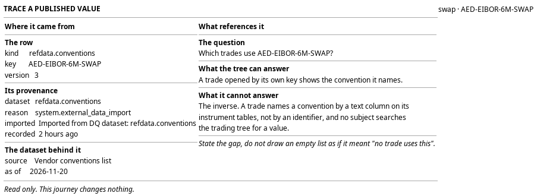

:PROPERTIES:
:ID: 84DB1AC9-9384-43BB-A97A-2A17261DA50F
:END:
#+title: User Journey: Find the trade a published value belongs to
#+description: A person holds a published value and asks which dataset wrote it and which trades reference it, and learns that the second question has no path today.
#+type: user_journey
#+level: cross
#+filetags: :knowledge:user_journey:dq:
#+created: 2026-11-22
#+updated: 2026-11-22
#+startup: inlineimages

This page documents a [[id:F44766FA-1E9C-416F-849A-E131101B2ECA][user journey]]: A person traces a published value to the dataset that wrote it and to the trades that reference it.

A user journey describes what one person is trying to do, before anything is
built. It is a design document that outlives any sprint, so it names the
screens, the entity fields each screen shows, and the operations and messages
each step needs.

* Goal

"A valuation disagrees with a term. Before I change anything I need to know where
that value came from and what reads it — which dataset published it, and which
trades reference it."

The journey is done when the person can name the dataset that wrote the value and
has either named the trades that reference it, or learned that the tree cannot
answer that question today.

* Actor and trigger

The actor is a data quality operator, a market risk analyst, or the tenant
administrator who fields the question. The trigger is a disagreement: a report
that values differently from expectation, or a term a trader challenges.

It starts with a value the person already holds — a convention's key, a
currency's code, a calendar's name — and it ends either at a trade or at the
statement that the second half of the question is not answerable yet.

The journey carries no state. It reads, and it changes nothing.

* Steps

1. *Hold the value.* The person starts from what they have: a key in a report, a
   term in a confirmation, a name in someone's message. The screen takes the key
   and the kind it belongs to, because the same string names rows in more than one
   kind.

2. *Find the published row.* The system reads the row of that kind by its key, in
   the tenant that holds it — which for a platform or world row is the system
   tenant, read where it lies.

3. *Read where it came from.* The system shows the row's provenance: the dataset
   name that published it, the reason code and commentary the publish stamped, and
   the row's version and changed-at. From the dataset name the person can reach
   the dataset, its artefact type and its staging table.

4. *Read what the dataset is.* The dataset's code, name, source system and
   as-of date say how current the value is and which vendor it came from. This is
   the answer to "where did this come from", and it is the half the tree answers.

5. *Ask what references it.* The person asks which trades use the value. The
   system cannot answer: a trade references a convention by a text column on its
   instrument tables, not by an identifier, and no subject searches the trading
   tree for a value.

6. *Read what could be answered instead.* The system offers what the tree does
   hold: the trades are searchable by their own keys and by party, and a person
   who knows the trade can open it and read the convention it names. The inverse
   question — from the value to the trade — is stated as missing rather than
   drawn as an empty table.

* Screens and wireframes

One screen in two halves. The left half walks back from the value: the row, its
provenance and the dataset behind it. The right half is the forward question:
what references this value. The right half says what it cannot answer, and why,
rather than showing an empty list as if it meant "no trade uses this".

#+caption: Trace a published value: the provenance backwards, and the used-by
#+caption: question forwards, which the tree cannot answer today.
#+attr_html: :width 100%

The source is [[proj:doc/knowledge/journeys/dq/wireframe_trace_a_published_value.puml][~wireframe_trace_a_published_value.puml~]],
rendered with =plantuml -tpng wireframe_trace_a_published_value.puml=.

* Prototype

The prototype is at
[[proj:doc/prototypes/dq/trace-a-published-value/][=doc/prototypes/dq/trace-a-published-value/=]]
and its design note is
[[id:4AD548F1-06BC-47D7-B15F-138DA4805CF0][Trace a published value prototype]].

* Entities composed

| Entity | Panel | Fields |
|--------+-------+--------|
| the published entity's row | The left half, step 1 | its key and its values |
| its provenance tail | The left half, step 3 | =dataset= name, =change_reason=, =commentary=, =version=, =recorded_at= |
| =dataset= | The left half, step 4 | =code=, =name=, =source_system=, =as_of_date= |
| =artefact_type= | The left half, step 4 | =artefact_table=, =target_table= |
| a trade's instrument tables | The right half, step 6 | the text column that names the convention |

* Operations and messages

| Step | Operation | Subject | Provided today |
|------+-----------+---------+----------------|
| 1, 2 | Read the row of a kind by its key | each entity's =list= and =get= | yes |
| 3, 4 | Read the dataset behind it | =dq.v1.datasets.list=, =dq.v1.datasets.get= | yes |
| 5 | Trades that reference a value | — | no: no subject answers the inverse question |
| 6 | Trades by their own keys, and one trade | =trading.v1.trades.list=, =trading.v1.trades.get= | yes |

* What is missing

- *A used-by operation.* Nothing answers "which trades reference this value".
  The reference is a text column on the instrument tables — a convention is named
  by its business-day convention, its calendars and its key — and not an
  identifier, so even a scan would compare strings. The column is declared as a
  text member at =ores.trading.instrument_schedule.org= line 245 and created as
  ="convention" text null= at =trading_instrument_schedules_create.sql= line 81.
- *A convention held by identifier.* Because the reference is text, a rename in
  the reference data does not move with the trade. The trace journey's inverse
  question is unanswerable for the same reason a rename is dangerous.
- *The provenance is not queryable by value.* It is on the row, so step 3 works
  once the row is read. There is no subject that searches provenance, so "which
  rows did dataset X write" is unanswerable in bulk for the same reason the
  published count is.
- *This journey cannot be fully built.* Steps 1 to 4 and 6 are drawable today.
  Step 5 is not, and the screen states it. That is the honest shape, and it is
  why the journey is written before the screen: it names the mechanism the
  trading component would need.

* Related journeys

- [[id:FC857853-3657-4B61-AB19-4E264B28EB88][Correct one artefact]] — where the
  person goes once the value is found wrong.
- [[id:23E34C1D-4C42-450A-BF19-E5165739D20C][Publish a dataset]] — where the
  person goes when the value is missing rather than wrong.
- [[id:99481EA8-1D2B-426D-A4E6-5E834FF5FFCE][Publish conventions from data
  quality]] — the journey that puts the value there in the first place.

* Related knowledge

- [[id:7287B58F-964C-4D42-8EC4-6C5DA53EEE2D][Reference data classification by publication level]] — the levels, and why a world row is read from the system tenant.
- [[id:F05B779F-769B-49D5-B369-D2AAC029B36D][DQ Bundle Publication Pipeline]] — the provenance a publish stamps, and what it names.
- [[id:D53501D6-5FF5-44BF-B389-AAA727ACAE6F][Qt DQ surface inventory]] — the accession card and the lineage graph the Qt client drew, which read provenance and not usage.

* See also

- [[id:34A4373F-1BD1-4710-885B-95B3C3A3B8F7][Design and build the DQ screens from the journeys]] — the task that builds this.
- [[id:50550498-38ED-4A07-AF28-209BAFF378F0][DQ journeys]] — the group this belongs to.
