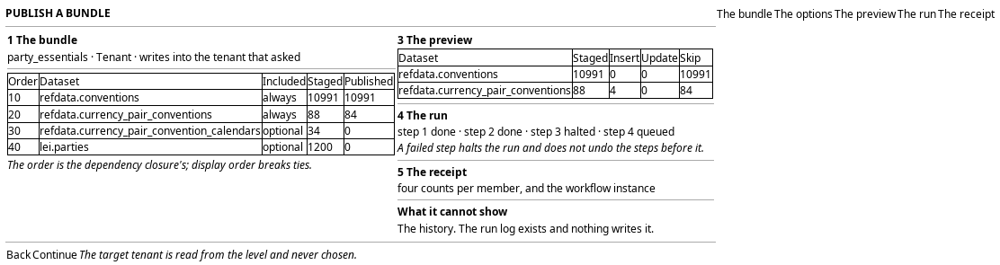

:PROPERTIES:
:ID: 4E233C8D-E3CA-4D37-AC43-1F81EF3AA133
:END:
#+title: User Journey: Publish a bundle
#+description: A data quality operator publishes a bundle: its members in dependency order, the optional ones, the mode, the preview, the run and the receipt.
#+type: user_journey
#+level: cross
#+filetags: :knowledge:user_journey:dq:
#+created: 2026-11-22
#+updated: 2026-11-22
#+startup: inlineimages

This page documents a [[id:F44766FA-1E9C-416F-849A-E131101B2ECA][user journey]]: A data quality operator publishes a bundle and reads what the run wrote.

A user journey describes what one person is trying to do, before anything is
built. It is a design document that outlives any sprint, so it names the
screens, the entity fields each screen shows, and the operations and messages
each step needs.

* Goal

"I am onboarding a party, or the tenant, and it needs a whole set of catalogues
at once. I want to see what the set carries, what order it runs in, what it would
write, and what it wrote."

The journey is done when the person has read the contents, decided on the
optional members and the mode, watched the run to its end, and read a receipt
that names what each member wrote.

* Actor and trigger

The actor is a data quality operator, or the tenant administrator who onboards
parties. The trigger is a new tenant, a new party, or a bundle whose catalogues
have moved on.

It starts at a bundle and it ends at its receipt. It is the wide door beside
[[id:23E34C1D-4C42-450A-BF19-E5165739D20C][Publish a dataset]]: the bundle is
for a set, and that is for one.

The journey carries no state of its own: the run is a workflow instance, and its
progress is read from the instance, so the person can leave and come back.

* Steps

1. *Read what the bundle carries.* The person opens a bundle. The system states
   its code, name, level and scope, the tenant the level writes into, and its
   members in display order with each member's artefact type and whether it is
   optional.

2. *Read the order, and why it is that order.* The system states that the run
   follows the dependency closure, and that the display order only breaks ties. A
   member that another member depends on is published before it, whatever the
   list says.

3. *Decide the optional members.* The system lists the optional members with what
   skipping them means, and the person includes the ones the party needs. A large
   GLEIF dataset does not arrive with every small catalogue unless it is asked
   for.

4. *Choose the mode.* The system offers upsert, insert only and replace all, and
   states what each does to a row that is already there.

5. *Read the preview.* The system reports, per member, how many rows are staged
   and how many the run would insert, update and skip under the chosen mode. The
   person reads this before committing to the run.

6. *Run it, and watch.* The system starts one workflow instance, reports its
   identifier, and shows each member as it completes or halts. A halted step does
   not undo the ones before it.

7. *Read the receipt.* The system reports the four counts per member and names
   the workflow instance. It also says what it cannot show: no history row was
   written, because nothing writes the run log.

* Screens and wireframes

One page with a rail of five steps and a card each: the bundle, the options, the
preview, the run and the receipt. The target tenant is read from the bundle's
level and never offered as a control. The screen states it on the preview, before
the run starts, because the level is what refuses a caller and the person should
learn that before pressing anything: =publish_handler.hpp= reads the bundle's
level at line 189 and compares the caller's tenant with the system tenant at line
204.

#+caption: Publish a bundle: the rail, the preview that makes the run readable
#+caption: before it happens, and the receipt.
#+attr_html: :width 100%

The source is [[proj:doc/knowledge/journeys/dq/wireframe_publish_a_bundle.puml][~wireframe_publish_a_bundle.puml~]],
rendered with =plantuml -tpng wireframe_publish_a_bundle.puml=.

* Prototype

The prototype is at
[[proj:doc/prototypes/dq/publish-a-bundle/][=doc/prototypes/dq/publish-a-bundle/=]]
and its design note is
[[id:495EFAFA-A5B3-4DE4-93DB-FDFA577E3790][Publish a bundle prototype]]. It is
signed off.

* Entities composed

| Entity | Panel | Fields |
|--------+-------+--------|
| =dataset_bundle= | The header | =code=, =name=, =level=, =description= |
| =dataset_bundle_member= | The contents | =dataset_code=, =display_order=, =optional= |
| =dataset= | The contents | =code=, =name=, =artefact_type= |
| =artefact_type= | The destination | =artefact_table=, =target_table=, =target_subject= |
| =publication= | The receipt, when the run log has a writer | the four counts, =published_at=, =published_by= |

* Operations and messages

| Step | Operation | Subject | Provided today |
|------+-----------+---------+----------------|
| 1 | The bundles and their level | =dq.v1.dataset_bundles.list= | yes |
| 1, 3 | The members in order | =dq.v1.dataset_bundle_members.list_by_bundle_code= | yes |
| 1, 2 | The datasets and artefact types | =dq.v1.datasets.list=, =dq.v1.artefact_types.list= | yes |
| 5 | The preview | — | no: =ores_dq_bundle_preview_fn= computes it, nothing serves it |
| 6 | Publish the bundle | =dq.v1.ops.publish_bundle= | yes |
| 7 | The receipt | the workflow step results | yes, as a workflow result |
| 7 | The history | =dq.v1.publications.list= | yes, and always empty |

* What is missing

- *The preview is not served.* =ores_dq_bundle_preview_fn= and
  =ores_dq_bundle_datasets_list_fn= compute the readiness and the counts, and no
  subject carries either. The publish path calls them for its own use.
- *The run log has no writer.* =ores_dq_dataset_publications_tbl= exists and
  nothing writes it, so the receipt is the function counts and not a record.
  Captured as
  [[id:5C20BEF9-13CA-48B5-8221-E83C1D6345DD][The publication run log has no
  writer, so the history screen is always empty]].
- *The bundle roster function names no level.* =ores_dq_bundles_list_fn= returns
  the name and the member count and not the level, so a screen that used it alone
  could not group the bundles by the level they publish at.
- *No staged count per member over the bus.* The staged figure in the preview
  needs a read of each artefact table, which no subject offers.

* Related journeys

- [[id:23E34C1D-4C42-450A-BF19-E5165739D20C][Publish a dataset]] — the same run
  for one dataset.
- [[id:99481EA8-1D2B-426D-A4E6-5E834FF5FFCE][Publish conventions from data
  quality]] — the conventions topic's own instance of this run, which reads the
  receipt per convention kind.
- [[id:5344ADC1-E729-4846-BE07-C6BC2169C4C9][Is my reference data complete?]] —
  where the person decides the bundle is what is missing.

* Related knowledge

- [[id:F05B779F-769B-49D5-B369-D2AAC029B36D][DQ Bundle Publication Pipeline]] — the stages behind steps 6 and 7.
- [[id:7287B58F-964C-4D42-8EC4-6C5DA53EEE2D][Reference data classification by publication level]] — the bundle map the level comes from.
- [[id:D53501D6-5FF5-44BF-B389-AAA727ACAE6F][Qt DQ surface inventory]] — the five-page wizard the Qt client had, and what it asked.

* See also

- [[id:34A4373F-1BD1-4710-885B-95B3C3A3B8F7][Design and build the DQ screens from the journeys]] — the task that builds this.
- [[id:50550498-38ED-4A07-AF28-209BAFF378F0][DQ journeys]] — the group this belongs to.
