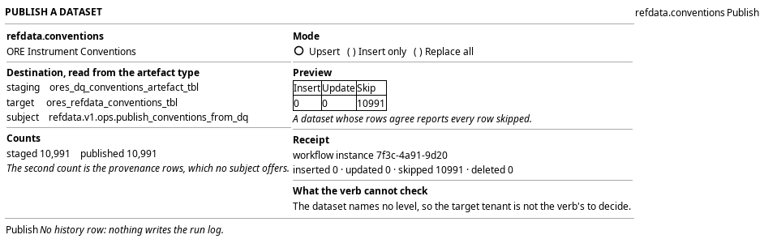

:PROPERTIES:
:ID: 23E34C1D-4C42-450A-BF19-E5165739D20C
:END:
#+title: User Journey: Publish a dataset
#+description: A data quality operator publishes one dataset into the tenant and reads what the run wrote, member by member of its artefact type.
#+type: user_journey
#+level: cross
#+filetags: :knowledge:user_journey:dq:
#+created: 2026-11-22
#+updated: 2026-11-22
#+startup: inlineimages

This page documents a [[id:F44766FA-1E9C-416F-849A-E131101B2ECA][user journey]]: A data quality operator publishes one dataset into the tenant and reads what the run wrote.

A user journey describes what one person is trying to do, before anything is
built. It is a design document that outlives any sprint, so it names the
screens, the entity fields each screen shows, and the operations and messages
each step needs.

* Goal

"One catalogue is stale, or one catalogue is missing. I do not want to republish
everything to fix it, and I want to know what the run wrote when it is done."

The journey is done when the person has published exactly one dataset, read the
four counts the function returned, and can say which rows changed and which were
skipped.

* Actor and trigger

The actor is a data quality operator, or the tenant administrator who holds the
DQ write permission. The trigger is a dataset whose curated rows changed
upstream, or a valuation that reports a term the tenant should have.

It starts at the dataset and it ends at its receipt. It is the narrow door beside
[[id:4E233C8D-E3CA-4D37-AC43-1F81EF3AA133][Publish a bundle]]: the bundle is for
onboarding a set, and this is for fixing one.

The journey carries no state of its own: the publish runs as a workflow instance
and its progress is read from the instance.

* Steps

1. *Find the dataset.* The person opens the dataset list and searches by code or
   name, then opens the one they need. The system shows the dataset's code, name,
   artefact type, source system and as-of date, all of which say whether this is
   the right catalogue.

2. *Read what would be published.* The system shows the artefact type's staging
   table, target table and target subject, and the counts of staged and published
   rows. The first three say where the rows will go; the last two say how far it
   has already got.

3. *Read what the run would write.* The person chooses the mode and reads the
   preview: how many rows would be inserted, updated and skipped. A dataset whose
   rows already agree reports every row as skipped, which is the evidence that
   nothing needs doing.

4. *Publish.* The person publishes. The system starts one workflow instance and
   reports its identifier, then follows the step as it completes.

5. *Read the receipt.* The system reports the four counts the publish function
   returned and names the workflow instance. The person can tell a run that wrote
   rows from one that found them all in place.

* Screens and wireframes

One page, four regions: the dataset header, the destination, the mode with its
preview, and the receipt once the run returns. The destination is read and never
chosen: it comes from the artefact type, and the level the dataset's bundle
carries decides which tenant receives the rows.

#+caption: Publish a dataset: the dataset, its destination, the mode and preview,
#+caption: and the receipt.
#+attr_html: :width 100%

The source is [[proj:doc/knowledge/journeys/dq/wireframe_publish_a_dataset.puml][~wireframe_publish_a_dataset.puml~]],
rendered with =plantuml -tpng wireframe_publish_a_dataset.puml=.

* Prototype

The prototype is at
[[proj:doc/prototypes/dq/publish-a-dataset/][=doc/prototypes/dq/publish-a-dataset/=]]
and its design note is
[[id:9F601830-091B-4F2D-A02F-70FB402F5206][Publish a dataset prototype]].

* Entities composed

| Entity | Panel | Fields |
|--------+-------+--------|
| =dataset= | The header | =code=, =name=, =artefact_type=, =source_system=, =as_of_date= |
| =artefact_type= | The destination | =artefact_table=, =target_table=, =target_subject= |
| =dataset_bundle_member= | Explains the level, where the dataset is a member | =bundle_code=, =display_order=, =optional= |
| =publication= | Not shown: the run log has no writer | the four counts, =published_at=, =published_by= |

* Operations and messages

| Step | Operation | Subject | Provided today |
|------+-----------+---------+----------------|
| 1 | The datasets | =dq.v1.datasets.list=, =dq.v1.datasets.get= | yes |
| 1, 2 | The artefact types | =dq.v1.artefact_types.list= | yes |
| 2 | Staged and published counts for one dataset | — | no: no subject counts either |
| 3 | A preview of the run | — | no: =ores_dq_bundle_preview_fn= is per bundle, and unserved |
| 4 | Publish the dataset | =dq.v1.ops.publish_datasets= | yes |
| 5 | The receipt | the workflow step result | yes, as a workflow result |
| 5 | The publication history | =dq.v1.publications.list= | yes, and always empty |

* What is missing

- *The detail verb names no level.* =publish_datasets= takes dataset identifiers
  and no level, and a dataset carries no level of its own, so the verb cannot
  decide the tenant the run writes into and admits any caller the permission
  allows. The bundle verb compares the caller against the bundle's level; this one
  has nothing to compare. Captured as
  [[id:B14DE752-043F-4EA0-A72E-ECDEB034C5F4][A dataset publish names no level, so
  a tenant can publish a world dataset into itself]].
- *No preview for one dataset.* The preview that exists is per bundle. A person
  who publishes one dataset needs the same counts, scoped to it.
- *No staged or published count.* Staged is readable only from the database, and
  published is a count of provenance rows no service offers.
- *No read of an artefact table over the bus.* DQ publishes artefact types and
  datasets, not the rows they stage, so the counts above cannot be assembled from
  what is served today.

* Related journeys

- [[id:4E233C8D-E3CA-4D37-AC43-1F81EF3AA133][Publish a bundle]] — the same run
  over a set of datasets, when onboarding rather than fixing.
- [[id:FC857853-3657-4B61-AB19-4E264B28EB88][Correct one artefact]] — reached
  when the dataset is right and one row is wrong.
- [[id:5344ADC1-E729-4846-BE07-C6BC2169C4C9][Is my reference data complete?]] —
  reached first, when the person does not yet know which dataset is missing.

* Related knowledge

- [[id:F05B779F-769B-49D5-B369-D2AAC029B36D][DQ Bundle Publication Pipeline]] — the stages behind steps 4 and 5.
- [[id:7287B58F-964C-4D42-8EC4-6C5DA53EEE2D][Reference data classification by publication level]] — why the target tenant is read and not chosen.
- [[id:D53501D6-5FF5-44BF-B389-AAA727ACAE6F][Qt DQ surface inventory]] — what the Qt client offered here.

* See also

- [[id:34A4373F-1BD1-4710-885B-95B3C3A3B8F7][Design and build the DQ screens from the journeys]] — the task that builds this.
- [[id:50550498-38ED-4A07-AF28-209BAFF378F0][DQ journeys]] — the group this belongs to.
