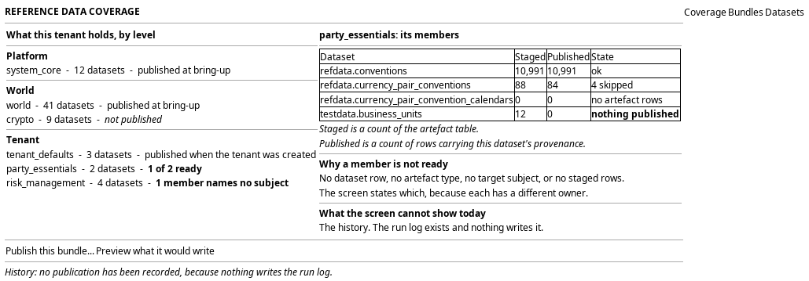

:PROPERTIES:
:ID: 5344ADC1-E729-4846-BE07-C6BC2169C4C9
:END:
#+title: User Journey: Is my reference data complete?
#+description: A data quality operator reads whether the tenant holds every catalogue it needs, names why a member is not ready, and publishes the bundle that fills the gap.
#+type: user_journey
#+level: cross
#+filetags: :knowledge:user_journey:dq:
#+created: 2026-11-22
#+updated: 2026-11-22
#+startup: inlineimages

This page documents a [[id:F44766FA-1E9C-416F-849A-E131101B2ECA][user journey]]: A data quality operator reads whether the tenant holds every catalogue it needs, names why a member is not ready, and publishes the bundle that fills the gap.

A user journey describes what one person is trying to do, before anything is
built. It is a design document that outlives any sprint, so it names the
screens, the entity fields each screen shows, and the operations and messages
each step needs.

* Goal

"I need to know that the reference data my valuations read is actually here —
what the tenant holds, what it is missing, and which bundle fills the gap. If
something is missing I want to see why before I publish, not after."

The journey is done when the person can state three things: which bundles the
tenant holds at each level, which member of a bundle is not ready and which of
the four reasons applies, and what they published to close each gap.

* Actor and trigger

The actor is a data quality operator, or the tenant administrator who holds the
DQ write permission in a small installation. The trigger is one of three: a
database that has just been recreated, a tenant that has just been created, or a
valuation that reports a missing term.

It starts on the coverage screen and it ends either with a publish that the
person ran or with a gap handed to the person who can fill it — an artefact with
no staged rows is an importer's problem, not a publisher's.

The journey carries no state of its own. A publish runs as a workflow instance
in =ores.workflow=, and the progress of that run is read from the instance,
which is what lets the person leave the screen and come back. See
[[id:3361CF92-89B0-481E-9E51-ACE2FEEF2FAA][Journey execution]].

It publishes and it reads. It does not author a dataset, does not change an
artefact row, and does not correct the term a valuation complains about — that
is a journey of its own.

* Steps

1. *Read what the tenant holds.* The person opens the coverage screen. The
   system lists the bundles with their level, grouped by level, and says for
   each whether it was published, is partly published, or was never published.
   A platform or world bundle is read where it lies in the system tenant, so the
   screen says so rather than showing it as absent from the tenant.

2. *Read the members of one bundle.* The person selects a bundle. The system
   lists its members in display order with, for each: the dataset code and name,
   the artefact type, the target subject, whether the dataset exists, whether it
   has staged rows, and whether it is publishable at all. An optional member is
   marked as optional, because it publishes only when someone asks for it.

3. *Read why a member is not ready.* The system states one of four reasons,
   because each has a different owner: no dataset row names this member, the
   dataset names no artefact type, the artefact type names no target subject, or
   the artefact table holds no rows. The first three are DQ's to fix; the fourth
   is the importer's.

4. *Read what a publish would write.* The person opens the preview for the
   bundle. The system reports, per dataset, the number of staged rows and what a
   publish at the chosen mode would do with them — insert, update or skip — so a
   run is not the first time the person learns the answer.

5. *Publish.* The person chooses the mode and publishes. The system starts one
   workflow instance and reports its identifier; the screen follows the steps as
   they complete and reads the per-dataset counts, which come from the functions
   that wrote the rows.

6. *Re-read the coverage.* The person returns to the screen and reads the same
   rows again. A dataset that published its rows now carries a published count;
   one that reported a skip carries the same count as before, which is the
   evidence that nothing changed.

* Screens and wireframes

One screen answers the first four steps. The roster on the left is grouped by
level; the selected bundle's members fill the right; the reasons a member is not
ready sit under that table, and the actions are the two the person needs — the
preview and the publish.

#+caption: The coverage screen: the roster by level, the members of one bundle,
#+caption: the reason a member is not ready, and the two actions.
#+attr_html: :width 100%

The source is [[proj:doc/knowledge/journeys/dq/wireframe_reference_data_coverage.puml][~wireframe_reference_data_coverage.puml~]],
rendered with =plantuml -tpng wireframe_reference_data_coverage.puml=.

* Prototype

The prototype is at
[[proj:doc/prototypes/dq/reference-data-coverage/][=doc/prototypes/dq/reference-data-coverage/=]]:
the bundles grouped by level, the chosen bundle's members with the reason each is
not ready, and the four reasons with their owners. It draws mock data and every
place where the server does not yet answer is marked on the page. Steps 4 and 5 —
the preview and the run — are drawn by the publish prototype below, and step 6 returns
here.
Its design note is
[[id:CB98437A-6293-4AC0-B68A-06D606FC9225][Reference data coverage prototype]],
and the publish it hands to is drawn by
[[id:495EFAFA-A5B3-4DE4-93DB-FDFA577E3790][Publish a bundle prototype]]. A
prototype stays on main once accepted, as
[[id:708C2462-C1F8-455B-B091-9D9690FEEAAB][Keep journey prototypes on main]]
requires; this one is not signed off yet.

* Entities composed

| Entity | Panel | Fields |
|--------+-------+--------|
| =dataset_bundle= | The roster, grouped by level | =code=, =name=, =level= |
| =dataset_bundle_member= | The member table's order and the optional mark | =dataset_code=, =display_order=, =optional= |
| =dataset= | The member table's identity | =code=, =name=, =artefact_type= |
| =artefact_type= | The member table's destination | =artefact_table=, =target_table=, =target_subject= |
| =publication= | Not shown today: the run log it models has no writer | =published_at=, =dataset_code=, =mode=, the four counts, =published_by= |

The published count is not a field of any of these. It is read from the
provenance each published row carries, which names the dataset that wrote it; the
target entity of each dataset owns that tail, so the screen reads one target
table per member.

* Operations and messages

| Step | Operation | Subject | Provided today |
|------+-----------+---------+----------------|
| 1 | The bundles and their level | =dq.v1.dataset_bundles.list= | yes |
| 1 | A bundle's member count | — | no: =ores_dq_bundles_list_fn= computes it, nothing serves it |
| 2 | A bundle's members in order | =dq.v1.dataset_bundle_members.list_by_bundle_code= | yes |
| 2 | The datasets | =dq.v1.datasets.list= | yes |
| 2 | The artefact types and their subjects | =dq.v1.artefact_types.list= | yes |
| 2, 3 | Readiness per member: dataset exists, subject set, publishable, optional | — | no: =ores_dq_bundle_datasets_list_fn= computes it, nothing serves it |
| 4 | Preview of a publish | — | no: =ores_dq_bundle_preview_fn= computes it, nothing serves it |
| 5 | Publish the bundle | =dq.v1.ops.publish_bundle= | yes |
| 6 | Published rows for a dataset | — | no: each target service lists its own rows, and none filters by the dataset in the provenance |
| 6 | The publication history | =dq.v1.publications.list= | yes, and always empty |

The three operations that are missing are the three SQL functions the publish
path already calls for its own purposes. They are computed today and served to
no one.

* What is missing

- *A coverage operation.* The three discovery functions —
  =ores_dq_bundles_list_fn=, =ores_dq_bundle_datasets_list_fn= and
  =ores_dq_bundle_preview_fn= — exist in the database and have no subject. The
  screen needs one operation that answers all three, because three round trips
  per bundle and one per member is what the Qt client did and what made the
  screen slow to trust.
- *A published-row count per dataset.* The provenance names the dataset on every
  published row, and nothing counts by it. Without the count the screen can say
  a bundle was published and cannot say how much of it landed.
- *A writer for the run log.* =ores_dq_dataset_publications_tbl= and its CRUD
  subject both exist, and nothing on the publish path writes a row, so the
  history is empty however the screen is built. This is captured as
  [[id:5C20BEF9-13CA-48B5-8221-E83C1D6345DD][The publication run log has no
  writer, so the history screen is always empty]]. It is a precondition for any
  history screen, not for this journey's first five steps.
- *A read of an artefact table over the bus.* No subject reads
  =ores_dq_<plural>_artefact_tbl=, so the staged count and the preview are only
  reachable through the coverage operation above. DQ publishes artefact types and
  datasets, not the rows they stage.
- *A level on the bundle roster function.* =ores_dq_bundles_list_fn= returns the
  bundle's name and member count and not its level, so a screen that used it
  alone could not group the roster. The entity list carries the level; the two
  must agree.

* Related journeys

- [[id:99481EA8-1D2B-426D-A4E6-5E834FF5FFCE][Publish conventions from data
  quality]] — the topic journey this one hands to: once the gap is a missing
  convention, the person reads what a publish covers and what it will skip.
- *Publish a bundle* — planned, not yet written. Reached from step 5 when the
  person wants to understand the order and the optional members rather than just
  run it.
- *Publish a dataset* — planned, not yet written. Reached when one member is
  missing rather than a whole bundle.
- *Correct one artefact* — planned, not yet written. Reached when the member is
  staged and wrong rather than absent.

* Related knowledge

- [[id:7287B58F-964C-4D42-8EC4-6C5DA53EEE2D][Reference data classification by publication level]] — the levels the roster is grouped by, and the tenant each writes into.
- [[id:F05B779F-769B-49D5-B369-D2AAC029B36D][DQ Bundle Publication Pipeline]] — the stages behind steps 4 to 6, and what a run records.
- [[id:D53501D6-5FF5-44BF-B389-AAA727ACAE6F][Qt DQ surface inventory]] — what the Qt client offered here, and the audit dialog that read a table nothing writes.
- [[id:2BF7F03F-6BF4-45FF-8E26-4D3B4E2D943D][Record screen standard]] — the shape the screen takes once a record is what it shows.

* See also

- [[id:34A4373F-1BD1-4710-885B-95B3C3A3B8F7][Design and build the DQ screens from the journeys]] — the task that builds this.
- [[id:7D2BBBBC-36A3-4BFB-9673-0F9005991D94][Take the DQ pipeline end to end, from a seeded artefact table to a published system]] — the story, and the empty-catalogue failure this journey answers.
