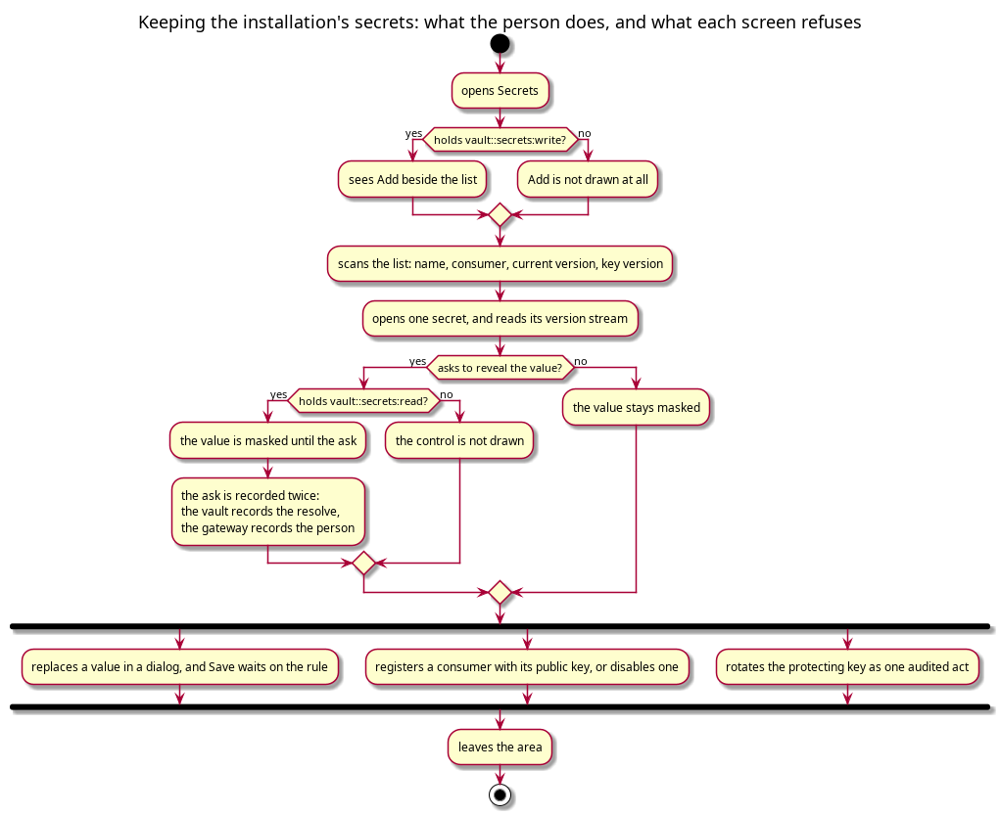
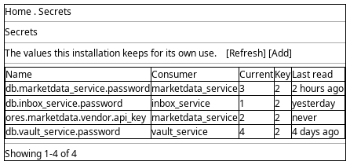
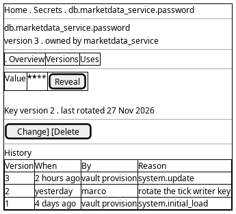
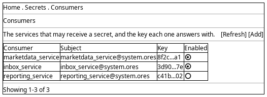
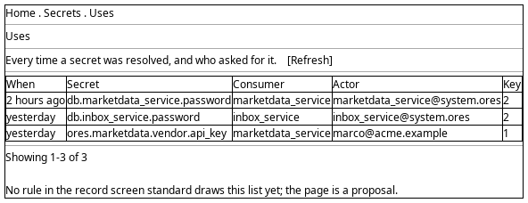

:PROPERTIES:
:ID: B14B2A74-CA0D-4A83-9C0A-46CAB79F6E8B
:END:
#+title: User Journey: Keep the installation's secrets
#+description: A tenant administrator sees what the vault holds, reveals a value once and has it recorded, replaces it, registers the consumers that may receive it, and reads who asked for what.
#+type: user_journey
#+level: cross
#+filetags: :user_journey:security:vault:
#+created: 2026-11-28
#+updated: 2026-11-28
#+startup: inlineimages

This page documents a [[id:F44766FA-1E9C-416F-849A-E131101B2ECA][user journey]]: a tenant administrator keeps the secrets the installation holds.

A user journey describes what one person is trying to do, before anything is
built. It is a design document that outlives any sprint, so it names the
screens, the entity fields each screen shows, and the operations and messages
each step needs.

* Goal

"I want to know what this installation holds, give a service the value it needs,
and see who has been reading it." The administrator lists the secrets, opens one,
reveals a value once and has the act recorded, replaces a value without anyone
re-entering it, registers the consumer that may receive it, and reads the uses.

* Actor and trigger

The tenant administrator: an account inside the tenant that holds
=vault::secrets:read= and =vault::secrets:write=. The trigger is a rotation that
is due, a consumer that has to be given a key, or a use that looks wrong. It
starts when the administrator opens *Secrets*, and ends when they leave it.

A member cannot reach the area at all, and a service is not a person here: a
consumer receives a secret by asking the vault, and the consumer row is what
decides whether the vault answers.

* Steps

#+ATTR_HTML: :class hug-leading
| Step | What the person does | What draws it |
|------+---------------------+----------------|
| 1 | Opens *Secrets* | The record screen standard: the breadcrumb, the plural title and the one sentence (*RS-LIST-01*, *RS-LIST-02*), with /Refresh/ and /Add/ at the right (*RS-LIST-03*) |
| 2 | Scans the list | The standard's cells (*RS-LIST-15*): name, consumer, the current version, and the protecting key's version. The key version is the vault's own vocabulary and has no rule of its own |
| 3 | Opens a secret | The standard's record page, with the version stream the history rule draws (*RS-HIST-01*) |
| 4 | Reveals the value | A kind's own action: the value is masked, one control asks for it, and the ask demands =vault::secrets:read= and is recorded twice — the vault records the gateway's resolve, the gateway records the person |
| 5 | Replaces the value | A dialog over the page (*RS-ADDR-01*), whose Save waits on the rule that a name and its consumer cannot both be changed in one act (*RS-WRITE-08*) |
| 6 | Rotates the protecting key | A workflow, not a screen: one audited act that re-seals every secret, and nobody re-enters a value |
| 7 | Registers a consumer, or disables one | The record screen standard for the consumer kind; the public key is a kind's own action, pasted or uploaded rather than typed into a form |
| 8 | Reads the uses | No rule draws it yet, and no server operation answers it: [[id:AB30FE64-5790-4942-A1CB-30CB7AE17530][The vault's uses have no screen and no operation]] |

#+caption: The journey: a list, a record, one reveal that is recorded, a replacement that no one re-enters, and a consumer record that decides who may receive the value.

Source: [[file:journey_keep_the_installations_secrets.puml][journey_keep_the_installations_secrets.puml]], rendered with =plantuml -tpng journey_keep_the_installations_secrets.puml=.

** Screens and wireframes

Four screens, each drawn here as a PlantUML =salt= wireframe and later as a
prototype at [[file:../../prototypes/vault/keep-the-secrets/index.html][doc/prototypes/vault]].
The wireframes carry no title directive, so the caption below each one is the
title.

#+caption: The secrets list: the breadcrumb, the plural title, one sentence, Refresh and Add at the right, and the rows the vault holds.

Source: [[file:wireframe_secrets.puml][wireframe_secrets.puml]], rendered with =plantuml -tpng wireframe_secrets.puml=.

#+caption: The secret's record: the value masked with one control that asks, the protecting key's version, and the version stream beneath.

Source: [[file:wireframe_secret.puml][wireframe_secret.puml]], rendered with =plantuml -tpng wireframe_secret.puml=.

#+caption: The consumers: which services may receive a secret, the key each answers with, and whether each is enabled.

Source: [[file:wireframe_consumers.puml][wireframe_consumers.puml]], rendered with =plantuml -tpng wireframe_consumers.puml=.

#+caption: The uses: one row per resolve, with the consumer, the actor and the key version — a proposal, because no rule draws it yet.

Source: [[file:wireframe_uses.puml][wireframe_uses.puml]], rendered with =plantuml -tpng wireframe_uses.puml=.

** Entities composed

| Entity | What it holds | Where it comes from |
|--------+---------------+---------------------|
| Secret | a name, the consumer that owns it, the sealed value, the protecting key's version, the current version and its versions | =ores_vault_secrets_tbl= |
| Consumer | a name, the subject it authenticates as, the public key it answers a challenge with, and whether it is enabled | =ores_vault_consumers_tbl= |
| Use | the secret, the consumer, the actor, the key version and the time | =ores_vault_secret_uses_tbl= |
| Key version | the protecting key's version and when it was last rotated | the vault's own state, not a table a person reads |

The screens compose these and nothing else: no screen reads an IAM account, and
the actor on a use is a name the vault recorded rather than a row it joins.

** Operations and messages

Every step is a vault operation over the bus, carried in the sealed envelope the
vault's protocol states; the screen calls it through the gateway and never
through a BFF, and the two doors the gateway already has are its own
([[id:4F28F755-7DA1-4EDD-9983-256622B6088A][Sealed Delivery of a Secret to Its
Consumer]]).

The reveal is the one operation a person runs that resolves a value: the gateway
asks the vault as a consumer, the vault records the resolve, and the gateway
records the person. The write is the other door, and the screen seals nothing
itself.

** Coverage

Every step's operation, the subject that carries it, and whether it exists today.

#+ATTR_HTML: :class hug-leading
| Step | Operation | Subject | Status |
|------+-----------+---------+--------|
| 1 | list secrets | =vault.v1.secrets.list= | exists, and =GET /api/v1/vault/secrets= |
| 2 | open a secret, and its versions | =vault.v1.ops.describe=, =vault.v1.secrets_versions.list= | the record exists, and =GET /api/v1/vault/secrets/{name}=; the versions have no door |
| 3 | reveal the value | =vault.v1.ops.resolve= | exists, and =GET /api/v1/vault/secrets/{name}/value= |
| 4 | replace the value | =vault.v1.ops.write= | exists, and =POST /api/v1/vault/secrets= |
| 5 | delete a secret | =vault.v1.ops.delete= | exists, and =DELETE /api/v1/vault/secrets/{name}= |
| 6 | rotate the protecting key | =vault.v1.ops.rotate= | exists on the bus; no HTTP door yet |
| 7 | register a consumer, or disable one | =vault.v1.ops.register_consumer=, =vault.v1.consumers.put= | exists on the bus; no HTTP door yet |
| 8 | read the uses | — | missing: no operation and no rule |

** What is missing

Three gaps, and none is guessed at.

The *versions* of a secret have no door. The record shows the key version that
protects the current value and no history, because the gateway has no route for
=vault.v1.secrets_versions.list=
([[id:BD0CFC52-82B1-4F07-AD12-5D732BE52E55][The versions of a secret have no
door]]).

*Rotating* the protecting key and *registering* a consumer have no door either.
Both exist on the bus, and a step whose door does not exist is not drawn: the
consumers screen lists the consumers and offers no way to add or disable one
([[id:90C2DEFE-3554-4F70-BCB1-7544CE5AA23D][No screen registers a
consumer]]).

The *uses* screen has neither an operation nor a rule:
[[id:AB30FE64-5790-4942-A1CB-30CB7AE17530][The vault's uses have no screen and no
operation]].

* The two refusals

A journey is judged by what it refuses as much as by what it offers.

*The person who holds no write permission.* They see the area and the records,
because the read is theirs, and /Add/ is not drawn at all rather than drawn
disabled (*RS-FEEDBACK-01*). The record page shows the access mark as read-only
rather than offering a save that would fail.

*The consumer that asks for a secret it does not own.* The vault answers with a
refusal, and the screen that shows it names the consumer and the secret and
nothing else: a refusal is not a reason to read the value beside it. The
administrator's own list shows the consumer as enabled or disabled, which is the
fact that explains the refusal.

* What comes from HashiCorp Vault, and what is refused

The screens follow Vault's shapes because they are the shapes an operator
already knows, and they refuse three of its mechanisms because ORE's secrets are
not Vault's.

#+ATTR_HTML: :class hug-leading
| Vault screen | What this journey takes |
|--------------+-------------------------|
| Secrets engine (KV) | A secret has versions and metadata, and the list marks the current one |
| Secret detail | The value is masked, one control reveals it, and the reveal is a request that is kept |
| Policies and tokens | A client's record says what it may do; here that record is the consumer row |
| Audit devices | Every request is recorded; here that is the uses list the journey still cannot show |
| Seal and key rotation | The protecting key is an object with a version and a last-rotated time |

- *No lease, and no dynamic credential.* They end by themselves, and ORE's
  secrets are configuration that outlives any run. A value that expires would
  take a service down at a time nobody chose.
- *No unseal ceremony.* Vault's key is split among holders and assembled at
  start. This vault's key never enters the process as a share; it lives beside
  the vault and the deployment protects it
  ([[id:F9F1A2BA-94C2-4DAA-8689-F0871AA56801][Secret Custody in the Vault]]).
- *No unrecorded reveal.* A value is never on the screen because the page was
  opened: it is masked until the person asks, the ask demands the read, and the
  act is recorded twice. The bus carries ciphertext either way, so the record is
  the price of the reveal
  ([[id:4F28F755-7DA1-4EDD-9983-256622B6088A][Sealed Delivery of a Secret to Its
  Consumer]]).

* What the journey settles, and what it leaves

It settles that the area is its own, that the reveal is the screen's one heavy
act, that a kind's own action draws the public key and the reveal, and that the
uses screen is a gap rather than an assumption.

The prototype settles what the journey leaves open: how a version list marks the
current version, the words for a secret no consumer has read, where a refusal
sits on the page, and what a masked value says about the record a reveal leaves.
It follows the owner's sign-off, because a prototype drawn over an unjudged
journey hides its gaps.

* Related journeys

None yet: this is the vault's only journey. A person's link to an external
provider and a client asking to act for them are journeys of their own, and they
belong to [[id:B008A2C9-BAF5-49F7-AC79-B136AF9DAAE5][Federated identity]].

* Related knowledge

- [[id:51DB7CD9-8F93-4EB0-8BC4-A660AC3EF826][Vault journeys]] — the group this
  journey belongs to.
- [[id:D602E114-F896-42CA-893A-841AD6FC3221][User Journeys]] — the index.
- [[id:5B2D332C-7480-40E4-A989-CC8B1D2124D5][Extract the vault's journey and
  prototype its screens]] — the task this page answers.
