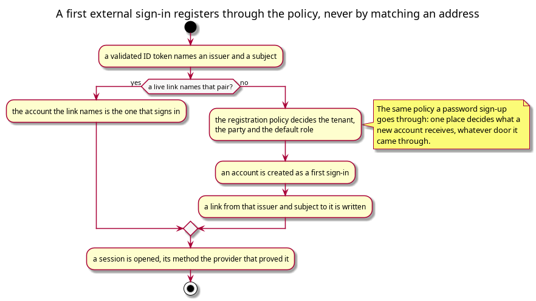

:PROPERTIES:
:ID: 8408B333-FE16-4D3C-AB31-DCB3400C1D07
:END:
#+title: A first sign-in registers through the policy
#+description: An external account ORE has never seen registers as a first sign-in through the same policy a password sign-up goes through, which decides the tenant, the party and the first role; it is never attached to a lookalike address.
#+type: knowledge
#+level: cross
#+filetags: :knowledge:security:identity:registration:federation:
#+created: 2026-11-28
#+updated: 2026-11-28

* Summary

A person who signs in with a provider account ORE has never seen gets an ORE
account, not a refusal, and not somebody else's account. The account is created by
the same registration the deployment already decides for a password sign-up: one
policy answers which tenant the person lands in, which party they join and which
role they receive, and it answers the same way whichever door the person came
through.

Two rules make that safe. The link is written in the same act as the account, so a
half-registration cannot leave a provider account unlinked while the ORE account
exists; and nothing is ever attached to an existing account by comparing
addresses, which is the rule
[[id:359CFBD3-E8FD-47CF-96CD-D11D0AF09685][The identity link is the provider's
issuer and subject]] states and this page applies.

* Detail

** How the tenant is chosen

The tenant is the one the address names, resolved exactly as a password sign-in
resolves it: the browser is talking to a tenant's page, and the provider rows that
answer are that tenant's. A person whose provider account belongs to another
tenant is a person with two accounts at ORE, one per tenant, which is what an ORE
account being a tenant's means.

** What the provider row adds

A provider row states the email domains it will accept a first sign-in from. That
is not an identity check and does not become one: it is a limit on who the tenant
lets in through that provider, decided when the provider is enabled, and it is
checked at the first sign-in because that is the only moment the tenant's own
policy can refuse the person without touching an existing account.

** What the policy decides, and what it does not

The policy owns the three answers — tenant, party, first role — and this page does
not restate them
([[id:84706C3E-D48D-4A4B-967A-4AADB3CF44B2][Registration and Onboarding
Defaults]]). Everything else a first sign-in might be tempted to decide, it does
not: it does not grant a role because the provider's token says the person is an
administrator somewhere, it does not choose a party from the address, and it does
not skip a step because the provider said the address was verified.

#+caption: A validated issuer and subject either names a live link or goes through the registration policy; the account and its link are written in one act, and the session follows.

Source: [[file:a_first_sign_in_registers_through_the_policy.puml][a_first_sign_in_registers_through_the_policy.puml]], rendered with =plantuml -tpng a_first_sign_in_registers_through_the_policy.puml=.

** The alternatives this rejects

*Refusing an unknown subject* means every new person needs an administrator to
create their account and then link it, which turns a self-service door into a
provisioning queue. It is the right rule for a tenant that closes registration,
and the policy already expresses that; it is wrong as a default for a provider a
tenant enabled so that people can get in.

*Creating the account with no policy* — a default tenant with the default role —
would put a second answer to "what does a new account receive" beside the policy's,
and the two would drift.

*Creating the account and linking later* splits one act into two, so a failure
between them leaves an ORE account nobody can sign in to and a provider account
that registers again on the next attempt.

*Attaching to the account whose address matches* is the takeover this cluster
exists to preclude; it is rejected in full in
[[id:359CFBD3-E8FD-47CF-96CD-D11D0AF09685][The identity link is the provider's
issuer and subject]].

** What the person is told

A refusal after a validated ID token is not a failed sign-in: the provider proved
who the person is and ORE declined to register them. That difference reaches the
person as a different message and a different code, which is what lets a support
conversation start from the right end
([[id:504863AB-C45A-47E8-BB77-AADCB620A305][The entry journeys]]).

* Sources

- OpenID Foundation, [[https://openid.net/specs/openid-connect-core-1_0.html][OpenID
  Connect Core 1.0]] — the ID token a registration is decided on, and =sub= as the
  identifier it carries.
- [[https://www.rfc-editor.org/rfc/rfc9700#section-4.15][RFC 9700, section 4.15]] —
  why a provider's stated address is not evidence for attaching a sign-in to an
  existing account.

* See also

- [[id:B008A2C9-BAF5-49F7-AC79-B136AF9DAAE5][Federated identity]] — the
  structure note that orders this cluster.
- [[id:DC393929-BB21-4D0A-A334-EA93E1045DCF][ORE as a relying party to an
  external identity provider]] — the flow that establishes the issuer and the
  subject.
- [[id:359CFBD3-E8FD-47CF-96CD-D11D0AF09685][The identity link is the provider's
  issuer and subject]] — why the address never chooses the account.
- [[id:6DAE22AE-31F6-4EC5-810B-66AF27AB66DE][A session names the method it was
  opened with]] — what is recorded once the registration has finished.
- [[id:84706C3E-D48D-4A4B-967A-4AADB3CF44B2][Registration and Onboarding
  Defaults]] — the policy itself.
