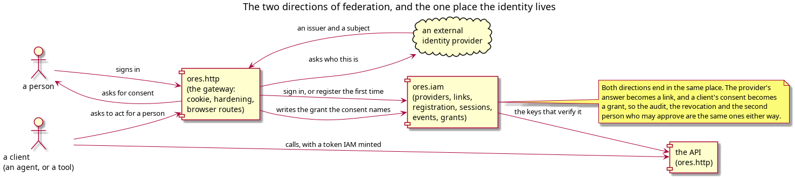

:PROPERTIES:
:ID: B008A2C9-BAF5-49F7-AC79-B136AF9DAAE5
:END:
#+title: Federated identity
#+description: Structure note: ORE as a relying party to a provider, the link it keeps, and ORE as an authorization server.
#+type: knowledge
#+level: cross
#+filetags: :knowledge:security:structure_note:identity:federation:
#+created: 2026-11-28
#+updated: 2026-11-28

* Summary

ORE Studio takes part in identity federation twice, in two directions, and the
two are easy to confuse because the protocol underneath is the same.

In the first direction ORE is a *relying party*. A person holds an account at a
provider they already trust — a workspace account, a public identity provider —
and ORE accepts that provider's word for who they are, without holding a
password for them.

In the second direction ORE is an *authorization server*. A client of ORE's own
API asks the person for the right to act for them, and ORE answers because the
grant it hands out, the audit that records it and the approval a second person
may have to give all already live in IAM.

The cluster is ordered by where a person's identity is decided. Read it in that
order: what ORE trusts, what it writes down about it, what it creates the first
time, what it records when the session opens, and finally what it hands to a
client that asks to act for somebody.

#+caption: Both directions end in IAM: the provider's answer becomes a link and a client's consent becomes a grant, so one audit, one revocation and one approval cover both.

Source: [[file:federated_identity_hub.puml][federated_identity_hub.puml]], rendered with =plantuml -tpng federated_identity_hub.puml=.

* Reading order

** What ORE trusts

[[id:DC393929-BB21-4D0A-A334-EA93E1045DCF][ORE as a relying party]] — the flow itself: the
authorization code with PKCE, the state and the nonce, the exact redirect match,
and the validation of the ID token against the provider's published keys. Read it
first, because every page after it is about what ORE does with a validated
answer.

[[id:359CFBD3-E8FD-47CF-96CD-D11D0AF09685][The identity link as the provider's issuer and subject]] — what ORE writes down and what it refuses to
infer. The address the provider states is evidence of what a person linked, not a
way to find them; the page states why and names the alternatives it rejects.

** What ORE creates on the first sign-in

[[id:8408B333-FE16-4D3C-AB31-DCB3400C1D07][The registration of a first external sign-in]] — an unknown provider account is not refused and not linked
to a lookalike address: it goes through the registration the deployment already
decides, which names the tenant, the party and the first role.

** What ORE remembers about how a session began

[[id:6DAE22AE-31F6-4EC5-810B-66AF27AB66DE][The authentication method of a session]] — the method, the standard =amr= claim and ORE's =idp=,
and the uses that turn on them: the audit, the sessions screen, what a step-up
can ask for, and what a revocation ends.

** What ORE hands to a client of its own API

[[id:09B79B9C-507B-4C9F-8FFC-B1CC572FBB3D][ORE as an authorization
server for its own clients]] — the same protocol from the other side: ORE as the
server a client asks, the consent a person gives, and the grant that consent
creates, which is the grant an agent key creates.

* What this cluster excludes

It stops at the identity ORE holds and the client it authorises. How a *service*
acts for a person — token exchange, run grants, delegated agent access — is the
next cluster along, and it takes the session and the token described here for
granted ([[id:47B179BF-C982-4BB1-AF4F-35E00B9D2750][Delegated Access for LLM
Agents]], [[id:3E20C1A0-7BA1-4F31-8C34-1E5F13558890][Service-to-Service Auth
Patterns]]). Where a recoverable secret is kept, which is what a provider's client
secret is, is the vault's question and not this cluster's
([[id:F9F1A2BA-94C2-4DAA-8689-F0871AA56801][Secret Custody in the Vault]]). And
what a person sees on the screens — the doors, the links, the consent page — is
the journey and screen work that follows this architecture, not part of it.

* Reading it in reverse

There is one case for inverting the order. When a sign-in is refused and the
reason is not the password, start at the entry journey that names the refusal
codes and work back to the flow above: a refused state, an unknown provider and
a subject with no link are three different refusals, and only the last one is
about a person.

* Sources

- OpenID Foundation, [[https://openid.net/specs/openid-connect-core-1_0.html][OpenID
  Connect Core 1.0]] — the relying-party flow and the ID token the cluster is
  built on.
- [[https://www.rfc-editor.org/rfc/rfc9700][RFC 9700, Best Current Practice for
  OAuth 2.0 Security]] — the redirect match, the state parameter and the
  authorization-code rules the flow follows.

* See also

- [[id:AF46793A-FF6C-4066-A059-279CE9936420][Identity and Access]] — the
  structure note this cluster hangs from, and the cluster it sits beside.
- [[id:7474935C-95D1-3034-B833-83DCD9FB3A09][Knowledge]] — the index.
- [[id:8AEB87D6-0CE2-1434-E71B-60BEAE20ADF0][Identity and Access Management]] —
  the identity lifecycle, and the vocabulary the pages here use without
  restating.
- [[id:84706C3E-D48D-4A4B-967A-4AADB3CF44B2][Registration and Onboarding
  Defaults]] — the policy a first sign-in goes through.
- [[id:504863AB-C45A-47E8-BB77-AADCB620A305][The entry journeys]] — the refusal
  codes and the order in which a sign-in is refused.
- [[id:3E20C1A0-7BA1-4F31-8C34-1E5F13558890][Service-to-Service Auth
  Patterns]] — how a *service* acts for a person, which is a different question
  from a client asking for it.
