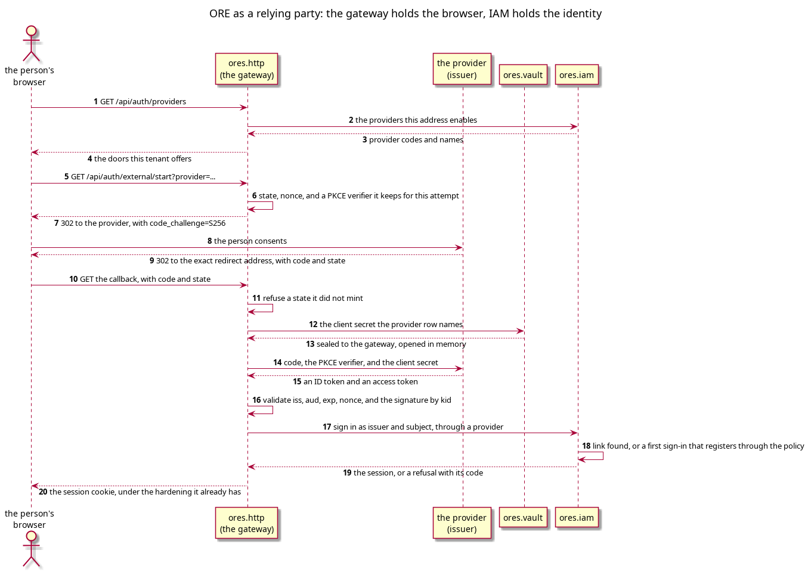

:PROPERTIES:
:ID: DC393929-BB21-4D0A-A334-EA93E1045DCF
:END:
#+title: ORE as a relying party to an external identity provider
#+description: The authorization code flow with PKCE, the state and the nonce, the exact redirect match and the ID token validated by kid: what ORE checks before it believes a provider, and why the gateway serves the browser end of it.
#+type: knowledge
#+level: cross
#+filetags: :knowledge:security:identity:oidc:federation:
#+created: 2026-11-28
#+updated: 2026-11-28

* Summary

A relying party is a service that accepts somebody else's word for who a person
is. ORE takes that word from a provider the tenant enabled, over OpenID Connect's
authorization code flow with PKCE, and it takes nothing else: the flow answers an
issuer and a subject, and to ORE those two are the person's identity at that
provider, whatever the provider's screen called them.

The flow belongs to the gateway and the identity belongs to IAM. The gateway
answers the browser because it already holds the session cookie and the HTTP
hardening, and because no =ores.http= target holds a database to read an account
from. IAM keeps the provider rows, the links, the registration, the session and
the event, which is the subject of the pages that follow this one.

* Detail

** The exchange

The flow is the one OpenID Connect Core 1.0 defines for a server-side client,
with the hardening RFC 9700 recommends and PKCE from RFC 7636.

The browser asks which doors the tenant offers, then asks to sign in through one
of them. The gateway mints three values for that attempt and keeps them: a
=state=, a =nonce=, and a PKCE verifier. It answers with a redirect to the
provider's authorization endpoint carrying =response_type=code=, the client
identifier, the exact redirect address, the =openid= scope with whatever profile
scopes the tenant asked for, the =state=, the =nonce=, and the S256 challenge of
the verifier.

The provider shows its own consent and answers at the redirect address with a
code and the state. The gateway refuses a state it did not mint before it does
anything else, then exchanges the code at the provider's token endpoint, proving
the PKCE verifier and the client secret. Both are cheap checks against the two
attacks that matter here: a code replayed from somebody else's browser, and a
code intercepted without the verifier.

The client secret is the provider row's *name* for a value, never the value: the
deployment places it in the vault and the gateway resolves it at the exchange,
which is what makes a provider's credential the same kind of secret as a service's
([[id:DBF20EC5-63BB-4DE5-957C-5322DE0E487F][Secrets Register]]).

** What the ID token has to prove

The ID token is a signed JWT and ORE treats it as a claim, not as a fact. Before
it believes anything, the gateway checks that the signature verifies against the
key the token names by =kid=, in the key set the provider publishes; that =iss=
is exactly the issuer the provider row states; that =aud= names this client; that
=exp= has not passed and =iat= is not in the future; and that the =nonce= is the
one it minted for this attempt. A provider whose key set cannot be read is a
provider nobody can sign in through, and the failure is a refusal rather than a
fallback to the claim alone.

Validation is done with jwt-cpp and OpenSSL, both already linked, so the flow
adds no HTTP client and no JWT library: outbound calls use the transport the
official market data adapter already uses.

#+caption: The gateway mints the state, the nonce and the PKCE verifier, keeps them for one attempt, and asks the provider for a code; IAM is asked only once the ID token has been validated.

Source: [[file:ore_as_a_relying_party.puml][ore_as_a_relying_party.puml]], rendered with =plantuml -tpng ore_as_a_relying_party.puml=.

** What the flow refuses to be

The *implicit* flow is rejected because it puts tokens in a URL the browser keeps
and the network can log, and OpenID Connect's own guidance is to prefer the code
flow ([OpenID Foundation 2014](https://openid.net/specs/openid-connect-core-1_0.html)).
The *resource owner password* grant against the provider is rejected because it
would have ORE ask a person for their provider password, which is the pressure a
provider's own sign-in page exists to avoid
([RFC 9700, section 2.4](https://www.rfc-editor.org/rfc/rfc9700)).

Running an identity broker beside IAM — Keycloak, or an equivalent — is rejected
for the reason the whole cluster is one component: it would put the provider
rows, the links and the consent somewhere other than where the grant, the audit
and the second pair of eyes already are
([[id:09B79B9C-507B-4C9F-8FFC-B1CC572FBB3D][ORE as an authorization server for
its own clients]]).

A provider that answers without a signature to check — a bare =userinfo= call,
or an ID token validated by decoding alone — is rejected because the token's
contents would then be whatever the network said they were.

* Sources

- OpenID Foundation, [[https://openid.net/specs/openid-connect-core-1_0.html][OpenID
  Connect Core 1.0]] — the authorization code flow, the =state= and =nonce=
  parameters, and the ID token's claims.
- [[https://www.rfc-editor.org/rfc/rfc7636][RFC 7636, Proof Key for Code
  Exchange by OAuth Public Clients]] — the S256 code challenge and verifier.
- [[https://www.rfc-editor.org/rfc/rfc9700][RFC 9700, Best Current Practice for
  OAuth 2.0 Security]] — the exact redirect match, the state parameter, and why
  the implicit and password grants are not used.
- [[https://www.rfc-editor.org/rfc/rfc7519][RFC 7519, JSON Web Token]] — the
  signature, =iss=, =aud=, =exp= and =nonce= claims the flow checks.

* See also

- [[id:B008A2C9-BAF5-49F7-AC79-B136AF9DAAE5][Federated identity]] — the
  structure note that orders this cluster.
- [[id:359CFBD3-E8FD-47CF-96CD-D11D0AF09685][The identity link is the provider's
  issuer and subject]] — what ORE does with the issuer and subject this flow
  returns.
- [[id:8408B333-FE16-4D3C-AB31-DCB3400C1D07][A first sign-in registers through
  the policy]] — the case where the pair is one ORE has never seen.
- [[id:6DAE22AE-31F6-4EC5-810B-66AF27AB66DE][A session names the method it was
  opened with]] — what the session records about this flow having run.
- [[id:8AEB87D6-0CE2-1434-E71B-60BEAE20ADF0][Identity and Access Management]] —
  the identity lifecycle this flow feeds.
