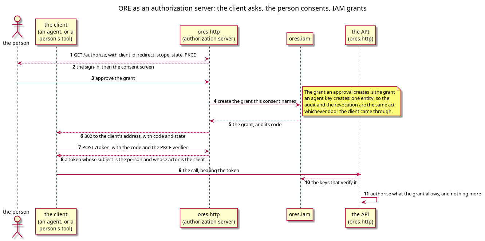

:PROPERTIES:
:ID: 09B79B9C-507B-4C9F-8FFC-B1CC572FBB3D
:END:
#+title: ORE as an authorization server for its own clients
#+description: A client of ORE's API asks the person for the right to act for them, and ORE answers with the protocol itself, a consent screen where the grant, the audit and the second pair of eyes already live, and a token whose subject is the person and whose actor is the client.
#+type: knowledge
#+level: cross
#+filetags: :knowledge:security:identity:oauth:consent:federation:
#+created: 2026-11-28
#+updated: 2026-11-28

* Summary

The other direction of federation is ORE answering rather than asking. A client —
an agent acting for a person, or a tool a person runs — needs to call ORE's API as
that person, and it asks through OAuth 2.1's authorization code flow with PKCE.
The person approves on a consent screen ORE serves, and the approval creates a
grant in IAM.

The grant it creates is the grant an agent key creates. That single sentence is
the reason ORE serves the protocol rather than running an identity provider beside
itself: consent belongs where the grant, the audit of each call and the second
person who may have to approve already are.

* Detail

** The flow, from the client's side

The client sends the person to ORE's authorization endpoint with its client
identifier, its exact redirect address, the scope it wants, a =state=, and the S256
challenge of a PKCE verifier it keeps. If the person holds no session, ORE asks
them to sign in first — by either door of this cluster — and then shows the consent
screen: which client is asking, for which capabilities, and for how long.

An approval creates the grant and answers the client at its redirect address with
a code and the state. The client exchanges the code at the token endpoint, proving
the verifier, and receives a token whose subject is the person and whose actor is
the client
([[id:47B179BF-C982-4BB1-AF4F-35E00B9D2750][Delegated Access for LLM Agents]]).
A refusal is answered at the same address with an error code and the state, and it
writes nothing.

#+caption: The client asks, the person consents, IAM writes the grant an agent key would have written, and the token that comes back names the person as subject and the client as actor.

Source: [[file:ore_as_an_authorization_server.puml][ore_as_an_authorization_server.puml]], rendered with =plantuml -tpng ore_as_an_authorization_server.puml=.

** What the token carries, and what reads it

The token is ORE's own, minted by IAM and verified by every caller against IAM's
published keys, so it carries the same claims a service's token does plus the two
that make delegation legible: the person as subject and the client as actor
([RFC 8693](https://www.rfc-editor.org/rfc/rfc8693)). A caller reads it exactly as
it reads any token — the audience, the permissions the grant allows, and the
tenant — so nothing in the API needs to learn a second kind of caller.

The grant is the thing that bounds it. Revoking the grant ends the tokens minted
under it, and the person can see, from the same screen, which clients hold one
([[id:EA249899-6611-407F-A43A-B37019EBD1A7][Service architecture patterns]]).

** Why ORE serves the protocol rather than running a server**

An external authorization server — Keycloak, ORY Hydra, or a hosted service —
would answer the protocol correctly and put the consent, the grant and the audit
in a second place. A person would then approve a client somewhere other than where
the grant is recorded, and the six-eyes approval a tenant may require for a
sensitive grant could not be part of the act. The rule this cluster keeps is that
consent belongs where the grant, the audit and the second person already are.

Writing the protocol is affordable because the pieces ORE needs are the ones it
already has: a session that names its method, a grant entity, an audit of each
call, and signing keys it publishes. No vcpkg port implements OAuth 2.1 or OpenID
Connect, so the choice was never "adopt a library or write one"; it was "serve the
protocol where the grants are, or delegate it away from them".

** Why the flow waits**

The agent key is the path an MCP client uses today, and it is not a lesser path:
the same grant is created, by a key rather than by a consent screen, and the same
audit records each call. The authorization code flow is the answer for the moment a
client cannot hold a key — a browser-based tool, or a client the person installs —
and until then serving it would add a second door to the same grants before anybody
knocked on it.

** The alternatives this rejects

*Client credentials only.* A client that proves only itself calls as itself, which
is a service acting for nobody; it cannot carry a person's grants, and it has no
one to consent. It is the right flow for a service and the wrong one for a client
of a person's data.

*A profile narrower than OAuth for the API.* Tailoring the flow to one client
protocol would make every other client a special case, and the API's grants are not
that protocol's property.

*A consent screen with no grant behind it.* An approval that writes a
session-scoped permission instead of a grant is invisible to the audit and
unrevocable in one act, which is the state the cluster exists to leave behind.

*The provider's own tokens passed through.* Handing a client the token an external
provider issued would make ORE's API trust a third party's audience and give the
client a credential ORE cannot bound.

* Sources

- [[https://datatracker.ietf.org/doc/draft-ietf-oauth-v2-1/][The OAuth 2.1
  Authorization Framework]] — the authorization code flow with PKCE as the one
  flow, and the prohibition on the implicit and password grants.
- [[https://www.rfc-editor.org/rfc/rfc9700][RFC 9700, Best Current Practice for
  OAuth 2.0 Security]] — the redirect match, the state parameter and the consent
  rules.
- [[https://www.rfc-editor.org/rfc/rfc8693][RFC 8693, OAuth 2.0 Token Exchange]] —
  the subject-and-actor shape of a delegated token.
- [[https://www.rfc-editor.org/rfc/rfc9068][RFC 9068, JSON Web Token Profile for
  OAuth 2.0 Access Tokens]] — the claims a resource server validates.

* See also

- [[id:B008A2C9-BAF5-49F7-AC79-B136AF9DAAE5][Federated identity]] — the
  structure note that orders this cluster.
- [[id:6DAE22AE-31F6-4EC5-810B-66AF27AB66DE][A session names the method it was
  opened with]] — the sign-in the consent screen stands on.
- [[id:47B179BF-C982-4BB1-AF4F-35E00B9D2750][Delegated Access for LLM Agents]] —
  the cluster for the clients this page serves.
- [[id:EA249899-6611-407F-A43A-B37019EBD1A7][Service architecture patterns]] — the
  grant management and token exchange patterns this page applies.
- [[id:3E20C1A0-7BA1-4F31-8C34-1E5F13558890][Service-to-Service Auth Patterns]] —
  which pattern a given call needs.
