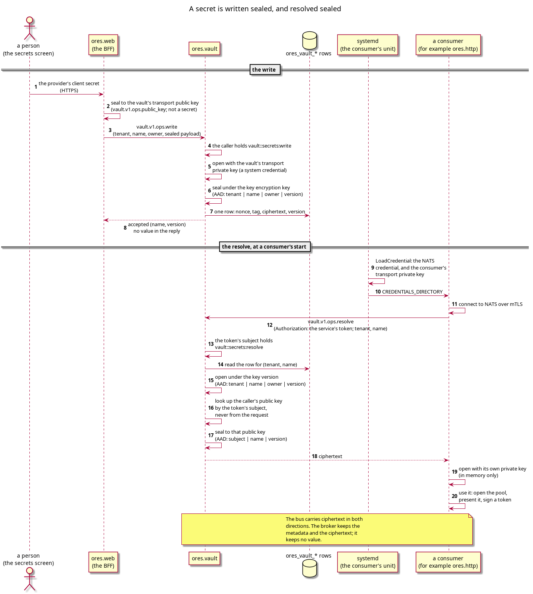

:PROPERTIES:
:ID: 4F28F755-7DA1-4EDD-9983-256622B6088A
:END:
#+title: Sealed Delivery of a Secret to Its Consumer
#+description: How a secret reaches a service as ciphertext sealed to the recipient, so that the bus carries no plaintext, and the terms of the one person-facing reveal.
#+type: knowledge
#+level: cross
#+filetags: :security:secrets:vault:nats:transport:crypto:
#+created: 2026-11-26
#+updated: 2026-11-26

* Summary

A secret that ORE Studio hands to one of its own services travels as ciphertext
sealed to that service's key, and the vault chooses the key from the
authenticated subject rather than from anything the request carries. The same
primitive runs in the other direction, so a secret a person writes reaches the
vault sealed to the vault's key. Plaintext therefore exists only inside the
process that must use it: it is not in a NATS message, not in a request record,
and not in the broker.

One act is the exception, and **The person's reveal** states it in full: a
person who holds the read asks for the value, and the gateway answers over the
session.

* Detail

** The transport is not the boundary

Transport security proves who is connected and protects the hop. It does not
keep the party that terminates the hop from reading the body, and every
deployment of NATS terminates the connection per client. Mutual TLS on the bus
establishes that a caller is the service it claims to be; it says nothing about
what the broker does with the payload.

This is not a theoretical concern in this tree, because a traced, logged and
inspected request is the normal condition of the system. A trace attribute that
records a request argument, or a debug line that prints one, turns a payload
into a permanent record without any change to the transport.

The session token already crosses the bus in message headers, which is not a
licence for secrets. A token is short-lived, scoped by the permission codes it
carries, and cheap to replace when it leaks; a secret that ORE presents to
another party is long-lived and broad, and a copy of it stays valid until
somebody rotates it (NIST SP 800-57 Part 1 Rev. 5, §5).

The rule that follows is stated once and applied to the bus: no plaintext
secret appears in a message, in either direction. The bus is where the rule
binds. A body that answers a person is the one place it does not, and
**The person's reveal** states the terms under which that body is sent.

** The primitive

The value is sealed with X25519 for key agreement (Bernstein, 2006; RFC 7748),
HKDF-SHA256 for the key derivation (RFC 5869), and AES-256-GCM for the
authenticated encryption (NIST SP 800-38D, RFC 5116). The GCM half is the same
cipher the symmetric sealer in =ores.security= already uses, so the new
primitive adds key agreement and derivation and no second cipher.

=ores.security= carries both primitives: =secret_sealer= seals under a key it
is given, for the stored ciphertext, and =sealed_box= seals to a recipient's
public key, for the transport. Neither holds state and neither reads a
credential, which is why both belong to the kernel rather than to the vault.
Both take a context string — the row's fields for the sealer, the delivery's
fields for the box — and authenticate it, so no caller can seal a value that
opens somewhere other than where it was written.

Two properties make the sealed box the right shape for delivery.

- *The vault holds only public keys.* A copy of the vault's tables does not let
  its holder open traffic the vault sent, because the vault never had the
  consumers' private halves.
- *The recipient is named, not described.* Sealing to a public key the caller
  supplied would let any caller ask the vault to seal to the caller's own key
  and read the answer. The vault therefore looks the key up by the subject in
  the verified token and ignores any key in the request.

** The keys and where each one lives

| Key | Held by | Lives in | Rotates when |
|-----+---------+----------+--------------|
| The key encryption key, AES-256 | the vault only | a system credential of the vault's unit | =rotate= re-wraps every row under a new version |
| The vault's transport key, X25519 | the vault only | a system credential of the vault's unit | a deployment of the vault; the public half is published |
| A consumer's transport key, X25519 | one consumer, and the vault's =vault_consumer= row for its public half | a system credential of the consumer's unit | the consumer's key is re-registered and the deployment restarts it |
| A consumer's NATS credential | one consumer | the deployment's certificate and credential files | the certificate schedule ([[id:18D8CB4F-E926-49E8-83C3-7C8418861B33][NATS certificates]]) |

A private half never crosses the bus, and a public half is not a secret. The
consumers' keys are provisioned with the same step that provisions their NATS
credentials, so no new kind of artefact and no new distribution channel is
introduced.

** The write, the resolve, and the rotation**

The write seals toward the vault and the resolve seals away from it. Both are
shown together, with the start of a consumer, because the order in which a
service obtains its material is part of the mechanism.

The write route belongs to =ores.http=, which already holds the session, the
routes and the hardening that fronts them. No second server sits between the
person and the vault, so the process that seals a value is the gateway and not
a browser-facing layer beside it. The gateway is also the first consumer, since
it resolves a provider's client secret at the token exchange.

#+attr_html: :width 100% :alt a sealed write, a sealed resolve and a person's reveal
#+caption: A secret is sealed to the vault on the way in and sealed to the consumer on the way out, so the bus carries ciphertext in both directions; a person's reveal is the gateway resolving as a consumer and answering over the session.

Source: [[file:sealed_delivery_of_a_secret_to_its_consumer.puml][sealed_delivery_of_a_secret_to_its_consumer.puml]], rendered with =plantuml -tpng sealed_delivery_of_a_secret_to_its_consumer.puml=.

The stored value is bound to its row. Its additional authenticated data names
the tenant, the secret's name, the owning consumer and the key version, so a
ciphertext copied into another row, another tenant or another version does not
open. The delivered value is bound to its recipient in the same way: its
additional authenticated data names the subject, the name and the version, so a
captured reply replayed to another consumer fails at that consumer's open.

=rotate= re-wraps each stored value under a new key encryption key without
leaving the process: the value is opened and sealed again in memory, and the row
records its new version. The transport keys are untouched by it.

** The person's reveal

A secret exists to be used, and a person maintains the services that use it, so
a person must be able to check what the installation holds. HashiCorp Vault
takes the conventional position: a client whose token holds the read capability
is given the value, through the command line, the GUI's reveal control and the
API alike (HashiCorp, *Read data*). ORE keeps the capability and changes only
the hop.

- *The vault gains no operation.* A reveal is =resolve=, asked by the gateway,
  which is a registered consumer for this purpose. The vault seals to the
  gateway's key as it seals to any other consumer, so the vault's contract does
  not widen.
- *The gateway answers.* It opens the reply in its own process and returns the
  value in the body of the authenticated session request. The route demands
  =vault::secrets:read=, and the response carries =Cache-Control: no-store=.
- *The bus stays sealed.* The broker carries ciphertext, as it does for every
  other resolve.
- *A reveal is recorded twice.* The vault appends the resolve against the
  gateway's subject, which is the identity it can verify. The gateway records
  the person's subject in its own request log. The vault never authorises on a
  name the gateway states, so the second record is evidence and not a grant.

The write is the same hop in the other direction, and it already carries the
value in a request body over the session. A reveal closes the loop the write
opens, which is what a screen for the vault draws.

A reveal does not cross the bus, is not cached, and appears in no trace
attribute, log line or error message.

** What a capture yields

The threat model is stated rather than implied, because the design is only as
good as its weakest position.

| Position | What it yields |
|----------+----------------|
| An observer of the bus | the metadata of a request: names, versions, who asked, when. No value, in either direction. |
| The broker's process memory | the same ciphertext and the same metadata, because the sealing is end to end. |
| A stolen NATS credential, used by somebody who is not the consumer | the ability to ask, limited by the permission code, and a reply sealed to the real consumer's key, which the thief cannot open. |
| A compromised consumer | that consumer's own secrets, which it was entitled to hold. |
| A compromised vault | every secret, because the vault holds the key encryption key and is the party that opens each value on the way in. Custody concentrates this risk deliberately: one small, single-purpose, audited process instead of every service. |

** The alternatives that were excluded

- *Plaintext in a bus reply, over mutual TLS.* This is the contract of a
  conventional secret store, whose read operation returns the value to an
  authenticated client over TLS (HashiCorp, *Read data*). It was rejected for
  the bus, because the broker and every hop that records a request would hold
  the value. It is accepted for the one person-facing hop, whose terms
  **The person's reveal** states.
- *The vault performs the call that needs the secret.* A credential proxy, in
  which the vault speaks to the provider and returns only the result, keeps the
  value inside the vault's process altogether. It was deferred rather than
  rejected: it makes the vault an HTTP client for every provider it serves and
  couples a small component to each, and the sealed box achieves the stated
  requirement without that coupling. It remains the answer if a requirement
  arrives that the plaintext must never leave the vault.
- *A shared symmetric key per consumer.* It would reuse the symmetric sealer
  and need no key agreement, but the vault would hold the key that opens what
  it sends, so a copied vault would open captured traffic. The sealed box costs
  one key agreement and removes that.

** What this does not solve

The write still shows the value to the process that seals it, and the reveal
shows it to the process that answers. A route that seals in the gateway
therefore protects the bus and not the gateway. Sealing in the browser is
possible with a second primitive that WebCrypto supports universally, and it
would remove both exposures at once; it is recorded here as a later step rather
than as a property this design has.

Everything rests on the provisioning of the credentials. A private half that is
copied from the deployment's key material is as good as the consumer it was
issued to, and no part of this design detects that the holder is the wrong
process.

* See also

- [[id:F9F1A2BA-94C2-4DAA-8689-F0871AA56801][Secret Custody in the Vault]] —
  completes this page: custody decides where a secret lives, and this page
  decides how it travels.
- [[id:AF46793A-FF6C-4066-A059-279CE9936420][Identity and Access]] — the structure
  note of the cluster.
- [[id:3E20C1A0-7BA1-4F31-8C34-1E5F13558890][Service-to-Service Auth Patterns]] —
  answers what the token that names the caller carries, and which layer checks
  it.
- [[id:18D8CB4F-E926-49E8-83C3-7C8418861B33][NATS certificates]] — exemplifies a
  key that must remain a file, and therefore does not travel this way.
- [[id:DBF20EC5-63BB-4DE5-957C-5322DE0E487F][Secrets Register]] — exemplifies this
  mechanism: the values that will use it, and in which phase.

* Sources

- Bernstein, D. J. (2006). Curve25519: New Diffie-Hellman Speed Records. In
  *Public Key Cryptography — PKC 2006*, Lecture Notes in Computer Science 3958,
  pp. 207–228. Springer.
- Nir, Y. and Langley, A. (2018). *Elliptic Curves for Security*. RFC 7748.
  Internet Engineering Task Force.
- Krawczyk, H. and Eronen, P. (2010). *HMAC-based Extract-and-Expand Key
  Derivation Function (HKDF)*. RFC 5869. Internet Engineering Task Force.
- Dworkin, M. (2007). *Recommendation for Block Cipher Modes of Operation:
  Galois/Counter Mode (GCM) and GMAC*. NIST Special Publication 800-38D.
  National Institute of Standards and Technology.
- McGrew, D. (2008). *An Interface and Algorithms for Authenticated
  Encryption*. RFC 5116. Internet Engineering Task Force.
- Barker, E. (2020). *Recommendation for Key Management: Part 1 — General*.
  NIST Special Publication 800-57 Part 1 Revision 5. National Institute of
  Standards and Technology.
- HashiCorp. *Vault Documentation*, "Read data".
  https://developer.hashicorp.com/vault/docs/secrets/kv/kv-v2/cookbook/read-data.
  Cited for the read contract: a client holding the read capability is given
  the value, from the command line, the GUI's reveal control and the API alike.
  This design keeps the capability for a person's own reveal and keeps the bus
  sealed.
