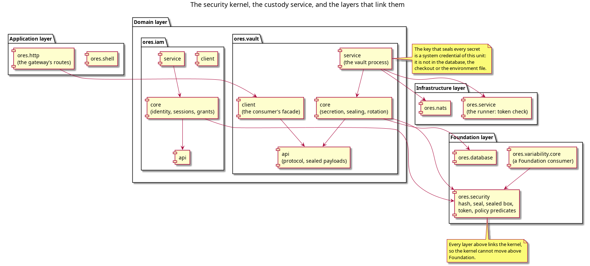

:PROPERTIES:
:ID: F9F1A2BA-94C2-4DAA-8689-F0871AA56801
:END:
#+title: Secret Custody in the Vault
#+description: Where a recoverable secret is kept, why the custody is a service of its own, and where its boundary with IAM runs.
#+type: knowledge
#+level: cross
#+filetags: :security:secrets:vault:custody:components:
#+created: 2026-11-26
#+updated: 2026-11-26

* Summary

A secret that ORE Studio must present to another party cannot be kept as a
one-way hash, and it cannot be kept beside the key that protects it, because a
copy of the database would carry both halves. ORE therefore keeps such a secret
in a service of its own, =ores.vault=, sealed under a key that lives outside the
database, and answers a consumer only with the secret sealed to that consumer's
own key. The service is a Domain composite while the primitives that seal and
open a value remain in =ores.security=, a Foundation kernel that every layer
above it links. No part of the vault decides who may ask: IAM keeps that
decision, and the boundary between the two is stated below.

* Detail

** Two classes of secret

A credential is either one that ORE only checks or one that ORE must hand back
verbatim, and the distinction decides where it lives.

The first class is verified and never recovered. A password is stored as a
scrypt hash, and an agent key as the SHA-256 hash of 256 random bits
([[proj:projects/ores.iam/modeling/ores.iam.agent_key.org][the agent key
entity]]), because the value is only ever compared with a value offered later.
A verified credential needs no custody: a copy of its table discloses nothing
that can be presented.

The second class must be recovered exactly. A provider's client secret is
presented to the provider during a token exchange; a database role's password
opens a connection pool; a signing key produces a token. Each of these values
must exist somewhere in a form that a process can use, which makes the place it
is kept a security decision rather than a storage detail.

The workspace currently keeps twenty-nine such values in one environment file:
twenty-five database passwords across the service, administrative and test
roles, one RSA signing key, two shared TLS client keys, and a demonstration
login. [[proj:compass/checks/env_format.org][The environment format]] declares
them, twenty-five of them through a =secret= row whose value is made once and
then kept. That file is the starting point of the migration in [[id:DBF20EC5-63BB-4DE5-957C-5322DE0E487F][Secrets
Register]]; it is evidence that custody is a gap, not an argument that the file
is the wrong place for every kind of value.

** Why the custody is a component of its own

The kernel and the custody service have different consumers and different
lifetimes, and the layer model separates them.

=ores.security= is a Foundation component: thirteen headers, eleven hundred and
forty-one lines of source, seventy-four test cases, and no row and no subject. It is the most widely linked component
in the tree. Two thousand and eleven files reference its headers, of which one
thousand eight hundred and twenty-two are generated; seventy-seven CMake link
lines name it across twenty-one components. Its consumers sit at the bottom of
the stack as well as the top: =ores.variability.core= is a Foundation component
that includes the token verifier, and the Infrastructure service runner builds
the per-service verifier and checks the permission codes in
=ores.service/include/ores.service/service/= and
=ores.service/include/ores.service/messaging/=.

A secret store of the second class is the opposite kind of thing. It owns a
table per secret, a NATS subject namespace, a database role, a system certificate
and a unit that must run before the services that ask it. That is a Domain
service, and the [[id:D773166D-0C91-8CB4-3323-42166BC07687][System Model]] states
the rule it would break: a layer may only depend on layers below it.

Three placements were considered for the custody service.

- *Inside =ores.security=.* The component would hold the kernel of the bottom
  layer and a Domain service at once. A component whose parts a Foundation
  component links would itself be documented as a Domain component, and the
  tree has never done that: the two components that span layers,
  =ores.telemetry= and =ores.storage=, span one step each. The move is
  affordable — twenty-four template lines own every generated include, and the
  remaining consumers are hand-written — but it buys a single name for the
  domain at the cost of the layer model, so it was rejected.
- *Inside =ores.iam=.* Cohesion fails before layering does. IAM's stated
  responsibilities are identity lifecycle, authentication, authorisation and
  enforcement ([[id:8AEB87D6-0CE2-1434-E71B-60BEAE20ADF0][Identity and Access
  Management]]); custody of a third party's secret is none of them, and the
  component that holds the most identity data is the last one that should also
  hold the key to every secret.
- *As its own Domain composite.* Chosen. =ores.vault= declares =api=, =core=,
  =service= and =client=, in the standard roles of
  [[id:F27E5DF7-6223-4B6F-80A5-CEFBEB1BC756][Component architecture]], and
  =ores.security= keeps the primitives, gaining the sealed box beside the
  symmetric sealer.

The split also keeps the two halves of one mechanism honest about their
dependencies. The kernel links OpenSSL, jwt-cpp, =ores.utility=, =ores.platform=
and =ores.logging=, and nothing else. The vault links the kernel, the database,
NATS and the service runner. Neither depends on a provider or on a table the
other owns.

#+attr_html: :width 100% :alt the security kernel, the custody service and their consumers
#+caption: The security kernel stays at the bottom of the stack; the custody service sits in the domain layer beside IAM and its consumers.

Source: [[file:secret_custody_in_the_vault.puml][secret_custody_in_the_vault.puml]], rendered with =plantuml -tpng secret_custody_in_the_vault.puml=.

** What the vault holds

Two entities carry the state, and both are tenant-scoped under the row-level
security every other table uses.

| Entity | Holds |
|--------+-------|
| =vault_secret= | the tenant, the name, the consumer the secret belongs to, the nonce, the tag and the ciphertext, the key version that sealed it, and the audit tail every entity carries |
| =vault_consumer= | the identity a token's subject carries, the consumer's sealing public key, its state, and the time it last asked |

The key that protects the ciphertext lives outside the vault's tables, its
repository and the checkout: it is a system credential that the unit reads at
start, so a database copy, a backup and a stolen environment file each disclose
nothing. A key stored beside the ciphertext is obfuscation, not protection
(NIST SP 800-57 Part 1 Rev. 5, §8.2.2).

Five operations act on a secret: =write=, =describe=, =delete=, =resolve= and
=rotate=. Only =resolve= lets a value out, and it leaves sealed to the caller;
[[id:4F28F755-7DA1-4EDD-9983-256622B6088A][Sealed Delivery of a Secret to Its
Consumer]] states that mechanism. =describe= answers the metadata and no value.
=rotate= re-wraps every secret under a new key version without a plaintext
leaving the process. Every resolve appends the name, the version, the subject
and the time to the audit; no operation records the value.

** The boundary with IAM**

The two components meet at a token and part immediately.

| Concern | Owner |
|---------+-------|
| Accounts, credentials, sessions, sign-in records | IAM |
| Roles, permissions, grants, role requests | IAM |
| The token's policy: which claims, which audience, what is withheld from an agent | IAM |
| The token's mechanism: minting, verification, the claim shape | =ores.security= |
| A provider's registry entry: issuer, client, domains, enabled | IAM |
| A provider's client secret: ciphertext, key, versions, rotation, use | =ores.vault= |
| Hashing, sealing, password and email policy | =ores.security=, with no state and no key |

Four rules hold the line.

1. IAM keeps every one-way credential and no recoverable one. The provider
   registry holds a reference to a secret and never the secret, so a dump of
   the IAM schema discloses nothing that can be presented.
2. The vault decides no policy of its own. A caller must hold the permission
   code IAM issued and pass the runner's token check before the vault is
   reached, and the vault adds only the record of the use.
3. No part of =ores.vault= links any part of =ores.iam=. The tenant and the
   subject arrive in the request context that the runner builds from the token,
   and the permission arrives with them.
4. The owner of a secret is a consumer, not a person. The vault answers
   services; a person reaches a secret through a route whose permission IAM
   grants.

** What the vault does not do

The component is not a secret manager for the fleet, and the limits are
deliberate. It issues no dynamic credential and no lease, runs no certificate
authority, keeps no storage engine of its own and knows no account. It knows a
tenant, because isolation needs one, and a subject, because the audit and the
sealing key need one.

Material that a library must read as a file, or that a schedule rotates, stays
outside. The certificates a service presents to NATS are per-service leaves that
the deployment issues and rotates every ninety days
([[id:18D8CB4F-E926-49E8-83C3-7C8418861B33][NATS certificates]]); the tests keep
their own database passwords; the demonstration login is a person's credential
and not the system's. [[id:DBF20EC5-63BB-4DE5-957C-5322DE0E487F][Secrets
Register]] states the disposition of each.

** The cost: a start-up dependency

A service that resolves at start cannot start before the vault, so the vault
joins the database and NATS as one of the three things that must be up first.
The service registry already carries the ordering, in its =depends_on= field,
and the vault itself depends only on the database and the bus.

No consumer keeps a copy on disk. A cache would be a second copy of the key
material, it would survive a rotation, and it would outlive the reason the value
was sealed. A vault outage therefore delays a start rather than exposing a
secret, and the vault's own footprint is kept small for the same reason: one
connection pool, one subject namespace, no queue of work.

* See also

- [[id:AF46793A-FF6C-4066-A059-279CE9936420][Identity and Access]] — the structure
  note of the cluster; this page completes it with the concern that is neither
  identity nor access.
- [[id:4F28F755-7DA1-4EDD-9983-256622B6088A][Sealed Delivery of a Secret to Its
  Consumer]] — completes this page: custody decides where a secret lives, and
  delivery decides how it travels.
- [[id:DBF20EC5-63BB-4DE5-957C-5322DE0E487F][Secrets Register]] — exemplifies the
  rule: every value the workspace holds today, and where it goes.
- [[id:F27E5DF7-6223-4B6F-80A5-CEFBEB1BC756][Component architecture]] — grounds the
  split, the role names and the collision rule the placement had to satisfy.
- [[id:8AEB87D6-0CE2-1434-E71B-60BEAE20ADF0][Identity and Access Management]] —
  answers the other half: who may ask, and what a token says.
- [[id:18D8CB4F-E926-49E8-83C3-7C8418861B33][NATS certificates]] — exemplifies
  what stays out of the vault, and why a leaf that must be a file is not custody.

* Sources

- Barker, E. (2020). *Recommendation for Key Management: Part 1 — General*.
  NIST Special Publication 800-57 Part 1 Revision 5. National Institute of
  Standards and Technology. §8.2.2 states the separation of a key from the
  material it protects.
- Nir, Y. and Langley, A. (2018). *Elliptic Curves for Security*. RFC 7748.
  Internet Engineering Task Force. Defines X25519.
- Krawczyk, H. and Eronen, P. (2010). *HMAC-based Extract-and-Expand Key
  Derivation Function (HKDF)*. RFC 5869. Internet Engineering Task Force.
- McGrew, D. (2008). *An Interface and Algorithms for Authenticated
  Encryption*. RFC 5116. Internet Engineering Task Force.
- Dworkin, M. (2007). *Recommendation for Block Cipher Modes of Operation:
  Galois/Counter Mode (GCM) and GMAC*. NIST Special Publication 800-38D.
  National Institute of Standards and Technology.
- HashiCorp. *Vault Documentation*. https://developer.hashicorp.com/vault/docs.
  Vendor documentation for the comparison of a delivery contract that returns a
  plaintext value to an authenticated client.
- Wiggins, A. (2011). *The Twelve-Factor App*. Factor III, "Config", states why
  configuration that varies between deployments belongs in the environment; the
  argument does not extend to a value whose disclosure is the risk.
