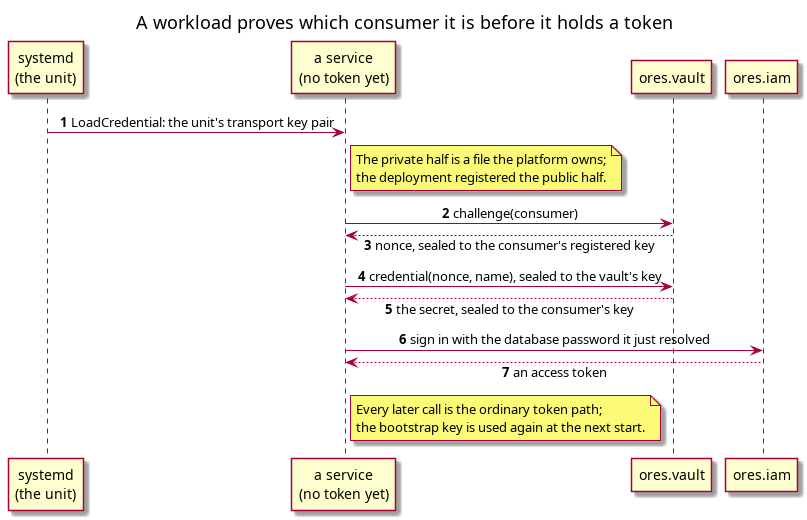

:PROPERTIES:
:ID: 5FADF948-4520-41D3-B4F0-BE4873C06AF0
:END:
#+title: Secure Introduction of a Workload to the Vault
#+description: How a workload proves which consumer it is before it holds a token, by the platform's key and a challenge the vault seals to it.
#+type: knowledge
#+level: cross
#+filetags: :security:secrets:vault:identity:bootstrap:attestation:
#+created: 2026-11-27
#+updated: 2026-11-27

* Summary

ORE Studio introduces a workload to its vault by secure introduction: the
platform that launches the unit delivers its key pair as a system credential,
the vault already holds the public half, and a challenge the vault seals to that
key proves which consumer is calling before any token exists. The difficulty
this answers is known as *secret zero*: a workload that must fetch its own
credentials at start cannot authenticate to the store with a token, because the
token is issued by a service whose own start depends on the same store
(HashiCorp, 2026). The established resolutions fall into two families, the store
trusting the platform that launched the workload, or a trusted orchestrator
injecting a credential as it launches it, and ORE Studio takes the first
(HashiCorp, 2026). This page states the protocol, the alternatives it rejects,
and the limits of what it proves.

* Detail

** The circularity

Every ORE Studio service obtains its access token from =ores.iam= by signing in
as itself, and it signs in with its database password ([[id:4B5B6195-F542-4A88-B5B3-9A4561554406][Client
Credentials]]). Moving the service passwords into the vault therefore closes a
circle: to call the vault as a service one holds a token, to obtain a token one
presents the database password, and the database password is what the vault
holds. The order the register states for a cold start — the database, then the
vault with its own credentials, then the services — does not break the circle,
because the last step still needs a credential the vault has not yet handed
over.

Two further facts narrow the design. The vault refuses a request that carries
no verified token, so a service cannot register its own public key either: the
deployment registers it, as the person who deploys, before the unit starts. And
the vault's own key encryption key, transport key and database password stay
files, because a store cannot be the source of the key that opens it.

** The established pattern

The secret-zero problem is named in the platform documentation and solved the
same way across the industry. The store cannot verify a workload's password,
because a password is a shared secret; it can verify either the platform's word
for the workload or the workload's possession of a key the platform issued. The
first is *platform integration*: a cloud instance presents the identity document
its platform publishes, or a pod presents the token its platform projects, and
the store asks the platform whether the document is genuine (HashiCorp, 2026).
The second is the *trusted orchestrator*: something already authenticated to the
store, such as a deployment tool, injects one-of-a-kind material as it launches
the workload, and the workload exchanges it once (HashiCorp, 2026).

SPIFFE and SPIRE generalise the first family into a specification, and state the
property that makes it work: the interface that issues a workload its identity
document "does not require that a calling workload have any knowledge of its own
identity, or possess any authentication token when calling the API" (The SPIFFE
authors, 2026). The document it receives, an SVID, is short-lived and is
preferred in X.509 form over JWT form because a bearer token can be replayed by
anyone who obtains it (The SPIFFE authors, 2026). The orchestrator family has a
matching idiom for the single use: a wrapped credential that the store honours
once and then forgets (HashiCorp, 2026).

Three properties recur in every version, and ORE Studio adopts all three: the
identity is established out of band by the platform rather than by a secret
that travels; the exchange uses material that is good once; and what the
workload receives is short-lived, while what it used to authenticate itself
stays in the platform's keeping.

** Why ORE Studio's form is platform integration with a possession proof

The platform is systemd. It already delivers the vault's key encryption key, the
vault's transport key and the gateway's transport key as credentials, so it
already carries the trust channel that a workload's identity needs
([[id:F9F1A2BA-94C2-4DAA-8689-F0871AA56801][Secret Custody in the Vault]]). The
material it delivers is an X25519 key pair rather than a shared password: the
vault holds the public half in =vault_consumer=, so a copy of the vault's tables
discloses nothing that can answer a challenge.

The proof is by decryption, and it runs in both directions. The vault seals a
nonce to the consumer's registered public key; only the holder of the private
half can open it. The workload answers with that nonce and the name it asks for,
sealed to the vault's transport key; only the vault can open that. Neither
message is usable by an observer, and the nonce makes a recorded request
worthless on a second attempt. The answer is the requested secret sealed to the
same consumer key, so the exchange inherits the property that the bus carries no
plaintext ([[id:4F28F755-7DA1-4EDD-9983-256622B6088A][Sealed Delivery of a
Secret to Its Consumer]]).

Four alternatives were considered and rejected.

- *A bootstrap token path in =ores.iam=.* IAM would mint a token for a caller
  that has no credential, which moves secret zero into IAM and does not remove
  it: IAM's own start needs the database, and the whole difficulty is reaching a
  store before a token exists.
- *The NATS client certificate as the identity.* The deployment already issues
  each unit its own leaf ([[id:18D8CB4F-E926-49E8-83C3-7C8418861B33][NATS
  certificates]]), and a certificate is the X.509-SVID shape the specification
  prefers. The client in this tree sets its own TLS options and reads no peer
  certificate (=projects/ores.nats/src/service/client.cpp=), so a service that
  receives a message cannot see which leaf the connection presented. Were the
  broker to forward that identity, the certificate would be the shorter path and
  the challenge a fallback.
- *A shared bootstrap secret.* One secret per unit would be simpler to
  provision and strictly weaker: a copy of it can be replayed by anyone who
  reads it, where a private key can only be used by a process that holds it.
- *Leaving the database password in a file.* That is the state the register's
  second phase removes; it answers the circularity by not solving it.

** The exchange

The sequence has four steps and one property worth stating in advance: the
exchange happens once per start, and everything after it is the ordinary token
path.

1. The workload calls =vault.v1.ops.challenge=, naming the consumer the
   deployment registered for it; a consumer is the vault's name for the identity
   a caller is known by, which is the subject its token carries once it has one.
2. The vault draws a random nonce, records it against that consumer with a short
   life, and answers it sealed to the consumer's registered public key.
3. The workload opens the nonce and sends =vault.v1.ops.credential=, carrying the
   nonce and the name it asks for, sealed to the vault's transport key under a
   context that names the consumer, the nonce and the secret.
4. The vault opens the request, matches the nonce to the one it issued to that
   consumer, retires it, and answers the secret sealed to the same consumer key.

#+attr_html: :width 100% :alt a workload resolving its first secret before it holds a token
#+caption: The vault authenticates a workload by a challenge it sealed to the workload's own key, so the first secret is resolved before any token exists; the token path begins once the workload has its database password.

Source: [[file:secure_introduction_of_a_workload_to_the_vault.puml][secure_introduction_of_a_workload_to_the_vault.puml]], rendered with =plantuml -tpng secure_introduction_of_a_workload_to_the_vault.puml=.

The operation answers the consumer's own secret and nothing else: the name the
caller may read is derived from the consumer it proved itself to be, not from
the request, and a consumer that asks for another's entry is refused as one that
holds no such secret. The exchange is therefore a narrower power than a token,
not a wider one, and it cannot be used as a general login.

** Where the platform's own secrets live

The exchange answers in one tenant, and it is the system tenant, because what it
hands over belongs to the deployment and not to any of the tenants it serves. A
service's database password protects a database role, and the role is the same
whichever tenant's request the service later serves; a tenant that held a copy
would hold the deployment's credential, and an installation with ten tenants
would hold ten copies of it. Service accounts are already rows of the system
tenant (=ores_iam_service_accounts_upsert_fn= writes them with
=ores_utility_system_tenant_id_fn()=), so the consumer a service registers and
the password it resolves sit beside its own account.

Two consequences follow. Provisioning must act as a system-tenant identity, not
as a tenant administrator, because the row it writes belongs to the system
tenant; the shell account =shell@system.ores= is one, and the deployment already
holds its database user. And the person-facing =register_consumer= stays as it
is: a tenant's own consumer, such as an integration that resolves a tenant's
secret, registers under the tenant whose request it makes, and the vault
resolves it in that tenant through the verified token. The two paths do not
overlap: a token path for what belongs to a tenant, the bootstrap path for what
belongs to the deployment.

** What it does not do

The bootstrap key lives as long as the unit's deployment, so the guarantee is
only as strong as the unit's isolation: systemd credentials are readable by the
unit's own user, and a process that runs as that user can read them. Rotation is
by re-registering the consumer's public key and restarting the unit, which is
the same step that rotates the NATS leaf.

A single-use nonce defeats replay and not a compromised process: a workload that
is already running has the secret it resolved. The exchange also puts the vault
on the path of every cold start, so a vault that is unavailable delays the
services behind it; the vault itself starts alone, from its files, which is why
its own material is not in its own store.

The challenge is issued to whoever asks for it, since a caller that has no
credential cannot be identified before it answers one. It is therefore bounded
rather than trusted: a challenge is good once, for a short time, and it is
useless to anyone who cannot open it. The request that answers it names the
consumer, the nonce and the secret it asks for, and the vault opens the request
with all three authenticated, so a nonce issued for one consumer cannot be
redirected to another and a nonce issued for one secret cannot be spent on a
second.

* Patterns used

- [[id:94C14185-EE64-412F-8681-849AFF04B4D8][Request-Reply]] — the challenge
  and the credential are each one request and one reply on NATS, and the
  workload waits for the answer before it opens its pool.

* See also

- [[id:F9F1A2BA-94C2-4DAA-8689-F0871AA56801][Secret Custody in the Vault]] — the
  structure note of this cluster: what the vault is, and what it decides.
- [[id:4F28F755-7DA1-4EDD-9983-256622B6088A][Sealed Delivery of a Secret to Its
  Consumer]] — completes: the delivery this page bootstraps, and the primitive
  both directions share.
- [[id:DBF20EC5-63BB-4DE5-957C-5322DE0E487F][Secrets Register]] — exemplifies:
  the entries this exchange moves, and the phase that moves them.
- [[id:18D8CB4F-E926-49E8-83C3-7C8418861B33][NATS certificates]] — relates: the
  leaf identity the bus already issues, and why the vault cannot read it.
- [[id:4B5B6195-F542-4A88-B5B3-9A4561554406][Client Credentials]] — completes:
  the token path that begins once the first secret is resolved.

* Sources

- HashiCorp (2026). /Authentication for applications/. Vault Validated Designs.
  [[https://developer.hashicorp.com/validated-designs/vault/administration-guide/authentication-for-applications][developer.hashicorp.com]]
  — names the secret-zero problem and the platform-integration and
  trusted-orchestrator families.
- The SPIFFE authors (2026). /SPIFFE Concepts/. SPIFFE documentation.
  [[https://spiffe.io/docs/latest/spiffe-about/spiffe-concepts/][spiffe.io]] —
  the Workload API's freedom from a caller-held token, SVIDs, and the preference
  for X.509 over a replayed JWT.
- HashiCorp (2026). /Response Wrapping/. Vault documentation.
  [[https://developer.hashicorp.com/vault/docs/concepts/response-wrapping][developer.hashicorp.com]]
  — the single-use credential an orchestrator injects.
- Hohpe, G. and Woolf, B. (2003). /Enterprise Integration Patterns/.
  Addison-Wesley — request-reply over a message channel.
- Bernstein, D. J. (2006). Curve25519: new Diffie-Hellman speed records. In
  /Public Key Cryptography/ (PKC 2006), LNCS 3958 — with RFC 7748 and RFC 5869,
  the key agreement and derivation this exchange uses, as cited in
  [[id:4F28F755-7DA1-4EDD-9983-256622B6088A][Sealed Delivery of a Secret to Its
  Consumer]].
