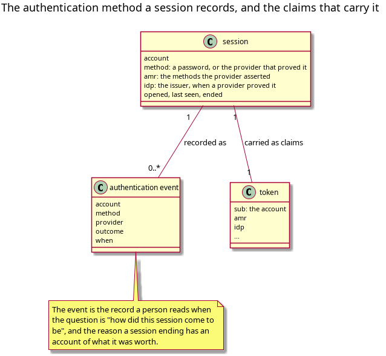

:PROPERTIES:
:ID: 6DAE22AE-31F6-4EC5-810B-66AF27AB66DE
:END:
#+title: The authentication method of a session
#+description: A session records how the person proved themselves, and the token carries amr and ORE's idp.
#+type: knowledge
#+level: cross
#+filetags: :knowledge:security:identity:session:federation:
#+created: 2026-11-28
#+updated: 2026-11-28

* Summary

A session is not only a claim that somebody signed in; it is a claim about how.
ORE records the method on the session, carries it into the token as the standard
=amr= claim, and names the provider in an =idp= claim of its own when a provider
is what proved the person. The session is ORE's own either way: the provider's tokens are used at the
exchange and not kept, so a provider outage is a reason a *new* session cannot
open, never a reason an open one stops working.

* Detail

** The three values and what each one means

The session's *method* is ORE's own word for the door: a password, or the provider
whose flow opened it. It is what a person reads on the sessions screen, and what
an operator filters on when a provider turns out to be compromised.

The token's =amr= claim carries the authentication methods, in the vocabulary
RFC 8176 defines, as the provider asserted them: a provider that says the person
used a password and a one-time code contributes both, and ORE does not upgrade or
invent what the provider did not state. A password sign-in contributes =pwd= from
ORE's own knowledge of what it did.

The =idp= claim is ORE's own, and carries the issuer when a provider is what
proved the person. It is absent on a password sign-in, because there is no
provider to name, and it is what lets a resource server see that the person
arrived through federation without ORE having to describe its own session. =amr=
is the standard claim here; =idp= is ORE's spelling, and a client that reads it
reads it as ORE's.

** What the method makes possible

*The audit.* The authentication event records that a sign-in happened and the
method it used, so a question about how somebody got in is answered from the record
and not reconstructed from logs
([[id:8AEB87D6-0CE2-1434-E71B-60BEAE20ADF0][Identity and Access Management]]).

*The sessions screen.* A person who sees their open sessions can tell a browser
opened with a password from one opened through their workspace provider, which is
the difference between "I forgot I signed in there" and "somebody has my
password".

*Step-up.* A capability that wants a stronger method than the session used can ask
for it, because the session says what it has rather than only that it has
something. The check is a comparison against the method, not a guess.

*Revocation with a boundary.* Ending a provider's sessions and disabling the
provider are two different acts, and the method is what lets an operator perform
the narrower one: disabling the provider stops new sign-ins through it and leaves
everything else working.

#+caption: The session carries the method, the token repeats it as amr and idp, and the authentication event is the record a person or an operator reads afterwards.

Source: [[file:the_authentication_method_of_a_session.puml][the_authentication_method_of_a_session.puml]], rendered with =plantuml -tpng the_authentication_method_of_a_session.puml=.

** The alternatives this rejects

*A boolean "signed in".* It answers the question a session already answers by
existing, and leaves every question above unanswered.

*Holding the provider's tokens as the session.* It would make every request depend
on the provider's availability and on a token ORE does not need: ORE asks the
provider one thing, who the person is, and has the answer in the ID token it has
already validated. It would also turn a provider's revocation into ORE's, which is
a stronger tie than federation requires.

*Trusting the provider's =acr= alone.* An assurance level the provider states is
useful evidence, but it is the provider's vocabulary and not ORE's, and a session
that records only it cannot say what ORE itself verified (OpenID Connect Core 1.0,
section 2).

*A method that names the provider rather than the door.* Naming Google or a
workspace provider in the method column makes the column a copy of =idp= and
leaves the tenant's own vocabulary to be inferred from a vendor's name.

* Sources

- [[https://www.rfc-editor.org/rfc/rfc8176][RFC 8176, Authentication Method
  Reference Values for OAuth 2.0]] — the =amr= values, including =pwd= and =mfa=.
- OpenID Foundation, [[https://openid.net/specs/openid-connect-core-1_0.html#IDToken][OpenID
  Connect Core 1.0, section 2]] — the ID token's =amr= and =acr= claims, and the
  difference between a method and an assurance level.
- [[https://www.rfc-editor.org/rfc/rfc9068#section-2.2][RFC 9068, section 2.2]] —
  the access-token claims a resource server validates, which is where =amr= is
  read when the token is ORE's own.

* See also

- [[id:B008A2C9-BAF5-49F7-AC79-B136AF9DAAE5][Federated identity]] — the
  structure note that orders this cluster.
- [[id:DC393929-BB21-4D0A-A334-EA93E1045DCF][ORE as a relying party to an
  external identity provider]] — the flow that produces the methods and the
  issuer.
- [[id:8408B333-FE16-4D3C-AB31-DCB3400C1D07][The registration of a first external sign-in]] — the session a first sign-in opens.
- [[id:09B79B9C-507B-4C9F-8FFC-B1CC572FBB3D][ORE as an authorization server for
  its own clients]] — the token described here, read by a client of ORE's API.
- [[id:8AEB87D6-0CE2-1434-E71B-60BEAE20ADF0][Identity and Access Management]] —
  the identity lifecycle and the session's place in it.
