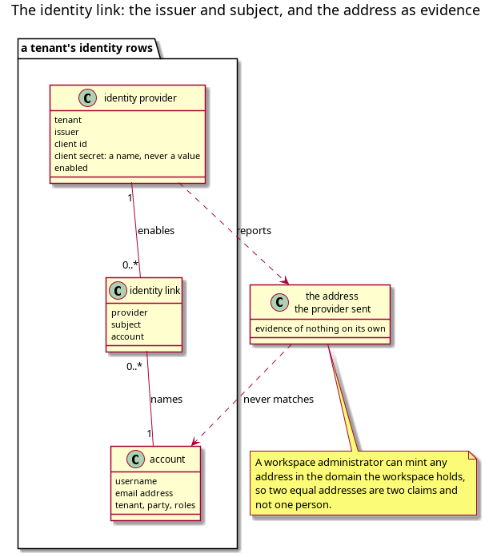

:PROPERTIES:
:ID: 359CFBD3-E8FD-47CF-96CD-D11D0AF09685
:END:
#+title: The identity link as the provider's issuer and subject
#+description: ORE names a provider account by its issuer and subject, and keeps the address as evidence, never as a key.
#+type: knowledge
#+level: cross
#+filetags: :knowledge:security:identity:federation:link:
#+created: 2026-11-28
#+updated: 2026-11-28

* Summary

An account at an external provider is named by two values: the *issuer*, which
identifies the provider, and the *subject*, which the provider states is stable and
locally unique for that account. ORE writes those two down as the link's identity and
treats them as the only thing it trusts about the provider account. The address
the provider states is recorded beside them as a fact about the moment of linking,
and nothing in ORE ever looks a person up by it.

The reason is not caution for its own sake. A workspace provider lets an
administrator of that workspace mint any address in the domain it holds, so two
equal addresses are two independent claims rather than one person. A service that
links on the address alone hands the account to whoever can create an address
elsewhere.

* Detail

** What the link holds

The link names an ORE account, the provider, and the provider account's issuer and
subject. With the tenant, the pair (issuer, subject) is the natural key: one
provider account links to one ORE account in a tenant, and a second link for the
same pair is a defect rather than a second opinion.

Beside the pair the link records the address the provider stated when the link was
made, and whether the provider said it was verified. Both are evidence of what the
person linked. Neither is identity: an address at a provider can change after the
link, and a record of "verified at that moment" says nothing about a later
sign-in. The pair is what a sign-in is matched on, so nothing rots when an address
changes.

A provider is a row a tenant enables: its issuer, the client identifier ORE uses
with it, the name of a secret rather than the secret, the scopes it asks for, the
email domains it will accept a first sign-in from, and whether it is enabled at
all. Disabling a provider leaves the links in place and stops them signing anybody
in, which is the behaviour an operator needs when a provider is compromised.

** The invariants that keep a person reachable

A person may hold several links, one per provider, and remove any of them. The
one rule the link's own operations enforce is that an account keeps at least one
way in at all times: removing the last link of an account whose password was never
set is refused, because the act would leave an account nobody can reach.

The pair is also per tenant. The same provider account may sign in to two tenants,
and when it does it holds two links to two accounts, because an ORE account lives
in one tenant and its roles and parties are that tenant's.

#+caption: The link joins an ORE account to one provider account by issuer and subject; the address travels beside the link as evidence and never as a key.

Source: [[file:the_identity_link_as_issuer_and_subject.puml][the_identity_link_as_issuer_and_subject.puml]], rendered with =plantuml -tpng the_identity_link_as_issuer_and_subject.puml=.

** The alternatives this rejects

*Matching on the address.* The tempting shortcut is to accept a provider sign-in
whose address equals an ORE account's address, and treat it as that account. It is
rejected because the address is a claim the provider makes about a namespace it
controls, not about a person: an administrator who can create
=someone@workspace.example= can create the address another person already uses at
ORE, and the sign-in would then attach to their account without either person
doing anything wrong. The standards state what the address is worth: =email= is a
claim with a verification flag, and =email_verified= says only that the provider
took affirmative steps at that moment, where =sub= is the identifier the provider
guarantees is never reassigned (OpenID Connect Core 1.0, sections 2 and 5.7). The
takeover that follows is derived here from those two statements rather than quoted
from a standard, because none states it as a rule.

*Linking by domain.* A weaker form accepts any address at the tenant's own domain
without a link. It fails for the same reason one step later, and it silently
grants the tenant's default role to whoever the provider admits, which is a
registration decision taken by a directory administrator rather than by ORE.

*One link per person, globally.* A single row keyed on the subject alone would
cross tenants. The pair with the tenant is the key because an ORE account is a
tenant's, and a person who belongs to two tenants is two accounts with two sets of
grants.

** How a link comes into being

There are two doors and they are deliberately different. An ORE account that
already exists links a provider account *from a signed-in session*, as an act the
person performs after proving the ORE account, which is the rule this page states
in one line: linking is an act, not an inference
([[id:504863AB-C45A-47E8-BB77-AADCB620A305][The entry journeys]]).

A provider account nobody has linked either registers through the policy
([[id:8408B333-FE16-4D3C-AB31-DCB3400C1D07][The registration of a first external sign-in]]) or is refused; neither door is ever "find the account whose address
looks like this one".

* Sources

- OpenID Foundation, [[https://openid.net/specs/openid-connect-core-1_0.html#Claims][OpenID
  Connect Core 1.0, sections 2 and 5.7]] — =sub= as a locally unique and never
  reassigned identifier within the issuer, and =email_verified= as a statement
  about a moment rather than about a person.
- [[https://www.rfc-editor.org/rfc/rfc9700#section-4.4][RFC 9700, section 4.4]] —
  mix-up and identity confusion between parties, the class of failure an
  address-based link turns into a routine one.

* See also

- [[id:B008A2C9-BAF5-49F7-AC79-B136AF9DAAE5][Federated identity]] — the
  structure note that orders this cluster.
- [[id:DC393929-BB21-4D0A-A334-EA93E1045DCF][ORE as a relying party to an
  external identity provider]] — the flow that yields the issuer and the subject.
- [[id:8408B333-FE16-4D3C-AB31-DCB3400C1D07][The registration of a first external sign-in]] — the door a provider account with no link takes.
- [[id:84706C3E-D48D-4A4B-967A-4AADB3CF44B2][Registration and Onboarding
  Defaults]] — the three questions the policy answers.
- [[id:8AEB87D6-0CE2-1434-E71B-60BEAE20ADF0][Identity and Access Management]] —
  the account the link names.
