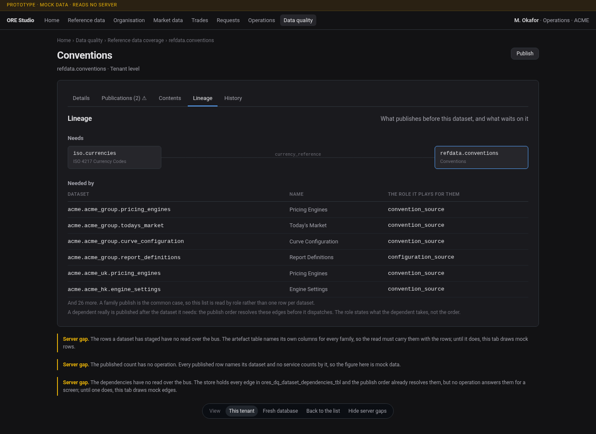
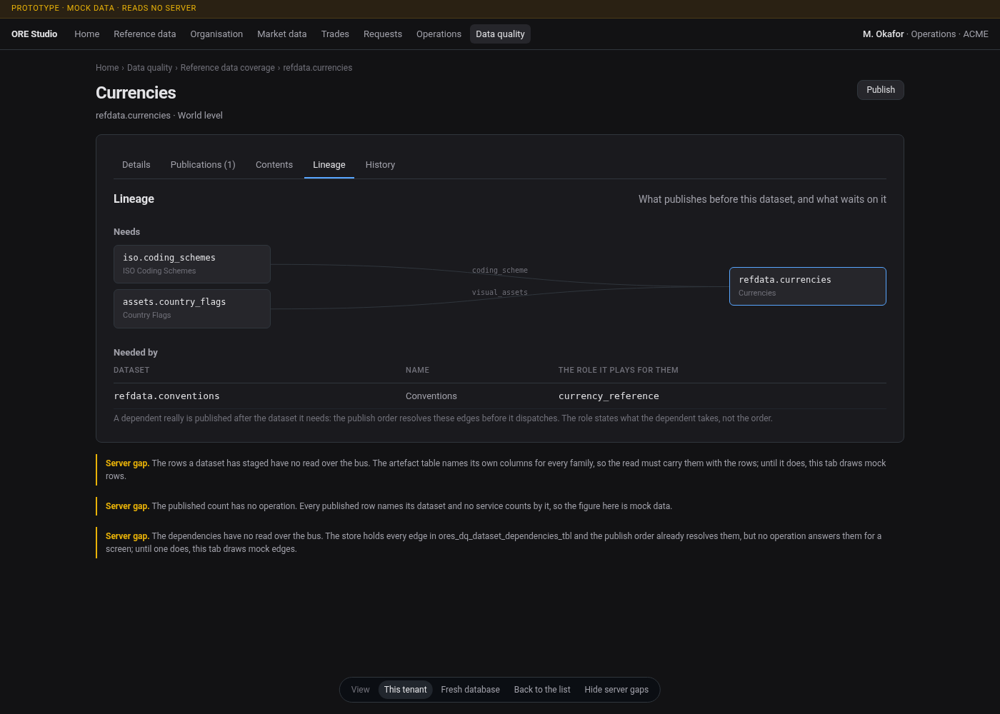
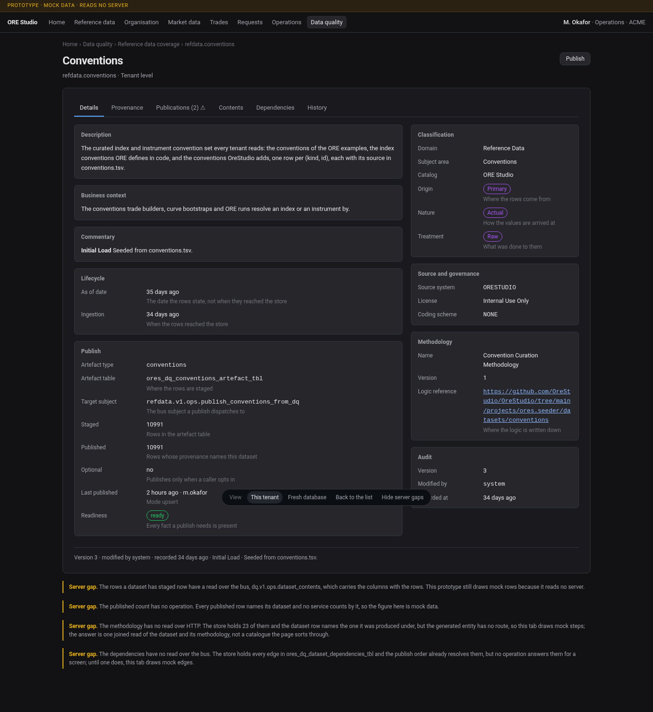
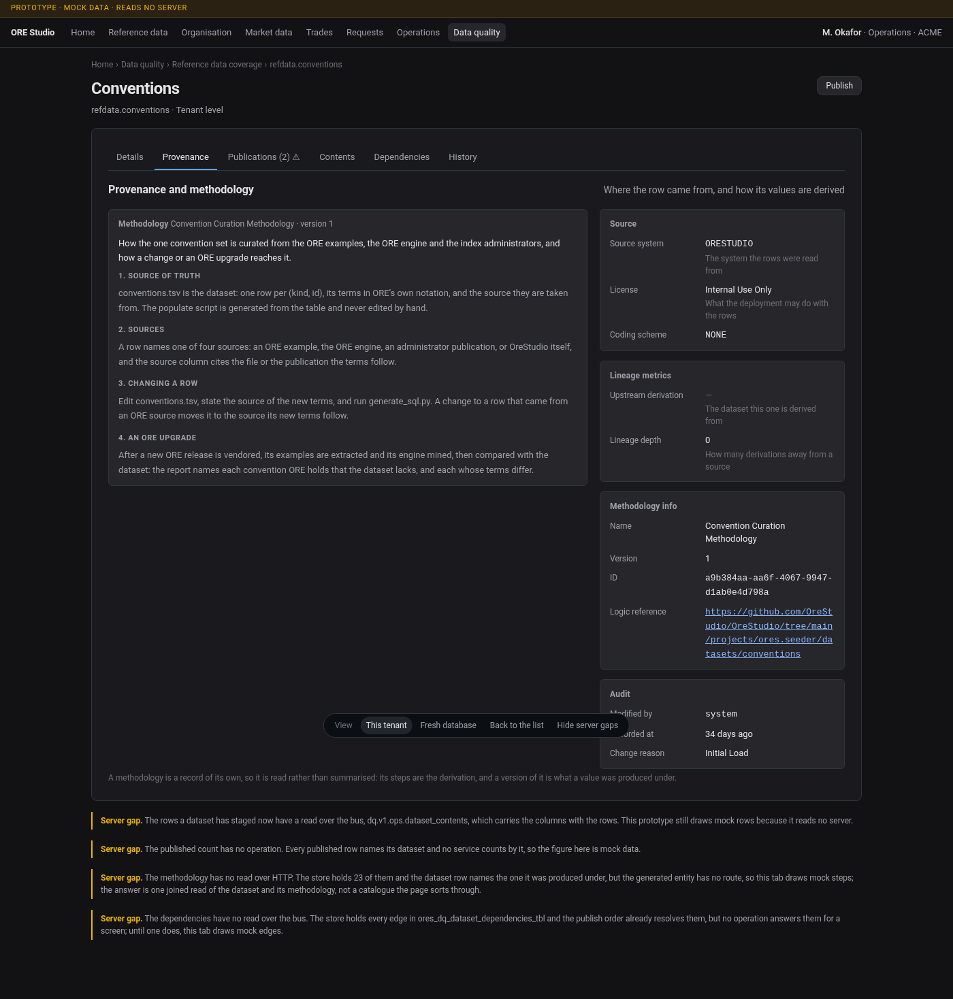

:PROPERTIES:
:ID: CB98437A-6293-4AC0-B68A-06D606FC9225
:END:
#+title: Reference data coverage prototype
#+description: The roster of bundles by level, the members of one bundle and the reason a member is not ready, drawn as the answer to whether the tenant holds what its valuations read.
#+type: knowledge
#+level: cross
#+filetags: :prototype:ui:dq:
#+created: 2026-11-22
#+updated: 2026-11-28

| Item          | Where                                          |
|---------------+------------------------------------------------|
| Prototype     | [[file:reference-data-coverage/][the prototype]] |
| Gemini review | none                                           |
| Group         | [[file:index.org][DQ prototypes]]                              |

* Summary

This prototype argues that the question "is my reference data complete?" is one
list screen, grouped by the level a bundle publishes at, with the chosen
bundle's members underneath. The level is not decoration: it decides which
tenant holds the rows and whether a tenant owes a copy, so grouping by it is
what makes the answer readable. The member table then says how much is staged,
how much is published, and which of four reasons keeps a member from being
ready. It answers to
[[id:5344ADC1-E729-4846-BE07-C6BC2169C4C9][Is my reference data complete?]].

It is throwaway. It reads no server, opens with no build and no session, and
draws mock data. Every place where the server does not provide what the screen
needs is marked on the page, and a link in the bar at the foot hides those
notes.

* Detail

** What it argues

- *The level is the first thing read, not a column.* A tenant that holds a
  platform or world bundle has two copies of a fact, so the roster groups the
  bundles by the level they publish at and states, for each, that the rows live
  in the system tenant and are read where they lie.
- *Readiness has four reasons and each has an owner.* No dataset row, no artefact
  type, no target subject, no staged rows. A screen that says "not ready" without
  the reason sends the person to the wrong owner: three of the four are DQ's to
  fix and the fourth is the importer's.
- *Published is a count, not a state.* The published column counts the rows whose
  provenance names the dataset, and a member whose count is still zero after a run
  is the only evidence that the run wrote nothing. The prototype draws the count
  because a tick would hide exactly the failure the arc exists to fix.
- *A fresh database looks like a screen, not like an error.* The state that
  started this work was a recreate that reported success while the catalogues were
  empty; the prototype draws that state with a sentence.
- *The history is left out, on purpose.* The run log exists and nothing writes
  it, so a history here would be an empty table, which reads as "nothing was ever
  published" — a different claim. The absence is stated instead, in a server-gap
  note.

** The screen

One list screen in three cards: the bundles grouped by level, the chosen
bundle's members, and the four reasons with the owner of each. The screen
publishes nothing. The publish itself is the journey's next step and is drawn by
[[file:../publish-a-bundle.org][Publish a bundle]], so this page stays a read.

** States, by query string

=?bundle=system_core|world|crypto|tenant_defaults|party_essentials|risk_management=,
=?empty=1=, =?actor=<person>=, =?gaps=0=. The bar at the foot switches between
the tenant as it is and a fresh database, and hides the server-gap notes.

=?layout=librarian= draws the same model in the shape of the Qt Data Librarian
and the record screen standard: a tree of the levels and their bundles on the
left, and a dense table of the chosen bundle's datasets on the right, with a text
and a state filter. A row opens the dataset's own screen.

=?view=dataset&dataset=<code>= is that screen: the record page of one dataset,
with a Details tab, a Publications tab and a History tab. =?tab=details|
publications|history= chooses the tab. =?q=<text>= and
=?state=all|bad|unpublished|published= are the two filters on the table.

** What is fake

The bundles, their counts, and every staged and published figure, and the demo
clock every relative time reads against.
=party_essentials= and =risk_management= carry mock members because they are the
two shapes the prototype argues: a bundle with a member that cannot publish, and
a bundle with a member that publishes nothing. The other four bundles list their
names and open no table, which is what the screen would do before the coverage
operation exists. The provenance read behind the published column is not drawn at
all.

** Where the code lives

[[proj:doc/prototypes/dq/reference-data-coverage/][=doc/prototypes/dq/reference-data-coverage/=]]:
=index.html=, =prototype.js=, and =management.css= and =management.js=, which are
the conventions prototypes' shell copied verbatim: the shell head, the
breadcrumb, the page header, the refresh, the table, the badges and the server-gap
note. The conventions mock data the script carries is inert here. Nothing is
built, imported or served.

** The dataset's own screen

A row in the table does not open a card beside it, because a dataset is a record
and the [[id:2BF7F03F-6BF4-45FF-8E26-4D3B4E2D943D][Record screen standard]] gives
a record a page of its own: the breadcrumb, the display field as the title, the
key and the level as the lead, then the tabs.

The page answers the questions a list cannot:

- *Details.* The dataset's own row and not only its publish-facing
  facts, in the cards the Qt client drew and not in one grid of seventeen values.
  The main column answers what the dataset is: its description, its business
  context, its commentary, when its rows state a date and when they reached the
  store, and what a publish does with them. The side column answers how it is
  classified and where it came from: domain, subject area and catalog, the three
  classifications — origin, nature and treatment, each drawn as the badge the label
  catalogue gives its code — the source system, the license, the coding scheme, and
  the methodology's name, version and logic reference. Under both stands the
  last-changed line every record page ends with. The row states all of it and the
  generated dataset read already answers it; the page that drew the roster member
  alone could not.

- *Provenance.* Where the row came from and how its values are derived: the source
  system, the license and the coding scheme, the upstream dataset it is derived
  from, its lineage depth, and the methodology read as the record it is — name,
  version, id, logic reference, description and implementation details. The Qt
  client split this from the overview for the same reason the cards keep them
  apart: one answers what the dataset is, the other how it came to be.

- *Publications.* Every publish of this dataset, one row each: when, by whom, the
  mode, the four counts, the outcome, and what the run said. A warning is a row
  the run chose not to write; an error is a row it could not. A run that wrote
  nothing and said why is the row an operator actually needs, and the current log
  cannot hold it.
- *History.* The versions of the dataset row, which the design defers: the entity
  is versioned and this prototype draws none of it.

- *Contents.* The tables the dataset stages into, and the rows of one of them. A
  dataset does not sit in one table: its artefact type names a table or a family,
  and every family carries its own columns beside the two all of them share,
  =dataset_id= and =tenant_id=. So the tab lists the tables first — each with its
  own column list and its own staged count — and a table is opened to read its
  rows. The read that serves it must carry the columns with the rows, which is
  why [[id:99F3E780-6AA0-4879-8F6F-2A1321ACDB85][its task]] owns that decision.
  The rows here are mock data and the page says so.

  The rows are a list, so they page like every other list: the same six page
  sizes, the same first–previous–next–last strip, the same bounds sentence, and
  the page held in the address. A table of half a million rows reads like a page
  of fifteen, and a page size of five hundred is a choice a person makes, not a
  cap the view takes on their behalf.

  A column states its kind as well as its name, because some kinds are drawn and
  not printed. An =image= column is the first: the artefact table holds an image
  id, the read answers the image's code, and the screen draws the flag. Printing
  the id would tell a reader nothing about a row whose point is the picture. This
  is drawn but not built: the contents read answers the id today, and
  [[id:D1B5FAF4-BD7A-4740-AC52-A980A0FFE901][the image task]] owns both halves.

- *Dependencies.* What publishes before the dataset, and what waits on it. The store
  holds every edge in =ores_dq_dataset_dependencies_tbl= — 196 rows when this was
  written — as "this dataset depends on that one for this role". The publish order
  already resolves them, so the tab states a fact about a publish and not a
  drawing of an idea. It draws the two directions differently, and the asymmetry
  is the decision: a dataset needs at most six others, which fits the small graph
  the Qt Data Librarian drew, and is needed by as many as thirty-two, which does
  not. So *Needs* is a graph with the role on each wire and *Needed by* is a table
  whose rows open the dependent dataset. The edges here are mock data and the page
  says so.

The list keeps the state column *and* the page exists, because they answer
different questions: the list says which datasets need attention, and the page
says what one dataset needs and what happened to it last time.

** The build, and the second layout

The first screen built from this design does not draw it. Three cards became a
grid of bundle chips, the roster table with its datasets, checked and state
columns became that grid, the member table lost its target subject and its state,
and the reasons table lost the meaning of each reason and kept only a badge. The
result states the same facts in more space and reads nothing like the Qt Data
Librarian the area replaces.

The librarian layout is the answer to that. It keeps the model and changes the
arrangement: the tree answers "which bundle", the table answers "which dataset",
and the card answers "what does this dataset need". It is a variant on this page
and not a second page, so the two can be compared side by side with one query
string.

** Verdict

The layout holds, in one of its two arrangements. Grouping the bundles by level is
the smallest thing that shows the level mattering. One question is left open: the
published count costs one read per dataset, so it may belong behind the bundle
rather than on every row of the list. The history is not drawn here at all,
because the run log has no writer; when it gets one, it belongs to the publish
journey and not to this screen.

*Signed off* on 2026-11-22 by Marco, on the table layout as it stood. That sign-off
was for a design the build did not follow, and the Data Librarian comparison
reopened the arrangement.

*Signed off* again on 2026-11-26 by Marco, on the librarian arrangement and the
dataset's own page, with these decisions:

- The list is the Data Librarian's master-detail: the bundles by level on the left,
  the chosen bundle's datasets in a dense table on the right, with a text and a
  state filter.
- A dataset is a record, so a row opens its own page and not a card beside the
  table. The page follows the
  [[id:2BF7F03F-6BF4-45FF-8E26-4D3B4E2D943D][Record screen standard]].
- The page states when the dataset was last published, and every publish with its
  outcome and what the run said, in its own Publications tab.

The Contents tab was drawn and signed off on 2026-11-28, on the decision that a
dataset's contents are a list of the tables its artefact type names and not one
grid: =conventions= names thirty-four tables, each with its own columns, so a table
is listed with its columns and count and opened to read its rows. See
[[id:99F3E780-6AA0-4879-8F6F-2A1321ACDB85][See the rows a dataset has staged]].

The Details tab and a Provenance tab were drawn on 2026-11-28 and *signed off* the
same day by Marco. They answer the question the review raised: a dataset's page
showed nothing of the dataset itself. They were redrawn as cards before the
sign-off, because the first cut laid seventeen values in one grid and the reviewer
still could not find the dataset in its own page; the cards are the Qt dialog's
sections, which is what the area is measured against. Both readings exist — the row
is served by the generated dataset read, and the label catalogue already maps the
three classifications — except the methodology, which has a bus list and no HTTP
route. The answer drawn is one joined read of the dataset and its methodology, not a
catalogue the page sorts through. See
[[id:C764076D-053A-4980-95D2-EC74639C7954][its task]].

The Dependencies tab was drawn on 2026-11-28 and *signed off* with the two tabs
above. It is the Qt dialog's Dependencies tab under the name the Qt client gave it,
and it answers what the Qt Data Librarian's lineage graph answered. Its open point
was the asymmetry above — a graph upstream, a table downstream — and the sign-off
keeps it: a dataset needs at most six others, which the graph draws, and is needed
by as many as thirty-two, which reads as a table. See
[[id:4C516D35-0DAA-47FD-8FC4-BE62E071D3D8][its task]].

The Contents tab's paging and its image column were drawn on 2026-11-28 as well. The
paging is the standard =Pager= the record lists use and is built; the image column
is signed off with the tabs and still awaits its read and its route, so the screen
prints a uuid until then. See
[[id:D1B5FAF4-BD7A-4740-AC52-A980A0FFE901][the image task]].

#+caption: The Dependencies tab: one need, drawn as the Qt client drew it, and the
#+caption: thirty-two dependents read as a table, of which six are shown.
#+attr_html: :width 100%

#+caption: Two needs, with each wire labelled by the role the edge states.
#+attr_html: :width 100%

#+caption: The Details tab in the Qt dialog's cards: what the dataset is on the
#+caption: left, how it is classified and where it came from on the right.
#+attr_html: :width 100%

#+caption: The Provenance tab: the methodology read as a record, and the source,
#+caption: lineage metrics and audit that say where its values came from.
#+attr_html: :width 100%

The table layout stays on the page only as the record of what was first drawn.

* See also

- [[file:index.org][DQ prototypes]] — the group this belongs to.
- [[id:5344ADC1-E729-4846-BE07-C6BC2169C4C9][Is my reference data complete?]] — the journey it answers.
