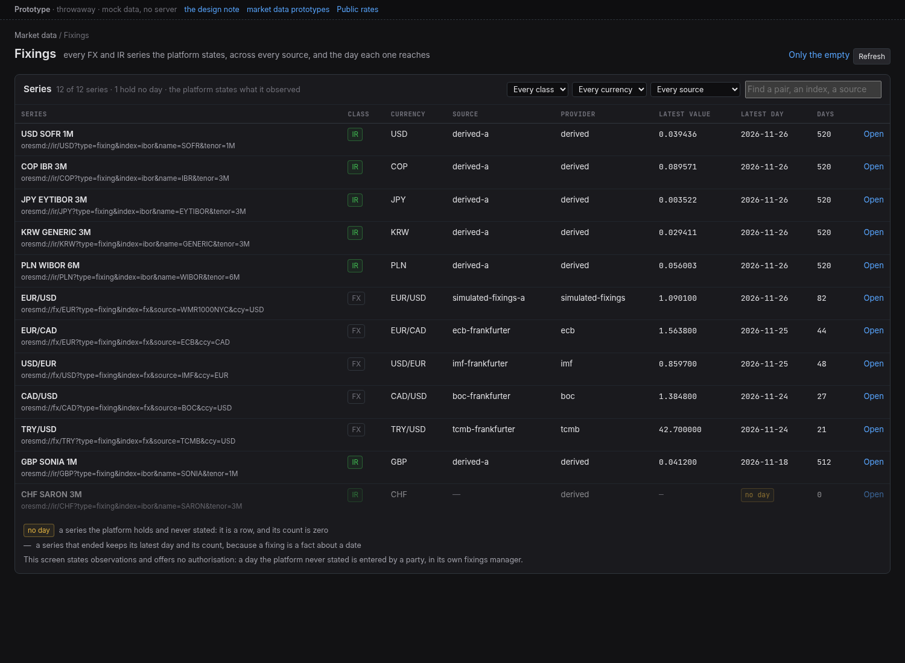
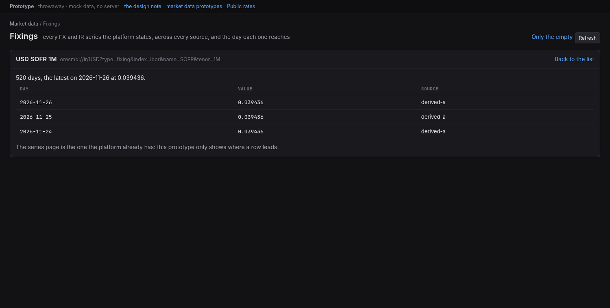

:PROPERTIES:
:ID: 7E4C2F58-3B91-42D0-8C6A-9F15E2B7D348
:END:
#+title: Fixings, prototype
#+description: The fixing series the platform states as one list a system administrator reads: what each series fixes, the source its values came from, the latest value and its day, and how many days it holds, including the series that hold none.
#+type: knowledge
#+level: cross
#+filetags: :prototype:ui:market_data:fixings:
#+created: 2026-11-26
#+updated: 2026-11-26

| Item          | Where                                                    |
|---------------+----------------------------------------------------------|
| Prototype     | [[file:fixings/][the prototype page]]                    |
| Design note   | this page                                                |
| Group         | [[file:index.org][Market data prototypes]]               |
| Journey       | [[file:../../knowledge/journeys/market_data/journey_see-the-fixings-the-platform-states.org][See the fixings the platform states]] |
| Review        | none                                                     |
| Sign-off      | pending                                                  |

* Summary

Quotes shows the market as the vendors quote it, Public rates shows what the
public bodies publish, and a fixing series page shows one item by its address.
None of them lists the fixings. A system administrator asking whether the
platform is stating what it should has no screen that answers "every series we
hold, and how far each one reaches".

This prototype argues one list, and the shape of its rows before any code is
written. A row is one series, because a fixing is one value of one series on one
day: the pair or the index, the class, the source the values came from, the
publisher the series belongs to, the value of its latest day, that day, and how
many days it holds.

#+ATTR_HTML: :class hug-leading
| Surface | Question | Reads |
|---------+----------+-------|
| Fixings (list) | What does the platform state, and how far does each series reach? | one row per fixing series: label, class, underlying, source, provider, latest value, latest day, day count |
| The row's act | What did this series state, day by day? | the fixing series page the platform already has, opened by the series' address |

The prototype decides five things, and no more.

- *The grain is the series.* A provider, a source or a curve may state many
  series, and each reaches its own day. Grouping them would answer a question
  nobody asked and hide the series that stopped.
- *A series that holds no day is a row.* It reads =no day= and a count of zero.
  It is the state the platform is asked about most: a series it holds and never
  stated.
- *A series that ended keeps its row, its latest day and its count.* A fixing is
  a fact about a date, so a series that stopped states the last day it reached
  and the days it holds; it is not hidden and its last value is not carried
  forward.
- *The address is the identity, and the label is derived from it.* The screen
  shows =USD SOFR 1M= and =EUR/USD=, and states the address beneath, because the
  address is what the series page reads and what a person pastes into a query.
- *Nothing is offered but reading.* There is no approve, no override, no edit.
  The platform states the observations it holds; a day it never stated is a
  party's to enter, with an explanation, in its own fixings manager.

* The words

#+ATTR_HTML: :class hug-leading
| Word | Meaning | Example |
|------+---------+---------|
| /Series/ | One item's fixings, held under one provider | =oresmd://ir/USD?type=fixing&index=ibor&name=SOFR&tenor=1M= |
| /Item/ | What the series fixes: an index or a pair | =USD SOFR 1M=, =EUR/USD= |
| /Source/ | Where the values came from: a vendor, a public body, or a generator | =ecb-frankfurter=, =derived-a= |
| /Provider/ | Who owns the series | =ecb=, =derived= |
| /Day count/ | How many days the series holds | 520 |
| /Latest day/ | The newest day the series stated | 2026-11-26 |
| /Empty/ | A series the platform holds and never stated | any count of zero |

* States and addresses

#+ATTR_HTML: :class hug-leading
| State | Address | What it shows |
|-------+---------+---------------|
| The list | =?= | Every series, the filters and the legend |
| One class | =?class=ir= (=fx=) | The IR series alone |
| One currency | =?currency=JPY= | The series that name the currency, on either side of a pair |
| One source | =?source=ecb-frankfurter= | The series one source states |
| A search | =?find=sofr= | The series whose label, address, source or provider name it |
| The empty series | =?state=empty= | Only the series that hold no day |
| A series | =?series=USD%20SOFR%201M= | The series page the row opens |

* What it argues

- *One list answers the operational question.* The other screens answer "what is
  the market" and "what did the public bodies publish". This one answers "what
  do we hold, and how current is each part of it", which is the question a
  person asks when a party reports a fixing it cannot get.
- *The count is the health, the latest day is the freshness.* A series at 520
  days with a latest day of today is stating; one at 512 with a latest day of a
  week ago stopped and did not resume; one at zero never started. Three facts on
  one row, none of them a colour that has to be learned.
- *The filters are the three questions a person has.* Which class, which
  currency, which source. A filter on the provider would duplicate the provider
  column, and a filter on the day count would be a threshold disguised as a
  filter.
- *The label is not the identity.* Two providers may state the same index, so
  the label repeats across rows and the address tells them apart. The screen
  shows both, the label first.
- *The row opens the page we have.* The fixing series page already reads one
  item by its address, with its values and the feeds that carry it. The list is
  the way in, and it builds no second reading.

* What it asks

1. Should the list state the first day as well as the last, so a series that
   began late reads as such on the row rather than only on its page?
2. Should the empty series sort to the top, out of the order of the addresses,
   or stay where its address puts it? The prototype keeps them in order and
   dims them.
3. Should a row carry the count of days *missing* since the last day it should
   have stated, which needs each series' expected rhythm, or is the latest day
   enough for a person to judge?

* What is fake

- Every series, value, day and count is invented, except the five derived
  indices' newest values, which are copied from a run of the platform so the
  rows read like the real ones.
- The filters are applied to the mock rows in the page; the read states them.
- The series page the row opens is drawn from the same mock row repeated over
  three days, because that page already exists and this prototype only argues
  where a row leads.
- Nothing is written: Refresh reloads the page, and every act moves the query
  string.

* The pages

#+caption: The list: the filters, the series, the empty series and the legend.
#+attr_html: :width 100%

#+caption: The row's act: where a series leads, which is the page the platform already has.
#+attr_html: :width 100%

