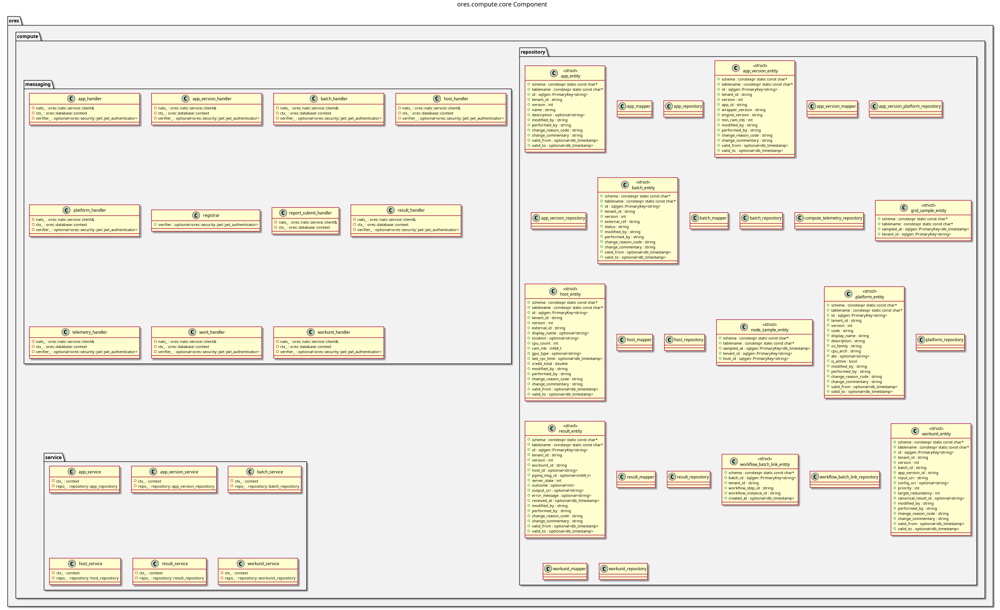

:PROPERTIES:
:ID: 3BFFDF5C-86F5-4D57-9D9F-676D0D62B344
:END:
#+title: ores.compute.core
#+name: compute.core
#+full_name: ores.compute.core
#+description: Compute cluster management — app registration, batch dispatch, and result collection for risk compute jobs.
#+brief: Risk compute cluster orchestration core
#+type: ores.codegen.component
#+component_kind: core
#+hidden_visibility: true
#+level: cross
#+filetags: :compute:core:component:
#+created: 2026-05-19
#+updated: 2026-05-19

* Diagram

#+attr_html: :width 100% :alt ores.compute.core component diagram
#+caption: ores.compute.core

* Summary

=ores.compute.core= manages the compute cluster for ORE risk runs. It maintains
a registry of available compute applications (=app=, =app_version=), assigns
batch jobs to available hosts, tracks execution state, and collects results.
Worker nodes running =ores.compute.wrapper= register themselves and receive
job assignments via NATS; results flow back through the same channel.

* Inputs

- NATS messages from =ores.compute.wrapper= instances (registration, heartbeat,
  job completion with result paths).
- NATS request messages from UI clients (batch CRUD, host/app queries).
- PostgreSQL connections to =ores_compute_*= tables.

* Outputs

- Batch and result records persisted to the =ores_compute= schema.
- NATS job-assignment messages dispatched to compute workers.
- NATS response messages returned to callers.

* Entry points

- =include/ores.compute.core/ores.compute.hpp= — the component's banner
  header, the same shape every component carries. It declares no symbol.
- =include/ores.compute.core/messaging/registrar.hpp= — registers handlers.
- =include/ores.compute.core/service/= — app, batch, host, result services.

* Dependencies

- =ores.compute.api= — shared domain types and NATS protocol schemas.
- =ores.dq= — ORM base classes.
- =ores.iam.core= — authorisation context.
- =rfl=, =sqlgen=, =nats.c=.

* Build dependencies

What the shared profile cannot know, declared here rather than
hand-edited into the generated build file. Each block is spliced
into its generated file after the profile's baseline.

* See also

- [[id:A8B7F2C9-D416-4E83-B527-9F814E62C1A5][ores.compute]] — component group overview.

- [[id:A59E121A-B8FB-43F0-A5CD-1FA5F426E66A][ores.compute.api]] — protocol types and domain entities.
- [[id:152C4A5E-9947-4EE1-A5D4-893305D235B5][ores.compute.service]] — NATS service entrypoint.
- [[id:F1B19D84-A5C9-4478-BB46-EE6EA62DAFCA][ores.compute.wrapper]] — worker node that executes ORE runs.

* Test dependencies

The suites link what the profile cannot know about.

#+begin_src cmake :name extra_dependencies
target_link_libraries(${lib_target_name}
    PUBLIC
        ores.compute.api.lib
        ores.database.lib
        ores.nats.lib
        ores.dq.api.lib
        ores.diff.lib
        ores.service.lib
    PRIVATE
        ores.security.lib
        ores.utility.lib
        ores.logging.lib
        ores.platform.lib
        ores.reporting.api.lib
        ores.iam.client.lib
        ores.history.core.lib
        faker-cxx::faker-cxx
        libfort::fort)
#+end_src

#+begin_src cmake :name extra_test_dependencies
target_link_libraries(${tests_target_name}
    PRIVATE
        ${lib_target_name}
        ores.utility.lib
        ores.testing.lib
        ores.logging.lib
        ores.eventing.api.lib
        ores.eventing.core.lib
        ores.refdata.core.lib
        Catch2::Catch2
        faker-cxx::faker-cxx
        Threads::Threads)
#+end_src
