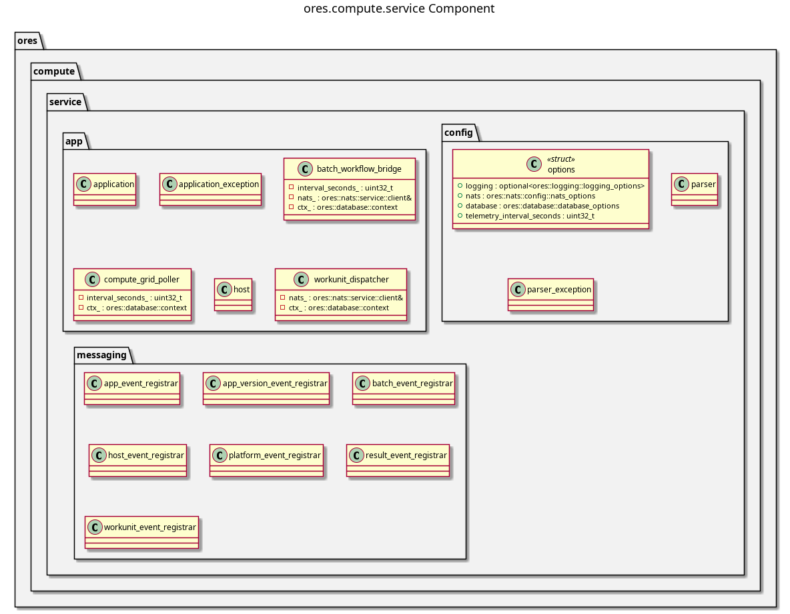

:PROPERTIES:
:ID: 152C4A5E-9947-4EE1-A5D4-893305D235B5
:ores.cpp.service-app.enabled: nil
:END:
#+title: ores.compute.service
#+name: compute.service
#+full_name: ores.compute.service
#+description: NATS service entrypoint for the compute domain.
#+brief: Compute orchestrator service entrypoint
#+type: ores.codegen.component
#+component_kind: service
#+level: cross
#+filetags: :compute:service:component:
#+created: 2026-05-19
#+updated: 2026-05-19

* Diagram

#+attr_html: :width 100% :alt ores.compute.service component diagram
#+caption: ores.compute.service

* Summary

=ores.compute.service= is the NATS service entrypoint for the compute
orchestrator. It opens database and NATS connections, registers all message
handlers from =ores.compute.core=, and runs the event loop.

* Inputs

- Configuration file: NATS server URL, PostgreSQL connection string.
- NATS messages from workers and UI clients.

* Outputs

- A running NATS service for compute orchestration.

* Entry points

- =src/main.cpp=, =src/app/=, =src/config/=.

* Dependencies

- =ores.compute.core=, =ores.compute.api=, =ores.logging=, =nats.c=.

* Build dependencies

What the shared profile cannot know, declared here rather than
hand-edited into the generated build file. Each block is spliced
into its generated file after the profile's baseline.

#+begin_src cmake :name extra_dependencies
target_link_libraries(${lib_target_name}
    PUBLIC
        ores.eventing.core.lib
    PRIVATE
        ores.iam.client.lib
        ores.workflow.api.lib)
#+end_src

* See also

- [[id:A8B7F2C9-D416-4E83-B527-9F814E62C1A5][ores.compute]] — component group overview.

- [[id:3BFFDF5C-86F5-4D57-9D9F-676D0D62B344][ores.compute.core]] — all orchestration logic.

* Test dependencies

The suites link what the profile cannot know about.

#+begin_src cmake :name extra_test_dependencies
target_link_libraries(${tests_target_name} PRIVATE
    ores.utility.lib
)
#+end_src
