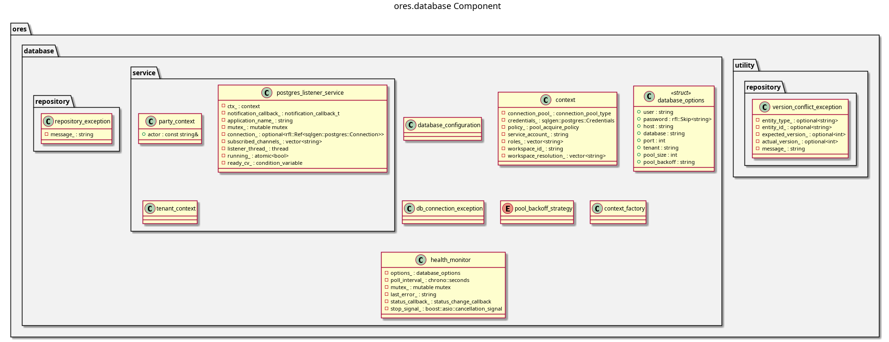

:PROPERTIES:
:ID: 3A8F2E91-D4C7-8AB4-5E23-91D6F8C04A72
:END:
#+title: ores.database
#+name: database
#+full_name: ores.database
#+brief: Shared PostgreSQL access layer for every ORE Studio service.
#+description: PostgreSQL database access layer — connection pool, tenant context, bitemporal operations, and repository helpers.
#+type: ores.codegen.component
#+level: cross
#+filetags: :database:persistence:component:
#+created: 2026-05-20
#+updated: 2026-10-26

* Diagram

#+attr_html: :width 100% :alt ores.database component diagram
#+caption: ores.database

* Summary

=ores.database= is the shared PostgreSQL access layer used by every domain
service. It provides a connection pool (=tenant_aware_pool=), tenant and party
context management, bitemporal CRUD operations, repository base helpers, and
the mapper and exception scaffolding the generated repositories build on. It
also exposes a =health_monitor= and a =postgres_listener_service= for
LISTEN/NOTIFY integration. All persistence code in domain services builds on
this library.

The layer's target shape, pooled long-lived connections, a unit of work that
hands repositories an open transaction, typed statements and classed errors,
is set out in [[id:CE41E828-18EB-4E88-BB02-6A4930E7B67C][The data path]].

The component owns no codegen entity models. It is hand-written
infrastructure, and every type it exposes stays below the audit, history and
eventing stacks it would otherwise have to link. The =ores_database_info_tbl=
table lives in the SQL technical space under =projects/ores.sql=.

=context_factory::make_context= refuses a database built from other SQL. The
build compiles in the schema fingerprint of =projects/ores.sql=; the context
factory reads the fingerprint the database recorded at recreate, logs both,
and throws =schema_mismatch_exception= when they differ. Service mains map
it to =exit_code::schema_mismatch= after printing its message.

* Inputs

- PostgreSQL connection string from service configuration.
- Tenant and party identifiers set per request for row-level security.

* Outputs

- Pooled libpqxx connections scoped to tenant/party context.
- Bitemporal entity CRUD results with version-conflict detection.

* Entry points

- =include/ores.database/domain/= — =database_options=, =context=, =tenant_aware_pool=.
- =include/ores.database/repository/= — bitemporal operations, mapper helpers.
- =include/ores.database/service/= — =health_monitor=, =postgres_listener_service=,
  =tenant_context=, =party_context=.
- =include/ores.database/config/= — =database_configuration= parsing.

* Dependencies

- libpqxx — PostgreSQL C++ client.
- =ores.logging= — structured logging.

* Entity modules

None. The component has no codegen entity models.

* See also

- [[id:CE41E828-18EB-4E88-BB02-6A4930E7B67C][The data path]] — the target shape of this layer.

#+begin_src cmake :name extra_dependencies
target_link_libraries(${lib_target_name}
    PUBLIC
        sqlgen::sqlgen
        ores.logging.lib
        ores.platform.lib
    PRIVATE
        ores.utility.lib)

target_link_libraries(${lib_target_name} PRIVATE ores.rfl.pch)
#+end_src

#+begin_src cmake :name extra_test_dependencies
target_link_libraries(${tests_target_name}
    PRIVATE
        ${lib_target_name}
        ores.testing.lib
        ores.logging.lib
        Catch2::Catch2
        faker-cxx::faker-cxx
        ores.openssl_cleanup
        Threads::Threads)
#+end_src
