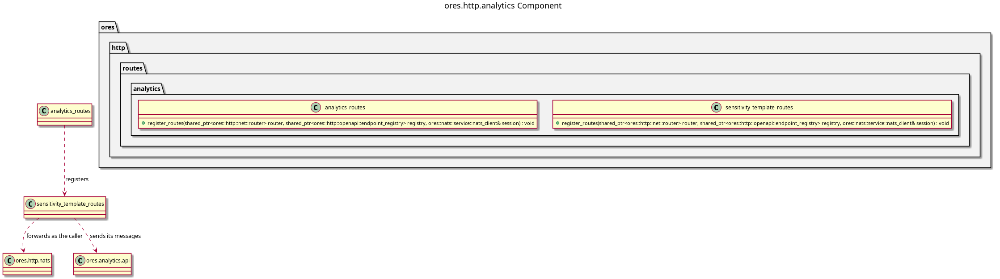

:PROPERTIES:
:ID: 577DB4C2-31AE-4168-A7AA-A88AD674C0E9
:END:
#+title: ores.http.analytics
#+description: The HTTP gateway's analytics adapter part. Holds the route units that project the sensitivity templates onto the REST surface.
#+type: ores.codegen.component
#+component_kind: adapter
#+level: cross
#+filetags: :http:rest:analytics:component:
#+created: 2026-11-19
#+updated: 2026-11-19
#+name: analytics
#+full_name: ores.http.analytics
#+brief: HTTP analytics route units

* Diagram

#+attr_html: :width 100% :alt ores.http.analytics component diagram
#+caption: ores.http.analytics

* Summary

=ores.http.analytics= is the adapter part that projects the analytics domain
onto the HTTP server's REST surface. It holds one hand-written unit, the
sensitivity templates screen, and it will hold the units of the analytics
models that opt in to the =ores.cpp.http-route= facet.

The part speaks the canonical protocol over NATS and holds no service,
repository or database context: the analytics service stays the only place that
decides, and the caller's own token travels with every forwarded request.

The part declares =#+component_kind: adapter=. Its =CMakeLists.txt= files are
hand-authored, because the link libraries belong to the HTTP surface rather than
to the domain, and codegen writes only the two =component_files.cmake= lists. A
regeneration therefore never writes over the build.

The routes answer under the =analytics= area, which is the published namespace
the inventory counts them in.

* Inputs

- HTTP requests on the =/api/analytics/...= paths the unit registers.
- The caller's bearer token, forwarded to the service on every NATS request.
- The connected NATS client the hand-written per-component aggregator passes
  to =register_routes=.
- The analytics models under =projects/ores.analytics/modeling/=.

* Outputs

- The sensitivity template routes: the tenant's keys, the two lookups a key
  states, one key, its history, and the writes that raise, correct and remove
  one.
- The routes and their OpenAPI schemas, registered on the router and the
  endpoint registry.
- NATS request messages to the analytics service, one per route.

* Entry points

- =include/ores.http/routes/analytics/sensitivity_template_routes.hpp= -- the
  unit-level entry the host calls to install the screen's routes.
- =analytics_routes= -- the part's aggregate, which lists the units.

* Dependencies

- =ores.http.api= -- the router, the route builder, the OpenAPI registry and
  the request/response types.
- =ores.http.nats= -- the gateway's one forwarding step to the services.
- =ores.nats= -- NATS transport for service calls.
- =ores.analytics.api= -- the canonical protocol messages the units send.
- =ores.history.api= -- one record's versions, read through the shared step.
- =ores.utility= -- the codecs and the wire support types.
- =ores.logging= -- logger factory.

* See also

- [[id:A8B318BC-8653-4D33-A58C-60793E3596D5][ores.http.server]] -- the process that hosts these routes.
- [[id:1EBDA080-07F6-496D-AA4A-72899E65641C][ores.cpp.http-route]] -- the facet that emits the generated units.
- [[id:F27E5DF7-6223-4B6F-80A5-CEFBEB1BC756][Component architecture]] -- the composite and adapter kinds.
- [[id:09BD5681-9C12-469A-80DA-27D1DF9D0808][ores.http]] -- the composite that holds this part.

#+begin_src cmake :name extra_dependencies
target_link_libraries(${lib_target_name}
    PUBLIC
        ores.http.api.lib
        ores.nats.lib
        ores.logging.lib
    PRIVATE
        ores.http.nats.lib
        ores.analytics.api.lib
        ores.history.api.lib
        ores.utility.lib)
#+end_src

#+begin_src cmake :name extra_test_dependencies
target_link_libraries(${tests_target_name}
    PRIVATE
        ${lib_target_name}
        ores.testing.lib
        Catch2::Catch2
        ores.openssl_cleanup
        Threads::Threads)
#+end_src
