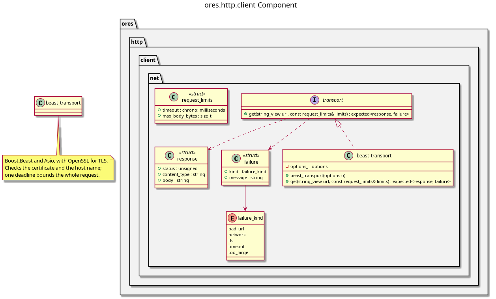

:PROPERTIES:
:ID: 1648E671-911B-422B-B8E9-402697E1AE4E
:END:
#+title: ores.http.client
#+description: An HTTP client on Boost.Beast: a GET over TLS, behind an interface a test can replace.
#+type: ores.codegen.component
#+level: cross
#+filetags: :http:client:component:
#+hidden_visibility: true
#+created: 2026-10-28
#+updated: 2026-10-28
#+name: http.client
#+full_name: ores.http.client
#+brief: Outbound HTTP client

* Diagram

#+attr_html: :width 100% :alt ores.http.client component diagram
#+caption: ores.http.client

* Summary

=ores.http.client= is how the system reads an outside HTTP API. The public sources
adapter reads the daily rates of central banks through it, and so may any other part
that calls out. Its first function is a GET over TLS on Boost.Beast and Boost.Asio,
with OpenSSL for TLS, which checks the certificate and the host name and bounds the
wait and the size of the body. A caller holds it through the =transport= interface,
so a test hands back stored responses and needs no network. The server parts of
=ores.http= serve requests; this part makes them.

* Inputs

- A URL, =http= or =https=, and the limits of one request: a timeout and a body size.

* Outputs

- A response: the status, the content type and the body; or the reason the request
  failed: a refused certificate, a timeout, a body over the limit, or a network error.

* Entry points

- =ores::http::client::transport=, the interface a caller holds.
- =ores::http::client::beast_transport=, the implementation over the network.

* Dependencies

- Boost.Beast, Boost.Asio and Boost.URL.
- OpenSSL, through Asio's TLS stream, and the system's trusted certificates.

* See also

- [[id:F4BBEF34-D84C-4AE6-A3AA-DC47C3EE06EE][Public sources publish daily fixings through an adapter]] — its first caller.

* Build dependencies

What the shared profile cannot know, declared here rather than hand-edited into
the generated build file. Each block is spliced into its generated file after the
profile's baseline.

#+begin_src cmake :name extra_dependencies
find_package(Boost REQUIRED COMPONENTS url)

target_link_libraries(${lib_target_name}
    PUBLIC
        Boost::boost
        Boost::url
    PRIVATE
        OpenSSL::SSL
        OpenSSL::Crypto)
#+end_src

#+begin_src cmake :name extra_test_dependencies
target_link_libraries(${tests_target_name}
    PRIVATE
        ${lib_target_name}
        Catch2::Catch2
        OpenSSL::SSL
        OpenSSL::Crypto
        ores.openssl_cleanup
        Threads::Threads)
#+end_src

