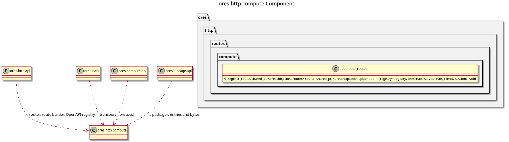

:PROPERTIES:
:ID: 2F5990E4-B2ED-4411-B81B-3374D55F2EC0
:END:
#+title: ores.http.compute
#+description: The HTTP gateway's compute adapter part. Holds the route units that project the compute grid onto the REST surface.
#+type: ores.codegen.component
#+component_kind: adapter
#+level: cross
#+filetags: :http:rest:compute:component:
#+created: 2026-11-17
#+updated: 2026-11-17
#+name: compute
#+full_name: ores.http.compute
#+brief: HTTP compute route units

* Diagram

#+attr_html: :width 100% :alt ores.http.compute component diagram
#+caption: ores.http.compute

* Summary

=ores.http.compute= is the adapter part that projects the compute grid onto the
HTTP server's REST surface. It serves the grid screens: the batches, work units
and results the grid ran, the bytes a work unit read and a run wrote, and the
application versions a runner offers.

The units speak the canonical protocol over NATS and hold no service,
repository or database context: the grid stays the only place that decides, and
the caller's own token travels with every forwarded request. The bytes a
download returns are read from the object store the grid wrote them to, which is
why this part reads =ores.storage.api=.

The part declares =#+component_kind: adapter=. Its =CMakeLists.txt= files are
hand-authored, because the link libraries belong to the HTTP surface rather than
to the domain, and codegen writes only the two =component_files.cmake= lists.

The units answer under the =grid= area, which =#+http_area:= states on each model
rather than the part stating it once, because the area is a published namespace
and not a property of the component that happens to hold the model.

* Inputs

- HTTP requests on the =/api/operations/grid/...= paths the units register.
- The caller's bearer token, forwarded to the service on every NATS request.
- The connected NATS client the per-component aggregator passes to
  =register_routes=.

* Outputs

- One route unit per grid resource, at
  =src/routes/compute/<unit>_routes.cpp= and
  =include/ores.http/routes/compute/<unit>_routes.hpp=.
- The routes and their OpenAPI schemas, registered on the router and the
  endpoint registry.
- NATS request messages to the compute service, one per route, and the bytes of
  a package entry read from the object store.

* Entry points

- =include/ores.http/routes/compute/= -- the unit headers.
- =src/routes/compute/= -- the unit implementations.
- =compute_routes= -- the aggregate the server calls to install the part's
  routes.

* Dependencies

- =ores.http.api= -- the router, the route builder, the OpenAPI registry and
  the request/response types.
- =ores.http.nats= -- the gateway's one forwarding step to the services.
- =ores.nats= -- NATS transport for service calls.
- =ores.compute.api= -- the canonical protocol messages the units send.
- =ores.storage.api= -- what a package holds, and the bytes of one entry.
- =ores.utility= -- the codecs and the wire support types.
- =ores.logging= -- logger factory.

* See also

- [[id:A8B318BC-8653-4D33-A58C-60793E3596D5][ores.http.server]] -- the process that hosts these routes.
- [[id:09BD5681-9C12-469A-80DA-27D1DF9D0808][ores.http]] -- the composite that holds the parts.

#+begin_src cmake :name extra_dependencies
target_link_libraries(${lib_target_name}
    PUBLIC
        ores.http.api.lib
        ores.nats.lib
        ores.logging.lib
    PRIVATE
        ores.http.nats.lib
        ores.compute.api.lib
        ores.storage.api.lib
        ores.utility.lib)
#+end_src

#+begin_src cmake :name extra_test_dependencies
target_link_libraries(${tests_target_name}
    PRIVATE
        ${lib_target_name}
        ores.testing.lib
        Catch2::Catch2
        ores.openssl_cleanup
        Threads::Threads)
#+end_src
